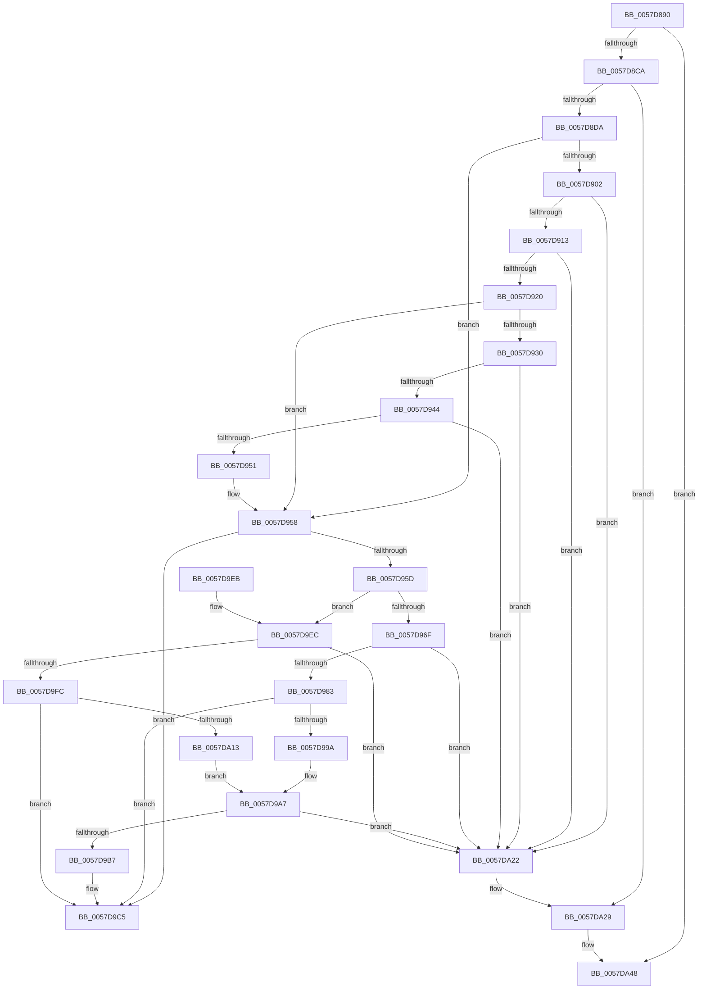

# CcSetLogHandleForFile

- RVA: `0x0057D890`–`0x0057DA67` (길이 `471` bytes)
- VA: `0x000000014057D890`
- 실행 섹션: `.text`
- PDB 이름 있음: `예`; PDB Function 태그: `아니요`
- unwind 정보 RVA: `0x000C5874`
- 디코드: `110`개 명령, `471/471` bytes 표시
- 미해석 바이트: `0` (있으면 어셈블리에 `.byte`로 보존)

> 이 문서는 커널 이미지의 기계어와 PDB 기호를 분석해 생성했습니다. 4번과 5번은 함수 원형과 자료형을 바이너리 사용 방식에서 추정한 C 해석이며 원본 소스 복구 결과는 아닙니다.

## 1. Dependencies

- 직접 호출 지점: **4**; 고유 호출 대상: **3**
- 직접 호출자로 확인된 함수: **0**
- RIP 상대 이미지 참조: **1**

### Outgoing calls
- `0x0057D8EC` → [KeAcquireInStackQueuedSpinLock](../27/KeAcquireInStackQueuedSpinLock_function_002757A0.md) (function, `0x002757A0`)
- `0x0057D9D1` → [KeReleaseInStackQueuedSpinLock](../34/KeReleaseInStackQueuedSpinLock_function_00342CE0.md) (function, `0x00342CE0`)
- `0x0057DA42` → [KeBugCheckEx](../4F/KeBugCheckEx_function_004FD660.md) (function, `0x004FD660`)
- `0x0057DA61` → [KeBugCheckEx](../4F/KeBugCheckEx_function_004FD660.md) (function, `0x004FD660`)

### Direct callers
- 이 함수 시작 RVA로 연결되는 직접 call은 확인되지 않았습니다. 간접 호출은 완전히 역산할 수 없습니다.

### Static image references
- `0x0057D920` → RVA `0x00E65B88` (`.data`; read)

## 2. Other-region calls and transfers

- 다른 실행 섹션으로 향하는 call: **0**
- 별도 외부 분기/꼬리 이동을 확인하지 못했습니다.

## 3. Assembly (complete function range)

```asm
0057D890  4C 8B DC                        mov r11, rsp
0057D893  49 89 5B 08                     mov qword ptr [r11 + 8], rbx
0057D897  49 89 6B 10                     mov qword ptr [r11 + 0x10], rbp
0057D89B  49 89 73 18                     mov qword ptr [r11 + 0x18], rsi
0057D89F  57                              push rdi
0057D8A0  48 83 EC 50                     sub rsp, 0x50
0057D8A4  33 C0                           xor eax, eax
0057D8A6  0F 57 C0                        xorps xmm0, xmm0
0057D8A9  0F 11 44 24 30                  movups xmmword ptr [rsp + 0x30], xmm0
0057D8AE  49 89 43 E8                     mov qword ptr [r11 - 0x18], rax
0057D8B2  49 8B F0                        mov rsi, r8
0057D8B5  48 8B 41 28                     mov rax, qword ptr [rcx + 0x28]
0057D8B9  48 8B EA                        mov rbp, rdx
0057D8BC  48 8B 58 08                     mov rbx, qword ptr [rax + 8]
0057D8C0  83 7B 04 00                     cmp dword ptr [rbx + 4], 0
0057D8C4  0F 84 7E 01 00 00               je 0x14057da48
0057D8CA  F7 83 98 00 00 00 00 00 00 01   test dword ptr [rbx + 0x98], 0x1000000
0057D8D4  0F 85 4F 01 00 00               jne 0x14057da29
0057D8DA  48 8B BB 18 02 00 00            mov rdi, qword ptr [rbx + 0x218]
0057D8E1  49 8D 53 D8                     lea rdx, [r11 - 0x28]
0057D8E5  48 8D 8F 00 03 00 00            lea rcx, [rdi + 0x300]
0057D8EC  E8 AF 7E CF FF                  call 0x1402757a0
0057D8F1  48 83 BB F8 00 00 00 00         cmp qword ptr [rbx + 0xf8], 0
0057D8F9  48 89 B3 00 01 00 00            mov qword ptr [rbx + 0x100], rsi
0057D900  74 56                           je 0x14057d958
0057D902  48 8D 43 78                     lea rax, [rbx + 0x78]
0057D906  48 8B 10                        mov rdx, qword ptr [rax]
0057D909  48 39 42 08                     cmp qword ptr [rdx + 8], rax
0057D90D  0F 85 0F 01 00 00               jne 0x14057da22
0057D913  48 8B 48 08                     mov rcx, qword ptr [rax + 8]
0057D917  48 39 01                        cmp qword ptr [rcx], rax
0057D91A  0F 85 02 01 00 00               jne 0x14057da22
0057D920  80 3D 61 82 8E 00 00            cmp byte ptr [rip + 0x8e8261], 0
0057D927  48 89 11                        mov qword ptr [rcx], rdx
0057D92A  48 89 4A 08                     mov qword ptr [rdx + 8], rcx
0057D92E  74 28                           je 0x14057d958
0057D930  48 8D 83 48 02 00 00            lea rax, [rbx + 0x248]
0057D937  48 8B 10                        mov rdx, qword ptr [rax]
0057D93A  48 39 42 08                     cmp qword ptr [rdx + 8], rax
0057D93E  0F 85 DE 00 00 00               jne 0x14057da22
0057D944  48 8B 48 08                     mov rcx, qword ptr [rax + 8]
0057D948  48 39 01                        cmp qword ptr [rcx], rax
0057D94B  0F 85 D1 00 00 00               jne 0x14057da22
0057D951  48 89 11                        mov qword ptr [rcx], rdx
0057D954  48 89 4A 08                     mov qword ptr [rdx + 8], rcx
0057D958  48 85 ED                        test rbp, rbp
0057D95B  74 68                           je 0x14057d9c5
0057D95D  0F BA AB 98 00 00 00 19         bts dword ptr [rbx + 0x98], 0x19
0057D965  48 8D 43 78                     lea rax, [rbx + 0x78]
0057D969  83 7B 70 00                     cmp dword ptr [rbx + 0x70], 0
0057D96D  74 7D                           je 0x14057d9ec
0057D96F  48 8D 8F D0 02 00 00            lea rcx, [rdi + 0x2d0]
0057D976  48 8B 51 08                     mov rdx, qword ptr [rcx + 8]
0057D97A  48 39 0A                        cmp qword ptr [rdx], rcx
0057D97D  0F 85 9F 00 00 00               jne 0x14057da22
0057D983  80 3D FE 81 8E 00 00            cmp byte ptr [rip + 0x8e81fe], 0
0057D98A  48 89 08                        mov qword ptr [rax], rcx
0057D98D  48 89 50 08                     mov qword ptr [rax + 8], rdx
0057D991  48 89 02                        mov qword ptr [rdx], rax
0057D994  48 89 41 08                     mov qword ptr [rcx + 8], rax
0057D998  74 2B                           je 0x14057d9c5
0057D99A  48 8B 83 58 02 00 00            mov rax, qword ptr [rbx + 0x258]
0057D9A1  48 05 B0 02 00 00               add rax, 0x2b0
0057D9A7  48 8B 50 08                     mov rdx, qword ptr [rax + 8]
0057D9AB  48 8D 8B 48 02 00 00            lea rcx, [rbx + 0x248]
0057D9B2  48 39 02                        cmp qword ptr [rdx], rax
0057D9B5  75 6B                           jne 0x14057da22
0057D9B7  48 89 01                        mov qword ptr [rcx], rax
0057D9BA  48 89 51 08                     mov qword ptr [rcx + 8], rdx
0057D9BE  48 89 0A                        mov qword ptr [rdx], rcx
0057D9C1  48 89 48 08                     mov qword ptr [rax + 8], rcx
0057D9C5  48 8D 4C 24 30                  lea rcx, [rsp + 0x30]
0057D9CA  48 89 AB F8 00 00 00            mov qword ptr [rbx + 0xf8], rbp
0057D9D1  E8 0A 53 DC FF                  call 0x140342ce0
0057D9D6  48 8B 5C 24 60                  mov rbx, qword ptr [rsp + 0x60]
0057D9DB  48 8B 6C 24 68                  mov rbp, qword ptr [rsp + 0x68]
0057D9E0  48 8B 74 24 70                  mov rsi, qword ptr [rsp + 0x70]
0057D9E5  48 83 C4 50                     add rsp, 0x50
0057D9E9  5F                              pop rdi
0057D9EA  C3                              ret
0057D9EB  CC                              int3
0057D9EC  48 8D 8F 90 02 00 00            lea rcx, [rdi + 0x290]
0057D9F3  48 8B 51 08                     mov rdx, qword ptr [rcx + 8]
0057D9F7  48 39 0A                        cmp qword ptr [rdx], rcx
0057D9FA  75 26                           jne 0x14057da22
0057D9FC  80 3D 85 81 8E 00 00            cmp byte ptr [rip + 0x8e8185], 0
0057DA03  48 89 08                        mov qword ptr [rax], rcx
0057DA06  48 89 50 08                     mov qword ptr [rax + 8], rdx
0057DA0A  48 89 02                        mov qword ptr [rdx], rax
0057DA0D  48 89 41 08                     mov qword ptr [rcx + 8], rax
0057DA11  74 B2                           je 0x14057d9c5
0057DA13  48 8B 83 58 02 00 00            mov rax, qword ptr [rbx + 0x258]
0057DA1A  48 05 70 02 00 00               add rax, 0x270
0057DA20  EB 85                           jmp 0x14057d9a7
0057DA22  B9 03 00 00 00                  mov ecx, 3
0057DA27  CD 29                           int 0x29
0057DA29  48 83 64 24 20 00               and qword ptr [rsp + 0x20], 0
0057DA2F  45 33 C9                        xor r9d, r9d
0057DA32  BA 84 01 00 00                  mov edx, 0x184
0057DA37  49 C7 C0 20 04 00 C0            mov r8, 0xffffffffc0000420
0057DA3E  41 8D 49 34                     lea ecx, [r9 + 0x34]
0057DA42  E8 19 FC F7 FF                  call 0x1404fd660
0057DA47  CC                              int3
0057DA48  48 83 64 24 20 00               and qword ptr [rsp + 0x20], 0
0057DA4E  45 33 C9                        xor r9d, r9d
0057DA51  BA 7E 01 00 00                  mov edx, 0x17e
0057DA56  49 C7 C0 20 04 00 C0            mov r8, 0xffffffffc0000420
0057DA5D  41 8D 49 34                     lea ecx, [r9 + 0x34]
0057DA61  E8 FA FB F7 FF                  call 0x1404fd660
0057DA66  CC                              int3
```

## 4. C-style interpretation (structured pseudocode)

```c
__int64 __fastcall CcSetLogHandleForFile(__int64 a1, __int64 a2, __int64 a3, int a4)
{
    __int64 result;
    __int64 v_rsp;
    unsigned __int64 v_stack_m28;
    unsigned __int64 v_stack_p10;
    unsigned __int64 v_stack_p18;
    unsigned __int64 v_stack_p20;
    unsigned __int64 v_stack_p8;

    *(unsigned __int64 *)(v_rsp + 8) = v_rbx;
    *(unsigned __int64 *)(v_rsp + 16) = v_rbp;
    *(unsigned __int64 *)(v_rsp + 24) = v_rsi;
    v_rsp = (v_rsp) - (80);
    result = 0;
    v_stack_m28 = v_xmm0;
    *(unsigned __int64 *)(v_rsp - 24) = 0;
    if ((*(unsigned int *)(*(unsigned __int64 *)(*(unsigned __int64 *)(a1 + 40) + 8) + 4)) == 0) goto loc_0057DA48;
    if (((*(unsigned int *)(*(unsigned __int64 *)(*(unsigned __int64 *)(a1 + 40) + 8) + 152)) & (0x1000000ULL)) != 0) goto loc_0057DA29;
    result = KeAcquireInStackQueuedSpinLock(*(unsigned __int64 *)(*(unsigned __int64 *)(*(unsigned __int64 *)(a1 + 40) + 8) + 536) + 768, v_rsp - 40, a3, a4);
    *(unsigned __int64 *)(*(unsigned __int64 *)(*(unsigned __int64 *)(a1 + 40) + 8) + 256) = a3;
    if ((*(unsigned __int64 *)(*(unsigned __int64 *)(*(unsigned __int64 *)(a1 + 40) + 8) + 248)) == 0) goto loc_0057D958;
    if ((*(unsigned __int64 *)(*(unsigned __int64 *)(*(unsigned __int64 *)(*(unsigned __int64 *)(a1 + 40) + 8) + 120) + 8)) != (*(unsigned __int64 *)(*(unsigned __int64 *)(a1 + 40) + 8) + 120)) goto loc_0057DA22;
    if ((*(unsigned __int64 *)(*(unsigned __int64 *)(*(unsigned __int64 *)(*(unsigned __int64 *)(a1 + 40) + 8) + 120 + 8))) != (*(unsigned __int64 *)(*(unsigned __int64 *)(a1 + 40) + 8) + 120)) goto loc_0057DA22;
    *(unsigned __int64 *)(*(unsigned __int64 *)(*(unsigned __int64 *)(*(unsigned __int64 *)(a1 + 40) + 8) + 120 + 8)) = *(unsigned __int64 *)(*(unsigned __int64 *)(*(unsigned __int64 *)(a1 + 40) + 8) + 120);
    *(unsigned __int64 *)(*(unsigned __int64 *)(*(unsigned __int64 *)(*(unsigned __int64 *)(a1 + 40) + 8) + 120) + 8) = *(unsigned __int64 *)(*(unsigned __int64 *)(*(unsigned __int64 *)(a1 + 40) + 8) + 120 + 8);
    if ((*(unsigned __int8 *)(v_rip + 9339489)) == 0) goto loc_0057D958;
    if ((*(unsigned __int64 *)(*(unsigned __int64 *)(*(unsigned __int64 *)(*(unsigned __int64 *)(a1 + 40) + 8) + 584) + 8)) != (*(unsigned __int64 *)(*(unsigned __int64 *)(a1 + 40) + 8) + 584)) goto loc_0057DA22;
    if ((*(unsigned __int64 *)(*(unsigned __int64 *)(*(unsigned __int64 *)(*(unsigned __int64 *)(a1 + 40) + 8) + 584 + 8))) != (*(unsigned __int64 *)(*(unsigned __int64 *)(a1 + 40) + 8) + 584)) goto loc_0057DA22;
    *(unsigned __int64 *)(*(unsigned __int64 *)(*(unsigned __int64 *)(*(unsigned __int64 *)(a1 + 40) + 8) + 584 + 8)) = *(unsigned __int64 *)(*(unsigned __int64 *)(*(unsigned __int64 *)(a1 + 40) + 8) + 584);
    *(unsigned __int64 *)(*(unsigned __int64 *)(*(unsigned __int64 *)(*(unsigned __int64 *)(a1 + 40) + 8) + 584) + 8) = *(unsigned __int64 *)(*(unsigned __int64 *)(*(unsigned __int64 *)(a1 + 40) + 8) + 584 + 8);
loc_0057D958:
    if (a2 == 0) goto loc_0057D9C5;
    if ((*(unsigned int *)(*(unsigned __int64 *)(*(unsigned __int64 *)(a1 + 40) + 8) + 112)) == 0) goto loc_0057D9EC;
    if ((*(unsigned __int64 *)(*(unsigned __int64 *)(*(unsigned __int64 *)(*(unsigned __int64 *)(*(unsigned __int64 *)(a1 + 40) + 8) + 536) + 720 + 8))) != (*(unsigned __int64 *)(*(unsigned __int64 *)(*(unsigned __int64 *)(a1 + 40) + 8) + 536) + 720)) goto loc_0057DA22;
    *(unsigned __int64 *)(*(unsigned __int64 *)(*(unsigned __int64 *)(a1 + 40) + 8) + 120) = *(unsigned __int64 *)(*(unsigned __int64 *)(*(unsigned __int64 *)(a1 + 40) + 8) + 536) + 720;
    *(unsigned __int64 *)(*(unsigned __int64 *)(*(unsigned __int64 *)(a1 + 40) + 8) + 120 + 8) = *(unsigned __int64 *)(*(unsigned __int64 *)(*(unsigned __int64 *)(*(unsigned __int64 *)(a1 + 40) + 8) + 536) + 720 + 8);
    *(unsigned __int64 *)(*(unsigned __int64 *)(*(unsigned __int64 *)(*(unsigned __int64 *)(*(unsigned __int64 *)(a1 + 40) + 8) + 536) + 720 + 8)) = *(unsigned __int64 *)(*(unsigned __int64 *)(a1 + 40) + 8) + 120;
    *(unsigned __int64 *)(*(unsigned __int64 *)(*(unsigned __int64 *)(*(unsigned __int64 *)(a1 + 40) + 8) + 536) + 720 + 8) = *(unsigned __int64 *)(*(unsigned __int64 *)(a1 + 40) + 8) + 120;
    if ((*(unsigned __int8 *)(v_rip + 9339390)) == 0) goto loc_0057D9C5;
    result = (*(unsigned __int64 *)(*(unsigned __int64 *)(*(unsigned __int64 *)(a1 + 40) + 8) + 600)) + (688);
loc_0057D9A7:
    if ((*(unsigned __int64 *)(*(unsigned __int64 *)(result + 8))) != result) goto loc_0057DA22;
    *(unsigned __int64 *)(*(unsigned __int64 *)(*(unsigned __int64 *)(a1 + 40) + 8) + 584) = result;
    *(unsigned __int64 *)(*(unsigned __int64 *)(*(unsigned __int64 *)(a1 + 40) + 8) + 584 + 8) = *(unsigned __int64 *)(result + 8);
    *(unsigned __int64 *)(*(unsigned __int64 *)(result + 8)) = *(unsigned __int64 *)(*(unsigned __int64 *)(a1 + 40) + 8) + 584;
    *(unsigned __int64 *)(result + 8) = *(unsigned __int64 *)(*(unsigned __int64 *)(a1 + 40) + 8) + 584;
loc_0057D9C5:
    *(unsigned __int64 *)(*(unsigned __int64 *)(*(unsigned __int64 *)(a1 + 40) + 8) + 248) = a2;
    result = KeReleaseInStackQueuedSpinLock(v_stack_m28, *(unsigned __int64 *)(result + 8), a3, a4);
    v_rsp = (v_rsp) + (80);
    return result;
loc_0057D9EC:
    if ((*(unsigned __int64 *)(*(unsigned __int64 *)(*(unsigned __int64 *)(*(unsigned __int64 *)(*(unsigned __int64 *)(a1 + 40) + 8) + 536) + 656 + 8))) != (*(unsigned __int64 *)(*(unsigned __int64 *)(*(unsigned __int64 *)(a1 + 40) + 8) + 536) + 656)) goto loc_0057DA22;
    *(unsigned __int64 *)(result) = *(unsigned __int64 *)(*(unsigned __int64 *)(*(unsigned __int64 *)(a1 + 40) + 8) + 536) + 656;
    *(unsigned __int64 *)(result + 8) = *(unsigned __int64 *)(*(unsigned __int64 *)(*(unsigned __int64 *)(*(unsigned __int64 *)(a1 + 40) + 8) + 536) + 656 + 8);
    *(unsigned __int64 *)(*(unsigned __int64 *)(*(unsigned __int64 *)(*(unsigned __int64 *)(*(unsigned __int64 *)(a1 + 40) + 8) + 536) + 656 + 8)) = result;
    *(unsigned __int64 *)(*(unsigned __int64 *)(*(unsigned __int64 *)(*(unsigned __int64 *)(a1 + 40) + 8) + 536) + 656 + 8) = result;
    if ((*(unsigned __int8 *)(v_rip + 9339269)) == 0) goto loc_0057D9C5;
    result = (*(unsigned __int64 *)(v_stack_p8 + 600)) + (624);
    goto loc_0057D9A7;
loc_0057DA22:
loc_0057DA29:
    a4 = 0;
    result = KeBugCheckEx(a4 + 52, 388, 0xFFFFFFFFC0000420ULL, a4);
loc_0057DA48:
    a4 = 0;
    result = KeBugCheckEx(a4 + 52, 382, 0xFFFFFFFFC0000420ULL, a4);
    return result;
}
```

## 5. (Beta) C Style

```c
int64_t CcSetLogHandleForFile(void *Arg1, int64_t Arg2, int64_t Arg3, int32_t Arg4)
{
    uint8_t *arg1 = (uint8_t *)Arg1;

    int64_t result;
    int64_t local_rsp;
    uint64_t v_stack_m28;
    uint64_t v_stack_p10;
    uint64_t v_stack_p18;
    uint64_t v_stack_p20;
    uint64_t v_stack_p8;

    *(uint64_t *)(local_rsp + 0x8) = local_rbx;
    *(uint64_t *)(local_rsp + 0x10) = local_rbp;
    *(uint64_t *)(local_rsp + 0x18) = local_rsi;
    local_rsp = (local_rsp) - (80);
    result = 0;
    v_stack_m28 = v_xmm0;
    *(uint64_t *)(local_rsp - 0x18) = 0;
    if ((*(uint32_t *)(*(uint64_t *)(*(uint64_t *)(arg1 + 0x28) + 0x8) + 0x4)) == 0) goto loc_0057DA48;
    if (((*(uint32_t *)(*(uint64_t *)(*(uint64_t *)(arg1 + 0x28) + 0x8) + 0x98)) & (0x1000000ULL)) != 0) goto loc_0057DA29;
    result = KeAcquireInStackQueuedSpinLock(*(uint64_t *)(*(uint64_t *)(*(uint64_t *)(arg1 + 0x28) + 0x8) + 0x218) + 768, local_rsp - 40, Arg3, Arg4);
    *(uint64_t *)(*(uint64_t *)(*(uint64_t *)(arg1 + 0x28) + 0x8) + 0x100) = Arg3;
    if ((*(uint64_t *)(*(uint64_t *)(*(uint64_t *)(arg1 + 0x28) + 0x8) + 0xF8)) == 0) goto loc_0057D958;
    if ((*(uint64_t *)(*(uint64_t *)(*(uint64_t *)(*(uint64_t *)(arg1 + 0x28) + 0x8) + 0x78) + 0x8)) != (*(uint64_t *)(*(uint64_t *)(arg1 + 0x28) + 0x8) + 120)) goto loc_0057DA22;
    if ((*(uint64_t *)(*(uint64_t *)(*(uint64_t *)(*(uint64_t *)(arg1 + 0x28) + 0x8) + 0x78 + 0x8))) != (*(uint64_t *)(*(uint64_t *)(arg1 + 0x28) + 0x8) + 120)) goto loc_0057DA22;
    *(uint64_t *)(*(uint64_t *)(*(uint64_t *)(*(uint64_t *)(arg1 + 0x28) + 0x8) + 0x78 + 0x8)) = *(uint64_t *)(*(uint64_t *)(*(uint64_t *)(arg1 + 0x28) + 0x8) + 0x78);
    *(uint64_t *)(*(uint64_t *)(*(uint64_t *)(*(uint64_t *)(arg1 + 0x28) + 0x8) + 0x78) + 0x8) = *(uint64_t *)(*(uint64_t *)(*(uint64_t *)(arg1 + 0x28) + 0x8) + 0x78 + 0x8);
    if ((*(uint8_t *)(v_rip + 0x8E8261)) == 0) goto loc_0057D958;
    if ((*(uint64_t *)(*(uint64_t *)(*(uint64_t *)(*(uint64_t *)(arg1 + 0x28) + 0x8) + 0x248) + 0x8)) != (*(uint64_t *)(*(uint64_t *)(arg1 + 0x28) + 0x8) + 584)) goto loc_0057DA22;
    if ((*(uint64_t *)(*(uint64_t *)(*(uint64_t *)(*(uint64_t *)(arg1 + 0x28) + 0x8) + 0x248 + 0x8))) != (*(uint64_t *)(*(uint64_t *)(arg1 + 0x28) + 0x8) + 584)) goto loc_0057DA22;
    *(uint64_t *)(*(uint64_t *)(*(uint64_t *)(*(uint64_t *)(arg1 + 0x28) + 0x8) + 0x248 + 0x8)) = *(uint64_t *)(*(uint64_t *)(*(uint64_t *)(arg1 + 0x28) + 0x8) + 0x248);
    *(uint64_t *)(*(uint64_t *)(*(uint64_t *)(*(uint64_t *)(arg1 + 0x28) + 0x8) + 0x248) + 0x8) = *(uint64_t *)(*(uint64_t *)(*(uint64_t *)(arg1 + 0x28) + 0x8) + 0x248 + 0x8);
loc_0057D958:
    if (Arg2 == 0) goto loc_0057D9C5;
    if ((*(uint32_t *)(*(uint64_t *)(*(uint64_t *)(arg1 + 0x28) + 0x8) + 0x70)) == 0) goto loc_0057D9EC;
    if ((*(uint64_t *)(*(uint64_t *)(*(uint64_t *)(*(uint64_t *)(*(uint64_t *)(arg1 + 0x28) + 0x8) + 0x218) + 0x2D0 + 0x8))) != (*(uint64_t *)(*(uint64_t *)(*(uint64_t *)(arg1 + 0x28) + 0x8) + 0x218) + 720)) goto loc_0057DA22;
    *(uint64_t *)(*(uint64_t *)(*(uint64_t *)(arg1 + 0x28) + 0x8) + 0x78) = *(uint64_t *)(*(uint64_t *)(*(uint64_t *)(arg1 + 0x28) + 0x8) + 0x218) + 720;
    *(uint64_t *)(*(uint64_t *)(*(uint64_t *)(arg1 + 0x28) + 0x8) + 0x78 + 0x8) = *(uint64_t *)(*(uint64_t *)(*(uint64_t *)(*(uint64_t *)(arg1 + 0x28) + 0x8) + 0x218) + 0x2D0 + 0x8);
    *(uint64_t *)(*(uint64_t *)(*(uint64_t *)(*(uint64_t *)(*(uint64_t *)(arg1 + 0x28) + 0x8) + 0x218) + 0x2D0 + 0x8)) = *(uint64_t *)(*(uint64_t *)(arg1 + 0x28) + 0x8) + 120;
    *(uint64_t *)(*(uint64_t *)(*(uint64_t *)(*(uint64_t *)(arg1 + 0x28) + 0x8) + 0x218) + 0x2D0 + 0x8) = *(uint64_t *)(*(uint64_t *)(arg1 + 0x28) + 0x8) + 120;
    if ((*(uint8_t *)(v_rip + 0x8E81FE)) == 0) goto loc_0057D9C5;
    result = (*(uint64_t *)(*(uint64_t *)(*(uint64_t *)(arg1 + 0x28) + 0x8) + 0x258)) + (688);
loc_0057D9A7:
    if ((*(uint64_t *)(*(uint64_t *)(result + 0x8))) != result) goto loc_0057DA22;
    *(uint64_t *)(*(uint64_t *)(*(uint64_t *)(arg1 + 0x28) + 0x8) + 0x248) = result;
    *(uint64_t *)(*(uint64_t *)(*(uint64_t *)(arg1 + 0x28) + 0x8) + 0x248 + 0x8) = *(uint64_t *)(result + 0x8);
    *(uint64_t *)(*(uint64_t *)(result + 0x8)) = *(uint64_t *)(*(uint64_t *)(arg1 + 0x28) + 0x8) + 584;
    *(uint64_t *)(result + 0x8) = *(uint64_t *)(*(uint64_t *)(arg1 + 0x28) + 0x8) + 584;
loc_0057D9C5:
    *(uint64_t *)(*(uint64_t *)(*(uint64_t *)(arg1 + 0x28) + 0x8) + 0xF8) = Arg2;
    result = KeReleaseInStackQueuedSpinLock(v_stack_m28, *(uint64_t *)(result + 0x8), Arg3, Arg4);
    local_rsp = (local_rsp) + (80);
    return result;
loc_0057D9EC:
    if ((*(uint64_t *)(*(uint64_t *)(*(uint64_t *)(*(uint64_t *)(*(uint64_t *)(arg1 + 0x28) + 0x8) + 0x218) + 0x290 + 0x8))) != (*(uint64_t *)(*(uint64_t *)(*(uint64_t *)(arg1 + 0x28) + 0x8) + 0x218) + 656)) goto loc_0057DA22;
    *(uint64_t *)(result) = *(uint64_t *)(*(uint64_t *)(*(uint64_t *)(arg1 + 0x28) + 0x8) + 0x218) + 656;
    *(uint64_t *)(result + 0x8) = *(uint64_t *)(*(uint64_t *)(*(uint64_t *)(*(uint64_t *)(arg1 + 0x28) + 0x8) + 0x218) + 0x290 + 0x8);
    *(uint64_t *)(*(uint64_t *)(*(uint64_t *)(*(uint64_t *)(*(uint64_t *)(arg1 + 0x28) + 0x8) + 0x218) + 0x290 + 0x8)) = result;
    *(uint64_t *)(*(uint64_t *)(*(uint64_t *)(*(uint64_t *)(arg1 + 0x28) + 0x8) + 0x218) + 0x290 + 0x8) = result;
    if ((*(uint8_t *)(v_rip + 0x8E8185)) == 0) goto loc_0057D9C5;
    result = (*(uint64_t *)(v_stack_p8 + 0x258)) + (624);
    goto loc_0057D9A7;
loc_0057DA22:
loc_0057DA29:
    Arg4 = 0;
    result = KeBugCheckEx(Arg4 + 52, 388, 0xFFFFFFFFC0000420ULL, Arg4);
loc_0057DA48:
    Arg4 = 0;
    result = KeBugCheckEx(Arg4 + 52, 382, 0xFFFFFFFFC0000420ULL, Arg4);
    return result;
}
```

### 관측된 메모리 오프셋

구조체 형식이 확인되지 않은 접근은 인자 기준의 오프셋으로만 기록했습니다.

| 기준 인자 | 오프셋 표현 | 폭 (bit) | 접근 |
|---|---:|---:|---|
| `Arg1` | `+ 0x28` | `64` | `R` |

## 6. Execution-region graph

[열기: 2D/3D 그래프와 함수 탐색 컨트롤 패널](../../../control-panel.html?section=text&rva=0x0057D890&view=graph)

- 2D 그래프는 위에서 아래로 흐르고, 3D 그래프는 빈 공간을 드래그해 회전합니다. Shift+드래그는 이동, 휠은 확대·축소, 함수 노드 선택은 대상 보고서 이동입니다.

### Static fallback


