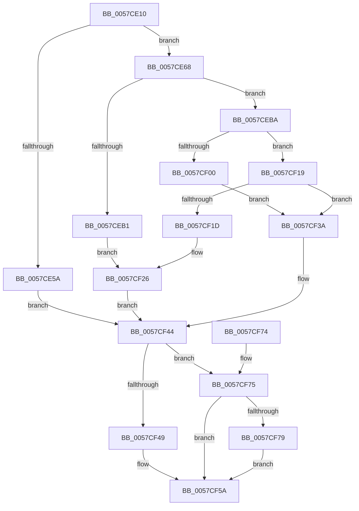

# CcSetupWatchForRegistryChanges

- RVA: `0x0057CE10`–`0x0057CFB7` (길이 `423` bytes)
- VA: `0x000000014057CE10`
- 실행 섹션: `.text`
- PDB 이름 있음: `예`; PDB Function 태그: `아니요`
- unwind 정보 RVA: `0x000C5808`
- 디코드: `102`개 명령, `423/423` bytes 표시
- 미해석 바이트: `0` (있으면 어셈블리에 `.byte`로 보존)

> 이 문서는 커널 이미지의 기계어와 PDB 기호를 분석해 생성했습니다. 4번과 5번은 함수 원형과 자료형을 바이너리 사용 방식에서 추정한 C 해석이며 원본 소스 복구 결과는 아닙니다.

## 1. Dependencies

- 직접 호출 지점: **9**; 고유 호출 대상: **6**
- 직접 호출자로 확인된 함수: **1**
- RIP 상대 이미지 참조: **9**

### Outgoing calls
- `0x0057CE48` → [ExAllocatePoolWithTag](../../poolcode/B8/ExAllocatePoolWithTag_function_00B82010.md) (function, `0x00B82010`)
- `0x0057CE76` → [RtlInitUnicodeString](../42/RtlInitUnicodeString_function_0042A780.md) (function, `0x0042A780`)
- `0x0057CEA0` → [CcOpenRegistryPath](CcOpenRegistryPath_function_0057CA80.md) (function, `0x0057CA80`)
- `0x0057CEEE` → [ZwNotifyChangeKey](../6A/ZwNotifyChangeKey_function_006AF550.md) (function, `0x006AF550`)
- `0x0057CF12` → [DbgPrintEx](../35/DbgPrintEx_function_00359290.md) (function, `0x00359290`)
- `0x0057CF33` → [DbgPrintEx](../35/DbgPrintEx_function_00359290.md) (function, `0x00359290`)
- `0x0057CF55` → [DbgPrintEx](../35/DbgPrintEx_function_00359290.md) (function, `0x00359290`)
- `0x0057CF9F` → [DbgPrintEx](../35/DbgPrintEx_function_00359290.md) (function, `0x00359290`)
- `0x0057CFB0` → [ExQueueWorkItem](../2F/ExQueueWorkItem_function_002F9520.md) (function, `0x002F9520`)

### Direct callers
- [sub_006E5110](../6E/Unknown_function_006E5110.md) at `0x006E5292`

### Static image references
- `0x0057CE6C` → RVA `0x006C7A60` (` ?? ::FNODOBFM::`string'`; read)
- `0x0057CE7B` → RVA `0x0057CFC0` (`CcUpdateDynamicRegistrySettings`; read)
- `0x0057CE86` → RVA `0x0057CC20` (`CcRegistryChangeCallback`; read)
- `0x0057CEB1` → RVA `0x006C7F00` (` ?? ::FNODOBFM::`string'`; read)
- `0x0057CF03` → RVA `0x006C7F50` (` ?? ::FNODOBFM::`string'`; read)
- `0x0057CF1D` → RVA `0x006C7E60` (` ?? ::FNODOBFM::`string'`; read)
- `0x0057CF3A` → RVA `0x00E65B48` (`.data`; write)
- `0x0057CF49` → RVA `0x006C7EB0` (` ?? ::FNODOBFM::`string'`; read)
- `0x0057CF90` → RVA `0x006C8020` (` ?? ::FNODOBFM::`string'`; read)

## 2. Other-region calls and transfers

- 다른 실행 섹션으로 향하는 call: **1**
  - `0x0057CE48` → [ExAllocatePoolWithTag](../../poolcode/B8/ExAllocatePoolWithTag_function_00B82010.md) (`.text` → `POOLCODE`)
- 별도 외부 분기/꼬리 이동을 확인하지 못했습니다.

## 3. Assembly (complete function range)

```asm
0057CE10  48 8B C4                        mov rax, rsp
0057CE13  48 89 58 08                     mov qword ptr [rax + 8], rbx
0057CE17  48 89 70 10                     mov qword ptr [rax + 0x10], rsi
0057CE1B  48 89 78 18                     mov qword ptr [rax + 0x18], rdi
0057CE1F  41 56                           push r14
0057CE21  48 81 EC 80 00 00 00            sub rsp, 0x80
0057CE28  83 60 C8 00                     and dword ptr [rax - 0x38], 0
0057CE2C  0F 57 C0                        xorps xmm0, xmm0
0057CE2F  0F 11 40 E8                     movups xmmword ptr [rax - 0x18], xmm0
0057CE33  48 83 60 D0 00                  and qword ptr [rax - 0x30], 0
0057CE38  BA 50 00 00 00                  mov edx, 0x50
0057CE3D  B9 00 06 00 00                  mov ecx, 0x600
0057CE42  41 B8 43 63 57 52               mov r8d, 0x52576343
0057CE48  E8 C3 51 60 00                  call 0x140b82010
0057CE4D  48 8B F8                        mov rdi, rax
0057CE50  48 89 44 24 58                  mov qword ptr [rsp + 0x58], rax
0057CE55  48 85 C0                        test rax, rax
0057CE58  75 0E                           jne 0x14057ce68
0057CE5A  BB 9A 00 00 C0                  mov ebx, 0xc000009a
0057CE5F  89 5C 24 50                     mov dword ptr [rsp + 0x50], ebx
0057CE63  E9 DC 00 00 00                  jmp 0x14057cf44
0057CE68  48 8D 70 38                     lea rsi, [rax + 0x38]
0057CE6C  48 8D 15 ED AB 14 00            lea rdx, [rip + 0x14abed]
0057CE73  48 8B CE                        mov rcx, rsi
0057CE76  E8 05 D9 EA FF                  call 0x14042a780
0057CE7B  48 8D 05 3E 01 00 00            lea rax, [rip + 0x13e]
0057CE82  48 89 47 28                     mov qword ptr [rdi + 0x28], rax
0057CE86  48 8D 05 93 FD FF FF            lea rax, [rip - 0x26d]
0057CE8D  48 89 47 10                     mov qword ptr [rdi + 0x10], rax
0057CE91  48 89 7F 18                     mov qword ptr [rdi + 0x18], rdi
0057CE95  48 83 27 00                     and qword ptr [rdi], 0
0057CE99  48 8D 57 20                     lea rdx, [rdi + 0x20]
0057CE9D  48 8B CE                        mov rcx, rsi
0057CEA0  E8 DB FB FF FF                  call 0x14057ca80
0057CEA5  8B D8                           mov ebx, eax
0057CEA7  89 44 24 50                     mov dword ptr [rsp + 0x50], eax
0057CEAB  33 D2                           xor edx, edx
0057CEAD  85 C0                           test eax, eax
0057CEAF  79 09                           jns 0x14057ceba
0057CEB1  4C 8D 05 48 B0 14 00            lea r8, [rip + 0x14b048]
0057CEB8  EB 6C                           jmp 0x14057cf26
0057CEBA  C6 44 24 48 01                  mov byte ptr [rsp + 0x48], 1
0057CEBF  83 64 24 40 00                  and dword ptr [rsp + 0x40], 0
0057CEC4  48 83 64 24 38 00               and qword ptr [rsp + 0x38], 0
0057CECA  C6 44 24 30 01                  mov byte ptr [rsp + 0x30], 1
0057CECF  C7 44 24 28 05 00 00 00         mov dword ptr [rsp + 0x28], 5
0057CED7  48 8D 44 24 70                  lea rax, [rsp + 0x70]
0057CEDC  48 89 44 24 20                  mov qword ptr [rsp + 0x20], rax
0057CEE1  41 B9 01 00 00 00               mov r9d, 1
0057CEE7  4C 8B C7                        mov r8, rdi
0057CEEA  48 8B 4F 20                     mov rcx, qword ptr [rdi + 0x20]
0057CEEE  E8 5D 26 13 00                  call 0x1406af550
0057CEF3  8B D8                           mov ebx, eax
0057CEF5  89 44 24 50                     mov dword ptr [rsp + 0x50], eax
0057CEF9  3D 03 01 00 00                  cmp eax, 0x103
0057CEFE  75 19                           jne 0x14057cf19
0057CF00  4C 8B CE                        mov r9, rsi
0057CF03  4C 8D 05 46 B0 14 00            lea r8, [rip + 0x14b046]
0057CF0A  BA 02 00 00 00                  mov edx, 2
0057CF0F  8D 4A 7D                        lea ecx, [rdx + 0x7d]
0057CF12  E8 79 C3 DD FF                  call 0x140359290
0057CF17  EB 21                           jmp 0x14057cf3a
0057CF19  85 C0                           test eax, eax
0057CF1B  79 1D                           jns 0x14057cf3a
0057CF1D  4C 8D 05 3C AF 14 00            lea r8, [rip + 0x14af3c]
0057CF24  33 D2                           xor edx, edx
0057CF26  44 8B C8                        mov r9d, eax
0057CF29  48 89 74 24 20                  mov qword ptr [rsp + 0x20], rsi
0057CF2E  B9 7F 00 00 00                  mov ecx, 0x7f
0057CF33  E8 58 C3 DD FF                  call 0x140359290
0057CF38  EB 0A                           jmp 0x14057cf44
0057CF3A  C7 05 04 8C 8E 00 01 00 00 00   mov dword ptr [rip + 0x8e8c04], 1
0057CF44  48 85 FF                        test rdi, rdi
0057CF47  75 2C                           jne 0x14057cf75
0057CF49  4C 8D 05 60 AF 14 00            lea r8, [rip + 0x14af60]
0057CF50  33 D2                           xor edx, edx
0057CF52  8D 4F 7F                        lea ecx, [rdi + 0x7f]
0057CF55  E8 36 C3 DD FF                  call 0x140359290
0057CF5A  4C 8D 9C 24 80 00 00 00         lea r11, [rsp + 0x80]
0057CF62  49 8B 5B 10                     mov rbx, qword ptr [r11 + 0x10]
0057CF66  49 8B 73 18                     mov rsi, qword ptr [r11 + 0x18]
0057CF6A  49 8B 7B 20                     mov rdi, qword ptr [r11 + 0x20]
0057CF6E  49 8B E3                        mov rsp, r11
0057CF71  41 5E                           pop r14
0057CF73  C3                              ret
0057CF74  CC                              int3
0057CF75  85 DB                           test ebx, ebx
0057CF77  79 E1                           jns 0x14057cf5a
0057CF79  0F 10 47 38                     movups xmm0, xmmword ptr [rdi + 0x38]
0057CF7D  F3 0F 7F 44 24 60               movdqu xmmword ptr [rsp + 0x60], xmm0
0057CF83  48 8D 44 24 60                  lea rax, [rsp + 0x60]
0057CF88  48 89 44 24 20                  mov qword ptr [rsp + 0x20], rax
0057CF8D  44 8B CB                        mov r9d, ebx
0057CF90  4C 8D 05 89 B0 14 00            lea r8, [rip + 0x14b089]
0057CF97  BA 02 00 00 00                  mov edx, 2
0057CF9C  8D 4A 7D                        lea ecx, [rdx + 0x7d]
0057CF9F  E8 EC C2 DD FF                  call 0x140359290
0057CFA4  C6 47 48 01                     mov byte ptr [rdi + 0x48], 1
0057CFA8  BA 01 00 00 00                  mov edx, 1
0057CFAD  48 8B CF                        mov rcx, rdi
0057CFB0  E8 6B C5 D7 FF                  call 0x1402f9520
0057CFB5  EB A3                           jmp 0x14057cf5a
```

## 4. C-style interpretation (structured pseudocode)

```c
__int64 __fastcall CcSetupWatchForRegistryChanges(void)
{
    __int64 result;
    __int64 v_rsp;
    unsigned __int64 v_stack_m18;
    unsigned __int64 v_stack_m20;
    unsigned __int64 v_stack_m30;
    unsigned int v_stack_m38;
    unsigned __int8 v_stack_m40;
    unsigned int v_stack_m48;
    unsigned __int64 v_stack_m50;
    unsigned __int8 v_stack_m58;
    unsigned int v_stack_m60;
    unsigned __int64 v_stack_m68;
    unsigned __int64 v_stack_m8;

    *(unsigned __int64 *)(v_rsp + 8) = v_rbx;
    *(unsigned __int64 *)(v_rsp + 16) = v_rsi;
    *(unsigned __int64 *)(v_rsp + 24) = v_rdi;
    v_rsp = (v_rsp) - (128);
    *(unsigned __int64 *)(v_rsp - 24) = v_xmm0;
    result = ExAllocatePoolWithTag((unsigned int)(0x600ULL), 80, (unsigned int)(0x52576343ULL), a4);
    v_stack_m30 = result;
    if (result != 0) goto loc_0057CE68;
    v_stack_m38 = (unsigned int)((unsigned int)(0xC000009AULL));
    goto loc_0057CF44;
loc_0057CE68:
    result = RtlInitUnicodeString(result + 56, v_rip + 1354733, (unsigned int)(0x52576343ULL), a4);
    *(unsigned __int64 *)(result + 40) = v_rip + 318;
    *(unsigned __int64 *)(result + 16) = v_rip - 621;
    *(unsigned __int64 *)(result + 24) = result;
    result = CcOpenRegistryPath(result + 56, result + 32, (unsigned int)(0x52576343ULL), a4);
    v_stack_m38 = (unsigned int)(result);
    a2 = 0;
    if (!sign_flag) goto loc_0057CEBA;
    goto loc_0057CF26;
loc_0057CEBA:
    v_stack_m40 = 1;
    v_stack_m58 = 1;
    v_stack_m60 = 5;
    v_stack_m68 = v_stack_m18;
    result = ZwNotifyChangeKey(*(unsigned __int64 *)(result + 32), a2, result, 1);
    v_stack_m38 = (unsigned int)(result);
    if (((unsigned int)(result)) != 259) goto loc_0057CF19;
    result = DbgPrintEx(2 + 125, 2, v_rip + 1355846, result + 56);
    goto loc_0057CF3A;
loc_0057CF19:
    if (!sign_flag) goto loc_0057CF3A;
    a2 = 0;
loc_0057CF26:
    v_stack_m68 = result + 56;
    result = DbgPrintEx(127, a2, v_rip + 1355580, (unsigned int)((unsigned int)(result)));
    goto loc_0057CF44;
loc_0057CF3A:
    *(unsigned int *)(v_rip + 9341956) = 1;
loc_0057CF44:
    if (result != 0) goto loc_0057CF75;
    a2 = 0;
    result = DbgPrintEx(result + 127, a2, v_rip + 1355616, (unsigned int)((unsigned int)(result)));
loc_0057CF5A:
    return result;
loc_0057CF75:
    if (!sign_flag) goto loc_0057CF5A;
    v_stack_m20 = v_xmm0;
    v_stack_m60 = v_stack_m20;
    result = DbgPrintEx(2 + 125, 2, v_rip + 1355913, (unsigned int)((unsigned int)(*(unsigned __int64 *)(v_stack_m8 + 16))));
    *(unsigned __int8 *)(*(unsigned __int64 *)(v_stack_m8 + 32) + 72) = 1;
    result = ExQueueWorkItem(*(unsigned __int64 *)(v_stack_m8 + 32), 1, v_rip + 1355913, (unsigned int)((unsigned int)(*(unsigned __int64 *)(v_stack_m8 + 16))));
    goto loc_0057CF5A;
}
```

## 5. (Beta) C Style

```c
void CcSetupWatchForRegistryChanges(void)
{
    int64_t result;
    int64_t local_rsp;
    uint64_t v_stack_m18;
    uint64_t v_stack_m20;
    uint64_t v_stack_m30;
    uint32_t v_stack_m38;
    uint8_t v_stack_m40;
    uint32_t v_stack_m48;
    uint64_t v_stack_m50;
    uint8_t v_stack_m58;
    uint32_t v_stack_m60;
    uint64_t v_stack_m68;
    uint64_t v_stack_m8;

    *(uint64_t *)(local_rsp + 0x8) = local_rbx;
    *(uint64_t *)(local_rsp + 0x10) = local_rsi;
    *(uint64_t *)(local_rsp + 0x18) = local_rdi;
    local_rsp = (local_rsp) - (128);
    *(uint64_t *)(local_rsp - 0x18) = v_xmm0;
    result = ExAllocatePoolWithTag((uint32_t)(0x600ULL), 80, (uint32_t)(0x52576343ULL), a4);
    v_stack_m30 = result;
    if (result != 0) goto loc_0057CE68;
    v_stack_m38 = (uint32_t)((uint32_t)(0xC000009AULL));
    goto loc_0057CF44;
loc_0057CE68:
    result = RtlInitUnicodeString(result + 56, v_rip + 1354733, (uint32_t)(0x52576343ULL), a4);
    *(uint64_t *)(result + 0x28) = v_rip + 318;
    *(uint64_t *)(result + 0x10) = v_rip - 621;
    *(uint64_t *)(result + 0x18) = result;
    result = CcOpenRegistryPath(result + 56, result + 32, (uint32_t)(0x52576343ULL), a4);
    v_stack_m38 = (uint32_t)(result);
    a2 = 0;
    if (!sign_flag) goto loc_0057CEBA;
    goto loc_0057CF26;
loc_0057CEBA:
    v_stack_m40 = 1;
    v_stack_m58 = 1;
    v_stack_m60 = 5;
    v_stack_m68 = v_stack_m18;
    result = ZwNotifyChangeKey(*(uint64_t *)(result + 0x20), a2, result, 1);
    v_stack_m38 = (uint32_t)(result);
    if (((uint32_t)(result)) != 259) goto loc_0057CF19;
    result = DbgPrintEx(2 + 125, 2, v_rip + 1355846, result + 56);
    goto loc_0057CF3A;
loc_0057CF19:
    if (!sign_flag) goto loc_0057CF3A;
    a2 = 0;
loc_0057CF26:
    v_stack_m68 = result + 56;
    result = DbgPrintEx(127, a2, v_rip + 1355580, (uint32_t)((uint32_t)(result)));
    goto loc_0057CF44;
loc_0057CF3A:
    *(uint32_t *)(v_rip + 0x8E8C04) = 1;
loc_0057CF44:
    if (result != 0) goto loc_0057CF75;
    a2 = 0;
    result = DbgPrintEx(result + 127, a2, v_rip + 1355616, (uint32_t)((uint32_t)(result)));
loc_0057CF5A:
    return result;
loc_0057CF75:
    if (!sign_flag) goto loc_0057CF5A;
    v_stack_m20 = v_xmm0;
    v_stack_m60 = v_stack_m20;
    result = DbgPrintEx(2 + 125, 2, v_rip + 1355913, (uint32_t)((uint32_t)(*(uint64_t *)(v_stack_m8 + 0x10))));
    *(uint8_t *)(*(uint64_t *)(v_stack_m8 + 0x20) + 0x48) = 1;
    result = ExQueueWorkItem(*(uint64_t *)(v_stack_m8 + 0x20), 1, v_rip + 1355913, (uint32_t)((uint32_t)(*(uint64_t *)(v_stack_m8 + 0x10))));
    goto loc_0057CF5A;
}
```

## 6. Execution-region graph

[열기: 2D/3D 그래프와 함수 탐색 컨트롤 패널](../../../control-panel.html?section=text&rva=0x0057CE10&view=graph)

- 2D 그래프는 위에서 아래로 흐르고, 3D 그래프는 빈 공간을 드래그해 회전합니다. Shift+드래그는 이동, 휠은 확대·축소, 함수 노드 선택은 대상 보고서 이동입니다.

### Static fallback


