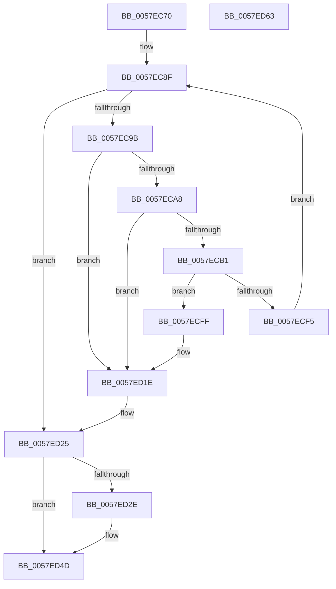

# CcUninitializePartitionVacbs

- RVA: `0x0057EC70`–`0x0057ED64` (길이 `244` bytes)
- VA: `0x000000014057EC70`
- 실행 섹션: `.text`
- PDB 이름 있음: `예`; PDB Function 태그: `아니요`
- unwind 정보 RVA: `0x0009B270`
- 디코드: `63`개 명령, `244/244` bytes 표시
- 미해석 바이트: `0` (있으면 어셈블리에 `.byte`로 보존)

> 이 문서는 커널 이미지의 기계어와 PDB 기호를 분석해 생성했습니다. 4번과 5번은 함수 원형과 자료형을 바이너리 사용 방식에서 추정한 C 해석이며 원본 소스 복구 결과는 아닙니다.

## 1. Dependencies

- 직접 호출 지점: **6**; 고유 호출 대상: **5**
- 직접 호출자로 확인된 함수: **1**
- RIP 상대 이미지 참조: **0**

### Outgoing calls
- `0x0057ECBB` → [MmFreeSystemCacheReserveView](../../page/7F/MmFreeSystemCacheReserveView_function_007FE2D8.md) (function, `0x007FE2D8`)
- `0x0057ECC9` → [KeAcquireQueuedSpinLock](../27/KeAcquireQueuedSpinLock_function_00273D80.md) (function, `0x00273D80`)
- `0x0057ECD9` → [CcSetVacbInFreeList](../26/CcSetVacbInFreeList_function_0026FBB0.md) (function, `0x0026FBB0`)
- `0x0057ECE5` → [KeReleaseQueuedSpinLock](../27/KeReleaseQueuedSpinLock_function_00272540.md) (function, `0x00272540`)
- `0x0057ED18` → [KeBugCheckEx](../4F/KeBugCheckEx_function_004FD660.md) (function, `0x004FD660`)
- `0x0057ED47` → [KeBugCheckEx](../4F/KeBugCheckEx_function_004FD660.md) (function, `0x004FD660`)

### Direct callers
- [CcDeletePartition](CcDeletePartition_function_0057DE9C.md) at `0x0057E003`

### Static image references
- 디코드된 RIP-relative 메모리 참조가 없습니다.

## 2. Other-region calls and transfers

- 다른 실행 섹션으로 향하는 call: **1**
  - `0x0057ECBB` → [MmFreeSystemCacheReserveView](../../page/7F/MmFreeSystemCacheReserveView_function_007FE2D8.md) (`.text` → `PAGE`)
- 별도 외부 분기/꼬리 이동을 확인하지 못했습니다.

## 3. Assembly (complete function range)

```asm
0057EC70  48 89 5C 24 08                  mov qword ptr [rsp + 8], rbx
0057EC75  48 89 74 24 10                  mov qword ptr [rsp + 0x10], rsi
0057EC7A  48 89 7C 24 18                  mov qword ptr [rsp + 0x18], rdi
0057EC7F  41 56                           push r14
0057EC81  48 83 EC 30                     sub rsp, 0x30
0057EC85  48 8B F9                        mov rdi, rcx
0057EC88  48 8D B1 D0 04 00 00            lea rsi, [rcx + 0x4d0]
0057EC8F  48 8B 06                        mov rax, qword ptr [rsi]
0057EC92  48 3B C6                        cmp rax, rsi
0057EC95  0F 84 8A 00 00 00               je 0x14057ed25
0057EC9B  4C 8B 00                        mov r8, qword ptr [rax]
0057EC9E  4C 8D 70 F0                     lea r14, [rax - 0x10]
0057ECA2  49 39 40 08                     cmp qword ptr [r8 + 8], rax
0057ECA6  75 76                           jne 0x14057ed1e
0057ECA8  48 8B 48 08                     mov rcx, qword ptr [rax + 8]
0057ECAC  48 39 01                        cmp qword ptr [rcx], rax
0057ECAF  75 6D                           jne 0x14057ed1e
0057ECB1  4C 89 01                        mov qword ptr [rcx], r8
0057ECB4  49 89 48 08                     mov qword ptr [r8 + 8], rcx
0057ECB8  49 8B 0E                        mov rcx, qword ptr [r14]
0057ECBB  E8 18 F6 27 00                  call 0x1407fe2d8
0057ECC0  49 83 26 00                     and qword ptr [r14], 0
0057ECC4  B9 04 00 00 00                  mov ecx, 4
0057ECC9  E8 B2 50 CF FF                  call 0x140273d80
0057ECCE  45 33 C0                        xor r8d, r8d
0057ECD1  49 8B D6                        mov rdx, r14
0057ECD4  48 8B CF                        mov rcx, rdi
0057ECD7  8A D8                           mov bl, al
0057ECD9  E8 D2 0E CF FF                  call 0x14026fbb0
0057ECDE  8A D3                           mov dl, bl
0057ECE0  B9 04 00 00 00                  mov ecx, 4
0057ECE5  E8 56 38 CF FF                  call 0x140272540
0057ECEA  8B 87 E0 04 00 00               mov eax, dword ptr [rdi + 0x4e0]
0057ECF0  83 F8 01                        cmp eax, 1
0057ECF3  72 0A                           jb 0x14057ecff
0057ECF5  FF C8                           dec eax
0057ECF7  89 87 E0 04 00 00               mov dword ptr [rdi + 0x4e0], eax
0057ECFD  EB 90                           jmp 0x14057ec8f
0057ECFF  48 83 64 24 20 00               and qword ptr [rsp + 0x20], 0
0057ED05  45 33 C9                        xor r9d, r9d
0057ED08  BA 8C 07 00 00                  mov edx, 0x78c
0057ED0D  49 C7 C0 20 04 00 C0            mov r8, 0xffffffffc0000420
0057ED14  41 8D 49 34                     lea ecx, [r9 + 0x34]
0057ED18  E8 43 E9 F7 FF                  call 0x1404fd660
0057ED1D  CC                              int3
0057ED1E  B9 03 00 00 00                  mov ecx, 3
0057ED23  CD 29                           int 0x29
0057ED25  83 BF E0 04 00 00 00            cmp dword ptr [rdi + 0x4e0], 0
0057ED2C  74 1F                           je 0x14057ed4d
0057ED2E  48 83 64 24 20 00               and qword ptr [rsp + 0x20], 0
0057ED34  45 33 C9                        xor r9d, r9d
0057ED37  BA 94 07 00 00                  mov edx, 0x794
0057ED3C  49 C7 C0 20 04 00 C0            mov r8, 0xffffffffc0000420
0057ED43  41 8D 49 34                     lea ecx, [r9 + 0x34]
0057ED47  E8 14 E9 F7 FF                  call 0x1404fd660
0057ED4C  CC                              int3
0057ED4D  48 8B 5C 24 40                  mov rbx, qword ptr [rsp + 0x40]
0057ED52  48 8B 74 24 48                  mov rsi, qword ptr [rsp + 0x48]
0057ED57  48 8B 7C 24 50                  mov rdi, qword ptr [rsp + 0x50]
0057ED5C  48 83 C4 30                     add rsp, 0x30
0057ED60  41 5E                           pop r14
0057ED62  C3                              ret
0057ED63  CC                              int3
```

## 4. C-style interpretation (structured pseudocode)

```c
__int64 __fastcall CcUninitializePartitionVacbs(__int64 a1, __int64 a2, __int64 a3, int a4)
{
    __int64 result;
    __int64 v_rsp;
    unsigned __int64 v_stack_m18;
    unsigned __int64 v_stack_p10;
    unsigned __int64 v_stack_p18;
    unsigned __int64 v_stack_p8;

    v_stack_p8 = v_rbx;
    v_stack_p10 = v_rsi;
    v_stack_p18 = v_rdi;
    v_rsp = (v_rsp) - (48);
loc_0057EC8F:
    if ((*(unsigned __int64 *)(a1 + 1232)) == (a1 + 1232)) goto loc_0057ED25;
    if ((*(unsigned __int64 *)(*(unsigned __int64 *)(*(unsigned __int64 *)(a1 + 1232)) + 8)) != (*(unsigned __int64 *)(a1 + 1232))) goto loc_0057ED1E;
    if ((*(unsigned __int64 *)(*(unsigned __int64 *)(*(unsigned __int64 *)(a1 + 1232) + 8))) != (*(unsigned __int64 *)(a1 + 1232))) goto loc_0057ED1E;
    *(unsigned __int64 *)(*(unsigned __int64 *)(*(unsigned __int64 *)(a1 + 1232) + 8)) = *(unsigned __int64 *)(*(unsigned __int64 *)(a1 + 1232));
    *(unsigned __int64 *)(*(unsigned __int64 *)(*(unsigned __int64 *)(a1 + 1232)) + 8) = *(unsigned __int64 *)(*(unsigned __int64 *)(a1 + 1232) + 8);
    result = MmFreeSystemCacheReserveView(*(unsigned __int64 *)(*(unsigned __int64 *)(a1 + 1232) - 16), a2, *(unsigned __int64 *)(*(unsigned __int64 *)(a1 + 1232)), a4);
    result = KeAcquireQueuedSpinLock(4, a2, *(unsigned __int64 *)(*(unsigned __int64 *)(a1 + 1232)), a4);
    a3 = 0;
    result = CcSetVacbInFreeList(a1, *(unsigned __int64 *)(a1 + 1232) - 16, a3, a4);
    result = KeReleaseQueuedSpinLock(4, (unsigned __int8)((unsigned __int8)(result)), a3, a4);
    if (((unsigned int)((unsigned int)(*(unsigned int *)(a1 + 1248)))) < 1) goto loc_0057ECFF;
    result = (unsigned int)(((unsigned int)(*(unsigned int *)(a1 + 1248))) - 1);
    *(unsigned int *)(a1 + 1248) = (unsigned int)(result);
    goto loc_0057EC8F;
loc_0057ECFF:
    a4 = 0;
    result = KeBugCheckEx(a4 + 52, (unsigned int)(0x78CULL), 0xFFFFFFFFC0000420ULL, a4);
loc_0057ED1E:
loc_0057ED25:
    if ((*(unsigned int *)(a1 + 1248)) != 0) {
        a4 = 0;
        a2 = 0x794ULL;
        a3 = 0xFFFFFFFFC0000420ULL;
        a1 = a4 + 52;
        result = KeBugCheckEx(a1, a2, a3, a4);
    }
    v_rsp = (v_rsp) + (48);
    return result;
}
```

## 5. (Beta) C Style

```c
int64_t CcUninitializePartitionVacbs(void *Arg1, int64_t Arg2, int64_t Arg3, int32_t Arg4)
{
    uint8_t *arg1 = (uint8_t *)Arg1;

    int64_t result;
    int64_t local_rsp;
    uint64_t v_stack_m18;
    uint64_t v_stack_p10;
    uint64_t v_stack_p18;
    uint64_t v_stack_p8;

    v_stack_p8 = local_rbx;
    v_stack_p10 = local_rsi;
    v_stack_p18 = local_rdi;
    local_rsp = (local_rsp) - (48);
loc_0057EC8F:
    if ((*(uint64_t *)(arg1 + 0x4D0)) == (Arg1 + 1232)) goto loc_0057ED25;
    if ((*(uint64_t *)(*(uint64_t *)(*(uint64_t *)(arg1 + 0x4D0)) + 0x8)) != (*(uint64_t *)(arg1 + 0x4D0))) goto loc_0057ED1E;
    if ((*(uint64_t *)(*(uint64_t *)(*(uint64_t *)(arg1 + 0x4D0) + 0x8))) != (*(uint64_t *)(arg1 + 0x4D0))) goto loc_0057ED1E;
    *(uint64_t *)(*(uint64_t *)(*(uint64_t *)(arg1 + 0x4D0) + 0x8)) = *(uint64_t *)(*(uint64_t *)(arg1 + 0x4D0));
    *(uint64_t *)(*(uint64_t *)(*(uint64_t *)(arg1 + 0x4D0)) + 0x8) = *(uint64_t *)(*(uint64_t *)(arg1 + 0x4D0) + 0x8);
    result = MmFreeSystemCacheReserveView(*(uint64_t *)(*(uint64_t *)(arg1 + 0x4D0) - 0x10), Arg2, *(uint64_t *)(*(uint64_t *)(arg1 + 0x4D0)), Arg4);
    result = KeAcquireQueuedSpinLock(4, Arg2, *(uint64_t *)(*(uint64_t *)(arg1 + 0x4D0)), Arg4);
    Arg3 = 0;
    result = CcSetVacbInFreeList(Arg1, *(uint64_t *)(arg1 + 0x4D0) - 16, Arg3, Arg4);
    result = KeReleaseQueuedSpinLock(4, (uint8_t)((uint8_t)(result)), Arg3, Arg4);
    if (((uint32_t)((uint32_t)(*(uint32_t *)(arg1 + 0x4E0)))) < 1) goto loc_0057ECFF;
    result = (uint32_t)(((uint32_t)(*(uint32_t *)(arg1 + 0x4E0))) - 1);
    *(uint32_t *)(arg1 + 0x4E0) = (uint32_t)(result);
    goto loc_0057EC8F;
loc_0057ECFF:
    Arg4 = 0;
    result = KeBugCheckEx(Arg4 + 52, (uint32_t)(0x78CULL), 0xFFFFFFFFC0000420ULL, Arg4);
loc_0057ED1E:
loc_0057ED25:
    if ((*(uint32_t *)(arg1 + 0x4E0)) != 0) {
        Arg4 = 0;
        Arg2 = 0x794ULL;
        Arg3 = 0xFFFFFFFFC0000420ULL;
        Arg1 = Arg4 + 52;
        result = KeBugCheckEx(Arg1, Arg2, Arg3, Arg4);
    }
    local_rsp = (local_rsp) + (48);
    return result;
}
```

### 관측된 메모리 오프셋

구조체 형식이 확인되지 않은 접근은 인자 기준의 오프셋으로만 기록했습니다.

| 기준 인자 | 오프셋 표현 | 폭 (bit) | 접근 |
|---|---:|---:|---|
| `Arg1` | `+ 0x0` | `64` | `R` |
| `Arg1` | `+ 0x4D0` | `64` | `R` |
| `Arg1` | `+ 0x4E0` | `32` | `R` |
| `Arg1` | `+ 0x4E0` | `32` | `W` |

## 6. Execution-region graph

[열기: 2D/3D 그래프와 함수 탐색 컨트롤 패널](../../../control-panel.html?section=text&rva=0x0057EC70&view=graph)

- 2D 그래프는 위에서 아래로 흐르고, 3D 그래프는 빈 공간을 드래그해 회전합니다. Shift+드래그는 이동, 휠은 확대·축소, 함수 노드 선택은 대상 보고서 이동입니다.

### Static fallback


