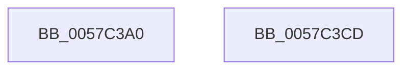

# CcUnregisterExternalCache

- RVA: `0x0057C3A0`–`0x0057C3CE` (길이 `46` bytes)
- VA: `0x000000014057C3A0`
- 실행 섹션: `.text`
- PDB 이름 있음: `예`; PDB Function 태그: `아니요`
- unwind 정보 RVA: `0x0005CF00`
- 디코드: `14`개 명령, `46/46` bytes 표시
- 미해석 바이트: `0` (있으면 어셈블리에 `.byte`로 보존)

> 이 문서는 커널 이미지의 기계어와 PDB 기호를 분석해 생성했습니다. 4번과 5번은 함수 원형과 자료형을 바이너리 사용 방식에서 추정한 C 해석이며 원본 소스 복구 결과는 아닙니다.

## 1. Dependencies

- 직접 호출 지점: **3**; 고유 호출 대상: **3**
- 직접 호출자로 확인된 함수: **0**
- RIP 상대 이미지 참조: **0**

### Outgoing calls
- `0x0057C3A9` → [CcRemoveExternalCache](CcRemoveExternalCache_function_0057C228.md) (function, `0x0057C228`)
- `0x0057C3B5` → [CcDeductDirtyPagesFromExternalCache](../4A/CcDeductDirtyPagesFromExternalCache_function_004A65D0.md) (function, `0x004A65D0`)
- `0x0057C3C2` → [ExFreePoolWithTag](../../poolcode/B8/ExFreePoolWithTag_function_00B82870.md) (function, `0x00B82870`)

### Direct callers
- 이 함수 시작 RVA로 연결되는 직접 call은 확인되지 않았습니다. 간접 호출은 완전히 역산할 수 없습니다.

### Static image references
- 디코드된 RIP-relative 메모리 참조가 없습니다.

## 2. Other-region calls and transfers

- 다른 실행 섹션으로 향하는 call: **1**
  - `0x0057C3C2` → [ExFreePoolWithTag](../../poolcode/B8/ExFreePoolWithTag_function_00B82870.md) (`.text` → `POOLCODE`)
- 별도 외부 분기/꼬리 이동을 확인하지 못했습니다.

## 3. Assembly (complete function range)

```asm
0057C3A0  40 53                           push rbx
0057C3A2  48 83 EC 20                     sub rsp, 0x20
0057C3A6  48 8B D9                        mov rbx, rcx
0057C3A9  E8 7A FE FF FF                  call 0x14057c228
0057C3AE  48 8B 53 08                     mov rdx, qword ptr [rbx + 8]
0057C3B2  48 8B CB                        mov rcx, rbx
0057C3B5  E8 16 A2 F2 FF                  call 0x1404a65d0
0057C3BA  BA 43 63 45 43                  mov edx, 0x43456343
0057C3BF  48 8B CB                        mov rcx, rbx
0057C3C2  E8 A9 64 60 00                  call 0x140b82870
0057C3C7  48 83 C4 20                     add rsp, 0x20
0057C3CB  5B                              pop rbx
0057C3CC  C3                              ret
0057C3CD  CC                              int3
```

## 4. C-style interpretation (structured pseudocode)

```c
__int64 __fastcall CcUnregisterExternalCache(__int64 a1)
{
    __int64 result;
    __int64 v_rsp;

    v_rsp = (v_rsp) - (32);
    result = CcRemoveExternalCache(a1, a2, a3, a4);
    result = CcDeductDirtyPagesFromExternalCache(a1, *(unsigned __int64 *)(a1 + 8), a3, a4);
    result = ExFreePoolWithTag(a1, (unsigned int)(0x43456343ULL), a3, a4);
    v_rsp = (v_rsp) + (32);
    return result;
}
```

## 5. (Beta) C Style

```c
int64_t CcUnregisterExternalCache(void *Arg1)
{
    uint8_t *arg1 = (uint8_t *)Arg1;

    int64_t result;
    int64_t local_rsp;

    local_rsp = (local_rsp) - (32);
    result = CcRemoveExternalCache(Arg1, a2, a3, a4);
    result = CcDeductDirtyPagesFromExternalCache(Arg1, *(uint64_t *)(arg1 + 0x8), a3, a4);
    result = ExFreePoolWithTag(Arg1, (uint32_t)(0x43456343ULL), a3, a4);
    local_rsp = (local_rsp) + (32);
    return result;
}
```

### 관측된 메모리 오프셋

구조체 형식이 확인되지 않은 접근은 인자 기준의 오프셋으로만 기록했습니다.

| 기준 인자 | 오프셋 표현 | 폭 (bit) | 접근 |
|---|---:|---:|---|
| `Arg1` | `+ 0x8` | `64` | `R` |

## 6. Execution-region graph

[열기: 2D/3D 그래프와 함수 탐색 컨트롤 패널](../../../control-panel.html?section=text&rva=0x0057C3A0&view=graph)

- 2D 그래프는 위에서 아래로 흐르고, 3D 그래프는 빈 공간을 드래그해 회전합니다. Shift+드래그는 이동, 휠은 확대·축소, 함수 노드 선택은 대상 보고서 이동입니다.

### Static fallback


