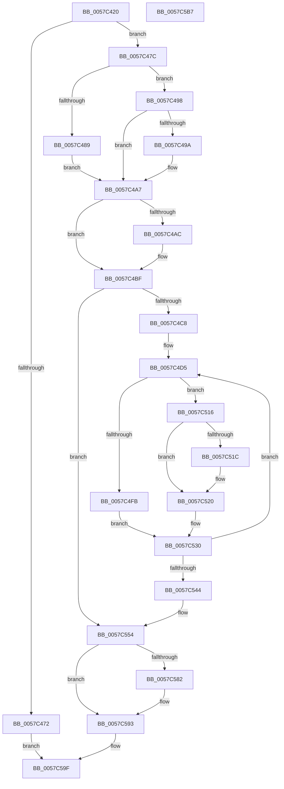

# CcUpdateExternalCacheInfoEx

- RVA: `0x0057C420`–`0x0057C5B8` (길이 `408` bytes)
- VA: `0x000000014057C420`
- 실행 섹션: `.text`
- PDB 이름 있음: `예`; PDB Function 태그: `아니요`
- unwind 정보 RVA: `0x000C5740`
- 디코드: `112`개 명령, `408/408` bytes 표시
- 미해석 바이트: `0` (있으면 어셈블리에 `.byte`로 보존)

> 이 문서는 커널 이미지의 기계어와 PDB 기호를 분석해 생성했습니다. 4번과 5번은 함수 원형과 자료형을 바이너리 사용 방식에서 추정한 C 해석이며 원본 소스 복구 결과는 아닙니다.

## 1. Dependencies

- 직접 호출 지점: **7**; 고유 호출 대상: **5**
- 직접 호출자로 확인된 함수: **0**
- RIP 상대 이미지 참조: **0**

### Outgoing calls
- `0x0057C4F1` → [KeAcquireInStackQueuedSpinLock](../27/KeAcquireInStackQueuedSpinLock_function_002757A0.md) (function, `0x002757A0`)
- `0x0057C50F` → [CcChargeDirtyPagesInternal](../3C/CcChargeDirtyPagesInternal_function_003CDE10.md) (function, `0x003CDE10`)
- `0x0057C52B` → [CcDeductDirtyPagesInternal](../4A/CcDeductDirtyPagesInternal_function_004A994C.md) (function, `0x004A994C`)
- `0x0057C535` → [KeReleaseInStackQueuedSpinLock](../34/KeReleaseInStackQueuedSpinLock_function_00342CE0.md) (function, `0x00342CE0`)
- `0x0057C560` → [KeAcquireInStackQueuedSpinLock](../27/KeAcquireInStackQueuedSpinLock_function_002757A0.md) (function, `0x002757A0`)
- `0x0057C58E` → [CcScheduleLazyWriteScan](../3C/CcScheduleLazyWriteScan_function_003CBD20.md) (function, `0x003CBD20`)
- `0x0057C598` → [KeReleaseInStackQueuedSpinLock](../34/KeReleaseInStackQueuedSpinLock_function_00342CE0.md) (function, `0x00342CE0`)

### Direct callers
- 이 함수 시작 RVA로 연결되는 직접 call은 확인되지 않았습니다. 간접 호출은 완전히 역산할 수 없습니다.

### Static image references
- 디코드된 RIP-relative 메모리 참조가 없습니다.

## 2. Other-region calls and transfers

- 다른 실행 섹션으로 향하는 call: **0**
- 별도 외부 분기/꼬리 이동을 확인하지 못했습니다.

## 3. Assembly (complete function range)

```asm
0057C420  48 89 5C 24 20                  mov qword ptr [rsp + 0x20], rbx
0057C425  48 89 54 24 10                  mov qword ptr [rsp + 0x10], rdx
0057C42A  55                              push rbp
0057C42B  56                              push rsi
0057C42C  57                              push rdi
0057C42D  41 54                           push r12
0057C42F  41 55                           push r13
0057C431  41 56                           push r14
0057C433  41 57                           push r15
0057C435  48 83 EC 50                     sub rsp, 0x50
0057C439  48 8B 71 40                     mov rsi, qword ptr [rcx + 0x40]
0057C43D  33 C0                           xor eax, eax
0057C43F  4C 8B 69 48                     mov r13, qword ptr [rcx + 0x48]
0057C443  33 DB                           xor ebx, ebx
0057C445  48 8B EA                        mov rbp, rdx
0057C448  48 89 44 24 40                  mov qword ptr [rsp + 0x40], rax
0057C44D  45 32 FF                        xor r15b, r15b
0057C450  88 84 24 90 00 00 00            mov byte ptr [rsp + 0x90], al
0057C457  0F 57 C0                        xorps xmm0, xmm0
0057C45A  44 89 BC 24 A0 00 00 00         mov dword ptr [rsp + 0xa0], r15d
0057C462  8D 53 01                        lea edx, [rbx + 1]
0057C465  48 8B F9                        mov rdi, rcx
0057C468  0F 11 44 24 30                  movups xmmword ptr [rsp + 0x30], xmm0
0057C46D  39 55 00                        cmp dword ptr [rbp], edx
0057C470  74 0A                           je 0x14057c47c
0057C472  B8 0D 00 00 C0                  mov eax, 0xc000000d
0057C477  E9 23 01 00 00                  jmp 0x14057c59f
0057C47C  48 8B 4D 28                     mov rcx, qword ptr [rbp + 0x28]
0057C480  48 8B 47 08                     mov rax, qword ptr [rdi + 8]
0057C484  48 3B C8                        cmp rcx, rax
0057C487  7E 0F                           jle 0x14057c498
0057C489  48 8B D9                        mov rbx, rcx
0057C48C  88 94 24 90 00 00 00            mov byte ptr [rsp + 0x90], dl
0057C493  48 2B D8                        sub rbx, rax
0057C496  EB 0F                           jmp 0x14057c4a7
0057C498  7D 0D                           jge 0x14057c4a7
0057C49A  88 9C 24 90 00 00 00            mov byte ptr [rsp + 0x90], bl
0057C4A1  48 8B D8                        mov rbx, rax
0057C4A4  48 2B D9                        sub rbx, rcx
0057C4A7  48 85 C0                        test rax, rax
0057C4AA  75 13                           jne 0x14057c4bf
0057C4AC  48 85 C9                        test rcx, rcx
0057C4AF  45 0F B6 FF                     movzx r15d, r15b
0057C4B3  44 0F 45 FA                     cmovne r15d, edx
0057C4B7  44 89 BC 24 A0 00 00 00         mov dword ptr [rsp + 0xa0], r15d
0057C4BF  48 85 DB                        test rbx, rbx
0057C4C2  0F 84 8C 00 00 00               je 0x14057c554
0057C4C8  40 8A AC 24 90 00 00 00         mov bpl, byte ptr [rsp + 0x90]
0057C4D0  B8 FF FF FF FF                  mov eax, 0xffffffff
0057C4D5  48 3B D8                        cmp rbx, rax
0057C4D8  48 8D 54 24 30                  lea rdx, [rsp + 0x30]
0057C4DD  44 8B F3                        mov r14d, ebx
0057C4E0  48 8D 8E 00 03 00 00            lea rcx, [rsi + 0x300]
0057C4E7  44 0F 47 F0                     cmova r14d, eax
0057C4EB  45 8B E6                        mov r12d, r14d
0057C4EE  49 2B DC                        sub rbx, r12
0057C4F1  E8 AA 92 CF FF                  call 0x1402757a0
0057C4F6  40 84 ED                        test bpl, bpl
0057C4F9  74 1B                           je 0x14057c516
0057C4FB  4C 89 6C 24 28                  mov qword ptr [rsp + 0x28], r13
0057C500  45 8B CE                        mov r9d, r14d
0057C503  45 33 C0                        xor r8d, r8d
0057C506  48 89 74 24 20                  mov qword ptr [rsp + 0x20], rsi
0057C50B  33 D2                           xor edx, edx
0057C50D  33 C9                           xor ecx, ecx
0057C50F  E8 FC 18 E5 FF                  call 0x1403cde10
0057C514  EB 1A                           jmp 0x14057c530
0057C516  4C 39 67 08                     cmp qword ptr [rdi + 8], r12
0057C51A  73 04                           jae 0x14057c520
0057C51C  44 8B 77 08                     mov r14d, dword ptr [rdi + 8]
0057C520  4D 8B CD                        mov r9, r13
0057C523  4C 8B C6                        mov r8, rsi
0057C526  41 8B D6                        mov edx, r14d
0057C529  33 C9                           xor ecx, ecx
0057C52B  E8 1C D4 F2 FF                  call 0x1404a994c
0057C530  48 8D 4C 24 30                  lea rcx, [rsp + 0x30]
0057C535  E8 A6 67 DC FF                  call 0x140342ce0
0057C53A  B8 FF FF FF FF                  mov eax, 0xffffffff
0057C53F  48 85 DB                        test rbx, rbx
0057C542  75 91                           jne 0x14057c4d5
0057C544  48 8B AC 24 98 00 00 00         mov rbp, qword ptr [rsp + 0x98]
0057C54C  44 8B BC 24 A0 00 00 00         mov r15d, dword ptr [rsp + 0xa0]
0057C554  48 8D 8E 00 03 00 00            lea rcx, [rsi + 0x300]
0057C55B  48 8D 54 24 30                  lea rdx, [rsp + 0x30]
0057C560  E8 3B 92 CF FF                  call 0x1402757a0
0057C565  48 8B 45 28                     mov rax, qword ptr [rbp + 0x28]
0057C569  48 89 47 08                     mov qword ptr [rdi + 8], rax
0057C56D  48 8B 45 30                     mov rax, qword ptr [rbp + 0x30]
0057C571  48 89 47 30                     mov qword ptr [rdi + 0x30], rax
0057C575  48 8B 45 38                     mov rax, qword ptr [rbp + 0x38]
0057C579  48 89 47 38                     mov qword ptr [rdi + 0x38], rax
0057C57D  45 84 FF                        test r15b, r15b
0057C580  74 11                           je 0x14057c593
0057C582  45 33 C9                        xor r9d, r9d
0057C585  45 33 C0                        xor r8d, r8d
0057C588  49 8B D5                        mov rdx, r13
0057C58B  48 8B CE                        mov rcx, rsi
0057C58E  E8 8D F7 E4 FF                  call 0x1403cbd20
0057C593  48 8D 4C 24 30                  lea rcx, [rsp + 0x30]
0057C598  E8 43 67 DC FF                  call 0x140342ce0
0057C59D  33 C0                           xor eax, eax
0057C59F  48 8B 9C 24 A8 00 00 00         mov rbx, qword ptr [rsp + 0xa8]
0057C5A7  48 83 C4 50                     add rsp, 0x50
0057C5AB  41 5F                           pop r15
0057C5AD  41 5E                           pop r14
0057C5AF  41 5D                           pop r13
0057C5B1  41 5C                           pop r12
0057C5B3  5F                              pop rdi
0057C5B4  5E                              pop rsi
0057C5B5  5D                              pop rbp
0057C5B6  C3                              ret
0057C5B7  CC                              int3
```

## 4. C-style interpretation (structured pseudocode)

```c
__int64 __fastcall CcUpdateExternalCacheInfoEx(__int64 a1, __int64 a2, int a3)
{
    __int64 result;
    __int64 v_r14;
    __int64 v_r15;
    __int64 v_rbx;
    __int64 v_rsp;
    unsigned __int64 v_stack_m48;
    unsigned __int64 v_stack_m58;
    unsigned __int64 v_stack_m60;
    unsigned __int64 v_stack_m68;
    unsigned __int64 v_stack_p10;
    unsigned int v_stack_p18;
    unsigned __int64 v_stack_p20;
    unsigned __int8 v_stack_p8;

    v_stack_p20 = v_rbx;
    v_stack_p10 = a2;
    v_rsp = (v_rsp) - (80);
    result = 0;
    v_rbx = 0;
    v_stack_m48 = 0;
    v_r15 = 0;
    v_stack_p8 = 0;
    v_stack_p18 = 0;
    v_stack_m58 = v_xmm0;
    if ((*(unsigned int *)(a2)) == ((unsigned int)(v_rbx + 1))) goto loc_0057C47C;
    goto loc_0057C59F;
loc_0057C47C:
    if ((*(unsigned __int64 *)(a2 + 40)) <= (*(unsigned __int64 *)(a1 + 8))) goto loc_0057C498;
    v_stack_p8 = (unsigned __int8)(v_rbx + 1);
    v_rbx = (*(unsigned __int64 *)(a2 + 40)) - (*(unsigned __int64 *)(a1 + 8));
    goto loc_0057C4A7;
loc_0057C498:
    if (!(condition_is_greater_or_equal)) {
        v_stack_p8 = (unsigned __int8)(v_rbx);
        v_rbx = *(unsigned __int64 *)(a1 + 8);
        v_rbx = (v_rbx) - (*(unsigned __int64 *)(a2 + 40));
    }
    if (*(unsigned __int64 *)(a1 + 8) == 0) {
        v_r15 = 0;
        if (*(unsigned __int64 *)(a2 + 40) != 0) { v_r15 = (unsigned int)(v_rbx + 1); }
        v_stack_p18 = (unsigned int)(v_r15);
    }
    if (v_rbx == 0) goto loc_0057C554;
loc_0057C4D5:
    v_r14 = (unsigned int)((unsigned int)(v_rbx));
    if (v_rbx > ((unsigned int)(0xFFFFFFFFULL))) { v_r14 = (unsigned int)((unsigned int)(0xFFFFFFFFULL)); }
    v_rbx = (v_rbx) - ((unsigned int)((unsigned int)(v_r14)));
    result = KeAcquireInStackQueuedSpinLock(*(unsigned __int64 *)(a1 + 64) + 768, v_stack_m58, a3, a4);
    if ((unsigned __int8)(v_stack_p8) == 0) goto loc_0057C516;
    v_stack_m60 = *(unsigned __int64 *)(a1 + 72);
    a3 = 0;
    v_stack_m68 = *(unsigned __int64 *)(a1 + 64);
    a2 = 0;
    a1 = 0;
    result = CcChargeDirtyPagesInternal(a1, a2, a3, (unsigned int)((unsigned int)(v_r14)));
    goto loc_0057C530;
loc_0057C516:
    if ((*(unsigned __int64 *)(a1 + 8)) < ((unsigned int)((unsigned int)(v_r14)))) {
        v_r14 = *(unsigned int *)(a1 + 8);
    }
    a1 = 0;
    result = CcDeductDirtyPagesInternal(a1, (unsigned int)((unsigned int)(v_r14)), *(unsigned __int64 *)(a1 + 64), *(unsigned __int64 *)(a1 + 72));
loc_0057C530:
    result = KeReleaseInStackQueuedSpinLock(v_stack_m58, (unsigned int)((unsigned int)(v_r14)), *(unsigned __int64 *)(a1 + 64), *(unsigned __int64 *)(a1 + 72));
    if (v_rbx != 0) goto loc_0057C4D5;
loc_0057C554:
    result = KeAcquireInStackQueuedSpinLock(*(unsigned __int64 *)(a1 + 64) + 768, v_stack_m58, *(unsigned __int64 *)(a1 + 64), *(unsigned __int64 *)(a1 + 72));
    *(unsigned __int64 *)(a1 + 8) = *(unsigned __int64 *)(v_stack_p10 + 40);
    *(unsigned __int64 *)(a1 + 48) = *(unsigned __int64 *)(v_stack_p10 + 48);
    *(unsigned __int64 *)(a1 + 56) = *(unsigned __int64 *)(v_stack_p10 + 56);
    result = *(unsigned __int64 *)(v_stack_p10 + 56);
    if ((unsigned __int8)((unsigned int)(v_stack_p18)) != 0) {
        a4 = 0;
        a3 = 0;
        a2 = *(unsigned __int64 *)(a1 + 72);
        a1 = *(unsigned __int64 *)(a1 + 64);
        result = CcScheduleLazyWriteScan(a1, a2, a3, a4);
    }
    result = KeReleaseInStackQueuedSpinLock(v_stack_m58, a2, a3, a4);
    result = 0;
loc_0057C59F:
    v_rsp = (v_rsp) + (80);
    return result;
}
```

## 5. (Beta) C Style

```c
int64_t CcUpdateExternalCacheInfoEx(void *Arg1, void *Arg2, int32_t Arg3)
{
    uint8_t *arg1 = (uint8_t *)Arg1;
    uint8_t *arg2 = (uint8_t *)Arg2;

    int64_t result;
    int64_t local_r14;
    int64_t local_r15;
    int64_t local_rbx;
    int64_t local_rsp;
    uint64_t v_stack_m48;
    uint64_t v_stack_m58;
    uint64_t v_stack_m60;
    uint64_t v_stack_m68;
    uint64_t v_stack_p10;
    uint32_t v_stack_p18;
    uint64_t v_stack_p20;
    uint8_t v_stack_p8;

    v_stack_p20 = local_rbx;
    v_stack_p10 = Arg2;
    local_rsp = (local_rsp) - (80);
    result = 0;
    local_rbx = 0;
    v_stack_m48 = 0;
    local_r15 = 0;
    v_stack_p8 = 0;
    v_stack_p18 = 0;
    v_stack_m58 = v_xmm0;
    if ((*(uint32_t *)(arg2)) == ((uint32_t)(local_rbx + 1))) goto loc_0057C47C;
    goto loc_0057C59F;
loc_0057C47C:
    if ((*(uint64_t *)(arg2 + 0x28)) <= (*(uint64_t *)(arg1 + 0x8))) goto loc_0057C498;
    v_stack_p8 = (uint8_t)(local_rbx + 1);
    local_rbx = (*(uint64_t *)(arg2 + 0x28)) - (*(uint64_t *)(arg1 + 0x8));
    goto loc_0057C4A7;
loc_0057C498:
    if (!(condition_is_greater_or_equal)) {
        v_stack_p8 = (uint8_t)(local_rbx);
        local_rbx = *(uint64_t *)(arg1 + 0x8);
        local_rbx = (local_rbx) - (*(uint64_t *)(arg2 + 0x28));
    }
    if (*(uint64_t *)(arg1 + 0x8) == 0) {
        local_r15 = 0;
        if (*(uint64_t *)(arg2 + 0x28) != 0) { local_r15 = (uint32_t)(local_rbx + 1); }
        v_stack_p18 = (uint32_t)(local_r15);
    }
    if (local_rbx == 0) goto loc_0057C554;
loc_0057C4D5:
    local_r14 = (uint32_t)((uint32_t)(local_rbx));
    if (local_rbx > ((uint32_t)(0xFFFFFFFFULL))) { local_r14 = (uint32_t)((uint32_t)(0xFFFFFFFFULL)); }
    local_rbx = (local_rbx) - ((uint32_t)((uint32_t)(local_r14)));
    result = KeAcquireInStackQueuedSpinLock(*(uint64_t *)(arg1 + 0x40) + 768, v_stack_m58, Arg3, a4);
    if ((uint8_t)(v_stack_p8) == 0) goto loc_0057C516;
    v_stack_m60 = *(uint64_t *)(arg1 + 0x48);
    Arg3 = 0;
    v_stack_m68 = *(uint64_t *)(arg1 + 0x40);
    Arg2 = 0;
    Arg1 = 0;
    result = CcChargeDirtyPagesInternal(Arg1, Arg2, Arg3, (uint32_t)((uint32_t)(local_r14)));
    goto loc_0057C530;
loc_0057C516:
    if ((*(uint64_t *)(arg1 + 0x8)) < ((uint32_t)((uint32_t)(local_r14)))) {
        local_r14 = *(uint32_t *)(arg1 + 0x8);
    }
    Arg1 = 0;
    result = CcDeductDirtyPagesInternal(Arg1, (uint32_t)((uint32_t)(local_r14)), *(uint64_t *)(arg1 + 0x40), *(uint64_t *)(arg1 + 0x48));
loc_0057C530:
    result = KeReleaseInStackQueuedSpinLock(v_stack_m58, (uint32_t)((uint32_t)(local_r14)), *(uint64_t *)(arg1 + 0x40), *(uint64_t *)(arg1 + 0x48));
    if (local_rbx != 0) goto loc_0057C4D5;
loc_0057C554:
    result = KeAcquireInStackQueuedSpinLock(*(uint64_t *)(arg1 + 0x40) + 768, v_stack_m58, *(uint64_t *)(arg1 + 0x40), *(uint64_t *)(arg1 + 0x48));
    *(uint64_t *)(arg1 + 0x8) = *(uint64_t *)(v_stack_p10 + 0x28);
    *(uint64_t *)(arg1 + 0x30) = *(uint64_t *)(v_stack_p10 + 0x30);
    *(uint64_t *)(arg1 + 0x38) = *(uint64_t *)(v_stack_p10 + 0x38);
    result = *(uint64_t *)(v_stack_p10 + 0x38);
    if ((uint8_t)((uint32_t)(v_stack_p18)) != 0) {
        a4 = 0;
        Arg3 = 0;
        Arg2 = *(uint64_t *)(arg1 + 0x48);
        Arg1 = *(uint64_t *)(arg1 + 0x40);
        result = CcScheduleLazyWriteScan(Arg1, Arg2, Arg3, a4);
    }
    result = KeReleaseInStackQueuedSpinLock(v_stack_m58, Arg2, Arg3, a4);
    result = 0;
loc_0057C59F:
    local_rsp = (local_rsp) + (80);
    return result;
}
```

### 관측된 메모리 오프셋

구조체 형식이 확인되지 않은 접근은 인자 기준의 오프셋으로만 기록했습니다.

| 기준 인자 | 오프셋 표현 | 폭 (bit) | 접근 |
|---|---:|---:|---|
| `Arg1` | `+ 0x8` | `32` | `R` |
| `Arg1` | `+ 0x8` | `64` | `R` |
| `Arg1` | `+ 0x8` | `64` | `W` |
| `Arg1` | `+ 0x30` | `64` | `W` |
| `Arg1` | `+ 0x38` | `64` | `W` |
| `Arg1` | `+ 0x40` | `64` | `R` |
| `Arg1` | `+ 0x48` | `64` | `R` |
| `Arg2` | `+ 0x0` | `32` | `R` |
| `Arg2` | `+ 0x28` | `64` | `R` |

## 6. Execution-region graph

[열기: 2D/3D 그래프와 함수 탐색 컨트롤 패널](../../../control-panel.html?section=text&rva=0x0057C420&view=graph)

- 2D 그래프는 위에서 아래로 흐르고, 3D 그래프는 빈 공간을 드래그해 회전합니다. Shift+드래그는 이동, 휠은 확대·축소, 함수 노드 선택은 대상 보고서 이동입니다.

### Static fallback


