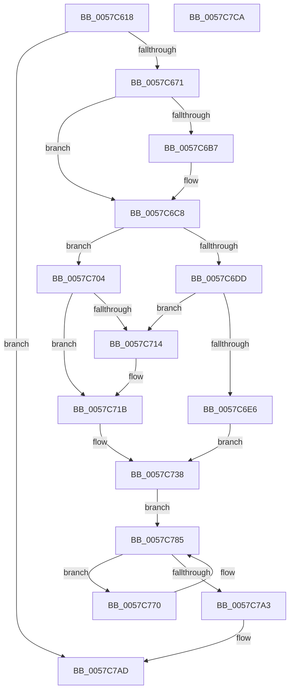

# CcWaitForCurrentLazyWriterActivityOnNode

- RVA: `0x0057C618`–`0x0057C7CB` (길이 `435` bytes)
- VA: `0x000000014057C618`
- 실행 섹션: `.text`
- PDB 이름 있음: `예`; PDB Function 태그: `아니요`
- unwind 정보 RVA: `0x000C57B4`
- 디코드: `110`개 명령, `435/435` bytes 표시
- 미해석 바이트: `0` (있으면 어셈블리에 `.byte`로 보존)

> 이 문서는 커널 이미지의 기계어와 PDB 기호를 분석해 생성했습니다. 4번과 5번은 함수 원형과 자료형을 바이너리 사용 방식에서 추정한 C 해석이며 원본 소스 복구 결과는 아닙니다.

## 1. Dependencies

- 직접 호출 지점: **10**; 고유 호출 대상: **7**
- 직접 호출자로 확인된 함수: **1**
- RIP 상대 이미지 참조: **2**

### Outgoing calls
- `0x0057C664` → [CcAllocateWorkQueueEntry](../35/CcAllocateWorkQueueEntry_function_0035710C.md) (function, `0x0035710C`)
- `0x0057C6C3` → [CcPerfLogWorkItemEnqueue](../35/CcPerfLogWorkItemEnqueue_function_00357340.md) (function, `0x00357340`)
- `0x0057C6D3` → [KeAcquireInStackQueuedSpinLock](../27/KeAcquireInStackQueuedSpinLock_function_002757A0.md) (function, `0x002757A0`)
- `0x0057C747` → [CcScheduleLazyWriteScan](../3C/CcScheduleLazyWriteScan_function_003CBD20.md) (function, `0x003CBD20`)
- `0x0057C750` → [KeReleaseInStackQueuedSpinLock](../34/KeReleaseInStackQueuedSpinLock_function_00342CE0.md) (function, `0x00342CE0`)
- `0x0057C767` → [KeWaitForSingleObject](../20/KeWaitForSingleObject_function_0020E6B0.md) (function, `0x0020E6B0`)
- `0x0057C770` → [KeReleaseInStackQueuedSpinLock](../34/KeReleaseInStackQueuedSpinLock_function_00342CE0.md) (function, `0x00342CE0`)
- `0x0057C780` → [KeDelayExecutionThread](../20/KeDelayExecutionThread_function_00209550.md) (function, `0x00209550`)
- `0x0057C790` → [KeAcquireInStackQueuedSpinLock](../27/KeAcquireInStackQueuedSpinLock_function_002757A0.md) (function, `0x002757A0`)
- `0x0057C7A3` → [KeReleaseInStackQueuedSpinLock](../34/KeReleaseInStackQueuedSpinLock_function_00342CE0.md) (function, `0x00342CE0`)

### Direct callers
- [CcWaitForCurrentLazyWriterActivityOnPartition](CcWaitForCurrentLazyWriterActivityOnPartition_function_0057C7D4.md) at `0x0057C81E`

### Static image references
- `0x0057C6AB` → RVA `0x00FC6B10` (`ALMOSTRO`; read)
- `0x0057C775` → RVA `0x00E0A850` (`.data`; read)

## 2. Other-region calls and transfers

- 다른 실행 섹션으로 향하는 call: **0**
- 별도 외부 분기/꼬리 이동을 확인하지 못했습니다.

## 3. Assembly (complete function range)

```asm
0057C618  48 89 5C 24 08                  mov qword ptr [rsp + 8], rbx
0057C61D  48 89 74 24 10                  mov qword ptr [rsp + 0x10], rsi
0057C622  48 89 7C 24 18                  mov qword ptr [rsp + 0x18], rdi
0057C627  55                              push rbp
0057C628  41 56                           push r14
0057C62A  41 57                           push r15
0057C62C  48 8B EC                        mov rbp, rsp
0057C62F  48 81 EC 80 00 00 00            sub rsp, 0x80
0057C636  48 83 65 38 00                  and qword ptr [rbp + 0x38], 0
0057C63B  4C 8D 4D 38                     lea r9, [rbp + 0x38]
0057C63F  33 C0                           xor eax, eax
0057C641  C6 45 B3 00                     mov byte ptr [rbp - 0x4d], 0
0057C645  0F 57 C0                        xorps xmm0, xmm0
0057C648  48 89 45 F0                     mov qword ptr [rbp - 0x10], rax
0057C64C  0F 57 C9                        xorps xmm1, xmm1
0057C64F  48 89 45 D8                     mov qword ptr [rbp - 0x28], rax
0057C653  0F 11 45 E0                     movups xmmword ptr [rbp - 0x20], xmm0
0057C657  4D 8B F8                        mov r15, r8
0057C65A  4C 8B F2                        mov r14, rdx
0057C65D  0F 11 4D C8                     movups xmmword ptr [rbp - 0x38], xmm1
0057C661  48 8B F1                        mov rsi, rcx
0057C664  E8 A3 AA DD FF                  call 0x14035710c
0057C669  85 C0                           test eax, eax
0057C66B  0F 88 3C 01 00 00               js 0x14057c7ad
0057C671  48 8B 5D 38                     mov rbx, qword ptr [rbp + 0x38]
0057C675  48 8D 45 B8                     lea rax, [rbp - 0x48]
0057C679  48 8D BE 50 03 00 00            lea rdi, [rsi + 0x350]
0057C680  C7 83 80 00 00 00 04 00 00 00   mov dword ptr [rbx + 0x80], 4
0057C68A  66 83 65 B0 00                  and word ptr [rbp - 0x50], 0
0057C68F  83 65 B4 00                     and dword ptr [rbp - 0x4c], 0
0057C693  48 89 45 C0                     mov qword ptr [rbp - 0x40], rax
0057C697  48 8D 45 B8                     lea rax, [rbp - 0x48]
0057C69B  48 89 45 B8                     mov qword ptr [rbp - 0x48], rax
0057C69F  48 8D 45 B0                     lea rax, [rbp - 0x50]
0057C6A3  C6 45 B2 06                     mov byte ptr [rbp - 0x4e], 6
0057C6A7  48 89 43 10                     mov qword ptr [rbx + 0x10], rax
0057C6AB  F7 05 5B A4 A4 00 00 00 02 00   test dword ptr [rip + 0xa4a45b], 0x20000
0057C6B5  74 11                           je 0x14057c6c8
0057C6B7  45 33 C9                        xor r9d, r9d
0057C6BA  45 33 C0                        xor r8d, r8d
0057C6BD  48 8B D3                        mov rdx, rbx
0057C6C0  48 8B CF                        mov rcx, rdi
0057C6C3  E8 78 AC DD FF                  call 0x140357340
0057C6C8  48 8D 8E 00 03 00 00            lea rcx, [rsi + 0x300]
0057C6CF  48 8D 55 E0                     lea rdx, [rbp - 0x20]
0057C6D3  E8 C8 90 CF FF                  call 0x1402757a0
0057C6D8  4D 85 F6                        test r14, r14
0057C6DB  75 27                           jne 0x14057c704
0057C6DD  48 8B 47 08                     mov rax, qword ptr [rdi + 8]
0057C6E1  48 39 38                        cmp qword ptr [rax], rdi
0057C6E4  75 2E                           jne 0x14057c714
0057C6E6  48 89 3B                        mov qword ptr [rbx], rdi
0057C6E9  48 89 43 08                     mov qword ptr [rbx + 8], rax
0057C6ED  48 89 18                        mov qword ptr [rax], rbx
0057C6F0  48 89 5F 08                     mov qword ptr [rdi + 8], rbx
0057C6F4  48 8D 9E 68 03 00 00            lea rbx, [rsi + 0x368]
0057C6FB  C6 86 1A 04 00 00 01            mov byte ptr [rsi + 0x41a], 1
0057C702  EB 34                           jmp 0x14057c738
0057C704  49 8D 86 10 03 00 00            lea rax, [r14 + 0x310]
0057C70B  48 8B 48 08                     mov rcx, qword ptr [rax + 8]
0057C70F  48 39 01                        cmp qword ptr [rcx], rax
0057C712  74 07                           je 0x14057c71b
0057C714  B9 03 00 00 00                  mov ecx, 3
0057C719  CD 29                           int 0x29
0057C71B  48 89 03                        mov qword ptr [rbx], rax
0057C71E  48 89 4B 08                     mov qword ptr [rbx + 8], rcx
0057C722  48 89 19                        mov qword ptr [rcx], rbx
0057C725  48 89 58 08                     mov qword ptr [rax + 8], rbx
0057C729  49 8D 9E 28 03 00 00            lea rbx, [r14 + 0x328]
0057C730  41 C6 86 DA 03 00 00 01         mov byte ptr [r14 + 0x3da], 1
0057C738  F0 FF 03                        lock inc dword ptr [rbx]
0057C73B  41 B1 01                        mov r9b, 1
0057C73E  49 8B D6                        mov rdx, r14
0057C741  45 8A C1                        mov r8b, r9b
0057C744  48 8B CE                        mov rcx, rsi
0057C747  E8 D4 F5 E4 FF                  call 0x1403cbd20
0057C74C  48 8D 4D E0                     lea rcx, [rbp - 0x20]
0057C750  E8 8B 65 DC FF                  call 0x140342ce0
0057C755  48 83 64 24 20 00               and qword ptr [rsp + 0x20], 0
0057C75B  48 8D 4D B0                     lea rcx, [rbp - 0x50]
0057C75F  45 33 C9                        xor r9d, r9d
0057C762  45 33 C0                        xor r8d, r8d
0057C765  33 D2                           xor edx, edx
0057C767  E8 44 1F C9 FF                  call 0x14020e6b0
0057C76C  8B F8                           mov edi, eax
0057C76E  EB 15                           jmp 0x14057c785
0057C770  E8 6B 65 DC FF                  call 0x140342ce0
0057C775  4C 8D 05 D4 E0 88 00            lea r8, [rip + 0x88e0d4]
0057C77C  33 D2                           xor edx, edx
0057C77E  33 C9                           xor ecx, ecx
0057C780  E8 CB CD C8 FF                  call 0x140209550
0057C785  48 8D 55 C8                     lea rdx, [rbp - 0x38]
0057C789  48 8D 8E 40 03 00 00            lea rcx, [rsi + 0x340]
0057C790  E8 0B 90 CF FF                  call 0x1402757a0
0057C795  41 83 BF B0 00 00 00 00         cmp dword ptr [r15 + 0xb0], 0
0057C79D  48 8D 4D C8                     lea rcx, [rbp - 0x38]
0057C7A1  75 CD                           jne 0x14057c770
0057C7A3  E8 38 65 DC FF                  call 0x140342ce0
0057C7A8  F0 FF 0B                        lock dec dword ptr [rbx]
0057C7AB  8B C7                           mov eax, edi
0057C7AD  4C 8D 9C 24 80 00 00 00         lea r11, [rsp + 0x80]
0057C7B5  49 8B 5B 20                     mov rbx, qword ptr [r11 + 0x20]
0057C7B9  49 8B 73 28                     mov rsi, qword ptr [r11 + 0x28]
0057C7BD  49 8B 7B 30                     mov rdi, qword ptr [r11 + 0x30]
0057C7C1  49 8B E3                        mov rsp, r11
0057C7C4  41 5F                           pop r15
0057C7C6  41 5E                           pop r14
0057C7C8  5D                              pop rbp
0057C7C9  C3                              ret
0057C7CA  CC                              int3
```

## 4. C-style interpretation (structured pseudocode)

```c
__int64 __fastcall CcWaitForCurrentLazyWriterActivityOnNode(__int64 a1, __int64 a2, __int64 a3)
{
    __int64 result;
    __int64 v_rsp;
    unsigned __int64 v_stack_m18;
    unsigned __int64 v_stack_m28;
    unsigned __int64 v_stack_m38;
    unsigned __int64 v_stack_m40;
    unsigned __int64 v_stack_m50;
    unsigned __int64 v_stack_m58;
    unsigned __int64 v_stack_m60;
    unsigned int v_stack_m64;
    unsigned __int8 v_stack_m65;
    unsigned __int8 v_stack_m66;
    unsigned __int16 v_stack_m68;
    unsigned __int64 v_stack_m78;
    unsigned __int64 v_stack_p10;
    unsigned __int64 v_stack_p18;
    unsigned __int64 v_stack_p20;
    unsigned __int64 v_stack_p8;

    v_stack_p8 = v_rbx;
    v_stack_p10 = v_rsi;
    v_stack_p18 = v_rdi;
    v_rsp = (v_rsp) - (128);
    result = 0;
    v_stack_m65 = 0;
    v_stack_m28 = 0;
    v_stack_m40 = 0;
    v_stack_m38 = v_xmm0;
    v_stack_m50 = v_xmm1;
    result = CcAllocateWorkQueueEntry(a1, a2, a3, v_stack_p20);
    if (sign_flag) goto loc_0057C7AD;
    *(unsigned int *)(v_stack_p20 + 128) = 4;
    v_stack_m58 = v_stack_m60;
    v_stack_m60 = v_stack_m60;
    v_stack_m66 = 6;
    *(unsigned __int64 *)(v_stack_p20 + 16) = v_stack_m68;
    result = v_stack_m68;
    if (((*(unsigned int *)(v_rip + 10789979)) & (0x20000ULL)) != 0) {
        a4 = 0;
        a3 = 0;
        a2 = v_stack_p20;
        a1 = a1 + 848;
        result = CcPerfLogWorkItemEnqueue(a1, a2, a3, a4);
    }
    result = KeAcquireInStackQueuedSpinLock(a1 + 768, v_stack_m38, a3, a4);
    if (a2 != 0) goto loc_0057C704;
    if ((*(unsigned __int64 *)(*(unsigned __int64 *)(a1 + 848 + 8))) != (a1 + 848)) goto loc_0057C714;
    *(unsigned __int64 *)(v_stack_p20) = a1 + 848;
    *(unsigned __int64 *)(v_stack_p20 + 8) = *(unsigned __int64 *)(a1 + 848 + 8);
    *(unsigned __int64 *)(*(unsigned __int64 *)(a1 + 848 + 8)) = v_stack_p20;
    *(unsigned __int64 *)(a1 + 848 + 8) = v_stack_p20;
    *(unsigned __int8 *)(a1 + 1050) = 1;
    goto loc_0057C738;
loc_0057C704:
    if ((*(unsigned __int64 *)(*(unsigned __int64 *)(a2 + 784 + 8))) != (a2 + 784)) {
        a1 = 3;
    }
    *(unsigned __int64 *)(a1 + 872) = a2 + 784;
    *(unsigned __int64 *)(a1 + 872 + 8) = a1;
    *(unsigned __int64 *)(a1) = a1 + 872;
    *(unsigned __int64 *)(a2 + 784 + 8) = a1 + 872;
    *(unsigned __int8 *)(a2 + 986) = 1;
loc_0057C738:
    result = CcScheduleLazyWriteScan(a1, a2, 1, 1);
    result = KeReleaseInStackQueuedSpinLock(v_stack_m38, a2, 1, 1);
    a4 = 0;
    a3 = 0;
    a2 = 0;
    result = KeWaitForSingleObject(v_stack_m68, a2, a3, a4);
    goto loc_0057C785;
loc_0057C770:
    result = KeReleaseInStackQueuedSpinLock(v_stack_m68, a2, a3, a4);
    a2 = 0;
    a1 = 0;
    result = KeDelayExecutionThread(a1, a2, v_rip + 8970452, a4);
loc_0057C785:
    result = KeAcquireInStackQueuedSpinLock(a1 + 832, v_stack_m50, v_rip + 8970452, a4);
    if ((*(unsigned int *)(a3 + 176)) != 0) goto loc_0057C770;
    result = KeReleaseInStackQueuedSpinLock(v_stack_m50, v_stack_m50, v_rip + 8970452, a4);
loc_0057C7AD:
    return (unsigned int)((unsigned int)((unsigned int)((unsigned int)(result))));
}
```

## 5. (Beta) C Style

```c
int64_t CcWaitForCurrentLazyWriterActivityOnNode(void *Arg1, int64_t Arg2, void *Arg3)
{
    uint8_t *arg1 = (uint8_t *)Arg1;
    uint8_t *arg3 = (uint8_t *)Arg3;

    int64_t result;
    int64_t local_rsp;
    uint64_t v_stack_m18;
    uint64_t v_stack_m28;
    uint64_t v_stack_m38;
    uint64_t v_stack_m40;
    uint64_t v_stack_m50;
    uint64_t v_stack_m58;
    uint64_t v_stack_m60;
    uint32_t v_stack_m64;
    uint8_t v_stack_m65;
    uint8_t v_stack_m66;
    uint16_t v_stack_m68;
    uint64_t v_stack_m78;
    uint64_t v_stack_p10;
    uint64_t v_stack_p18;
    uint64_t v_stack_p20;
    uint64_t v_stack_p8;

    v_stack_p8 = local_rbx;
    v_stack_p10 = local_rsi;
    v_stack_p18 = local_rdi;
    local_rsp = (local_rsp) - (128);
    result = 0;
    v_stack_m65 = 0;
    v_stack_m28 = 0;
    v_stack_m40 = 0;
    v_stack_m38 = v_xmm0;
    v_stack_m50 = v_xmm1;
    result = CcAllocateWorkQueueEntry(Arg1, Arg2, Arg3, v_stack_p20);
    if (sign_flag) goto loc_0057C7AD;
    *(uint32_t *)(v_stack_p20 + 0x80) = 4;
    v_stack_m58 = v_stack_m60;
    v_stack_m60 = v_stack_m60;
    v_stack_m66 = 6;
    *(uint64_t *)(v_stack_p20 + 0x10) = v_stack_m68;
    result = v_stack_m68;
    if (((*(uint32_t *)(v_rip + 0xA4A45B)) & (0x20000ULL)) != 0) {
        a4 = 0;
        Arg3 = 0;
        Arg2 = v_stack_p20;
        Arg1 = Arg1 + 848;
        result = CcPerfLogWorkItemEnqueue(Arg1, Arg2, Arg3, a4);
    }
    result = KeAcquireInStackQueuedSpinLock(Arg1 + 768, v_stack_m38, Arg3, a4);
    if (Arg2 != 0) goto loc_0057C704;
    if ((*(uint64_t *)(*(uint64_t *)(arg1 + 0x350 + 0x8))) != (Arg1 + 848)) goto loc_0057C714;
    *(void **)(v_stack_p20) = Arg1 + 848;
    *(uint64_t *)(v_stack_p20 + 0x8) = *(uint64_t *)(arg1 + 0x350 + 0x8);
    *(uint64_t *)(*(uint64_t *)(arg1 + 0x350 + 0x8)) = v_stack_p20;
    *(uint64_t *)(arg1 + 0x350 + 0x8) = v_stack_p20;
    *(uint8_t *)(arg1 + 0x41A) = 1;
    goto loc_0057C738;
loc_0057C704:
    if ((*(uint64_t *)(*(uint64_t *)(Arg2 + 0x310 + 0x8))) != (Arg2 + 784)) {
        Arg1 = 3;
    }
    *(uint64_t *)(arg1 + 0x368) = Arg2 + 784;
    *(void **)(arg1 + 0x368 + 0x8) = Arg1;
    *(void **)(arg1) = Arg1 + 872;
    *(void **)(Arg2 + 0x310 + 0x8) = Arg1 + 872;
    *(uint8_t *)(Arg2 + 0x3DA) = 1;
loc_0057C738:
    result = CcScheduleLazyWriteScan(Arg1, Arg2, 1, 1);
    result = KeReleaseInStackQueuedSpinLock(v_stack_m38, Arg2, 1, 1);
    a4 = 0;
    Arg3 = 0;
    Arg2 = 0;
    result = KeWaitForSingleObject(v_stack_m68, Arg2, Arg3, a4);
    goto loc_0057C785;
loc_0057C770:
    result = KeReleaseInStackQueuedSpinLock(v_stack_m68, Arg2, Arg3, a4);
    Arg2 = 0;
    Arg1 = 0;
    result = KeDelayExecutionThread(Arg1, Arg2, v_rip + 8970452, a4);
loc_0057C785:
    result = KeAcquireInStackQueuedSpinLock(Arg1 + 832, v_stack_m50, v_rip + 8970452, a4);
    if ((*(uint32_t *)(arg3 + 0xB0)) != 0) goto loc_0057C770;
    result = KeReleaseInStackQueuedSpinLock(v_stack_m50, v_stack_m50, v_rip + 8970452, a4);
loc_0057C7AD:
    return (uint32_t)((uint32_t)((uint32_t)((uint32_t)(result))));
}
```

### 관측된 메모리 오프셋

구조체 형식이 확인되지 않은 접근은 인자 기준의 오프셋으로만 기록했습니다.

| 기준 인자 | 오프셋 표현 | 폭 (bit) | 접근 |
|---|---:|---:|---|
| `Arg1` | `+ 0x8` | `64` | `R` |
| `Arg1` | `+ 0x8` | `64` | `W` |
| `Arg1` | `+ 0x300` | `64` | `R` |
| `Arg1` | `+ 0x340` | `64` | `R` |
| `Arg1` | `+ 0x350` | `64` | `R` |
| `Arg1` | `+ 0x368` | `64` | `R` |
| `Arg1` | `+ 0x41A` | `8` | `W` |
| `Arg3` | `+ 0xB0` | `32` | `R` |

## 6. Execution-region graph

[열기: 2D/3D 그래프와 함수 탐색 컨트롤 패널](../../../control-panel.html?section=text&rva=0x0057C618&view=graph)

- 2D 그래프는 위에서 아래로 흐르고, 3D 그래프는 빈 공간을 드래그해 회전합니다. Shift+드래그는 이동, 휠은 확대·축소, 함수 노드 선택은 대상 보고서 이동입니다.

### Static fallback


