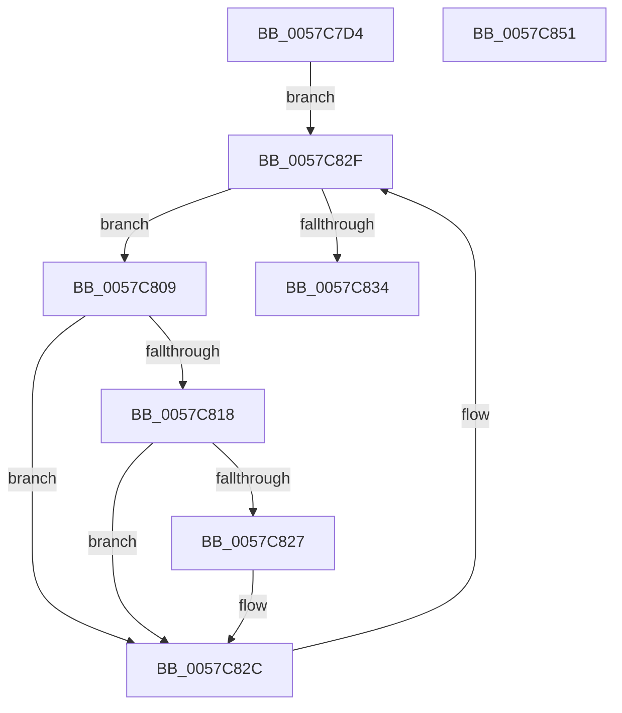

# CcWaitForCurrentLazyWriterActivityOnPartition

- RVA: `0x0057C7D4`–`0x0057C852` (길이 `126` bytes)
- VA: `0x000000014057C7D4`
- 실행 섹션: `.text`
- PDB 이름 있음: `예`; PDB Function 태그: `아니요`
- unwind 정보 RVA: `0x0005E6B4`
- 디코드: `39`개 명령, `126/126` bytes 표시
- 미해석 바이트: `0` (있으면 어셈블리에 `.byte`로 보존)

> 이 문서는 커널 이미지의 기계어와 PDB 기호를 분석해 생성했습니다. 4번과 5번은 함수 원형과 자료형을 바이너리 사용 방식에서 추정한 C 해석이며 원본 소스 복구 결과는 아닙니다.

## 1. Dependencies

- 직접 호출 지점: **1**; 고유 호출 대상: **1**
- 직접 호출자로 확인된 함수: **2**
- RIP 상대 이미지 참조: **0**

### Outgoing calls
- `0x0057C81E` → [CcWaitForCurrentLazyWriterActivityOnNode](CcWaitForCurrentLazyWriterActivityOnNode_function_0057C618.md) (function, `0x0057C618`)

### Direct callers
- [CcWaitForCurrentLazyWriterActivityHelper](CcWaitForCurrentLazyWriterActivityHelper_function_0057C5F0.md) at `0x0057C5F9`
- [CcExitPartition](CcExitPartition_function_0057E340.md) at `0x0057E399`

### Static image references
- 디코드된 RIP-relative 메모리 참조가 없습니다.

## 2. Other-region calls and transfers

- 다른 실행 섹션으로 향하는 call: **0**
- 별도 외부 분기/꼬리 이동을 확인하지 못했습니다.

## 3. Assembly (complete function range)

```asm
0057C7D4  48 8B C4                        mov rax, rsp
0057C7D7  48 89 58 08                     mov qword ptr [rax + 8], rbx
0057C7DB  48 89 68 10                     mov qword ptr [rax + 0x10], rbp
0057C7DF  48 89 70 18                     mov qword ptr [rax + 0x18], rsi
0057C7E3  48 89 78 20                     mov qword ptr [rax + 0x20], rdi
0057C7E7  41 56                           push r14
0057C7E9  48 83 EC 20                     sub rsp, 0x20
0057C7ED  33 DB                           xor ebx, ebx
0057C7EF  48 8D 41 10                     lea rax, [rcx + 0x10]
0057C7F3  48 85 D2                        test rdx, rdx
0057C7F6  48 8D 72 30                     lea rsi, [rdx + 0x30]
0057C7FA  48 8B EA                        mov rbp, rdx
0057C7FD  4C 8B F1                        mov r14, rcx
0057C800  48 0F 44 F0                     cmove rsi, rax
0057C804  48 8B 3E                        mov rdi, qword ptr [rsi]
0057C807  EB 26                           jmp 0x14057c82f
0057C809  4C 8D 47 E0                     lea r8, [rdi - 0x20]
0057C80D  B8 F6 02 00 00                  mov eax, 0x2f6
0057C812  66 41 39 00                     cmp word ptr [r8], ax
0057C816  75 14                           jne 0x14057c82c
0057C818  48 8B D5                        mov rdx, rbp
0057C81B  49 8B CE                        mov rcx, r14
0057C81E  E8 F5 FD FF FF                  call 0x14057c618
0057C823  85 DB                           test ebx, ebx
0057C825  78 05                           js 0x14057c82c
0057C827  85 C0                           test eax, eax
0057C829  0F 48 D8                        cmovs ebx, eax
0057C82C  48 8B 3F                        mov rdi, qword ptr [rdi]
0057C82F  48 3B FE                        cmp rdi, rsi
0057C832  75 D5                           jne 0x14057c809
0057C834  48 8B 6C 24 38                  mov rbp, qword ptr [rsp + 0x38]
0057C839  8B C3                           mov eax, ebx
0057C83B  48 8B 5C 24 30                  mov rbx, qword ptr [rsp + 0x30]
0057C840  48 8B 74 24 40                  mov rsi, qword ptr [rsp + 0x40]
0057C845  48 8B 7C 24 48                  mov rdi, qword ptr [rsp + 0x48]
0057C84A  48 83 C4 20                     add rsp, 0x20
0057C84E  41 5E                           pop r14
0057C850  C3                              ret
0057C851  CC                              int3
```

## 4. C-style interpretation (structured pseudocode)

```c
__int64 __fastcall CcWaitForCurrentLazyWriterActivityOnPartition(__int64 a1, __int64 a2)
{
    __int64 result;
    __int64 v_rbx;
    __int64 v_rsi;
    __int64 v_rsp;
    unsigned __int64 v_stack_p10;
    unsigned __int64 v_stack_p18;
    unsigned __int64 v_stack_p20;
    unsigned __int64 v_stack_p8;

    *(unsigned __int64 *)(v_rsp + 8) = v_rbx;
    *(unsigned __int64 *)(v_rsp + 16) = v_rbp;
    *(unsigned __int64 *)(v_rsp + 24) = v_rsi;
    *(unsigned __int64 *)(v_rsp + 32) = v_rdi;
    v_rsp = (v_rsp) - (32);
    v_rbx = 0;
    v_rsi = a2 + 48;
    if (a2 == 0) { v_rsi = a1 + 16; }
    goto loc_0057C82F;
loc_0057C809:
    if ((*(unsigned __int16 *)(*(unsigned __int64 *)(v_rsi) - 32)) != 758) goto loc_0057C82C;
    result = CcWaitForCurrentLazyWriterActivityOnNode(a1, a2, *(unsigned __int64 *)(v_rsi) - 32, a4);
    if (!(sign_flag)) {
        if (sign_flag) { v_rbx = (unsigned int)(result); }
    }
loc_0057C82F:
    if ((*(unsigned __int64 *)(*(unsigned __int64 *)(v_rsi))) != v_rsi) goto loc_0057C809;
    v_rsp = (v_rsp) + (32);
    return (unsigned int)((unsigned int)(v_rbx));
}
```

## 5. (Beta) C Style

```c
int64_t CcWaitForCurrentLazyWriterActivityOnPartition(void *Arg1, int64_t Arg2)
{
    uint8_t *arg1 = (uint8_t *)Arg1;

    int64_t result;
    int64_t local_rbx;
    int64_t local_rsi;
    int64_t local_rsp;
    uint64_t v_stack_p10;
    uint64_t v_stack_p18;
    uint64_t v_stack_p20;
    uint64_t v_stack_p8;

    *(uint64_t *)(local_rsp + 0x8) = local_rbx;
    *(uint64_t *)(local_rsp + 0x10) = local_rbp;
    *(uint64_t *)(local_rsp + 0x18) = local_rsi;
    *(uint64_t *)(local_rsp + 0x20) = local_rdi;
    local_rsp = (local_rsp) - (32);
    local_rbx = 0;
    local_rsi = Arg2 + 48;
    if (Arg2 == 0) { local_rsi = Arg1 + 16; }
    goto loc_0057C82F;
loc_0057C809:
    if ((*(uint16_t *)(*(uint64_t *)(local_rsi) - 0x20)) != 758) goto loc_0057C82C;
    result = CcWaitForCurrentLazyWriterActivityOnNode(Arg1, Arg2, *(uint64_t *)(local_rsi) - 32, a4);
    if (!(sign_flag)) {
        if (sign_flag) { local_rbx = (uint32_t)(result); }
    }
loc_0057C82F:
    if ((*(uint64_t *)(*(uint64_t *)(local_rsi))) != local_rsi) goto loc_0057C809;
    local_rsp = (local_rsp) + (32);
    return (uint32_t)((uint32_t)(local_rbx));
}
```

### 관측된 메모리 오프셋

구조체 형식이 확인되지 않은 접근은 인자 기준의 오프셋으로만 기록했습니다.

| 기준 인자 | 오프셋 표현 | 폭 (bit) | 접근 |
|---|---:|---:|---|
| `Arg1` | `+ 0x10` | `64` | `R` |

## 6. Execution-region graph

[열기: 2D/3D 그래프와 함수 탐색 컨트롤 패널](../../../control-panel.html?section=text&rva=0x0057C7D4&view=graph)

- 2D 그래프는 위에서 아래로 흐르고, 3D 그래프는 빈 공간을 드래그해 회전합니다. Shift+드래그는 이동, 휠은 확대·축소, 함수 노드 선택은 대상 보고서 이동입니다.

### Static fallback


