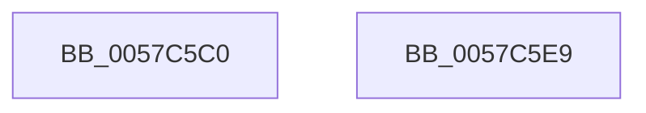

# CcWaitForCurrentLazyWriterActivity

- RVA: `0x0057C5C0`–`0x0057C5EA` (길이 `42` bytes)
- VA: `0x000000014057C5C0`
- 실행 섹션: `.text`
- PDB 이름 있음: `예`; PDB Function 태그: `아니요`
- unwind 정보 RVA: `0x0005C788`
- 디코드: `11`개 명령, `42/42` bytes 표시
- 미해석 바이트: `0` (있으면 어셈블리에 `.byte`로 보존)

> 이 문서는 커널 이미지의 기계어와 PDB 기호를 분석해 생성했습니다. 4번과 5번은 함수 원형과 자료형을 바이너리 사용 방식에서 추정한 C 해석이며 원본 소스 복구 결과는 아닙니다.

## 1. Dependencies

- 직접 호출 지점: **1**; 고유 호출 대상: **1**
- 직접 호출자로 확인된 함수: **1**
- RIP 상대 이미지 참조: **1**

### Outgoing calls
- `0x0057C5DB` → [CcForEachPartition](../2F/CcForEachPartition_function_002F0828.md) (function, `0x002F0828`)

### Direct callers
- [PopGracefulShutdown](../../pagelk/B6/PopGracefulShutdown_function_00B6BEC8.md) at `0x00B6C11C`

### Static image references
- `0x0057C5D1` → RVA `0x0057C5F0` (`CcWaitForCurrentLazyWriterActivityHelper`; read)

## 2. Other-region calls and transfers

- 다른 실행 섹션으로 향하는 call: **0**
- 별도 외부 분기/꼬리 이동을 확인하지 못했습니다.

## 3. Assembly (complete function range)

```asm
0057C5C0  48 83 EC 28                     sub rsp, 0x28
0057C5C4  83 64 24 30 00                  and dword ptr [rsp + 0x30], 0
0057C5C9  48 8D 54 24 30                  lea rdx, [rsp + 0x30]
0057C5CE  45 33 C9                        xor r9d, r9d
0057C5D1  48 8D 0D 18 00 00 00            lea rcx, [rip + 0x18]
0057C5D8  45 33 C0                        xor r8d, r8d
0057C5DB  E8 48 42 D7 FF                  call 0x1402f0828
0057C5E0  8B 44 24 30                     mov eax, dword ptr [rsp + 0x30]
0057C5E4  48 83 C4 28                     add rsp, 0x28
0057C5E8  C3                              ret
0057C5E9  CC                              int3
```

## 4. C-style interpretation (structured pseudocode)

```c
__int64 __fastcall CcWaitForCurrentLazyWriterActivity(__int64 a1, __int64 a2, int a3, int a4)
{
    __int64 result;
    __int64 v_rsp;
    unsigned int v_stack_p8;

    v_rsp = (v_rsp) - (40);
    a4 = 0;
    a3 = 0;
    result = CcForEachPartition(v_rip + 24, v_stack_p8, a3, a4);
    v_rsp = (v_rsp) + (40);
    return (unsigned int)(v_stack_p8);
}
```

## 5. (Beta) C Style

```c
int64_t CcWaitForCurrentLazyWriterActivity(int64_t Arg1, int64_t Arg2, int32_t Arg3, int32_t Arg4)
{
    int64_t result;
    int64_t local_rsp;
    uint32_t v_stack_p8;

    local_rsp = (local_rsp) - (40);
    Arg4 = 0;
    Arg3 = 0;
    result = CcForEachPartition(v_rip + 24, v_stack_p8, Arg3, Arg4);
    local_rsp = (local_rsp) + (40);
    return (uint32_t)(v_stack_p8);
}
```

## 6. Execution-region graph

[열기: 2D/3D 그래프와 함수 탐색 컨트롤 패널](../../../control-panel.html?section=text&rva=0x0057C5C0&view=graph)

- 2D 그래프는 위에서 아래로 흐르고, 3D 그래프는 빈 공간을 드래그해 회전합니다. Shift+드래그는 이동, 휠은 확대·축소, 함수 노드 선택은 대상 보고서 이동입니다.

### Static fallback


