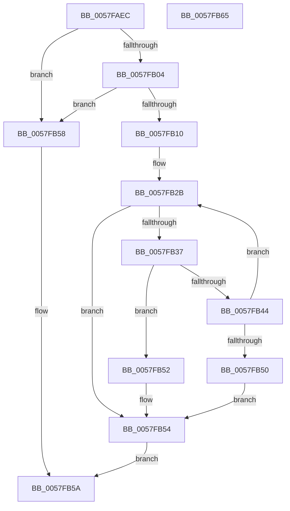

# CcWriteBehindAsyncFlushOneRange

- RVA: `0x0057FAEC`–`0x0057FB66` (길이 `122` bytes)
- VA: `0x000000014057FAEC`
- 실행 섹션: `.text`
- PDB 이름 있음: `예`; PDB Function 태그: `아니요`
- unwind 정보 RVA: `0x0005CAAC`
- 디코드: `39`개 명령, `122/122` bytes 표시
- 미해석 바이트: `0` (있으면 어셈블리에 `.byte`로 보존)

> 이 문서는 커널 이미지의 기계어와 PDB 기호를 분석해 생성했습니다. 4번과 5번은 함수 원형과 자료형을 바이너리 사용 방식에서 추정한 C 해석이며 원본 소스 복구 결과는 아닙니다.

## 1. Dependencies

- 직접 호출 지점: **3**; 고유 호출 대상: **3**
- 직접 호출자로 확인된 함수: **1**
- RIP 상대 이미지 참조: **0**

### Outgoing calls
- `0x0057FB2E` → [CcFlushCacheAcquireRange](../35/CcFlushCacheAcquireRange_function_0035A408.md) (function, `0x0035A408`)
- `0x0057FB3A` → [CcFlushCacheOneRange](../23/CcFlushCacheOneRange_function_00236A30.md) (function, `0x00236A30`)
- `0x0057FB47` → [CcFlushCachePostProcessOneRange](../35/CcFlushCachePostProcessOneRange_function_00359710.md) (function, `0x00359710`)

### Direct callers
- [CcAsyncLazywriteWorkerMulti](../4D/CcAsyncLazywriteWorkerMulti_function_004D1574.md) at `0x004D1902`
- [CcAsyncLazywriteWorkerMulti](../4D/CcAsyncLazywriteWorkerMulti_function_004D1574.md) at `0x004D19D4`

### Static image references
- 디코드된 RIP-relative 메모리 참조가 없습니다.

## 2. Other-region calls and transfers

- 다른 실행 섹션으로 향하는 call: **0**
- 별도 외부 분기/꼬리 이동을 확인하지 못했습니다.

## 3. Assembly (complete function range)

```asm
0057FAEC  48 89 5C 24 08                  mov qword ptr [rsp + 8], rbx
0057FAF1  57                              push rdi
0057FAF2  48 83 EC 20                     sub rsp, 0x20
0057FAF6  48 8B 41 10                     mov rax, qword ptr [rcx + 0x10]
0057FAFA  33 DB                           xor ebx, ebx
0057FAFC  48 8B F9                        mov rdi, rcx
0057FAFF  48 85 C0                        test rax, rax
0057FB02  74 54                           je 0x14057fb58
0057FB04  F7 80 98 00 00 00 00 00 00 04   test dword ptr [rax + 0x98], 0x4000000
0057FB0E  75 48                           jne 0x14057fb58
0057FB10  48 8B 41 48                     mov rax, qword ptr [rcx + 0x48]
0057FB14  66 C7 00 01 00                  mov word ptr [rax], 1
0057FB19  C6 40 02 06                     mov byte ptr [rax + 2], 6
0057FB1D  89 58 04                        mov dword ptr [rax + 4], ebx
0057FB20  48 83 C0 08                     add rax, 8
0057FB24  48 89 40 08                     mov qword ptr [rax + 8], rax
0057FB28  48 89 00                        mov qword ptr [rax], rax
0057FB2B  48 8B CF                        mov rcx, rdi
0057FB2E  E8 D5 A8 DD FF                  call 0x14035a408
0057FB33  84 C0                           test al, al
0057FB35  74 1D                           je 0x14057fb54
0057FB37  48 8B CF                        mov rcx, rdi
0057FB3A  E8 F1 6E CB FF                  call 0x140236a30
0057FB3F  39 5F 3C                        cmp dword ptr [rdi + 0x3c], ebx
0057FB42  74 0E                           je 0x14057fb52
0057FB44  48 8B CF                        mov rcx, rdi
0057FB47  E8 C4 9B DD FF                  call 0x140359710
0057FB4C  84 C0                           test al, al
0057FB4E  75 DB                           jne 0x14057fb2b
0057FB50  EB 02                           jmp 0x14057fb54
0057FB52  B3 01                           mov bl, 1
0057FB54  8A C3                           mov al, bl
0057FB56  EB 02                           jmp 0x14057fb5a
0057FB58  32 C0                           xor al, al
0057FB5A  48 8B 5C 24 30                  mov rbx, qword ptr [rsp + 0x30]
0057FB5F  48 83 C4 20                     add rsp, 0x20
0057FB63  5F                              pop rdi
0057FB64  C3                              ret
0057FB65  CC                              int3
```

## 4. C-style interpretation (structured pseudocode)

```c
__int64 __fastcall CcWriteBehindAsyncFlushOneRange(__int64 a1)
{
    __int64 result;
    __int64 v_rbx;
    __int64 v_rsp;
    unsigned __int64 v_stack_p8;

    v_stack_p8 = v_rbx;
    v_rsp = (v_rsp) - (32);
    v_rbx = 0;
    if (*(unsigned __int64 *)(a1 + 16) == 0) goto loc_0057FB58;
    if (((*(unsigned int *)(*(unsigned __int64 *)(a1 + 16) + 152)) & (0x4000000ULL)) != 0) goto loc_0057FB58;
    *(unsigned __int16 *)(*(unsigned __int64 *)(a1 + 72)) = 1;
    *(unsigned __int8 *)(*(unsigned __int64 *)(a1 + 72) + 2) = 6;
    *(unsigned int *)(*(unsigned __int64 *)(a1 + 72) + 4) = 0;
    result = (*(unsigned __int64 *)(a1 + 72)) + (8);
    *(unsigned __int64 *)(result + 8) = result;
    *(unsigned __int64 *)(result) = result;
loc_0057FB2B:
    result = CcFlushCacheAcquireRange(a1, a2, a3, a4);
    if ((unsigned __int8)(result) == 0) goto loc_0057FB54;
    result = CcFlushCacheOneRange(a1, a2, a3, a4);
    if ((*(unsigned int *)(a1 + 60)) == 0) goto loc_0057FB52;
    result = CcFlushCachePostProcessOneRange(a1, a2, a3, a4);
    if ((unsigned __int8)(result) != 0) goto loc_0057FB2B;
    goto loc_0057FB54;
loc_0057FB52:
loc_0057FB54:
    goto loc_0057FB5A;
loc_0057FB58:
    result = 0;
loc_0057FB5A:
    v_rsp = (v_rsp) + (32);
    return result;
}
```

## 5. (Beta) C Style

```c
int64_t CcWriteBehindAsyncFlushOneRange(void *Arg1)
{
    uint8_t *arg1 = (uint8_t *)Arg1;

    int64_t result;
    int64_t local_rbx;
    int64_t local_rsp;
    uint64_t v_stack_p8;

    v_stack_p8 = local_rbx;
    local_rsp = (local_rsp) - (32);
    local_rbx = 0;
    if (*(uint64_t *)(arg1 + 0x10) == 0) goto loc_0057FB58;
    if (((*(uint32_t *)(*(uint64_t *)(arg1 + 0x10) + 0x98)) & (0x4000000ULL)) != 0) goto loc_0057FB58;
    *(uint16_t *)(*(uint64_t *)(arg1 + 0x48)) = 1;
    *(uint8_t *)(*(uint64_t *)(arg1 + 0x48) + 0x2) = 6;
    *(uint32_t *)(*(uint64_t *)(arg1 + 0x48) + 0x4) = 0;
    result = (*(uint64_t *)(arg1 + 0x48)) + (8);
    *(uint64_t *)(result + 0x8) = result;
    *(uint64_t *)(result) = result;
loc_0057FB2B:
    result = CcFlushCacheAcquireRange(Arg1, a2, a3, a4);
    if ((uint8_t)(result) == 0) goto loc_0057FB54;
    result = CcFlushCacheOneRange(Arg1, a2, a3, a4);
    if ((*(uint32_t *)(arg1 + 0x3C)) == 0) goto loc_0057FB52;
    result = CcFlushCachePostProcessOneRange(Arg1, a2, a3, a4);
    if ((uint8_t)(result) != 0) goto loc_0057FB2B;
    goto loc_0057FB54;
loc_0057FB52:
loc_0057FB54:
    goto loc_0057FB5A;
loc_0057FB58:
    result = 0;
loc_0057FB5A:
    local_rsp = (local_rsp) + (32);
    return result;
}
```

### 관측된 메모리 오프셋

구조체 형식이 확인되지 않은 접근은 인자 기준의 오프셋으로만 기록했습니다.

| 기준 인자 | 오프셋 표현 | 폭 (bit) | 접근 |
|---|---:|---:|---|
| `Arg1` | `+ 0x10` | `64` | `R` |
| `Arg1` | `+ 0x3C` | `32` | `R` |
| `Arg1` | `+ 0x48` | `64` | `R` |

## 6. Execution-region graph

[열기: 2D/3D 그래프와 함수 탐색 컨트롤 패널](../../../control-panel.html?section=text&rva=0x0057FAEC&view=graph)

- 2D 그래프는 위에서 아래로 흐르고, 3D 그래프는 빈 공간을 드래그해 회전합니다. Shift+드래그는 이동, 휠은 확대·축소, 함수 노드 선택은 대상 보고서 이동입니다.

### Static fallback


