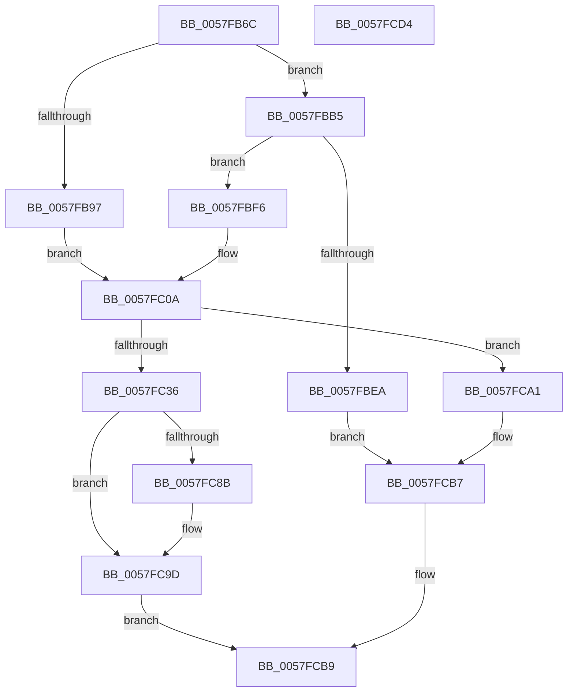

# CcWriteBehindAsyncPreProcess

- RVA: `0x0057FB6C`–`0x0057FCD5` (길이 `361` bytes)
- VA: `0x000000014057FB6C`
- 실행 섹션: `.text`
- PDB 이름 있음: `예`; PDB Function 태그: `아니요`
- unwind 정보 RVA: `0x000B5F04`
- 디코드: `82`개 명령, `361/361` bytes 표시
- 미해석 바이트: `0` (있으면 어셈블리에 `.byte`로 보존)

> 이 문서는 커널 이미지의 기계어와 PDB 기호를 분석해 생성했습니다. 4번과 5번은 함수 원형과 자료형을 바이너리 사용 방식에서 추정한 C 해석이며 원본 소스 복구 결과는 아닙니다.

## 1. Dependencies

- 직접 호출 지점: **6**; 고유 호출 대상: **5**
- 직접 호출자로 확인된 함수: **1**
- RIP 상대 이미지 참조: **2**

### Outgoing calls
- `0x0057FBA8` → [memset](../6C/memset_function_006C6C40.md) (function, `0x006C6C40`)
- `0x0057FBDD` → [ExAllocatePoolWithTagFromNode](../35/ExAllocatePoolWithTagFromNode_function_0035A944.md) (function, `0x0035A944`)
- `0x0057FC01` → [memset](../6C/memset_function_006C6C40.md) (function, `0x006C6C40`)
- `0x0057FC2B` → [CcWriteBehindPreProcess](../35/CcWriteBehindPreProcess_function_00357784.md) (function, `0x00357784`)
- `0x0057FC81` → [DbgPrintEx](../35/DbgPrintEx_function_00359290.md) (function, `0x00359290`)
- `0x0057FC93` → [ExFreePoolWithTag](../../poolcode/B8/ExFreePoolWithTag_function_00B82870.md) (function, `0x00B82870`)

### Direct callers
- [CcAsyncLazywriteWorkerMulti](../4D/CcAsyncLazywriteWorkerMulti_function_004D1574.md) at `0x004D18C5`

### Static image references
- `0x0057FC6F` → RVA `0x006C9200` (` ?? ::FNODOBFM::`string'`; read)
- `0x0057FCA1` → RVA `0x00F8F4F0` (`.data`; read)

## 2. Other-region calls and transfers

- 다른 실행 섹션으로 향하는 call: **1**
  - `0x0057FC93` → [ExFreePoolWithTag](../../poolcode/B8/ExFreePoolWithTag_function_00B82870.md) (`.text` → `POOLCODE`)
- 별도 외부 분기/꼬리 이동을 확인하지 못했습니다.

## 3. Assembly (complete function range)

```asm
0057FB6C  48 8B C4                        mov rax, rsp
0057FB6F  48 89 58 08                     mov qword ptr [rax + 8], rbx
0057FB73  48 89 70 10                     mov qword ptr [rax + 0x10], rsi
0057FB77  48 89 78 18                     mov qword ptr [rax + 0x18], rdi
0057FB7B  4C 89 70 20                     mov qword ptr [rax + 0x20], r14
0057FB7F  41 57                           push r15
0057FB81  48 83 EC 40                     sub rsp, 0x40
0057FB85  48 8B 79 10                     mov rdi, qword ptr [rcx + 0x10]
0057FB89  4D 8B F8                        mov r15, r8
0057FB8C  4C 8B F2                        mov r14, rdx
0057FB8F  48 8B F1                        mov rsi, rcx
0057FB92  48 85 FF                        test rdi, rdi
0057FB95  74 1E                           je 0x14057fbb5
0057FB97  8B 9F 00 01 00 00               mov ebx, dword ptr [rdi + 0x100]
0057FB9D  33 D2                           xor edx, edx
0057FB9F  41 B8 10 01 00 00               mov r8d, 0x110
0057FBA5  48 8B CF                        mov rcx, rdi
0057FBA8  E8 93 70 14 00                  call 0x1406c6c40
0057FBAD  89 9F 00 01 00 00               mov dword ptr [rdi + 0x100], ebx
0057FBB3  EB 55                           jmp 0x14057fc0a
0057FBB5  65 48 8B 04 25 20 00 00 00      mov rax, qword ptr gs:[0x20]
0057FBBE  BA 10 01 00 00                  mov edx, 0x110
0057FBC3  41 B8 43 63 57 42               mov r8d, 0x42576343
0057FBC9  48 8B 88 C0 00 00 00            mov rcx, qword ptr [rax + 0xc0]
0057FBD0  44 0F B7 89 8A 00 00 00         movzx r9d, word ptr [rcx + 0x8a]
0057FBD8  41 0F BA E9 1F                  bts r9d, 0x1f
0057FBDD  E8 62 AD DD FF                  call 0x14035a944
0057FBE2  48 8B F8                        mov rdi, rax
0057FBE5  48 85 C0                        test rax, rax
0057FBE8  75 0C                           jne 0x14057fbf6
0057FBEA  41 C7 06 9A 00 00 C0            mov dword ptr [r14], 0xc000009a
0057FBF1  E9 C1 00 00 00                  jmp 0x14057fcb7
0057FBF6  33 D2                           xor edx, edx
0057FBF8  41 B8 10 01 00 00               mov r8d, 0x110
0057FBFE  48 8B CF                        mov rcx, rdi
0057FC01  E8 3A 70 14 00                  call 0x1406c6c40
0057FC06  48 89 7E 10                     mov qword ptr [rsi + 0x10], rdi
0057FC0A  49 89 76 08                     mov qword ptr [r14 + 8], rsi
0057FC0E  48 8B CF                        mov rcx, rdi
0057FC11  66 83 A7 88 00 00 00 00         and word ptr [rdi + 0x88], 0
0057FC19  4C 89 77 70                     mov qword ptr [rdi + 0x70], r14
0057FC1D  48 89 B7 08 01 00 00            mov qword ptr [rdi + 0x108], rsi
0057FC24  C6 87 8B 00 00 00 00            mov byte ptr [rdi + 0x8b], 0
0057FC2B  E8 54 7B DD FF                  call 0x140357784
0057FC30  8B D8                           mov ebx, eax
0057FC32  85 C0                           test eax, eax
0057FC34  74 6B                           je 0x14057fca1
0057FC36  65 4C 8B 14 25 88 01 00 00      mov r10, qword ptr gs:[0x188]
0057FC3F  BA 03 00 00 00                  mov edx, 3
0057FC44  4C 8B 86 90 00 00 00            mov r8, qword ptr [rsi + 0x90]
0057FC4B  65 4C 8B 0C 25 88 01 00 00      mov r9, qword ptr gs:[0x188]
0057FC54  41 8B 48 18                     mov ecx, dword ptr [r8 + 0x18]
0057FC58  45 8B 89 08 05 00 00            mov r9d, dword ptr [r9 + 0x508]
0057FC5F  89 4C 24 38                     mov dword ptr [rsp + 0x38], ecx
0057FC63  41 8B 8A 10 05 00 00            mov ecx, dword ptr [r10 + 0x510]
0057FC6A  4C 89 44 24 30                  mov qword ptr [rsp + 0x30], r8
0057FC6F  4C 8D 05 8A 95 14 00            lea r8, [rip + 0x14958a]
0057FC76  89 44 24 28                     mov dword ptr [rsp + 0x28], eax
0057FC7A  89 4C 24 20                     mov dword ptr [rsp + 0x20], ecx
0057FC7E  8D 4A 7C                        lea ecx, [rdx + 0x7c]
0057FC81  E8 0A 96 DD FF                  call 0x140359290
0057FC86  83 FB 02                        cmp ebx, 2
0057FC89  75 12                           jne 0x14057fc9d
0057FC8B  BA 43 63 57 42                  mov edx, 0x42576343
0057FC90  48 8B CF                        mov rcx, rdi
0057FC93  E8 D8 2B 60 00                  call 0x140b82870
0057FC98  48 83 66 10 00                  and qword ptr [rsi + 0x10], 0
0057FC9D  8B C3                           mov eax, ebx
0057FC9F  EB 18                           jmp 0x14057fcb9
0057FCA1  48 8D 05 48 F8 A0 00            lea rax, [rip + 0xa0f848]
0057FCA8  C7 47 68 01 00 00 00            mov dword ptr [rdi + 0x68], 1
0057FCAF  48 89 47 60                     mov qword ptr [rdi + 0x60], rax
0057FCB3  4C 89 7F 48                     mov qword ptr [rdi + 0x48], r15
0057FCB7  33 C0                           xor eax, eax
0057FCB9  48 8B 5C 24 50                  mov rbx, qword ptr [rsp + 0x50]
0057FCBE  48 8B 74 24 58                  mov rsi, qword ptr [rsp + 0x58]
0057FCC3  48 8B 7C 24 60                  mov rdi, qword ptr [rsp + 0x60]
0057FCC8  4C 8B 74 24 68                  mov r14, qword ptr [rsp + 0x68]
0057FCCD  48 83 C4 40                     add rsp, 0x40
0057FCD1  41 5F                           pop r15
0057FCD3  C3                              ret
0057FCD4  CC                              int3
```

## 4. C-style interpretation (structured pseudocode)

```c
__int64 __fastcall CcWriteBehindAsyncPreProcess(__int64 a1, __int64 a2, __int64 a3)
{
    __int64 result;
    __int64 v_rsp;
    unsigned int v_stack_m10;
    unsigned __int64 v_stack_m18;
    unsigned int v_stack_m20;
    unsigned int v_stack_m28;
    unsigned __int64 v_stack_p10;
    unsigned __int64 v_stack_p18;
    unsigned __int64 v_stack_p20;
    unsigned __int64 v_stack_p8;

    *(unsigned __int64 *)(v_rsp + 8) = v_rbx;
    *(unsigned __int64 *)(v_rsp + 16) = v_rsi;
    *(unsigned __int64 *)(v_rsp + 24) = v_rdi;
    *(unsigned __int64 *)(v_rsp + 32) = v_r14;
    v_rsp = (v_rsp) - (64);
    if (*(unsigned __int64 *)(a1 + 16) == 0) goto loc_0057FBB5;
    a2 = 0;
    result = memset(*(unsigned __int64 *)(a1 + 16), a2, 272, a4);
    *(unsigned int *)(*(unsigned __int64 *)(a1 + 16) + 256) = (unsigned int)((unsigned int)(*(unsigned int *)(*(unsigned __int64 *)(a1 + 16) + 256)));
    goto loc_0057FC0A;
loc_0057FBB5:
    result = ExAllocatePoolWithTagFromNode(*(unsigned __int64 *)(*(unsigned __int64 *)(gs_base + (0 + 32)) + 192), 272, (unsigned int)(0x42576343ULL), *(unsigned __int16 *)(*(unsigned __int64 *)(*(unsigned __int64 *)(gs_base + (0 + 32)) + 192) + 138));
    if (result != 0) goto loc_0057FBF6;
    *(unsigned int *)(a2) = 0xC000009AULL;
    goto loc_0057FCB7;
loc_0057FBF6:
    a2 = 0;
    result = memset(result, a2, 272, *(unsigned __int16 *)(*(unsigned __int64 *)(*(unsigned __int64 *)(gs_base + (0 + 32)) + 192) + 138));
    *(unsigned __int64 *)(a1 + 16) = result;
loc_0057FC0A:
    *(unsigned __int64 *)(a2 + 8) = a1;
    *(unsigned __int64 *)(result + 112) = 0;
    *(unsigned __int64 *)(result + 264) = a1;
    *(unsigned __int8 *)(result + 139) = 0;
    result = CcWriteBehindPreProcess(result, a2, 272, *(unsigned __int16 *)(*(unsigned __int64 *)(*(unsigned __int64 *)(gs_base + (0 + 32)) + 192) + 138));
    if ((unsigned int)(result) == 0) goto loc_0057FCA1;
    v_stack_m10 = (unsigned int)((unsigned int)(*(unsigned int *)(*(unsigned __int64 *)(a1 + 144) + 24)));
    v_stack_m18 = *(unsigned __int64 *)(a1 + 144);
    v_stack_m20 = (unsigned int)(result);
    v_stack_m28 = (unsigned int)((unsigned int)(*(unsigned int *)(*(unsigned __int64 *)(gs_base + (0 + 392)) + 1296)));
    result = DbgPrintEx(3 + 124, 3, v_rip + 1349002, (unsigned int)(*(unsigned int *)(*(unsigned __int64 *)(gs_base + (0 + 392)) + 1288)));
    if (((unsigned int)((unsigned int)((unsigned int)(result)))) == 2) {
        a2 = 0x42576343ULL;
        a1 = result;
        result = ExFreePoolWithTag(a1, a2, v_rip + 1349002, (unsigned int)(*(unsigned int *)(*(unsigned __int64 *)(gs_base + (0 + 392)) + 1288)));
    }
    goto loc_0057FCB9;
loc_0057FCA1:
    *(unsigned int *)(result + 104) = 1;
    *(unsigned __int64 *)(result + 96) = v_rip + 10549320;
    *(unsigned __int64 *)(result + 72) = a3;
loc_0057FCB7:
    result = 0;
loc_0057FCB9:
    v_rsp = (v_rsp) + (64);
    return result;
}
```

## 5. (Beta) C Style

```c
int64_t CcWriteBehindAsyncPreProcess(void *Arg1, void *Arg2, int64_t Arg3)
{
    uint8_t *arg1 = (uint8_t *)Arg1;
    uint8_t *arg2 = (uint8_t *)Arg2;

    int64_t result;
    int64_t local_rsp;
    uint32_t v_stack_m10;
    uint64_t v_stack_m18;
    uint32_t v_stack_m20;
    uint32_t v_stack_m28;
    uint64_t v_stack_p10;
    uint64_t v_stack_p18;
    uint64_t v_stack_p20;
    uint64_t v_stack_p8;

    *(uint64_t *)(local_rsp + 0x8) = local_rbx;
    *(uint64_t *)(local_rsp + 0x10) = local_rsi;
    *(uint64_t *)(local_rsp + 0x18) = local_rdi;
    *(uint64_t *)(local_rsp + 0x20) = local_r14;
    local_rsp = (local_rsp) - (64);
    if (*(uint64_t *)(arg1 + 0x10) == 0) goto loc_0057FBB5;
    Arg2 = 0;
    result = memset(*(uint64_t *)(arg1 + 0x10), Arg2, 272, a4);
    *(uint32_t *)(*(uint64_t *)(arg1 + 0x10) + 0x100) = (uint32_t)((uint32_t)(*(uint32_t *)(*(uint64_t *)(arg1 + 0x10) + 0x100)));
    goto loc_0057FC0A;
loc_0057FBB5:
    result = ExAllocatePoolWithTagFromNode(*(uint64_t *)(*(uint64_t *)(gs_base + (0 + 0x20)) + 0xC0), 272, (uint32_t)(0x42576343ULL), *(uint16_t *)(*(uint64_t *)(*(uint64_t *)(gs_base + (0 + 0x20)) + 0xC0) + 0x8A));
    if (result != 0) goto loc_0057FBF6;
    *(uint32_t *)(arg2) = 0xC000009AULL;
    goto loc_0057FCB7;
loc_0057FBF6:
    Arg2 = 0;
    result = memset(result, Arg2, 272, *(uint16_t *)(*(uint64_t *)(*(uint64_t *)(gs_base + (0 + 0x20)) + 0xC0) + 0x8A));
    *(uint64_t *)(arg1 + 0x10) = result;
loc_0057FC0A:
    *(void **)(arg2 + 0x8) = Arg1;
    *(uint64_t *)(result + 0x70) = 0;
    *(void **)(result + 0x108) = Arg1;
    *(uint8_t *)(result + 0x8B) = 0;
    result = CcWriteBehindPreProcess(result, Arg2, 272, *(uint16_t *)(*(uint64_t *)(*(uint64_t *)(gs_base + (0 + 0x20)) + 0xC0) + 0x8A));
    if ((uint32_t)(result) == 0) goto loc_0057FCA1;
    v_stack_m10 = (uint32_t)((uint32_t)(*(uint32_t *)(*(uint64_t *)(arg1 + 0x90) + 0x18)));
    v_stack_m18 = *(uint64_t *)(arg1 + 0x90);
    v_stack_m20 = (uint32_t)(result);
    v_stack_m28 = (uint32_t)((uint32_t)(*(uint32_t *)(*(uint64_t *)(gs_base + (0 + 0x188)) + 0x510)));
    result = DbgPrintEx(3 + 124, 3, v_rip + 1349002, (uint32_t)(*(uint32_t *)(*(uint64_t *)(gs_base + (0 + 0x188)) + 0x508)));
    if (((uint32_t)((uint32_t)((uint32_t)(result)))) == 2) {
        Arg2 = 0x42576343ULL;
        Arg1 = result;
        result = ExFreePoolWithTag(Arg1, Arg2, v_rip + 1349002, (uint32_t)(*(uint32_t *)(*(uint64_t *)(gs_base + (0 + 0x188)) + 0x508)));
    }
    goto loc_0057FCB9;
loc_0057FCA1:
    *(uint32_t *)(result + 0x68) = 1;
    *(uint64_t *)(result + 0x60) = v_rip + 10549320;
    *(uint64_t *)(result + 0x48) = Arg3;
loc_0057FCB7:
    result = 0;
loc_0057FCB9:
    local_rsp = (local_rsp) + (64);
    return result;
}
```

### 관측된 메모리 오프셋

구조체 형식이 확인되지 않은 접근은 인자 기준의 오프셋으로만 기록했습니다.

| 기준 인자 | 오프셋 표현 | 폭 (bit) | 접근 |
|---|---:|---:|---|
| `Arg1` | `+ 0x10` | `64` | `R` |
| `Arg1` | `+ 0x10` | `64` | `R/W` |
| `Arg1` | `+ 0x10` | `64` | `W` |
| `Arg1` | `+ 0x90` | `64` | `R` |
| `Arg2` | `+ 0x0` | `32` | `W` |
| `Arg2` | `+ 0x8` | `64` | `W` |

## 6. Execution-region graph

[열기: 2D/3D 그래프와 함수 탐색 컨트롤 패널](../../../control-panel.html?section=text&rva=0x0057FB6C&view=graph)

- 2D 그래프는 위에서 아래로 흐르고, 3D 그래프는 빈 공간을 드래그해 회전합니다. Shift+드래그는 이동, 휠은 확대·축소, 함수 노드 선택은 대상 보고서 이동입니다.

### Static fallback


