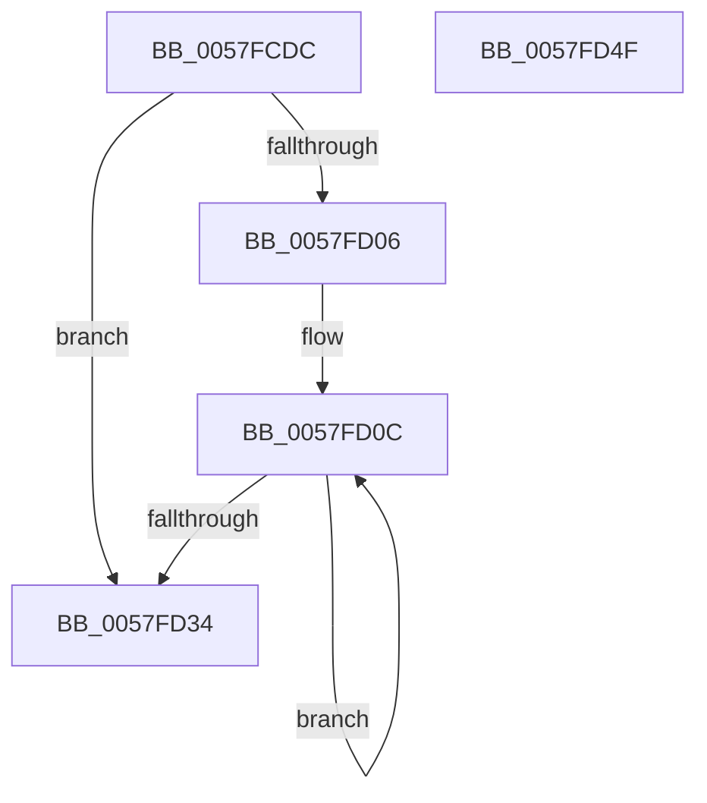

# DbgkPostEnclaveModuleMessages

- RVA: `0x0057FCDC`–`0x0057FD50` (길이 `116` bytes)
- VA: `0x000000014057FCDC`
- 실행 섹션: `.text`
- PDB 이름 있음: `예`; PDB Function 태그: `아니요`
- unwind 정보 RVA: `0x0005D7BC`
- 디코드: `34`개 명령, `116/116` bytes 표시
- 미해석 바이트: `0` (있으면 어셈블리에 `.byte`로 보존)

> 이 문서는 커널 이미지의 기계어와 PDB 기호를 분석해 생성했습니다. 4번과 5번은 함수 원형과 자료형을 바이너리 사용 방식에서 추정한 C 해석이며 원본 소스 복구 결과는 아닙니다.

## 1. Dependencies

- 직접 호출 지점: **1**; 고유 호출 대상: **1**
- 직접 호출자로 확인된 함수: **1**
- RIP 상대 이미지 참조: **0**

### Outgoing calls
- `0x0057FD25` → [DbgkPostModuleMessage](../49/DbgkPostModuleMessage_function_004913C4.md) (function, `0x004913C4`)

### Direct callers
- [sub_00B3E1FA](../../page/B3/Unknown_function_00B3E1FA.md) at `0x00B3E20D`

### Static image references
- 디코드된 RIP-relative 메모리 참조가 없습니다.

## 2. Other-region calls and transfers

- 다른 실행 섹션으로 향하는 call: **0**
- 별도 외부 분기/꼬리 이동을 확인하지 못했습니다.

## 3. Assembly (complete function range)

```asm
0057FCDC  48 8B C4                        mov rax, rsp
0057FCDF  48 89 58 08                     mov qword ptr [rax + 8], rbx
0057FCE3  48 89 68 10                     mov qword ptr [rax + 0x10], rbp
0057FCE7  48 89 70 18                     mov qword ptr [rax + 0x18], rsi
0057FCEB  48 89 78 20                     mov qword ptr [rax + 0x20], rdi
0057FCEF  41 56                           push r14
0057FCF1  48 83 EC 30                     sub rsp, 0x30
0057FCF5  8B 44 24 60                     mov eax, dword ptr [rsp + 0x60]
0057FCF9  49 8B F0                        mov rsi, r8
0057FCFC  48 8B EA                        mov rbp, rdx
0057FCFF  4C 8B F1                        mov r14, rcx
0057FD02  85 C0                           test eax, eax
0057FD04  74 2E                           je 0x14057fd34
0057FD06  49 8D 59 10                     lea rbx, [r9 + 0x10]
0057FD0A  8B F8                           mov edi, eax
0057FD0C  8B 43 04                        mov eax, dword ptr [rbx + 4]
0057FD0F  48 8B D5                        mov rdx, rbp
0057FD12  44 8B 0B                        mov r9d, dword ptr [rbx]
0057FD15  49 8B CE                        mov rcx, r14
0057FD18  4C 8B 43 F0                     mov r8, qword ptr [rbx - 0x10]
0057FD1C  48 89 74 24 28                  mov qword ptr [rsp + 0x28], rsi
0057FD21  89 44 24 20                     mov dword ptr [rsp + 0x20], eax
0057FD25  E8 9A 16 F1 FF                  call 0x1404913c4
0057FD2A  48 8D 5B 18                     lea rbx, [rbx + 0x18]
0057FD2E  48 83 EF 01                     sub rdi, 1
0057FD32  75 D8                           jne 0x14057fd0c
0057FD34  48 8B 5C 24 40                  mov rbx, qword ptr [rsp + 0x40]
0057FD39  48 8B 6C 24 48                  mov rbp, qword ptr [rsp + 0x48]
0057FD3E  48 8B 74 24 50                  mov rsi, qword ptr [rsp + 0x50]
0057FD43  48 8B 7C 24 58                  mov rdi, qword ptr [rsp + 0x58]
0057FD48  48 83 C4 30                     add rsp, 0x30
0057FD4C  41 5E                           pop r14
0057FD4E  C3                              ret
0057FD4F  CC                              int3
```

## 4. C-style interpretation (structured pseudocode)

```c
__int64 __fastcall DbgkPostEnclaveModuleMessages(__int64 a1, __int64 a2, __int64 a3, __int64 a4, unsigned int a5)
{
    __int64 result;
    __int64 v_rdi;
    __int64 v_rsp;
    unsigned __int64 v_stack_m10;
    unsigned int v_stack_m18;
    unsigned __int64 v_stack_p10;
    unsigned __int64 v_stack_p18;
    unsigned __int64 v_stack_p20;
    unsigned __int64 v_stack_p8;

    *(unsigned __int64 *)(v_rsp + 8) = v_rbx;
    *(unsigned __int64 *)(v_rsp + 16) = v_rbp;
    *(unsigned __int64 *)(v_rsp + 24) = v_rsi;
    *(unsigned __int64 *)(v_rsp + 32) = v_rdi;
    v_rsp = (v_rsp) - (48);
    if ((unsigned int)((unsigned int)(a5)) == 0) goto loc_0057FD34;
loc_0057FD0C:
    v_stack_m10 = a3;
    v_stack_m18 = (unsigned int)((unsigned int)(*(unsigned int *)(a4 + 16 + 4)));
    result = DbgkPostModuleMessage(a1, a2, *(unsigned __int64 *)(a4 + 16 - 16), (unsigned int)(*(unsigned int *)(a4 + 16)));
    v_rdi = ((unsigned int)((unsigned int)((unsigned int)(a5)))) - (1);
    if (condition_is_not_equal) goto loc_0057FD0C;
loc_0057FD34:
    v_rsp = (v_rsp) + (48);
    return result;
}
```

## 5. (Beta) C Style

```c
int64_t DbgkPostEnclaveModuleMessages(int64_t Arg1, int64_t Arg2, int64_t Arg3, void *Arg4, uint32_t Arg5)
{
    uint8_t *arg4 = (uint8_t *)Arg4;

    int64_t result;
    int64_t local_rdi;
    int64_t local_rsp;
    uint64_t v_stack_m10;
    uint32_t v_stack_m18;
    uint64_t v_stack_p10;
    uint64_t v_stack_p18;
    uint64_t v_stack_p20;
    uint64_t v_stack_p8;

    *(uint64_t *)(local_rsp + 0x8) = local_rbx;
    *(uint64_t *)(local_rsp + 0x10) = local_rbp;
    *(uint64_t *)(local_rsp + 0x18) = local_rsi;
    *(uint64_t *)(local_rsp + 0x20) = local_rdi;
    local_rsp = (local_rsp) - (48);
    if ((uint32_t)((uint32_t)(Arg5)) == 0) goto loc_0057FD34;
loc_0057FD0C:
    v_stack_m10 = Arg3;
    v_stack_m18 = (uint32_t)((uint32_t)(*(uint32_t *)(arg4 + 0x10 + 0x4)));
    result = DbgkPostModuleMessage(Arg1, Arg2, *(uint64_t *)(arg4 + 0x10 - 0x10), (uint32_t)(*(uint32_t *)(arg4 + 0x10)));
    local_rdi = ((uint32_t)((uint32_t)((uint32_t)(Arg5)))) - (1);
    if (condition_is_not_equal) goto loc_0057FD0C;
loc_0057FD34:
    local_rsp = (local_rsp) + (48);
    return result;
}
```

### 관측된 메모리 오프셋

구조체 형식이 확인되지 않은 접근은 인자 기준의 오프셋으로만 기록했습니다.

| 기준 인자 | 오프셋 표현 | 폭 (bit) | 접근 |
|---|---:|---:|---|
| `Arg4` | `- 0x10` | `64` | `R` |
| `Arg4` | `+ 0x0` | `32` | `R` |
| `Arg4` | `+ 0x4` | `32` | `R` |
| `Arg4` | `+ 0x10` | `64` | `R` |
| `Arg4` | `+ 0x18` | `64` | `R` |

## 6. Execution-region graph

[열기: 2D/3D 그래프와 함수 탐색 컨트롤 패널](../../../control-panel.html?section=text&rva=0x0057FCDC&view=graph)

- 2D 그래프는 위에서 아래로 흐르고, 3D 그래프는 빈 공간을 드래그해 회전합니다. Shift+드래그는 이동, 휠은 확대·축소, 함수 노드 선택은 대상 보고서 이동입니다.

### Static fallback


