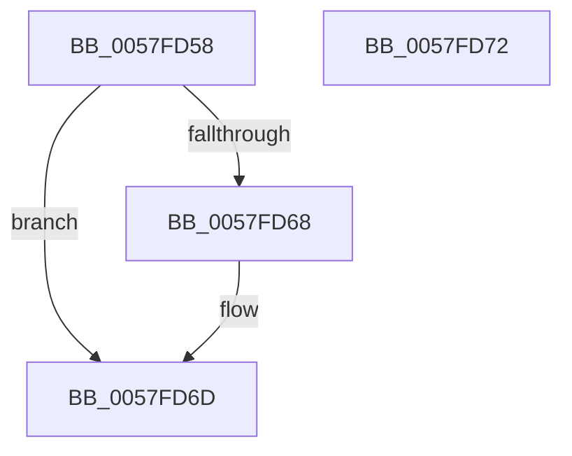

# DbgkpDereferenceErrorPort

- RVA: `0x0057FD58`–`0x0057FD73` (길이 `27` bytes)
- VA: `0x000000014057FD58`
- 실행 섹션: `.text`
- PDB 이름 있음: `예`; PDB Function 태그: `아니요`
- unwind 정보 RVA: `0x0005C788`
- 디코드: `9`개 명령, `27/27` bytes 표시
- 미해석 바이트: `0` (있으면 어셈블리에 `.byte`로 보존)

> 이 문서는 커널 이미지의 기계어와 PDB 기호를 분석해 생성했습니다. 4번과 5번은 함수 원형과 자료형을 바이너리 사용 방식에서 추정한 C 해석이며 원본 소스 복구 결과는 아닙니다.

## 1. Dependencies

- 직접 호출 지점: **1**; 고유 호출 대상: **1**
- 직접 호출자로 확인된 함수: **4**
- RIP 상대 이미지 참조: **0**

### Outgoing calls
- `0x0057FD68` → [DbgkpDeleteErrorPort](../../page/71/DbgkpDeleteErrorPort_function_0071100C.md) (function, `0x0071100C`)

### Direct callers
- [DbgkpRemoveErrorPort](../../page/71/DbgkpRemoveErrorPort_function_00711038.md) at `0x0071110D`
- [DbgkpSendErrorMessage](../../page/92/DbgkpSendErrorMessage_function_009210A8.md) at `0x00921452`
- [sub_00B20C44](../../page/B2/Unknown_function_00B20C44.md) at `0x00B20CDB`
- [sub_00B488AA](../../page/B4/Unknown_function_00B488AA.md) at `0x00B488AD`

### Static image references
- 디코드된 RIP-relative 메모리 참조가 없습니다.

## 2. Other-region calls and transfers

- 다른 실행 섹션으로 향하는 call: **1**
  - `0x0057FD68` → [DbgkpDeleteErrorPort](../../page/71/DbgkpDeleteErrorPort_function_0071100C.md) (`.text` → `PAGE`)
- 별도 외부 분기/꼬리 이동을 확인하지 못했습니다.

## 3. Assembly (complete function range)

```asm
0057FD58  48 83 EC 28                     sub rsp, 0x28
0057FD5C  83 C8 FF                        or eax, 0xffffffff
0057FD5F  F0 0F C1 01                     lock xadd dword ptr [rcx], eax
0057FD63  83 F8 01                        cmp eax, 1
0057FD66  75 05                           jne 0x14057fd6d
0057FD68  E8 9F 12 19 00                  call 0x14071100c
0057FD6D  48 83 C4 28                     add rsp, 0x28
0057FD71  C3                              ret
0057FD72  CC                              int3
```

## 4. C-style interpretation (structured pseudocode)

```c
__int64 __fastcall DbgkpDereferenceErrorPort(__int64 a1)
{
    __int64 result;
    __int64 v_rsp;

    v_rsp = (v_rsp) - (40);
    result = (unsigned int)((result) | (0xFFFFFFFFULL));
    if (((unsigned int)(result)) == 1) {
        result = DbgkpDeleteErrorPort(a1, a2, a3, a4);
    }
    v_rsp = (v_rsp) + (40);
    return result;
}
```

## 5. (Beta) C Style

```c
int64_t DbgkpDereferenceErrorPort(void *Arg1)
{
    uint8_t *arg1 = (uint8_t *)Arg1;

    int64_t result;
    int64_t local_rsp;

    local_rsp = (local_rsp) - (40);
    result = (uint32_t)((result) | (0xFFFFFFFFULL));
    if (((uint32_t)(result)) == 1) {
        result = DbgkpDeleteErrorPort(Arg1, a2, a3, a4);
    }
    local_rsp = (local_rsp) + (40);
    return result;
}
```

### 관측된 메모리 오프셋

구조체 형식이 확인되지 않은 접근은 인자 기준의 오프셋으로만 기록했습니다.

| 기준 인자 | 오프셋 표현 | 폭 (bit) | 접근 |
|---|---:|---:|---|
| `Arg1` | `+ 0x0` | `32` | `R/W` |

## 6. Execution-region graph

[열기: 2D/3D 그래프와 함수 탐색 컨트롤 패널](../../../control-panel.html?section=text&rva=0x0057FD58&view=graph)

- 2D 그래프는 위에서 아래로 흐르고, 3D 그래프는 빈 공간을 드래그해 회전합니다. Shift+드래그는 이동, 휠은 확대·축소, 함수 노드 선택은 대상 보고서 이동입니다.

### Static fallback


