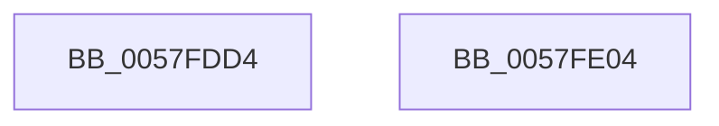

# DbgkpLkmdSnapDataEx

- RVA: `0x0057FDD4`–`0x0057FE05` (길이 `49` bytes)
- VA: `0x000000014057FDD4`
- 실행 섹션: `.text`
- PDB 이름 있음: `예`; PDB Function 태그: `아니요`
- unwind 정보 RVA: `0x00063458`
- 디코드: `11`개 명령, `49/49` bytes 표시
- 미해석 바이트: `0` (있으면 어셈블리에 `.byte`로 보존)

> 이 문서는 커널 이미지의 기계어와 PDB 기호를 분석해 생성했습니다. 4번과 5번은 함수 원형과 자료형을 바이너리 사용 방식에서 추정한 C 해석이며 원본 소스 복구 결과는 아닙니다.

## 1. Dependencies

- 직접 호출 지점: **1**; 고유 호출 대상: **1**
- 직접 호출자로 확인된 함수: **9**
- RIP 상대 이미지 참조: **0**

### Outgoing calls
- `0x0057FDFA` → [guard_dispatch_icall](../6B/guard_dispatch_icall_function_006BAAD0.md) (function, `0x006BAAD0`)

### Direct callers
- [DbgkpLkmdEnumApcOrDpcDataCallback](DbgkpLkmdEnumApcOrDpcDataCallback_function_0057FD80.md) at `0x0057FD9F`
- [DbgkpLkmdSnapData](DbgkpLkmdSnapData_function_0057FDB0.md) at `0x0057FDC3`
- [DbgkpLkmdSnapGlobals](DbgkpLkmdSnapGlobals_function_0057FE0C.md) at `0x0057FE55`
- [DbgkpLkmdSnapGlobals](DbgkpLkmdSnapGlobals_function_0057FE0C.md) at `0x0057FE8C`
- [DbgkpLkmdSnapKernelStack](DbgkpLkmdSnapKernelStack_function_0057FED8.md) at `0x0057FFE1`
- [DbgkpLkmdSnapKernelStackSegmentCallback](../58/DbgkpLkmdSnapKernelStackSegmentCallback_function_00580030.md) at `0x00580073`
- [DbgkpLkmdSnapObject](../58/DbgkpLkmdSnapObject_function_00580094.md) at `0x00580114`
- [DbgkpLkmdSnapObject](../58/DbgkpLkmdSnapObject_function_00580094.md) at `0x0058014D`
- [KeEnumerateProcessorDpcs](../5B/KeEnumerateProcessorDpcs_function_005BE1AC.md) at `0x005BE227`
- [DbgkCaptureLiveDump](../../page/71/DbgkCaptureLiveDump_function_0071113C.md) at `0x007113B3`
- [DbgkCaptureLiveDump](../../page/71/DbgkCaptureLiveDump_function_0071113C.md) at `0x00711496`
- [DbgkpLkmdSnapThreadInContext](../../page/71/DbgkpLkmdSnapThreadInContext_function_00711B3C.md) at `0x00711B88`
- [DbgkpLkmdSnapThreadInContext](../../page/71/DbgkpLkmdSnapThreadInContext_function_00711B3C.md) at `0x00711BF9`

### Static image references
- 디코드된 RIP-relative 메모리 참조가 없습니다.

## 2. Other-region calls and transfers

- 다른 실행 섹션으로 향하는 call: **0**
- 별도 외부 분기/꼬리 이동을 확인하지 못했습니다.

## 3. Assembly (complete function range)

```asm
0057FDD4  48 83 EC 48                     sub rsp, 0x48
0057FDD8  4C 8B 54 24 78                  mov r10, qword ptr [rsp + 0x78]
0057FDDD  48 8B 81 40 40 00 00            mov rax, qword ptr [rcx + 0x4040]
0057FDE4  48 81 C1 00 40 00 00            add rcx, 0x4000
0057FDEB  4C 89 54 24 28                  mov qword ptr [rsp + 0x28], r10
0057FDF0  4C 8B 54 24 70                  mov r10, qword ptr [rsp + 0x70]
0057FDF5  4C 89 54 24 20                  mov qword ptr [rsp + 0x20], r10
0057FDFA  E8 D1 AC 13 00                  call 0x1406baad0
0057FDFF  48 83 C4 48                     add rsp, 0x48
0057FE03  C3                              ret
0057FE04  CC                              int3
```

## 4. C-style interpretation (structured pseudocode)

```c
__int64 __fastcall DbgkpLkmdSnapDataEx(__int64 a1, __int64 a2, __int64 a3, __int64 a4, __int64 a5, __int64 a6)
{
    __int64 result;
    __int64 v_rsp;
    unsigned __int64 v_stack_m20;
    unsigned __int64 v_stack_m28;

    v_rsp = (v_rsp) - (72);
    a1 = (a1) + (0x4000ULL);
    v_stack_m20 = a6;
    v_stack_m28 = a5;
    result = guard_dispatch_icall(a1, a2, a3, a4);
    v_rsp = (v_rsp) + (72);
    return result;
}
```

## 5. (Beta) C Style

```c
int64_t DbgkpLkmdSnapDataEx(void *Arg1, int64_t Arg2, int64_t Arg3, int64_t Arg4, int64_t Arg5, int64_t Arg6)
{
    uint8_t *arg1 = (uint8_t *)Arg1;

    int64_t result;
    int64_t local_rsp;
    uint64_t v_stack_m20;
    uint64_t v_stack_m28;

    local_rsp = (local_rsp) - (72);
    Arg1 = (Arg1) + (0x4000ULL);
    v_stack_m20 = Arg6;
    v_stack_m28 = Arg5;
    result = guard_dispatch_icall(Arg1, Arg2, Arg3, Arg4);
    local_rsp = (local_rsp) + (72);
    return result;
}
```

### 관측된 메모리 오프셋

구조체 형식이 확인되지 않은 접근은 인자 기준의 오프셋으로만 기록했습니다.

| 기준 인자 | 오프셋 표현 | 폭 (bit) | 접근 |
|---|---:|---:|---|
| `Arg1` | `+ 0x4040` | `64` | `R` |

## 6. Execution-region graph

[열기: 2D/3D 그래프와 함수 탐색 컨트롤 패널](../../../control-panel.html?section=text&rva=0x0057FDD4&view=graph)

- 2D 그래프는 위에서 아래로 흐르고, 3D 그래프는 빈 공간을 드래그해 회전합니다. Shift+드래그는 이동, 휠은 확대·축소, 함수 노드 선택은 대상 보고서 이동입니다.

### Static fallback


