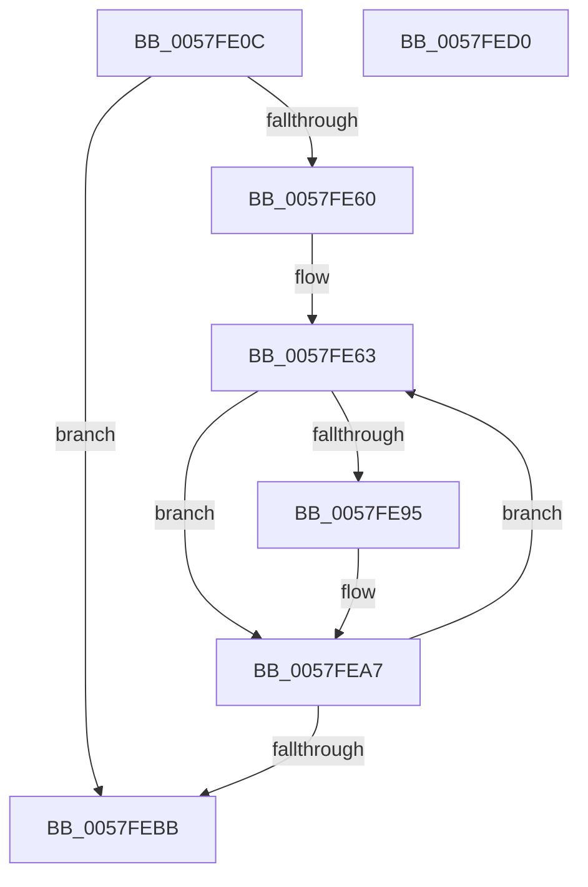

# DbgkpLkmdSnapGlobals

- RVA: `0x0057FE0C`–`0x0057FED1` (길이 `197` bytes)
- VA: `0x000000014057FE0C`
- 실행 섹션: `.text`
- PDB 이름 있음: `예`; PDB Function 태그: `아니요`
- unwind 정보 RVA: `0x000A7960`
- 디코드: `52`개 명령, `197/197` bytes 표시
- 미해석 바이트: `0` (있으면 어셈블리에 `.byte`로 보존)

> 이 문서는 커널 이미지의 기계어와 PDB 기호를 분석해 생성했습니다. 4번과 5번은 함수 원형과 자료형을 바이너리 사용 방식에서 추정한 C 해석이며 원본 소스 복구 결과는 아닙니다.

## 1. Dependencies

- 직접 호출 지점: **5**; 고유 호출 대상: **4**
- 직접 호출자로 확인된 함수: **1**
- RIP 상대 이미지 참조: **1**

### Outgoing calls
- `0x0057FE2D` → [KeQueryActiveProcessorCountEx](../24/KeQueryActiveProcessorCountEx_function_00249EF0.md) (function, `0x00249EF0`)
- `0x0057FE55` → [DbgkpLkmdSnapDataEx](DbgkpLkmdSnapDataEx_function_0057FDD4.md) (function, `0x0057FDD4`)
- `0x0057FE65` → [KeGetPrcb](../2D/KeGetPrcb_function_002D85D0.md) (function, `0x002D85D0`)
- `0x0057FE8C` → [DbgkpLkmdSnapDataEx](DbgkpLkmdSnapDataEx_function_0057FDD4.md) (function, `0x0057FDD4`)
- `0x0057FEAC` → [KeEnumerateProcessorDpcs](../5B/KeEnumerateProcessorDpcs_function_005BE1AC.md) (function, `0x005BE1AC`)

### Direct callers
- [DbgkCaptureLiveDump](../../page/71/DbgkCaptureLiveDump_function_0071113C.md) at `0x00711288`

### Static image references
- `0x0057FE38` → RVA `0x00FC8C40` (`ALMOSTRO`; read)

## 2. Other-region calls and transfers

- 다른 실행 섹션으로 향하는 call: **0**
- 별도 외부 분기/꼬리 이동을 확인하지 못했습니다.

## 3. Assembly (complete function range)

```asm
0057FE0C  48 8B C4                        mov rax, rsp
0057FE0F  48 89 58 08                     mov qword ptr [rax + 8], rbx
0057FE13  48 89 68 18                     mov qword ptr [rax + 0x18], rbp
0057FE17  48 89 70 20                     mov qword ptr [rax + 0x20], rsi
0057FE1B  57                              push rdi
0057FE1C  48 83 EC 30                     sub rsp, 0x30
0057FE20  48 83 60 10 00                  and qword ptr [rax + 0x10], 0
0057FE25  48 8B F1                        mov rsi, rcx
0057FE28  B9 FF FF 00 00                  mov ecx, 0xffff
0057FE2D  E8 BE A0 CC FF                  call 0x140249ef0
0057FE32  48 83 64 24 28 00               and qword ptr [rsp + 0x28], 0
0057FE38  48 8D 15 01 8E A4 00            lea rdx, [rip + 0xa48e01]
0057FE3F  48 83 64 24 20 00               and qword ptr [rsp + 0x20], 0
0057FE45  45 33 C9                        xor r9d, r9d
0057FE48  48 8B CE                        mov rcx, rsi
0057FE4B  8B E8                           mov ebp, eax
0057FE4D  44 8D 04 C5 00 00 00 00         lea r8d, [rax*8]
0057FE55  E8 7A FF FF FF                  call 0x14057fdd4
0057FE5A  33 DB                           xor ebx, ebx
0057FE5C  85 ED                           test ebp, ebp
0057FE5E  74 5B                           je 0x14057febb
0057FE60  48 8B FE                        mov rdi, rsi
0057FE63  8B CB                           mov ecx, ebx
0057FE65  E8 66 87 D5 FF                  call 0x1402d85d0
0057FE6A  48 8D 4C 24 48                  lea rcx, [rsp + 0x48]
0057FE6F  41 B9 02 00 00 00               mov r9d, 2
0057FE75  48 89 4C 24 28                  mov qword ptr [rsp + 0x28], rcx
0057FE7A  41 B8 00 CF 00 00               mov r8d, 0xcf00
0057FE80  48 83 64 24 20 00               and qword ptr [rsp + 0x20], 0
0057FE86  48 8B CE                        mov rcx, rsi
0057FE89  48 8B D0                        mov rdx, rax
0057FE8C  E8 43 FF FF FF                  call 0x14057fdd4
0057FE91  85 C0                           test eax, eax
0057FE93  78 12                           js 0x14057fea7
0057FE95  48 8B 44 24 48                  mov rax, qword ptr [rsp + 0x48]
0057FE9A  48 83 60 08 00                  and qword ptr [rax + 8], 0
0057FE9F  48 8B 44 24 48                  mov rax, qword ptr [rsp + 0x48]
0057FEA4  48 89 07                        mov qword ptr [rdi], rax
0057FEA7  4C 8B C6                        mov r8, rsi
0057FEAA  8B CB                           mov ecx, ebx
0057FEAC  E8 FB E2 03 00                  call 0x1405be1ac
0057FEB1  FF C3                           inc ebx
0057FEB3  48 83 C7 08                     add rdi, 8
0057FEB7  3B DD                           cmp ebx, ebp
0057FEB9  72 A8                           jb 0x14057fe63
0057FEBB  48 8B 5C 24 40                  mov rbx, qword ptr [rsp + 0x40]
0057FEC0  48 8B 6C 24 50                  mov rbp, qword ptr [rsp + 0x50]
0057FEC5  48 8B 74 24 58                  mov rsi, qword ptr [rsp + 0x58]
0057FECA  48 83 C4 30                     add rsp, 0x30
0057FECE  5F                              pop rdi
0057FECF  C3                              ret
0057FED0  CC                              int3
```

## 4. C-style interpretation (structured pseudocode)

```c
__int64 __fastcall DbgkpLkmdSnapGlobals(__int64 a1, __int64 a2, __int64 a3, int a4)
{
    __int64 result;
    __int64 v_rbx;
    __int64 v_rdi;
    __int64 v_rsp;
    unsigned __int64 v_stack_m10;
    unsigned __int64 v_stack_m18;
    unsigned __int64 v_stack_p10;
    unsigned __int64 v_stack_p18;
    unsigned __int64 v_stack_p20;
    unsigned __int64 v_stack_p8;

    *(unsigned __int64 *)(v_rsp + 8) = v_rbx;
    *(unsigned __int64 *)(v_rsp + 24) = v_rbp;
    *(unsigned __int64 *)(v_rsp + 32) = v_rsi;
    v_rsp = (v_rsp) - (48);
    result = KeQueryActiveProcessorCountEx((unsigned int)(0xFFFFULL), a2, a3, a4);
    a4 = 0;
    result = DbgkpLkmdSnapDataEx(a1, v_rip + 10784257, result * 8, a4);
    v_rbx = 0;
    if ((unsigned int)((unsigned int)((unsigned int)(result))) == 0) goto loc_0057FEBB;
loc_0057FE63:
    result = KeGetPrcb(0, v_rip + 10784257, result * 8, a4);
    v_stack_m10 = v_stack_p10;
    result = DbgkpLkmdSnapDataEx(a1, result, (unsigned int)(0xCF00ULL), 2);
    if (!(sign_flag)) {
        result = v_stack_p10;
        result = v_stack_p10;
        *(unsigned __int64 *)(a1) = result;
    }
    result = KeEnumerateProcessorDpcs(0, result, a1, 2);
    v_rbx = (unsigned int)((v_rbx) + 1);
    v_rdi = (a1) + (8);
    if (((unsigned int)(v_rbx)) < ((unsigned int)((unsigned int)((unsigned int)(result))))) goto loc_0057FE63;
loc_0057FEBB:
    v_rsp = (v_rsp) + (48);
    return result;
}
```

## 5. (Beta) C Style

```c
int64_t DbgkpLkmdSnapGlobals(void *Arg1, int64_t Arg2, int64_t Arg3, int32_t Arg4)
{
    uint8_t *arg1 = (uint8_t *)Arg1;

    int64_t result;
    int64_t local_rbx;
    int64_t local_rdi;
    int64_t local_rsp;
    uint64_t v_stack_m10;
    uint64_t v_stack_m18;
    uint64_t v_stack_p10;
    uint64_t v_stack_p18;
    uint64_t v_stack_p20;
    uint64_t v_stack_p8;

    *(uint64_t *)(local_rsp + 0x8) = local_rbx;
    *(uint64_t *)(local_rsp + 0x18) = local_rbp;
    *(uint64_t *)(local_rsp + 0x20) = local_rsi;
    local_rsp = (local_rsp) - (48);
    result = KeQueryActiveProcessorCountEx((uint32_t)(0xFFFFULL), Arg2, Arg3, Arg4);
    Arg4 = 0;
    result = DbgkpLkmdSnapDataEx(Arg1, v_rip + 10784257, result * 8, Arg4);
    local_rbx = 0;
    if ((uint32_t)((uint32_t)((uint32_t)(result))) == 0) goto loc_0057FEBB;
loc_0057FE63:
    result = KeGetPrcb(0, v_rip + 10784257, result * 8, Arg4);
    v_stack_m10 = v_stack_p10;
    result = DbgkpLkmdSnapDataEx(Arg1, result, (uint32_t)(0xCF00ULL), 2);
    if (!(sign_flag)) {
        result = v_stack_p10;
        result = v_stack_p10;
        *(uint64_t *)(arg1) = result;
    }
    result = KeEnumerateProcessorDpcs(0, result, Arg1, 2);
    local_rbx = (uint32_t)((local_rbx) + 1);
    local_rdi = (Arg1) + (8);
    if (((uint32_t)(local_rbx)) < ((uint32_t)((uint32_t)((uint32_t)(result))))) goto loc_0057FE63;
loc_0057FEBB:
    local_rsp = (local_rsp) + (48);
    return result;
}
```

### 관측된 메모리 오프셋

구조체 형식이 확인되지 않은 접근은 인자 기준의 오프셋으로만 기록했습니다.

| 기준 인자 | 오프셋 표현 | 폭 (bit) | 접근 |
|---|---:|---:|---|
| `Arg1` | `+ 0x0` | `64` | `W` |

## 6. Execution-region graph

[열기: 2D/3D 그래프와 함수 탐색 컨트롤 패널](../../../control-panel.html?section=text&rva=0x0057FE0C&view=graph)

- 2D 그래프는 위에서 아래로 흐르고, 3D 그래프는 빈 공간을 드래그해 회전합니다. Shift+드래그는 이동, 휠은 확대·축소, 함수 노드 선택은 대상 보고서 이동입니다.

### Static fallback


