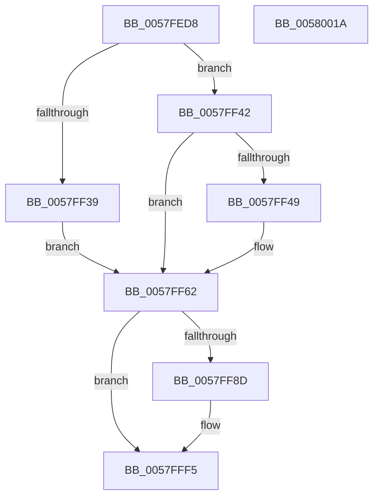

# DbgkpLkmdSnapKernelStack

- RVA: `0x0057FED8`–`0x0058001B` (길이 `323` bytes)
- VA: `0x000000014057FED8`
- 실행 섹션: `.text`
- PDB 이름 있음: `예`; PDB Function 태그: `아니요`
- unwind 정보 RVA: `0x000C59DC`
- 디코드: `85`개 명령, `323/323` bytes 표시
- 미해석 바이트: `0` (있으면 어셈블리에 `.byte`로 보존)

> 이 문서는 커널 이미지의 기계어와 PDB 기호를 분석해 생성했습니다. 4번과 5번은 함수 원형과 자료형을 바이너리 사용 방식에서 추정한 C 해석이며 원본 소스 복구 결과는 아닙니다.

## 1. Dependencies

- 직접 호출 지점: **5**; 고유 호출 대상: **4**
- 직접 호출자로 확인된 함수: **1**
- RIP 상대 이미지 참조: **2**

### Outgoing calls
- `0x0057FF55` → [memset](../6C/memset_function_006C6C40.md) (function, `0x006C6C40`)
- `0x0057FF84` → [KeEnumerateKernelStackSegments](../2A/KeEnumerateKernelStackSegments_function_002A13B8.md) (function, `0x002A13B8`)
- `0x0057FFA8` → [memset](../6C/memset_function_006C6C40.md) (function, `0x006C6C40`)
- `0x0057FFE1` → [DbgkpLkmdSnapDataEx](DbgkpLkmdSnapDataEx_function_0057FDD4.md) (function, `0x0057FDD4`)
- `0x00580001` → [_security_check_cookie](../6A/_security_check_cookie_function_006AC640.md) (function, `0x006AC640`)

### Direct callers
- [DbgkpLkmdSnapThreadInContext](../../page/71/DbgkpLkmdSnapThreadInContext_function_00711B3C.md) at `0x00711C1B`

### Static image references
- `0x0057FEF4` → RVA `0x00E0A740` (`.data`; read)
- `0x0057FF6C` → RVA `0x00580030` (`DbgkpLkmdSnapKernelStackSegmentCallback`; read)

## 2. Other-region calls and transfers

- 다른 실행 섹션으로 향하는 call: **0**
- 별도 외부 분기/꼬리 이동을 확인하지 못했습니다.

## 3. Assembly (complete function range)

```asm
0057FED8  40 55                           push rbp
0057FEDA  53                              push rbx
0057FEDB  56                              push rsi
0057FEDC  57                              push rdi
0057FEDD  41 54                           push r12
0057FEDF  41 55                           push r13
0057FEE1  41 56                           push r14
0057FEE3  41 57                           push r15
0057FEE5  48 8D AC 24 78 FB FF FF         lea rbp, [rsp - 0x488]
0057FEED  48 81 EC 88 05 00 00            sub rsp, 0x588
0057FEF4  48 8B 05 45 A8 88 00            mov rax, qword ptr [rip + 0x88a845]
0057FEFB  48 33 C4                        xor rax, rsp
0057FEFE  48 89 85 70 04 00 00            mov qword ptr [rbp + 0x470], rax
0057FF05  4C 8B B5 F0 04 00 00            mov r14, qword ptr [rbp + 0x4f0]
0057FF0C  49 8D 70 58                     lea rsi, [r8 + 0x58]
0057FF10  4C 8B AD F8 04 00 00            mov r13, qword ptr [rbp + 0x4f8]
0057FF17  4C 8B F9                        mov r15, rcx
0057FF1A  33 C9                           xor ecx, ecx
0057FF1C  4C 89 44 24 30                  mov qword ptr [rsp + 0x30], r8
0057FF21  89 4C 24 49                     mov dword ptr [rsp + 0x49], ecx
0057FF25  41 8A D9                        mov bl, r9b
0057FF28  66 89 4C 24 4D                  mov word ptr [rsp + 0x4d], cx
0057FF2D  4C 8B E2                        mov r12, rdx
0057FF30  88 4C 24 4F                     mov byte ptr [rsp + 0x4f], cl
0057FF34  4D 85 F6                        test r14, r14
0057FF37  74 09                           je 0x14057ff42
0057FF39  49 8B BE 98 00 00 00            mov rdi, qword ptr [r14 + 0x98]
0057FF40  EB 20                           jmp 0x14057ff62
0057FF42  48 8B 3E                        mov rdi, qword ptr [rsi]
0057FF45  84 DB                           test bl, bl
0057FF47  74 19                           je 0x14057ff62
0057FF49  33 D2                           xor edx, edx
0057FF4B  48 8D 4D A0                     lea rcx, [rbp - 0x60]
0057FF4F  41 B8 D0 04 00 00               mov r8d, 0x4d0
0057FF55  E8 E6 6C 14 00                  call 0x1406c6c40
0057FF5A  48 89 7D 38                     mov qword ptr [rbp + 0x38], rdi
0057FF5E  48 89 7D 40                     mov qword ptr [rbp + 0x40], rdi
0057FF62  4C 8D 44 24 38                  lea r8, [rsp + 0x38]
0057FF67  4C 89 7C 24 38                  mov qword ptr [rsp + 0x38], r15
0057FF6C  48 8D 15 BD 00 00 00            lea rdx, [rip + 0xbd]
0057FF73  48 89 7C 24 40                  mov qword ptr [rsp + 0x40], rdi
0057FF78  49 8B CC                        mov rcx, r12
0057FF7B  88 5C 24 48                     mov byte ptr [rsp + 0x48], bl
0057FF7F  4C 89 6C 24 50                  mov qword ptr [rsp + 0x50], r13
0057FF84  E8 2F 14 D2 FF                  call 0x1402a13b8
0057FF89  84 DB                           test bl, bl
0057FF8B  74 68                           je 0x14057fff5
0057FF8D  4D 85 F6                        test r14, r14
0057FF90  48 8D 5D A0                     lea rbx, [rbp - 0x60]
0057FF94  48 8D 4C 24 60                  lea rcx, [rsp + 0x60]
0057FF99  49 0F 45 DE                     cmovne rbx, r14
0057FF9D  41 BE 40 00 00 00               mov r14d, 0x40
0057FFA3  45 8B C6                        mov r8d, r14d
0057FFA6  33 D2                           xor edx, edx
0057FFA8  E8 93 6C 14 00                  call 0x1406c6c40
0057FFAD  48 8B 83 F8 00 00 00            mov rax, qword ptr [rbx + 0xf8]
0057FFB4  45 8D 4E C5                     lea r9d, [r14 - 0x3b]
0057FFB8  48 83 64 24 28 00               and qword ptr [rsp + 0x28], 0
0057FFBE  48 8D 54 24 60                  lea rdx, [rsp + 0x60]
0057FFC3  48 89 45 98                     mov qword ptr [rbp - 0x68], rax
0057FFC7  45 8B C6                        mov r8d, r14d
0057FFCA  48 8B 83 A0 00 00 00            mov rax, qword ptr [rbx + 0xa0]
0057FFD1  49 8B CF                        mov rcx, r15
0057FFD4  48 8D 5F C0                     lea rbx, [rdi - 0x40]
0057FFD8  48 89 45 90                     mov qword ptr [rbp - 0x70], rax
0057FFDC  48 89 5C 24 20                  mov qword ptr [rsp + 0x20], rbx
0057FFE1  E8 EE FD FF FF                  call 0x14057fdd4
0057FFE6  48 8B 44 24 30                  mov rax, qword ptr [rsp + 0x30]
0057FFEB  48 89 1E                        mov qword ptr [rsi], rbx
0057FFEE  C6 80 84 01 00 00 FF            mov byte ptr [rax + 0x184], 0xff
0057FFF5  33 C0                           xor eax, eax
0057FFF7  48 8B 8D 70 04 00 00            mov rcx, qword ptr [rbp + 0x470]
0057FFFE  48 33 CC                        xor rcx, rsp
00580001  E8 3A C6 12 00                  call 0x1406ac640
00580006  48 81 C4 88 05 00 00            add rsp, 0x588
0058000D  41 5F                           pop r15
0058000F  41 5E                           pop r14
00580011  41 5D                           pop r13
00580013  41 5C                           pop r12
00580015  5F                              pop rdi
00580016  5E                              pop rsi
00580017  5B                              pop rbx
00580018  5D                              pop rbp
00580019  C3                              ret
0058001A  CC                              int3
```

## 4. C-style interpretation (structured pseudocode)

```c
__int64 __fastcall DbgkpLkmdSnapKernelStack(__int64 a1, __int64 a2, __int64 a3, unsigned __int8 a4, __int64 a5, __int64 a6)
{
    __int64 result;
    __int64 v_r14;
    __int64 v_rbx;
    __int64 v_rsp;
    unsigned __int64 v_stack_m488;
    unsigned __int64 v_stack_m490;
    unsigned __int64 v_stack_m4C8;
    unsigned __int64 v_stack_m528;
    unsigned __int64 v_stack_m530;
    unsigned __int64 v_stack_m538;
    unsigned __int64 v_stack_m568;
    unsigned __int64 v_stack_m578;
    unsigned __int8 v_stack_m579;
    unsigned __int16 v_stack_m57B;
    unsigned int v_stack_m57F;
    unsigned __int64 v_stack_m58;
    unsigned __int8 v_stack_m580;
    unsigned __int64 v_stack_m588;
    unsigned __int64 v_stack_m590;
    unsigned __int64 v_stack_m598;
    unsigned __int64 v_stack_m5A0;
    unsigned __int64 v_stack_m5A8;

    v_rsp = (v_rsp) - (0x588ULL);
    result = (*(unsigned __int64 *)(v_rip + 8955973)) ^ (v_rsp);
    v_stack_m58 = result;
    a1 = 0;
    v_stack_m598 = a3;
    v_stack_m57F = 0;
    v_stack_m57B = 0;
    v_stack_m579 = 0;
    if (a5 == 0) goto loc_0057FF42;
    goto loc_0057FF62;
loc_0057FF42:
    if (a4 != 0) {
        a2 = 0;
        a1 = v_stack_m528;
        a3 = 0x4D0ULL;
        result = memset(a1, a2, a3, a4);
        v_stack_m490 = *(unsigned __int64 *)(a3 + 88);
        v_stack_m488 = *(unsigned __int64 *)(a3 + 88);
    }
    v_stack_m590 = a1;
    v_stack_m588 = *(unsigned __int64 *)(a3 + 88);
    v_stack_m580 = a4;
    v_stack_m578 = a6;
    result = KeEnumerateKernelStackSegments(0, v_rip + 189, v_stack_m590, a4);
    v_rbx = a4;
    v_r14 = a5;
    if (a4 != 0) {
        v_rbx = v_stack_m528;
        a1 = v_stack_m568;
        if (a5 != 0) { v_rbx = a5; }
        v_r14 = 64;
        a3 = (unsigned int)(v_r14);
        a2 = 0;
        result = memset(a1, a2, a3, a4);
        result = *(unsigned __int64 *)(v_rbx + 248);
        a4 = v_r14 - 59;
        a2 = v_stack_m568;
        v_stack_m530 = result;
        a3 = (unsigned int)(v_r14);
        result = *(unsigned __int64 *)(v_rbx + 160);
        a1 = a1;
        v_rbx = *(unsigned __int64 *)(a3 + 88) - 64;
        v_stack_m538 = result;
        v_stack_m5A8 = v_rbx;
        result = DbgkpLkmdSnapDataEx(a1, a2, a3, a4);
        result = v_stack_m598;
        *(unsigned __int64 *)(a3 + 88) = v_rbx;
        *(unsigned __int8 *)(result + 388) = 255;
    }
    result = 0;
    a1 = (v_stack_m58) ^ (v_rsp);
    result = _security_check_cookie(a1, a2, a3, a4);
    v_rsp = (v_rsp) + (0x588ULL);
    return result;
}
```

## 5. (Beta) C Style

```c
int64_t DbgkpLkmdSnapKernelStack(int64_t Arg1, int64_t Arg2, void *Arg3, uint8_t Arg4, int64_t Arg5, int64_t Arg6)
{
    uint8_t *arg3 = (uint8_t *)Arg3;

    int64_t result;
    int64_t local_r14;
    int64_t local_rbx;
    int64_t local_rsp;
    uint64_t v_stack_m488;
    uint64_t v_stack_m490;
    uint64_t v_stack_m4C8;
    uint64_t v_stack_m528;
    uint64_t v_stack_m530;
    uint64_t v_stack_m538;
    uint64_t v_stack_m568;
    uint64_t v_stack_m578;
    uint8_t v_stack_m579;
    uint16_t v_stack_m57B;
    uint32_t v_stack_m57F;
    uint64_t v_stack_m58;
    uint8_t v_stack_m580;
    uint64_t v_stack_m588;
    uint64_t v_stack_m590;
    uint64_t v_stack_m598;
    uint64_t v_stack_m5A0;
    uint64_t v_stack_m5A8;

    local_rsp = (local_rsp) - (0x588ULL);
    result = (*(uint64_t *)(v_rip + 0x88A845)) ^ (local_rsp);
    v_stack_m58 = result;
    Arg1 = 0;
    v_stack_m598 = Arg3;
    v_stack_m57F = 0;
    v_stack_m57B = 0;
    v_stack_m579 = 0;
    if (Arg5 == 0) goto loc_0057FF42;
    goto loc_0057FF62;
loc_0057FF42:
    if (Arg4 != 0) {
        Arg2 = 0;
        Arg1 = v_stack_m528;
        Arg3 = 0x4D0ULL;
        result = memset(Arg1, Arg2, Arg3, Arg4);
        v_stack_m490 = *(uint64_t *)(arg3 + 0x58);
        v_stack_m488 = *(uint64_t *)(arg3 + 0x58);
    }
    v_stack_m590 = Arg1;
    v_stack_m588 = *(uint64_t *)(arg3 + 0x58);
    v_stack_m580 = Arg4;
    v_stack_m578 = Arg6;
    result = KeEnumerateKernelStackSegments(0, v_rip + 189, v_stack_m590, Arg4);
    local_rbx = Arg4;
    local_r14 = Arg5;
    if (Arg4 != 0) {
        local_rbx = v_stack_m528;
        Arg1 = v_stack_m568;
        if (Arg5 != 0) { local_rbx = Arg5; }
        local_r14 = 64;
        Arg3 = (uint32_t)(local_r14);
        Arg2 = 0;
        result = memset(Arg1, Arg2, Arg3, Arg4);
        result = *(uint64_t *)(local_rbx + 0xF8);
        Arg4 = local_r14 - 59;
        Arg2 = v_stack_m568;
        v_stack_m530 = result;
        Arg3 = (uint32_t)(local_r14);
        result = *(uint64_t *)(local_rbx + 0xA0);
        Arg1 = Arg1;
        local_rbx = *(uint64_t *)(arg3 + 0x58) - 64;
        v_stack_m538 = result;
        v_stack_m5A8 = local_rbx;
        result = DbgkpLkmdSnapDataEx(Arg1, Arg2, Arg3, Arg4);
        result = v_stack_m598;
        *(uint64_t *)(arg3 + 0x58) = local_rbx;
        *(uint8_t *)(result + 0x184) = 255;
    }
    result = 0;
    Arg1 = (v_stack_m58) ^ (local_rsp);
    result = _security_check_cookie(Arg1, Arg2, Arg3, Arg4);
    local_rsp = (local_rsp) + (0x588ULL);
    return result;
}
```

### 관측된 메모리 오프셋

구조체 형식이 확인되지 않은 접근은 인자 기준의 오프셋으로만 기록했습니다.

| 기준 인자 | 오프셋 표현 | 폭 (bit) | 접근 |
|---|---:|---:|---|
| `Arg3` | `+ 0x0` | `64` | `R` |
| `Arg3` | `+ 0x0` | `64` | `W` |
| `Arg3` | `+ 0x58` | `64` | `R` |

## 6. Execution-region graph

[열기: 2D/3D 그래프와 함수 탐색 컨트롤 패널](../../../control-panel.html?section=text&rva=0x0057FED8&view=graph)

- 2D 그래프는 위에서 아래로 흐르고, 3D 그래프는 빈 공간을 드래그해 회전합니다. Shift+드래그는 이동, 휠은 확대·축소, 함수 노드 선택은 대상 보고서 이동입니다.

### Static fallback


