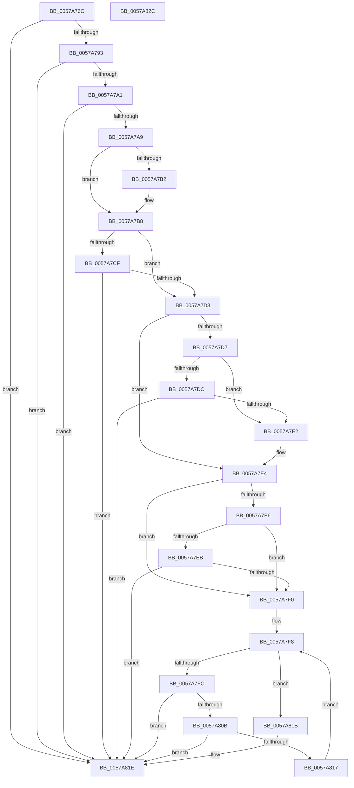

# DmrCheckPathMatch

- RVA: `0x0057A76C`–`0x0057A82D` (길이 `193` bytes)
- VA: `0x000000014057A76C`
- 실행 섹션: `.text`
- PDB 이름 있음: `예`; PDB Function 태그: `아니요`
- unwind 정보 RVA: `0x000950EC`
- 디코드: `66`개 명령, `193/193` bytes 표시
- 미해석 바이트: `0` (있으면 어셈블리에 `.byte`로 보존)

> 이 문서는 커널 이미지의 기계어와 PDB 기호를 분석해 생성했습니다. 4번과 5번은 함수 원형과 자료형을 바이너리 사용 방식에서 추정한 C 해석이며 원본 소스 복구 결과는 아닙니다.

## 1. Dependencies

- 직접 호출 지점: **0**; 고유 호출 대상: **0**
- 직접 호출자로 확인된 함수: **3**
- RIP 상대 이미지 참조: **0**

### Outgoing calls
- 직접 디코드된 call 명령이 없습니다.

### Direct callers
- [DmrFindDrhdForDeviceScope](DmrFindDrhdForDeviceScope_function_0057A6A0.md) at `0x0057A703`
- [DmrValidateDeviceScope](DmrValidateDeviceScope_function_0057AACC.md) at `0x0057AB9B`
- [DmrEnumerateRmrrDomains](DmrEnumerateRmrrDomains_function_0057ABC0.md) at `0x0057AC8F`

### Static image references
- 디코드된 RIP-relative 메모리 참조가 없습니다.

## 2. Other-region calls and transfers

- 다른 실행 섹션으로 향하는 call: **0**
- 별도 외부 분기/꼬리 이동을 확인하지 못했습니다.

## 3. Assembly (complete function range)

```asm
0057A76C  48 89 5C 24 08                  mov qword ptr [rsp + 8], rbx
0057A771  48 89 7C 24 10                  mov qword ptr [rsp + 0x10], rdi
0057A776  8A 19                           mov bl, byte ptr [rcx]
0057A778  45 33 C9                        xor r9d, r9d
0057A77B  8A C3                           mov al, bl
0057A77D  4C 8B D2                        mov r10, rdx
0057A780  4C 8B D9                        mov r11, rcx
0057A783  41 8D 79 01                     lea edi, [r9 + 1]
0057A787  40 2A C7                        sub al, dil
0057A78A  40 3A C7                        cmp al, dil
0057A78D  0F 87 8B 00 00 00               ja 0x14057a81e
0057A793  44 8A 02                        mov r8b, byte ptr [rdx]
0057A796  41 8A C0                        mov al, r8b
0057A799  40 2A C7                        sub al, dil
0057A79C  40 3A C7                        cmp al, dil
0057A79F  77 7D                           ja 0x14057a81e
0057A7A1  8A 42 05                        mov al, byte ptr [rdx + 5]
0057A7A4  38 41 05                        cmp byte ptr [rcx + 5], al
0057A7A7  75 75                           jne 0x14057a81e
0057A7A9  41 0F B6 D1                     movzx edx, r9b
0057A7AD  40 3A DF                        cmp bl, dil
0057A7B0  75 06                           jne 0x14057a7b8
0057A7B2  44 3A C7                        cmp r8b, dil
0057A7B5  0F 44 D7                        cmove edx, edi
0057A7B8  0F B6 49 01                     movzx ecx, byte ptr [rcx + 1]
0057A7BC  41 0F B6 42 01                  movzx eax, byte ptr [r10 + 1]
0057A7C1  83 E9 06                        sub ecx, 6
0057A7C4  83 E8 06                        sub eax, 6
0057A7C7  D1 E9                           shr ecx, 1
0057A7C9  D1 E8                           shr eax, 1
0057A7CB  84 D2                           test dl, dl
0057A7CD  74 04                           je 0x14057a7d3
0057A7CF  3B C8                           cmp ecx, eax
0057A7D1  75 4B                           jne 0x14057a81e
0057A7D3  3B C1                           cmp eax, ecx
0057A7D5  76 0D                           jbe 0x14057a7e4
0057A7D7  40 3A DF                        cmp bl, dil
0057A7DA  75 06                           jne 0x14057a7e2
0057A7DC  41 80 F8 02                     cmp r8b, 2
0057A7E0  74 3C                           je 0x14057a81e
0057A7E2  3B C1                           cmp eax, ecx
0057A7E4  73 0A                           jae 0x14057a7f0
0057A7E6  44 3A C7                        cmp r8b, dil
0057A7E9  75 05                           jne 0x14057a7f0
0057A7EB  80 FB 02                        cmp bl, 2
0057A7EE  74 2E                           je 0x14057a81e
0057A7F0  3B C8                           cmp ecx, eax
0057A7F2  41 8B D1                        mov edx, r9d
0057A7F5  0F 43 C8                        cmovae ecx, eax
0057A7F8  3B D1                           cmp edx, ecx
0057A7FA  73 1F                           jae 0x14057a81b
0057A7FC  44 8B C2                        mov r8d, edx
0057A7FF  43 8A 44 42 06                  mov al, byte ptr [r10 + r8*2 + 6]
0057A804  43 38 44 43 06                  cmp byte ptr [r11 + r8*2 + 6], al
0057A809  75 13                           jne 0x14057a81e
0057A80B  43 8A 44 42 07                  mov al, byte ptr [r10 + r8*2 + 7]
0057A810  43 38 44 43 07                  cmp byte ptr [r11 + r8*2 + 7], al
0057A815  75 07                           jne 0x14057a81e
0057A817  03 D7                           add edx, edi
0057A819  EB DD                           jmp 0x14057a7f8
0057A81B  44 8A CF                        mov r9b, dil
0057A81E  48 8B 5C 24 08                  mov rbx, qword ptr [rsp + 8]
0057A823  41 8A C1                        mov al, r9b
0057A826  48 8B 7C 24 10                  mov rdi, qword ptr [rsp + 0x10]
0057A82B  C3                              ret
0057A82C  CC                              int3
```

## 4. C-style interpretation (structured pseudocode)

```c
__int64 __fastcall DmrCheckPathMatch(__int64 a1, __int64 a2, __int64 a3, int a4)
{
    __int64 result;
    unsigned __int64 v_stack_p10;
    unsigned __int64 v_stack_p8;

    v_stack_p8 = v_rbx;
    v_stack_p10 = v_rdi;
    a4 = 0;
    result = (unsigned __int8)(((unsigned __int8)(*(unsigned __int8 *)(a1))) - ((unsigned __int8)(a4 + 1)));
    if (((unsigned __int8)(result)) > ((unsigned __int8)(a4 + 1))) goto loc_0057A81E;
    result = (unsigned __int8)(((unsigned __int8)(*(unsigned __int8 *)(a2))) - ((unsigned __int8)(a4 + 1)));
    if (((unsigned __int8)(result)) > ((unsigned __int8)(a4 + 1))) goto loc_0057A81E;
    if ((*(unsigned __int8 *)(a1 + 5)) != ((unsigned __int8)(*(unsigned __int8 *)(a2 + 5)))) goto loc_0057A81E;
    if (((unsigned __int8)(*(unsigned __int8 *)(a1))) == ((unsigned __int8)(a4 + 1))) {
        a2 = 0;
        if (((unsigned __int8)(*(unsigned __int8 *)(a2))) == ((unsigned __int8)(a4 + 1))) { a2 = (unsigned int)(a4 + 1); }
    }
    a1 = (unsigned int)((*(unsigned __int8 *)(a1 + 1)) - (6));
    result = (unsigned int)((*(unsigned __int8 *)(a2 + 1)) - (6));
    a1 = (unsigned int)((a1) >> (1));
    result = (unsigned int)((result) >> (1));
    if ((unsigned __int8)(a2) == 0) goto loc_0057A7D3;
    if (((unsigned int)(a1)) != ((unsigned int)(result))) goto loc_0057A81E;
loc_0057A7D3:
    if (((unsigned int)(result)) <= ((unsigned int)(a1))) goto loc_0057A7E4;
    if (((unsigned __int8)(*(unsigned __int8 *)(a1))) != ((unsigned __int8)(a4 + 1))) goto loc_0057A7E2;
    if (((unsigned __int8)(*(unsigned __int8 *)(a2))) == 2) goto loc_0057A81E;
loc_0057A7E2:
loc_0057A7E4:
    if (((unsigned int)(result)) >= ((unsigned int)(a1))) goto loc_0057A7F0;
    if (((unsigned __int8)(*(unsigned __int8 *)(a2))) != ((unsigned __int8)(a4 + 1))) goto loc_0057A7F0;
    if (((unsigned __int8)(*(unsigned __int8 *)(a1))) == 2) goto loc_0057A81E;
loc_0057A7F0:
    if (((unsigned int)(a1)) >= ((unsigned int)(result))) { a1 = (unsigned int)(result); }
loc_0057A7F8:
    if (0 >= ((unsigned int)(a1))) goto loc_0057A81B;
    if ((*(unsigned __int8 *)(a1 + 0 * 2 + 6)) != ((unsigned __int8)(*(unsigned __int8 *)(a2 + 0 * 2 + 6)))) goto loc_0057A81E;
    if ((*(unsigned __int8 *)(a1 + 0 * 2 + 7)) != ((unsigned __int8)(*(unsigned __int8 *)(a2 + 0 * 2 + 7)))) goto loc_0057A81E;
    a2 = (unsigned int)((0) + ((unsigned int)(a4 + 1)));
    goto loc_0057A7F8;
loc_0057A81B:
loc_0057A81E:
    return (unsigned __int8)((unsigned __int8)(a4 + 1));
}
```

## 5. (Beta) C Style

```c
int64_t DmrCheckPathMatch(void *Arg1, void *Arg2, int64_t Arg3, int32_t Arg4)
{
    uint8_t *arg1 = (uint8_t *)Arg1;
    uint8_t *arg2 = (uint8_t *)Arg2;

    int64_t result;
    uint64_t v_stack_p10;
    uint64_t v_stack_p8;

    v_stack_p8 = local_rbx;
    v_stack_p10 = local_rdi;
    Arg4 = 0;
    result = (uint8_t)(((uint8_t)(*(uint8_t *)(arg1))) - ((uint8_t)(Arg4 + 1)));
    if (((uint8_t)(result)) > ((uint8_t)(Arg4 + 1))) goto loc_0057A81E;
    result = (uint8_t)(((uint8_t)(*(uint8_t *)(arg2))) - ((uint8_t)(Arg4 + 1)));
    if (((uint8_t)(result)) > ((uint8_t)(Arg4 + 1))) goto loc_0057A81E;
    if ((*(uint8_t *)(arg1 + 0x5)) != ((uint8_t)(*(uint8_t *)(arg2 + 0x5)))) goto loc_0057A81E;
    if (((uint8_t)(*(uint8_t *)(arg1))) == ((uint8_t)(Arg4 + 1))) {
        Arg2 = 0;
        if (((uint8_t)(*(uint8_t *)(arg2))) == ((uint8_t)(Arg4 + 1))) { Arg2 = (uint32_t)(Arg4 + 1); }
    }
    Arg1 = (uint32_t)((*(uint8_t *)(arg1 + 0x1)) - (6));
    result = (uint32_t)((*(uint8_t *)(arg2 + 0x1)) - (6));
    Arg1 = (uint32_t)((Arg1) >> (1));
    result = (uint32_t)((result) >> (1));
    if ((uint8_t)(Arg2) == 0) goto loc_0057A7D3;
    if (((uint32_t)(Arg1)) != ((uint32_t)(result))) goto loc_0057A81E;
loc_0057A7D3:
    if (((uint32_t)(result)) <= ((uint32_t)(Arg1))) goto loc_0057A7E4;
    if (((uint8_t)(*(uint8_t *)(arg1))) != ((uint8_t)(Arg4 + 1))) goto loc_0057A7E2;
    if (((uint8_t)(*(uint8_t *)(arg2))) == 2) goto loc_0057A81E;
loc_0057A7E2:
loc_0057A7E4:
    if (((uint32_t)(result)) >= ((uint32_t)(Arg1))) goto loc_0057A7F0;
    if (((uint8_t)(*(uint8_t *)(arg2))) != ((uint8_t)(Arg4 + 1))) goto loc_0057A7F0;
    if (((uint8_t)(*(uint8_t *)(arg1))) == 2) goto loc_0057A81E;
loc_0057A7F0:
    if (((uint32_t)(Arg1)) >= ((uint32_t)(result))) { Arg1 = (uint32_t)(result); }
loc_0057A7F8:
    if (0 >= ((uint32_t)(Arg1))) goto loc_0057A81B;
    if ((*(uint8_t *)(arg1 + 0x0 * 2 + 0x6)) != ((uint8_t)(*(uint8_t *)(arg2 + 0x0 * 2 + 0x6)))) goto loc_0057A81E;
    if ((*(uint8_t *)(arg1 + 0x0 * 2 + 0x7)) != ((uint8_t)(*(uint8_t *)(arg2 + 0x0 * 2 + 0x7)))) goto loc_0057A81E;
    Arg2 = (uint32_t)((0) + ((uint32_t)(Arg4 + 1)));
    goto loc_0057A7F8;
loc_0057A81B:
loc_0057A81E:
    return (uint8_t)((uint8_t)(Arg4 + 1));
}
```

### 관측된 메모리 오프셋

구조체 형식이 확인되지 않은 접근은 인자 기준의 오프셋으로만 기록했습니다.

| 기준 인자 | 오프셋 표현 | 폭 (bit) | 접근 |
|---|---:|---:|---|
| `Arg1` | `+ 0x0` | `8` | `R` |
| `Arg1` | `+ 0x1` | `8` | `R` |
| `Arg1` | `+ 0x5` | `8` | `R` |
| `Arg1` | `+ 0x6 + r8*2` | `8` | `R` |
| `Arg1` | `+ 0x7 + r8*2` | `8` | `R` |
| `Arg2` | `+ 0x0` | `8` | `R` |
| `Arg2` | `+ 0x1` | `8` | `R` |
| `Arg2` | `+ 0x5` | `8` | `R` |
| `Arg2` | `+ 0x6 + r8*2` | `8` | `R` |
| `Arg2` | `+ 0x7 + r8*2` | `8` | `R` |

## 6. Execution-region graph

[열기: 2D/3D 그래프와 함수 탐색 컨트롤 패널](../../../control-panel.html?section=text&rva=0x0057A76C&view=graph)

- 2D 그래프는 위에서 아래로 흐르고, 3D 그래프는 빈 공간을 드래그해 회전합니다. Shift+드래그는 이동, 휠은 확대·축소, 함수 노드 선택은 대상 보고서 이동입니다.

### Static fallback


