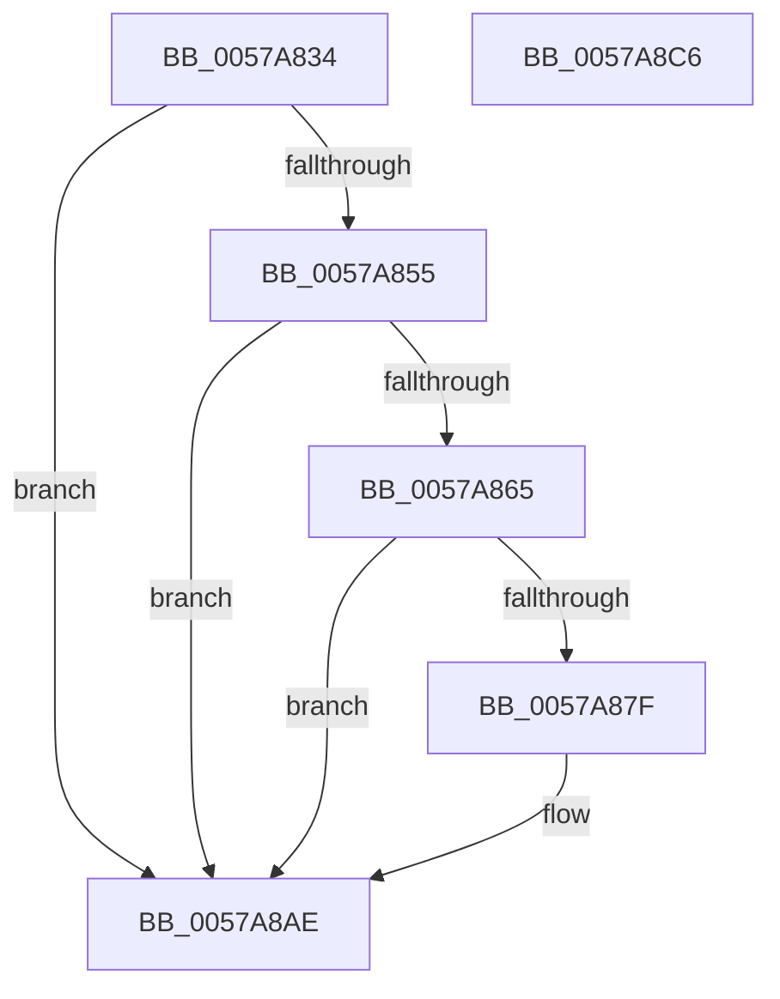

# DmrConvertDeviceScope

- RVA: `0x0057A834`–`0x0057A8C7` (길이 `147` bytes)
- VA: `0x000000014057A834`
- 실행 섹션: `.text`
- PDB 이름 있음: `예`; PDB Function 태그: `아니요`
- unwind 정보 RVA: `0x000B6A1C`
- 디코드: `43`개 명령, `147/147` bytes 표시
- 미해석 바이트: `0` (있으면 어셈블리에 `.byte`로 보존)

> 이 문서는 커널 이미지의 기계어와 PDB 기호를 분석해 생성했습니다. 4번과 5번은 함수 원형과 자료형을 바이너리 사용 방식에서 추정한 C 해석이며 원본 소스 복구 결과는 아닙니다.

## 1. Dependencies

- 직접 호출 지점: **2**; 고유 호출 대상: **2**
- 직접 호출자로 확인된 함수: **1**
- RIP 상대 이미지 참조: **0**

### Outgoing calls
- `0x0057A870` → [ExtEnvAllocateMemory](../56/ExtEnvAllocateMemory_function_005610B0.md) (function, `0x005610B0`)
- `0x0057A8A9` → [memcpy](../6C/memcpy_function_006C6840.md) (function, `0x006C6840`)

### Direct callers
- [HalpIvtCreateReservedDevice](HalpIvtCreateReservedDevice_function_0057A024.md) at `0x0057A0BD`

### Static image references
- 디코드된 RIP-relative 메모리 참조가 없습니다.

## 2. Other-region calls and transfers

- 다른 실행 섹션으로 향하는 call: **0**
- 별도 외부 분기/꼬리 이동을 확인하지 못했습니다.

## 3. Assembly (complete function range)

```asm
0057A834  48 8B C4                        mov rax, rsp
0057A837  48 89 58 08                     mov qword ptr [rax + 8], rbx
0057A83B  48 89 68 18                     mov qword ptr [rax + 0x18], rbp
0057A83F  48 89 70 20                     mov qword ptr [rax + 0x20], rsi
0057A843  57                              push rdi
0057A844  48 83 EC 20                     sub rsp, 0x20
0057A848  33 DB                           xor ebx, ebx
0057A84A  48 8B F2                        mov rsi, rdx
0057A84D  80 3A 01                        cmp byte ptr [rdx], 1
0057A850  0F B7 E9                        movzx ebp, cx
0057A853  75 59                           jne 0x14057a8ae
0057A855  0F B6 7A 01                     movzx edi, byte ptr [rdx + 1]
0057A859  66 83 EF 06                     sub di, 6
0057A85D  0F B7 D7                        movzx edx, di
0057A860  F6 C2 01                        test dl, 1
0057A863  75 49                           jne 0x14057a8ae
0057A865  48 21 58 10                     and qword ptr [rax + 0x10], rbx
0057A869  4C 8D 40 10                     lea r8, [rax + 0x10]
0057A86D  83 C2 18                        add edx, 0x18
0057A870  E8 3B 68 FE FF                  call 0x1405610b0
0057A875  48 8B 5C 24 38                  mov rbx, qword ptr [rsp + 0x38]
0057A87A  48 85 DB                        test rbx, rbx
0057A87D  74 2F                           je 0x14057a8ae
0057A87F  C7 03 01 00 00 00               mov dword ptr [rbx], 1
0057A885  48 8D 56 06                     lea rdx, [rsi + 6]
0057A889  66 89 6B 08                     mov word ptr [rbx + 8], bp
0057A88D  8A 4E 05                        mov cl, byte ptr [rsi + 5]
0057A890  88 4B 0B                        mov byte ptr [rbx + 0xb], cl
0057A893  0F B7 CF                        movzx ecx, di
0057A896  66 D1 E9                        shr cx, 1
0057A899  66 89 4B 0E                     mov word ptr [rbx + 0xe], cx
0057A89D  48 8D 4B 18                     lea rcx, [rbx + 0x18]
0057A8A1  44 0F B7 C7                     movzx r8d, di
0057A8A5  48 89 4B 10                     mov qword ptr [rbx + 0x10], rcx
0057A8A9  E8 92 BF 14 00                  call 0x1406c6840
0057A8AE  48 8B 6C 24 40                  mov rbp, qword ptr [rsp + 0x40]
0057A8B3  48 8B C3                        mov rax, rbx
0057A8B6  48 8B 5C 24 30                  mov rbx, qword ptr [rsp + 0x30]
0057A8BB  48 8B 74 24 48                  mov rsi, qword ptr [rsp + 0x48]
0057A8C0  48 83 C4 20                     add rsp, 0x20
0057A8C4  5F                              pop rdi
0057A8C5  C3                              ret
0057A8C6  CC                              int3
```

## 4. C-style interpretation (structured pseudocode)

```c
__int64 __fastcall DmrConvertDeviceScope(unsigned __int16 a1, __int64 a2)
{
    __int64 result;
    __int64 v_rbx;
    __int64 v_rdi;
    __int64 v_rsp;
    unsigned __int64 v_stack_p10;
    unsigned __int64 v_stack_p18;
    unsigned __int64 v_stack_p20;
    unsigned __int64 v_stack_p8;

    *(unsigned __int64 *)(v_rsp + 8) = v_rbx;
    *(unsigned __int64 *)(v_rsp + 24) = v_rbp;
    *(unsigned __int64 *)(v_rsp + 32) = v_rsi;
    v_rsp = (v_rsp) - (32);
    v_rbx = 0;
    if ((*(unsigned __int8 *)(a2)) != 1) goto loc_0057A8AE;
    v_rdi = (unsigned __int16)((*(unsigned __int8 *)(a2 + 1)) - (6));
    if ((((unsigned __int8)((unsigned __int16)(v_rdi))) & (1)) != 0) goto loc_0057A8AE;
    a2 = (unsigned int)(((unsigned __int16)(v_rdi)) + (24));
    result = ExtEnvAllocateMemory(a1, a2, v_rsp + 16, a4);
    if (v_stack_p10 != 0) {
        *(unsigned int *)(v_stack_p10) = 1;
        a2 = a2 + 6;
        *(unsigned __int16 *)(v_stack_p10 + 8) = a1;
        a1 = *(unsigned __int8 *)(a2 + 5);
        *(unsigned __int8 *)(v_stack_p10 + 11) = (unsigned __int8)(a1);
        a1 = (unsigned __int16)(v_rdi);
        a1 = (unsigned __int16)((a1) >> (1));
        *(unsigned __int16 *)(v_stack_p10 + 14) = a1;
        a1 = v_stack_p10 + 24;
        a3 = (unsigned __int16)(v_rdi);
        *(unsigned __int64 *)(v_stack_p10 + 16) = a1;
        result = memcpy(a1, a2, a3, a4);
    }
    v_rsp = (v_rsp) + (32);
    return v_stack_p10;
}
```

## 5. (Beta) C Style

```c
int64_t DmrConvertDeviceScope(uint16_t Arg1, void *Arg2)
{
    uint8_t *arg2 = (uint8_t *)Arg2;

    int64_t result;
    int64_t local_rbx;
    int64_t local_rdi;
    int64_t local_rsp;
    uint64_t v_stack_p10;
    uint64_t v_stack_p18;
    uint64_t v_stack_p20;
    uint64_t v_stack_p8;

    *(uint64_t *)(local_rsp + 0x8) = local_rbx;
    *(uint64_t *)(local_rsp + 0x18) = local_rbp;
    *(uint64_t *)(local_rsp + 0x20) = local_rsi;
    local_rsp = (local_rsp) - (32);
    local_rbx = 0;
    if ((*(uint8_t *)(arg2)) != 1) goto loc_0057A8AE;
    local_rdi = (uint16_t)((*(uint8_t *)(arg2 + 0x1)) - (6));
    if ((((uint8_t)((uint16_t)(local_rdi))) & (1)) != 0) goto loc_0057A8AE;
    Arg2 = (uint32_t)(((uint16_t)(local_rdi)) + (24));
    result = ExtEnvAllocateMemory(Arg1, Arg2, local_rsp + 16, a4);
    if (v_stack_p10 != 0) {
        *(uint32_t *)(v_stack_p10) = 1;
        Arg2 = Arg2 + 6;
        *(uint16_t *)(v_stack_p10 + 0x8) = Arg1;
        Arg1 = *(uint8_t *)(arg2 + 0x5);
        *(uint8_t *)(v_stack_p10 + 0xB) = (uint8_t)(Arg1);
        Arg1 = (uint16_t)(local_rdi);
        Arg1 = (uint16_t)((Arg1) >> (1));
        *(uint16_t *)(v_stack_p10 + 0xE) = Arg1;
        Arg1 = v_stack_p10 + 24;
        a3 = (uint16_t)(local_rdi);
        *(uint64_t *)(v_stack_p10 + 0x10) = Arg1;
        result = memcpy(Arg1, Arg2, a3, a4);
    }
    local_rsp = (local_rsp) + (32);
    return v_stack_p10;
}
```

### 관측된 메모리 오프셋

구조체 형식이 확인되지 않은 접근은 인자 기준의 오프셋으로만 기록했습니다.

| 기준 인자 | 오프셋 표현 | 폭 (bit) | 접근 |
|---|---:|---:|---|
| `Arg2` | `+ 0x0` | `8` | `R` |
| `Arg2` | `+ 0x1` | `8` | `R` |
| `Arg2` | `+ 0x5` | `8` | `R` |
| `Arg2` | `+ 0x6` | `64` | `R` |

## 6. Execution-region graph

[열기: 2D/3D 그래프와 함수 탐색 컨트롤 패널](../../../control-panel.html?section=text&rva=0x0057A834&view=graph)

- 2D 그래프는 위에서 아래로 흐르고, 3D 그래프는 빈 공간을 드래그해 회전합니다. Shift+드래그는 이동, 휠은 확대·축소, 함수 노드 선택은 대상 보고서 이동입니다.

### Static fallback


