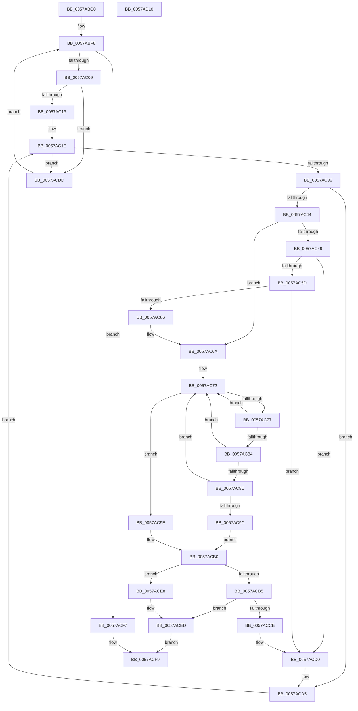

# DmrEnumerateRmrrDomains

- RVA: `0x0057ABC0`–`0x0057AD11` (길이 `337` bytes)
- VA: `0x000000014057ABC0`
- 실행 섹션: `.text`
- PDB 이름 있음: `예`; PDB Function 태그: `아니요`
- unwind 정보 RVA: `0x000BD538`
- 디코드: `105`개 명령, `337/337` bytes 표시
- 미해석 바이트: `0` (있으면 어셈블리에 `.byte`로 보존)

> 이 문서는 커널 이미지의 기계어와 PDB 기호를 분석해 생성했습니다. 4번과 5번은 함수 원형과 자료형을 바이너리 사용 방식에서 추정한 C 해석이며 원본 소스 복구 결과는 아닙니다.

## 1. Dependencies

- 직접 호출 지점: **7**; 고유 호출 대상: **7**
- 직접 호출자로 확인된 함수: **2**
- RIP 상대 이미지 참조: **0**

### Outgoing calls
- `0x0057ABF8` → [DmrGetNextRemappingStructure](DmrGetNextRemappingStructure_function_0057AA78.md) (function, `0x0057AA78`)
- `0x0057AC25` → [DmrGetNextDeviceScope](DmrGetNextDeviceScope_function_0057AA30.md) (function, `0x0057AA30`)
- `0x0057AC53` → [DmrFindDrhdForDeviceScope](DmrFindDrhdForDeviceScope_function_0057A6A0.md) (function, `0x0057A6A0`)
- `0x0057AC8F` → [DmrCheckPathMatch](DmrCheckPathMatch_function_0057A76C.md) (function, `0x0057A76C`)
- `0x0057ACA8` → [DmrpRmrrTreeAddNewScope](DmrpRmrrTreeAddNewScope_function_0057AD9C.md) (function, `0x0057AD9C`)
- `0x0057ACC0` → [DmrpRmrrTreeAddRegionToDevice](DmrpRmrrTreeAddRegionToDevice_function_0057AE3C.md) (function, `0x0057AE3C`)
- `0x0057ACF0` → [DmrFreeRmrrTree](DmrFreeRmrrTree_function_0057AD18.md) (function, `0x0057AD18`)

### Direct callers
- [HalpIvtLegacyProcessDrhdEntry](HalpIvtLegacyProcessDrhdEntry_function_00578C58.md) at `0x00578D7A`
- [HalpIvtProcessDrhdEntry](HalpIvtProcessDrhdEntry_function_005794B4.md) at `0x005795EE`

### Static image references
- 디코드된 RIP-relative 메모리 참조가 없습니다.

## 2. Other-region calls and transfers

- 다른 실행 섹션으로 향하는 call: **0**
- 별도 외부 분기/꼬리 이동을 확인하지 못했습니다.

## 3. Assembly (complete function range)

```asm
0057ABC0  48 89 5C 24 20                  mov qword ptr [rsp + 0x20], rbx
0057ABC5  48 89 54 24 10                  mov qword ptr [rsp + 0x10], rdx
0057ABCA  48 89 4C 24 08                  mov qword ptr [rsp + 8], rcx
0057ABCF  55                              push rbp
0057ABD0  56                              push rsi
0057ABD1  57                              push rdi
0057ABD2  41 54                           push r12
0057ABD4  41 55                           push r13
0057ABD6  41 56                           push r14
0057ABD8  41 57                           push r15
0057ABDA  48 83 EC 20                     sub rsp, 0x20
0057ABDE  4D 8D 78 08                     lea r15, [r8 + 8]
0057ABE2  48 8B FA                        mov rdi, rdx
0057ABE5  4D 89 7F 08                     mov qword ptr [r15 + 8], r15
0057ABE9  49 8B E8                        mov rbp, r8
0057ABEC  4D 89 3F                        mov qword ptr [r15], r15
0057ABEF  4C 8B D9                        mov r11, rcx
0057ABF2  41 83 20 00                     and dword ptr [r8], 0
0057ABF6  33 D2                           xor edx, edx
0057ABF8  E8 7B FE FF FF                  call 0x14057aa78
0057ABFD  48 8B D8                        mov rbx, rax
0057AC00  48 85 C0                        test rax, rax
0057AC03  0F 84 EE 00 00 00               je 0x14057acf7
0057AC09  66 83 38 01                     cmp word ptr [rax], 1
0057AC0D  0F 85 CA 00 00 00               jne 0x14057acdd
0057AC13  44 0F B7 68 02                  movzx r13d, word ptr [rax + 2]
0057AC18  4C 03 E8                        add r13, rax
0057AC1B  45 33 C0                        xor r8d, r8d
0057AC1E  49 8B D5                        mov rdx, r13
0057AC21  48 8D 4B 18                     lea rcx, [rbx + 0x18]
0057AC25  E8 06 FE FF FF                  call 0x14057aa30
0057AC2A  48 8B F0                        mov rsi, rax
0057AC2D  48 85 C0                        test rax, rax
0057AC30  0F 84 A7 00 00 00               je 0x14057acdd
0057AC36  8A 00                           mov al, byte ptr [rax]
0057AC38  88 44 24 70                     mov byte ptr [rsp + 0x70], al
0057AC3C  3C 01                           cmp al, 1
0057AC3E  0F 85 91 00 00 00               jne 0x14057acd5
0057AC44  48 85 FF                        test rdi, rdi
0057AC47  74 21                           je 0x14057ac6a
0057AC49  0F B7 53 06                     movzx edx, word ptr [rbx + 6]
0057AC4D  4C 8B C6                        mov r8, rsi
0057AC50  49 8B CB                        mov rcx, r11
0057AC53  E8 48 FA FF FF                  call 0x14057a6a0
0057AC58  48 85 C0                        test rax, rax
0057AC5B  74 73                           je 0x14057acd0
0057AC5D  48 83 C0 04                     add rax, 4
0057AC61  48 3B C7                        cmp rax, rdi
0057AC64  75 6A                           jne 0x14057acd0
0057AC66  8A 44 24 70                     mov al, byte ptr [rsp + 0x70]
0057AC6A  44 0F B7 63 06                  movzx r12d, word ptr [rbx + 6]
0057AC6F  4D 8B 37                        mov r14, qword ptr [r15]
0057AC72  4D 3B F7                        cmp r14, r15
0057AC75  74 27                           je 0x14057ac9e
0057AC77  49 8B FE                        mov rdi, r14
0057AC7A  4D 8B 36                        mov r14, qword ptr [r14]
0057AC7D  66 44 39 67 20                  cmp word ptr [rdi + 0x20], r12w
0057AC82  75 EE                           jne 0x14057ac72
0057AC84  48 8D 57 22                     lea rdx, [rdi + 0x22]
0057AC88  3A 02                           cmp al, byte ptr [rdx]
0057AC8A  75 E6                           jne 0x14057ac72
0057AC8C  48 8B CE                        mov rcx, rsi
0057AC8F  E8 D8 FA FF FF                  call 0x14057a76c
0057AC94  84 C0                           test al, al
0057AC96  8A 44 24 70                     mov al, byte ptr [rsp + 0x70]
0057AC9A  74 D6                           je 0x14057ac72
0057AC9C  EB 12                           jmp 0x14057acb0
0057AC9E  4C 8B C6                        mov r8, rsi
0057ACA1  41 0F B7 D4                     movzx edx, r12w
0057ACA5  48 8B CD                        mov rcx, rbp
0057ACA8  E8 EF 00 00 00                  call 0x14057ad9c
0057ACAD  48 8B F8                        mov rdi, rax
0057ACB0  48 85 FF                        test rdi, rdi
0057ACB3  74 33                           je 0x14057ace8
0057ACB5  4C 8B 43 10                     mov r8, qword ptr [rbx + 0x10]
0057ACB9  48 8B CF                        mov rcx, rdi
0057ACBC  48 8B 53 08                     mov rdx, qword ptr [rbx + 8]
0057ACC0  E8 77 01 00 00                  call 0x14057ae3c
0057ACC5  8B F8                           mov edi, eax
0057ACC7  85 C0                           test eax, eax
0057ACC9  78 22                           js 0x14057aced
0057ACCB  48 8B 7C 24 68                  mov rdi, qword ptr [rsp + 0x68]
0057ACD0  4C 8B 5C 24 60                  mov r11, qword ptr [rsp + 0x60]
0057ACD5  4C 8B C6                        mov r8, rsi
0057ACD8  E9 41 FF FF FF                  jmp 0x14057ac1e
0057ACDD  48 8B D3                        mov rdx, rbx
0057ACE0  49 8B CB                        mov rcx, r11
0057ACE3  E9 10 FF FF FF                  jmp 0x14057abf8
0057ACE8  BF 9A 00 00 C0                  mov edi, 0xc000009a
0057ACED  48 8B CD                        mov rcx, rbp
0057ACF0  E8 23 00 00 00                  call 0x14057ad18
0057ACF5  EB 02                           jmp 0x14057acf9
0057ACF7  33 FF                           xor edi, edi
0057ACF9  48 8B 5C 24 78                  mov rbx, qword ptr [rsp + 0x78]
0057ACFE  8B C7                           mov eax, edi
0057AD00  48 83 C4 20                     add rsp, 0x20
0057AD04  41 5F                           pop r15
0057AD06  41 5E                           pop r14
0057AD08  41 5D                           pop r13
0057AD0A  41 5C                           pop r12
0057AD0C  5F                              pop rdi
0057AD0D  5E                              pop rsi
0057AD0E  5D                              pop rbp
0057AD0F  C3                              ret
0057AD10  CC                              int3
```

## 4. C-style interpretation (structured pseudocode)

```c
__int64 __fastcall DmrEnumerateRmrrDomains(__int64 a1, __int64 a2, __int64 a3)
{
    __int64 result;
    __int64 v_r13;
    __int64 v_rdi;
    __int64 v_rsp;
    unsigned __int64 v_stack_p10;
    unsigned __int8 v_stack_p18;
    unsigned __int64 v_stack_p20;
    unsigned __int64 v_stack_p8;

    v_stack_p20 = v_rbx;
    v_stack_p10 = a2;
    v_stack_p8 = a1;
    v_rsp = (v_rsp) - (32);
    *(unsigned __int64 *)(a3 + 8 + 8) = a3 + 8;
    *(unsigned __int64 *)(a3 + 8) = a3 + 8;
    a2 = 0;
loc_0057ABF8:
    result = DmrGetNextRemappingStructure(a1, a2, a3, a4);
    if (result == 0) goto loc_0057ACF7;
    if ((*(unsigned __int16 *)(result)) != 1) goto loc_0057ACDD;
    v_r13 = (*(unsigned __int16 *)(result + 2)) + (result);
    a3 = 0;
loc_0057AC1E:
    result = DmrGetNextDeviceScope(result + 24, v_r13, a3, a4);
    if (result == 0) goto loc_0057ACDD;
    v_stack_p18 = (unsigned __int8)(*(unsigned __int8 *)(result));
    if (((unsigned __int8)(*(unsigned __int8 *)(result))) != 1) goto loc_0057ACD5;
    if (0 == 0) goto loc_0057AC6A;
    result = DmrFindDrhdForDeviceScope(a1, *(unsigned __int16 *)(result + 6), result, a4);
    if (result == 0) goto loc_0057ACD0;
    result = (result) + (4);
    if (result != 0) goto loc_0057ACD0;
loc_0057AC6A:
loc_0057AC72:
    if ((*(unsigned __int64 *)(a3 + 8)) == (a3 + 8)) goto loc_0057AC9E;
    if ((*(unsigned __int16 *)(*(unsigned __int64 *)(a3 + 8) + 32)) != ((unsigned __int16)(*(unsigned __int16 *)(result + 6)))) goto loc_0057AC72;
    if (((unsigned __int8)(v_stack_p18)) != (*(unsigned __int8 *)(*(unsigned __int64 *)(a3 + 8) + 34))) goto loc_0057AC72;
    result = DmrCheckPathMatch(result, *(unsigned __int64 *)(a3 + 8) + 34, result, a4);
    if ((unsigned __int8)(result) == 0) goto loc_0057AC72;
    goto loc_0057ACB0;
loc_0057AC9E:
    result = DmrpRmrrTreeAddNewScope(0, (unsigned __int16)(*(unsigned __int16 *)(result + 6)), result, a4);
loc_0057ACB0:
    if (result == 0) goto loc_0057ACE8;
    result = DmrpRmrrTreeAddRegionToDevice(result, *(unsigned __int64 *)(result + 8), *(unsigned __int64 *)(result + 16), a4);
    if (sign_flag) goto loc_0057ACED;
loc_0057ACD0:
loc_0057ACD5:
    goto loc_0057AC1E;
loc_0057ACDD:
    goto loc_0057ABF8;
loc_0057ACE8:
loc_0057ACED:
    result = DmrFreeRmrrTree(0, result, result, a4);
    goto loc_0057ACF9;
loc_0057ACF7:
    v_rdi = 0;
loc_0057ACF9:
    v_rsp = (v_rsp) + (32);
    return 0;
}
```

## 5. (Beta) C Style

```c
int64_t DmrEnumerateRmrrDomains(int64_t Arg1, int64_t Arg2, void *Arg3)
{
    uint8_t *arg3 = (uint8_t *)Arg3;

    int64_t result;
    int64_t local_r13;
    int64_t local_rdi;
    int64_t local_rsp;
    uint64_t v_stack_p10;
    uint8_t v_stack_p18;
    uint64_t v_stack_p20;
    uint64_t v_stack_p8;

    v_stack_p20 = local_rbx;
    v_stack_p10 = Arg2;
    v_stack_p8 = Arg1;
    local_rsp = (local_rsp) - (32);
    *(void **)(arg3 + 0x8 + 0x8) = Arg3 + 8;
    *(void **)(arg3 + 0x8) = Arg3 + 8;
    Arg2 = 0;
loc_0057ABF8:
    result = DmrGetNextRemappingStructure(Arg1, Arg2, Arg3, a4);
    if (result == 0) goto loc_0057ACF7;
    if ((*(uint16_t *)(result)) != 1) goto loc_0057ACDD;
    local_r13 = (*(uint16_t *)(result + 0x2)) + (result);
    Arg3 = 0;
loc_0057AC1E:
    result = DmrGetNextDeviceScope(result + 24, local_r13, Arg3, a4);
    if (result == 0) goto loc_0057ACDD;
    v_stack_p18 = (uint8_t)(*(uint8_t *)(result));
    if (((uint8_t)(*(uint8_t *)(result))) != 1) goto loc_0057ACD5;
    if (0 == 0) goto loc_0057AC6A;
    result = DmrFindDrhdForDeviceScope(Arg1, *(uint16_t *)(result + 0x6), result, a4);
    if (result == 0) goto loc_0057ACD0;
    result = (result) + (4);
    if (result != 0) goto loc_0057ACD0;
loc_0057AC6A:
loc_0057AC72:
    if ((*(uint64_t *)(arg3 + 0x8)) == (Arg3 + 8)) goto loc_0057AC9E;
    if ((*(uint16_t *)(*(uint64_t *)(arg3 + 0x8) + 0x20)) != ((uint16_t)(*(uint16_t *)(result + 0x6)))) goto loc_0057AC72;
    if (((uint8_t)(v_stack_p18)) != (*(uint8_t *)(*(uint64_t *)(arg3 + 0x8) + 0x22))) goto loc_0057AC72;
    result = DmrCheckPathMatch(result, *(uint64_t *)(arg3 + 0x8) + 34, result, a4);
    if ((uint8_t)(result) == 0) goto loc_0057AC72;
    goto loc_0057ACB0;
loc_0057AC9E:
    result = DmrpRmrrTreeAddNewScope(0, (uint16_t)(*(uint16_t *)(result + 0x6)), result, a4);
loc_0057ACB0:
    if (result == 0) goto loc_0057ACE8;
    result = DmrpRmrrTreeAddRegionToDevice(result, *(uint64_t *)(result + 0x8), *(uint64_t *)(result + 0x10), a4);
    if (sign_flag) goto loc_0057ACED;
loc_0057ACD0:
loc_0057ACD5:
    goto loc_0057AC1E;
loc_0057ACDD:
    goto loc_0057ABF8;
loc_0057ACE8:
loc_0057ACED:
    result = DmrFreeRmrrTree(0, result, result, a4);
    goto loc_0057ACF9;
loc_0057ACF7:
    local_rdi = 0;
loc_0057ACF9:
    local_rsp = (local_rsp) + (32);
    return 0;
}
```

### 관측된 메모리 오프셋

구조체 형식이 확인되지 않은 접근은 인자 기준의 오프셋으로만 기록했습니다.

| 기준 인자 | 오프셋 표현 | 폭 (bit) | 접근 |
|---|---:|---:|---|
| `Arg3` | `+ 0x0` | `32` | `R/W` |
| `Arg3` | `+ 0x0` | `64` | `R` |
| `Arg3` | `+ 0x0` | `64` | `W` |
| `Arg3` | `+ 0x8` | `64` | `R` |
| `Arg3` | `+ 0x8` | `64` | `W` |

## 6. Execution-region graph

[열기: 2D/3D 그래프와 함수 탐색 컨트롤 패널](../../../control-panel.html?section=text&rva=0x0057ABC0&view=graph)

- 2D 그래프는 위에서 아래로 흐르고, 3D 그래프는 빈 공간을 드래그해 회전합니다. Shift+드래그는 이동, 휠은 확대·축소, 함수 노드 선택은 대상 보고서 이동입니다.

### Static fallback


