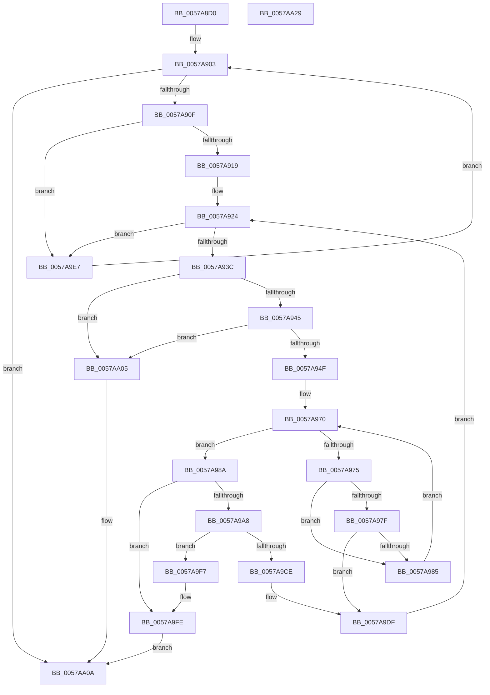

# DmrEnumerateSatcDevices

- RVA: `0x0057A8D0`–`0x0057AA2A` (길이 `346` bytes)
- VA: `0x000000014057A8D0`
- 실행 섹션: `.text`
- PDB 이름 있음: `예`; PDB Function 태그: `아니요`
- unwind 정보 RVA: `0x000BD610`
- 디코드: `94`개 명령, `346/346` bytes 표시
- 미해석 바이트: `0` (있으면 어셈블리에 `.byte`로 보존)

> 이 문서는 커널 이미지의 기계어와 PDB 기호를 분석해 생성했습니다. 4번과 5번은 함수 원형과 자료형을 바이너리 사용 방식에서 추정한 C 해석이며 원본 소스 복구 결과는 아닙니다.

## 1. Dependencies

- 직접 호출 지점: **4**; 고유 호출 대상: **3**
- 직접 호출자로 확인된 함수: **1**
- RIP 상대 이미지 참조: **3**

### Outgoing calls
- `0x0057A8F5` → [DmrGetNextRemappingStructure](DmrGetNextRemappingStructure_function_0057AA78.md) (function, `0x0057AA78`)
- `0x0057A92B` → [DmrGetNextDeviceScope](DmrGetNextDeviceScope_function_0057AA30.md) (function, `0x0057AA30`)
- `0x0057A999` → [ExtEnvAllocateMemory](../56/ExtEnvAllocateMemory_function_005610B0.md) (function, `0x005610B0`)
- `0x0057A9ED` → [DmrGetNextRemappingStructure](DmrGetNextRemappingStructure_function_0057AA78.md) (function, `0x0057AA78`)

### Direct callers
- [HalpIvtProcessDmarTable](HalpIvtProcessDmarTable_function_005793EC.md) at `0x00579450`

### Static image references
- `0x0057A8FC` → RVA `0x00FC1900` (`.data`; read)
- `0x0057A9C2` → RVA `0x00FC1908` (`.data`; read)
- `0x0057A9D8` → RVA `0x00FC1908` (`.data`; write)

## 2. Other-region calls and transfers

- 다른 실행 섹션으로 향하는 call: **0**
- 별도 외부 분기/꼬리 이동을 확인하지 못했습니다.

## 3. Assembly (complete function range)

```asm
0057A8D0  48 8B C4                        mov rax, rsp
0057A8D3  48 89 58 08                     mov qword ptr [rax + 8], rbx
0057A8D7  48 89 68 18                     mov qword ptr [rax + 0x18], rbp
0057A8DB  48 89 70 20                     mov qword ptr [rax + 0x20], rsi
0057A8DF  48 89 50 10                     mov qword ptr [rax + 0x10], rdx
0057A8E3  57                              push rdi
0057A8E4  41 54                           push r12
0057A8E6  41 55                           push r13
0057A8E8  41 56                           push r14
0057A8EA  41 57                           push r15
0057A8EC  48 83 EC 20                     sub rsp, 0x20
0057A8F0  33 D2                           xor edx, edx
0057A8F2  4C 8B F1                        mov r14, rcx
0057A8F5  E8 7E 01 00 00                  call 0x14057aa78
0057A8FA  33 DB                           xor ebx, ebx
0057A8FC  4C 8D 2D FD 6F A4 00            lea r13, [rip + 0xa46ffd]
0057A903  48 8B F8                        mov rdi, rax
0057A906  48 85 C0                        test rax, rax
0057A909  0F 84 FB 00 00 00               je 0x14057aa0a
0057A90F  66 83 38 05                     cmp word ptr [rax], 5
0057A913  0F 85 CE 00 00 00               jne 0x14057a9e7
0057A919  44 0F B7 78 02                  movzx r15d, word ptr [rax + 2]
0057A91E  4C 03 F8                        add r15, rax
0057A921  45 33 C0                        xor r8d, r8d
0057A924  49 8B D7                        mov rdx, r15
0057A927  48 8D 4F 08                     lea rcx, [rdi + 8]
0057A92B  E8 00 01 00 00                  call 0x14057aa30
0057A930  48 8B F0                        mov rsi, rax
0057A933  48 85 C0                        test rax, rax
0057A936  0F 84 AB 00 00 00               je 0x14057a9e7
0057A93C  80 38 01                        cmp byte ptr [rax], 1
0057A93F  0F 85 C0 00 00 00               jne 0x14057aa05
0057A945  80 78 01 08                     cmp byte ptr [rax + 1], 8
0057A949  0F 85 B6 00 00 00               jne 0x14057aa05
0057A94F  0F B6 68 05                     movzx ebp, byte ptr [rax + 5]
0057A953  0F B6 40 06                     movzx eax, byte ptr [rax + 6]
0057A957  48 8B 0D A2 6F A4 00            mov rcx, qword ptr [rip + 0xa46fa2]
0057A95E  66 C1 E5 05                     shl bp, 5
0057A962  66 0B E8                        or bp, ax
0057A965  0F B6 46 07                     movzx eax, byte ptr [rsi + 7]
0057A969  66 C1 E5 03                     shl bp, 3
0057A96D  66 0B E8                        or bp, ax
0057A970  49 3B CD                        cmp rcx, r13
0057A973  74 15                           je 0x14057a98a
0057A975  0F B7 47 06                     movzx eax, word ptr [rdi + 6]
0057A979  66 39 41 18                     cmp word ptr [rcx + 0x18], ax
0057A97D  75 06                           jne 0x14057a985
0057A97F  66 39 69 1C                     cmp word ptr [rcx + 0x1c], bp
0057A983  74 5A                           je 0x14057a9df
0057A985  48 8B 09                        mov rcx, qword ptr [rcx]
0057A988  EB E6                           jmp 0x14057a970
0057A98A  4C 8D 44 24 58                  lea r8, [rsp + 0x58]
0057A98F  48 89 5C 24 58                  mov qword ptr [rsp + 0x58], rbx
0057A994  BA 30 00 00 00                  mov edx, 0x30
0057A999  E8 12 67 FE FF                  call 0x1405610b0
0057A99E  48 8B 4C 24 58                  mov rcx, qword ptr [rsp + 0x58]
0057A9A3  48 85 C9                        test rcx, rcx
0057A9A6  74 56                           je 0x14057a9fe
0057A9A8  C7 41 10 01 00 00 00            mov dword ptr [rcx + 0x10], 1
0057A9AF  66 89 69 1C                     mov word ptr [rcx + 0x1c], bp
0057A9B3  0F B7 47 06                     movzx eax, word ptr [rdi + 6]
0057A9B7  66 89 41 18                     mov word ptr [rcx + 0x18], ax
0057A9BB  0F B6 47 04                     movzx eax, byte ptr [rdi + 4]
0057A9BF  89 41 28                        mov dword ptr [rcx + 0x28], eax
0057A9C2  48 8B 05 3F 6F A4 00            mov rax, qword ptr [rip + 0xa46f3f]
0057A9C9  4C 39 28                        cmp qword ptr [rax], r13
0057A9CC  75 29                           jne 0x14057a9f7
0057A9CE  4C 89 29                        mov qword ptr [rcx], r13
0057A9D1  48 89 41 08                     mov qword ptr [rcx + 8], rax
0057A9D5  48 89 08                        mov qword ptr [rax], rcx
0057A9D8  48 89 0D 29 6F A4 00            mov qword ptr [rip + 0xa46f29], rcx
0057A9DF  4C 8B C6                        mov r8, rsi
0057A9E2  E9 3D FF FF FF                  jmp 0x14057a924
0057A9E7  48 8B D7                        mov rdx, rdi
0057A9EA  49 8B CE                        mov rcx, r14
0057A9ED  E8 86 00 00 00                  call 0x14057aa78
0057A9F2  E9 0C FF FF FF                  jmp 0x14057a903
0057A9F7  B9 03 00 00 00                  mov ecx, 3
0057A9FC  CD 29                           int 0x29
0057A9FE  BB 9A 00 00 C0                  mov ebx, 0xc000009a
0057AA03  EB 05                           jmp 0x14057aa0a
0057AA05  BB BB 00 00 C0                  mov ebx, 0xc00000bb
0057AA0A  48 8B 6C 24 60                  mov rbp, qword ptr [rsp + 0x60]
0057AA0F  8B C3                           mov eax, ebx
0057AA11  48 8B 5C 24 50                  mov rbx, qword ptr [rsp + 0x50]
0057AA16  48 8B 74 24 68                  mov rsi, qword ptr [rsp + 0x68]
0057AA1B  48 83 C4 20                     add rsp, 0x20
0057AA1F  41 5F                           pop r15
0057AA21  41 5E                           pop r14
0057AA23  41 5D                           pop r13
0057AA25  41 5C                           pop r12
0057AA27  5F                              pop rdi
0057AA28  C3                              ret
0057AA29  CC                              int3
```

## 4. C-style interpretation (structured pseudocode)

```c
__int64 __fastcall DmrEnumerateSatcDevices(__int64 a1, __int64 a2, int a3)
{
    __int64 result;
    __int64 v_r15;
    __int64 v_rbp;
    __int64 v_rbx;
    __int64 v_rsp;
    unsigned __int64 v_stack_p10;
    unsigned __int64 v_stack_p18;
    unsigned __int64 v_stack_p20;
    unsigned __int64 v_stack_p8;

    *(unsigned __int64 *)(v_rsp + 8) = v_rbx;
    *(unsigned __int64 *)(v_rsp + 24) = v_rbp;
    *(unsigned __int64 *)(v_rsp + 32) = v_rsi;
    *(unsigned __int64 *)(v_rsp + 16) = a2;
    v_rsp = (v_rsp) - (32);
    a2 = 0;
    result = DmrGetNextRemappingStructure(a1, a2, a3, a4);
    v_rbx = 0;
loc_0057A903:
    if (result == 0) goto loc_0057AA0A;
    if ((*(unsigned __int16 *)(result)) != 5) goto loc_0057A9E7;
    v_r15 = (*(unsigned __int16 *)(result + 2)) + (result);
    a3 = 0;
loc_0057A924:
    result = DmrGetNextDeviceScope(result + 8, v_r15, a3, a4);
    if (result == 0) goto loc_0057A9E7;
    if ((*(unsigned __int8 *)(result)) != 1) goto loc_0057AA05;
    if ((*(unsigned __int8 *)(result + 1)) != 8) goto loc_0057AA05;
    v_rbp = (unsigned __int16)((*(unsigned __int8 *)(result + 5)) << (5));
    v_rbp = (unsigned __int16)((v_rbp) | ((unsigned __int16)(*(unsigned __int8 *)(result + 6))));
    v_rbp = (unsigned __int16)((v_rbp) << (3));
    v_rbp = (unsigned __int16)((v_rbp) | ((unsigned __int16)(*(unsigned __int8 *)(result + 7))));
loc_0057A970:
    if ((*(unsigned __int64 *)(v_rip + 10776482)) == (v_rip + 10776573)) goto loc_0057A98A;
    if ((*(unsigned __int16 *)(*(unsigned __int64 *)(v_rip + 10776482) + 24)) != ((unsigned __int16)(*(unsigned __int16 *)(result + 6)))) goto loc_0057A985;
    if ((*(unsigned __int16 *)(*(unsigned __int64 *)(v_rip + 10776482) + 28)) == ((unsigned __int16)(v_rbp))) goto loc_0057A9DF;
loc_0057A985:
    goto loc_0057A970;
loc_0057A98A:
    v_stack_p10 = 0;
    result = ExtEnvAllocateMemory(*(unsigned __int64 *)(*(unsigned __int64 *)(v_rip + 10776482)), 48, v_stack_p10, a4);
    if (v_stack_p10 == 0) goto loc_0057A9FE;
    *(unsigned int *)(v_stack_p10 + 16) = 1;
    *(unsigned __int16 *)(v_stack_p10 + 28) = (unsigned __int16)(v_rbp);
    *(unsigned __int16 *)(v_stack_p10 + 24) = (unsigned __int16)(*(unsigned __int16 *)(result + 6));
    *(unsigned int *)(v_stack_p10 + 40) = (unsigned int)(*(unsigned __int8 *)(result + 4));
    if ((*(unsigned __int64 *)(*(unsigned __int64 *)(v_rip + 10776383))) != (v_rip + 10776573)) goto loc_0057A9F7;
    *(unsigned __int64 *)(v_stack_p10) = v_rip + 10776573;
    *(unsigned __int64 *)(v_stack_p10 + 8) = *(unsigned __int64 *)(v_rip + 10776383);
    *(unsigned __int64 *)(*(unsigned __int64 *)(v_rip + 10776383)) = v_stack_p10;
    *(unsigned __int64 *)(v_rip + 10776361) = v_stack_p10;
loc_0057A9DF:
    goto loc_0057A924;
loc_0057A9E7:
    result = DmrGetNextRemappingStructure(a1, result, result, a4);
    goto loc_0057A903;
loc_0057A9F7:
loc_0057A9FE:
    goto loc_0057AA0A;
loc_0057AA05:
loc_0057AA0A:
    v_rsp = (v_rsp) + (32);
    return (unsigned int)((unsigned int)((unsigned int)(0xC00000BBULL)));
}
```

## 5. (Beta) C Style

```c
int64_t DmrEnumerateSatcDevices(int64_t Arg1, int64_t Arg2, int32_t Arg3)
{
    int64_t result;
    int64_t local_r15;
    int64_t local_rbp;
    int64_t local_rbx;
    int64_t local_rsp;
    uint64_t v_stack_p10;
    uint64_t v_stack_p18;
    uint64_t v_stack_p20;
    uint64_t v_stack_p8;

    *(uint64_t *)(local_rsp + 0x8) = local_rbx;
    *(uint64_t *)(local_rsp + 0x18) = local_rbp;
    *(uint64_t *)(local_rsp + 0x20) = local_rsi;
    *(uint64_t *)(local_rsp + 0x10) = Arg2;
    local_rsp = (local_rsp) - (32);
    Arg2 = 0;
    result = DmrGetNextRemappingStructure(Arg1, Arg2, Arg3, a4);
    local_rbx = 0;
loc_0057A903:
    if (result == 0) goto loc_0057AA0A;
    if ((*(uint16_t *)(result)) != 5) goto loc_0057A9E7;
    local_r15 = (*(uint16_t *)(result + 0x2)) + (result);
    Arg3 = 0;
loc_0057A924:
    result = DmrGetNextDeviceScope(result + 8, local_r15, Arg3, a4);
    if (result == 0) goto loc_0057A9E7;
    if ((*(uint8_t *)(result)) != 1) goto loc_0057AA05;
    if ((*(uint8_t *)(result + 0x1)) != 8) goto loc_0057AA05;
    local_rbp = (uint16_t)((*(uint8_t *)(result + 0x5)) << (5));
    local_rbp = (uint16_t)((local_rbp) | ((uint16_t)(*(uint8_t *)(result + 0x6))));
    local_rbp = (uint16_t)((local_rbp) << (3));
    local_rbp = (uint16_t)((local_rbp) | ((uint16_t)(*(uint8_t *)(result + 0x7))));
loc_0057A970:
    if ((*(uint64_t *)(v_rip + 0xA46FA2)) == (v_rip + 10776573)) goto loc_0057A98A;
    if ((*(uint16_t *)(*(uint64_t *)(v_rip + 0xA46FA2) + 0x18)) != ((uint16_t)(*(uint16_t *)(result + 0x6)))) goto loc_0057A985;
    if ((*(uint16_t *)(*(uint64_t *)(v_rip + 0xA46FA2) + 0x1C)) == ((uint16_t)(local_rbp))) goto loc_0057A9DF;
loc_0057A985:
    goto loc_0057A970;
loc_0057A98A:
    v_stack_p10 = 0;
    result = ExtEnvAllocateMemory(*(uint64_t *)(*(uint64_t *)(v_rip + 0xA46FA2)), 48, v_stack_p10, a4);
    if (v_stack_p10 == 0) goto loc_0057A9FE;
    *(uint32_t *)(v_stack_p10 + 0x10) = 1;
    *(uint16_t *)(v_stack_p10 + 0x1C) = (uint16_t)(local_rbp);
    *(uint16_t *)(v_stack_p10 + 0x18) = (uint16_t)(*(uint16_t *)(result + 0x6));
    *(uint32_t *)(v_stack_p10 + 0x28) = (uint32_t)(*(uint8_t *)(result + 0x4));
    if ((*(uint64_t *)(*(uint64_t *)(v_rip + 0xA46F3F))) != (v_rip + 10776573)) goto loc_0057A9F7;
    *(uint64_t *)(v_stack_p10) = v_rip + 10776573;
    *(uint64_t *)(v_stack_p10 + 0x8) = *(uint64_t *)(v_rip + 0xA46F3F);
    *(uint64_t *)(*(uint64_t *)(v_rip + 0xA46F3F)) = v_stack_p10;
    *(uint64_t *)(v_rip + 0xA46F29) = v_stack_p10;
loc_0057A9DF:
    goto loc_0057A924;
loc_0057A9E7:
    result = DmrGetNextRemappingStructure(Arg1, result, result, a4);
    goto loc_0057A903;
loc_0057A9F7:
loc_0057A9FE:
    goto loc_0057AA0A;
loc_0057AA05:
loc_0057AA0A:
    local_rsp = (local_rsp) + (32);
    return (uint32_t)((uint32_t)((uint32_t)(0xC00000BBULL)));
}
```

## 6. Execution-region graph

[열기: 2D/3D 그래프와 함수 탐색 컨트롤 패널](../../../control-panel.html?section=text&rva=0x0057A8D0&view=graph)

- 2D 그래프는 위에서 아래로 흐르고, 3D 그래프는 빈 공간을 드래그해 회전합니다. Shift+드래그는 이동, 휠은 확대·축소, 함수 노드 선택은 대상 보고서 이동입니다.

### Static fallback


