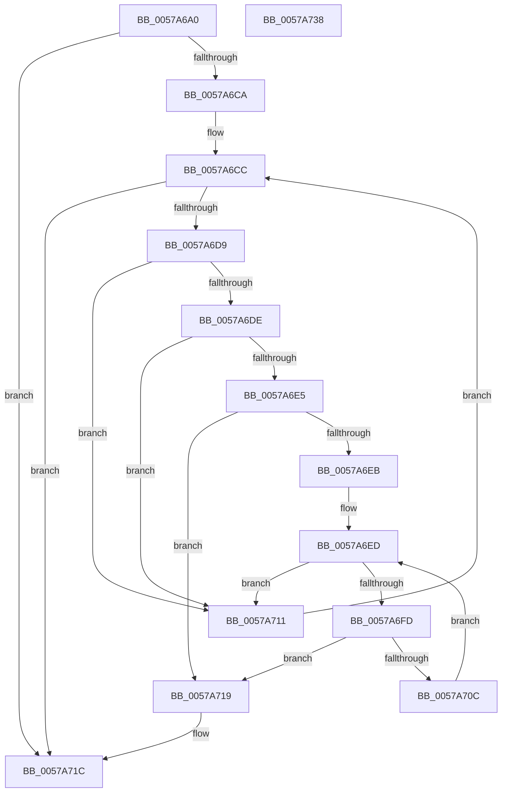

# DmrFindDrhdForDeviceScope

- RVA: `0x0057A6A0`–`0x0057A739` (길이 `153` bytes)
- VA: `0x000000014057A6A0`
- 실행 섹션: `.text`
- PDB 이름 있음: `예`; PDB Function 태그: `아니요`
- unwind 정보 RVA: `0x00060300`
- 디코드: `51`개 명령, `153/153` bytes 표시
- 미해석 바이트: `0` (있으면 어셈블리에 `.byte`로 보존)

> 이 문서는 커널 이미지의 기계어와 PDB 기호를 분석해 생성했습니다. 4번과 5번은 함수 원형과 자료형을 바이너리 사용 방식에서 추정한 C 해석이며 원본 소스 복구 결과는 아닙니다.

## 1. Dependencies

- 직접 호출 지점: **3**; 고유 호출 대상: **3**
- 직접 호출자로 확인된 함수: **1**
- RIP 상대 이미지 참조: **0**

### Outgoing calls
- `0x0057A6CC` → [DmrGetNextRemappingStructure](DmrGetNextRemappingStructure_function_0057AA78.md) (function, `0x0057AA78`)
- `0x0057A6F0` → [DmrGetNextDrhdDeviceScope](DmrGetNextDrhdDeviceScope_function_0057A740.md) (function, `0x0057A740`)
- `0x0057A703` → [DmrCheckPathMatch](DmrCheckPathMatch_function_0057A76C.md) (function, `0x0057A76C`)

### Direct callers
- [DmrEnumerateRmrrDomains](DmrEnumerateRmrrDomains_function_0057ABC0.md) at `0x0057AC53`

### Static image references
- 디코드된 RIP-relative 메모리 참조가 없습니다.

## 2. Other-region calls and transfers

- 다른 실행 섹션으로 향하는 call: **0**
- 별도 외부 분기/꼬리 이동을 확인하지 못했습니다.

## 3. Assembly (complete function range)

```asm
0057A6A0  48 89 5C 24 08                  mov qword ptr [rsp + 8], rbx
0057A6A5  48 89 6C 24 10                  mov qword ptr [rsp + 0x10], rbp
0057A6AA  48 89 74 24 18                  mov qword ptr [rsp + 0x18], rsi
0057A6AF  57                              push rdi
0057A6B0  41 56                           push r14
0057A6B2  41 57                           push r15
0057A6B4  48 83 EC 20                     sub rsp, 0x20
0057A6B8  33 FF                           xor edi, edi
0057A6BA  4D 8B F0                        mov r14, r8
0057A6BD  41 80 38 01                     cmp byte ptr [r8], 1
0057A6C1  44 0F B7 FA                     movzx r15d, dx
0057A6C5  48 8B E9                        mov rbp, rcx
0057A6C8  75 52                           jne 0x14057a71c
0057A6CA  33 D2                           xor edx, edx
0057A6CC  E8 A7 03 00 00                  call 0x14057aa78
0057A6D1  48 8B D8                        mov rbx, rax
0057A6D4  48 85 C0                        test rax, rax
0057A6D7  74 43                           je 0x14057a71c
0057A6D9  66 39 38                        cmp word ptr [rax], di
0057A6DC  75 33                           jne 0x14057a711
0057A6DE  66 44 39 78 06                  cmp word ptr [rax + 6], r15w
0057A6E3  75 2C                           jne 0x14057a711
0057A6E5  F6 40 04 01                     test byte ptr [rax + 4], 1
0057A6E9  75 2E                           jne 0x14057a719
0057A6EB  33 D2                           xor edx, edx
0057A6ED  48 8B CB                        mov rcx, rbx
0057A6F0  E8 4B 00 00 00                  call 0x14057a740
0057A6F5  48 8B F0                        mov rsi, rax
0057A6F8  48 85 C0                        test rax, rax
0057A6FB  74 14                           je 0x14057a711
0057A6FD  49 8B D6                        mov rdx, r14
0057A700  48 8B C8                        mov rcx, rax
0057A703  E8 64 00 00 00                  call 0x14057a76c
0057A708  84 C0                           test al, al
0057A70A  75 0D                           jne 0x14057a719
0057A70C  48 8B D6                        mov rdx, rsi
0057A70F  EB DC                           jmp 0x14057a6ed
0057A711  48 8B D3                        mov rdx, rbx
0057A714  48 8B CD                        mov rcx, rbp
0057A717  EB B3                           jmp 0x14057a6cc
0057A719  48 8B FB                        mov rdi, rbx
0057A71C  48 8B 5C 24 40                  mov rbx, qword ptr [rsp + 0x40]
0057A721  48 8B C7                        mov rax, rdi
0057A724  48 8B 6C 24 48                  mov rbp, qword ptr [rsp + 0x48]
0057A729  48 8B 74 24 50                  mov rsi, qword ptr [rsp + 0x50]
0057A72E  48 83 C4 20                     add rsp, 0x20
0057A732  41 5F                           pop r15
0057A734  41 5E                           pop r14
0057A736  5F                              pop rdi
0057A737  C3                              ret
0057A738  CC                              int3
```

## 4. C-style interpretation (structured pseudocode)

```c
__int64 __fastcall DmrFindDrhdForDeviceScope(__int64 a1, int a2, __int64 a3)
{
    __int64 result;
    __int64 v_rdi;
    __int64 v_rsp;
    unsigned __int64 v_stack_p10;
    unsigned __int64 v_stack_p18;
    unsigned __int64 v_stack_p8;

    v_stack_p8 = v_rbx;
    v_stack_p10 = v_rbp;
    v_stack_p18 = v_rsi;
    v_rsp = (v_rsp) - (32);
    v_rdi = 0;
    if ((*(unsigned __int8 *)(a3)) != 1) goto loc_0057A71C;
    a2 = 0;
loc_0057A6CC:
    result = DmrGetNextRemappingStructure(a1, a2, a3, a4);
    if (result == 0) goto loc_0057A71C;
    if ((*(unsigned __int16 *)(result)) != 0) goto loc_0057A711;
    if ((*(unsigned __int16 *)(result + 6)) != ((unsigned __int16)((unsigned __int16)(a2)))) goto loc_0057A711;
    if (((*(unsigned __int8 *)(result + 4)) & (1)) != 0) goto loc_0057A719;
    a2 = 0;
loc_0057A6ED:
    result = DmrGetNextDrhdDeviceScope(result, a2, a3, a4);
    if (result == 0) goto loc_0057A711;
    result = DmrCheckPathMatch(result, a3, a3, a4);
    if ((unsigned __int8)(result) != 0) goto loc_0057A719;
    goto loc_0057A6ED;
loc_0057A711:
    goto loc_0057A6CC;
loc_0057A719:
loc_0057A71C:
    v_rsp = (v_rsp) + (32);
    return result;
}
```

## 5. (Beta) C Style

```c
int64_t DmrFindDrhdForDeviceScope(int64_t Arg1, int32_t Arg2, void *Arg3)
{
    uint8_t *arg3 = (uint8_t *)Arg3;

    int64_t result;
    int64_t local_rdi;
    int64_t local_rsp;
    uint64_t v_stack_p10;
    uint64_t v_stack_p18;
    uint64_t v_stack_p8;

    v_stack_p8 = local_rbx;
    v_stack_p10 = local_rbp;
    v_stack_p18 = local_rsi;
    local_rsp = (local_rsp) - (32);
    local_rdi = 0;
    if ((*(uint8_t *)(arg3)) != 1) goto loc_0057A71C;
    Arg2 = 0;
loc_0057A6CC:
    result = DmrGetNextRemappingStructure(Arg1, Arg2, Arg3, a4);
    if (result == 0) goto loc_0057A71C;
    if ((*(uint16_t *)(result)) != 0) goto loc_0057A711;
    if ((*(uint16_t *)(result + 0x6)) != ((uint16_t)((uint16_t)(Arg2)))) goto loc_0057A711;
    if (((*(uint8_t *)(result + 0x4)) & (1)) != 0) goto loc_0057A719;
    Arg2 = 0;
loc_0057A6ED:
    result = DmrGetNextDrhdDeviceScope(result, Arg2, Arg3, a4);
    if (result == 0) goto loc_0057A711;
    result = DmrCheckPathMatch(result, Arg3, Arg3, a4);
    if ((uint8_t)(result) != 0) goto loc_0057A719;
    goto loc_0057A6ED;
loc_0057A711:
    goto loc_0057A6CC;
loc_0057A719:
loc_0057A71C:
    local_rsp = (local_rsp) + (32);
    return result;
}
```

### 관측된 메모리 오프셋

구조체 형식이 확인되지 않은 접근은 인자 기준의 오프셋으로만 기록했습니다.

| 기준 인자 | 오프셋 표현 | 폭 (bit) | 접근 |
|---|---:|---:|---|
| `Arg3` | `+ 0x0` | `8` | `R` |

## 6. Execution-region graph

[열기: 2D/3D 그래프와 함수 탐색 컨트롤 패널](../../../control-panel.html?section=text&rva=0x0057A6A0&view=graph)

- 2D 그래프는 위에서 아래로 흐르고, 3D 그래프는 빈 공간을 드래그해 회전합니다. Shift+드래그는 이동, 휠은 확대·축소, 함수 노드 선택은 대상 보고서 이동입니다.

### Static fallback


