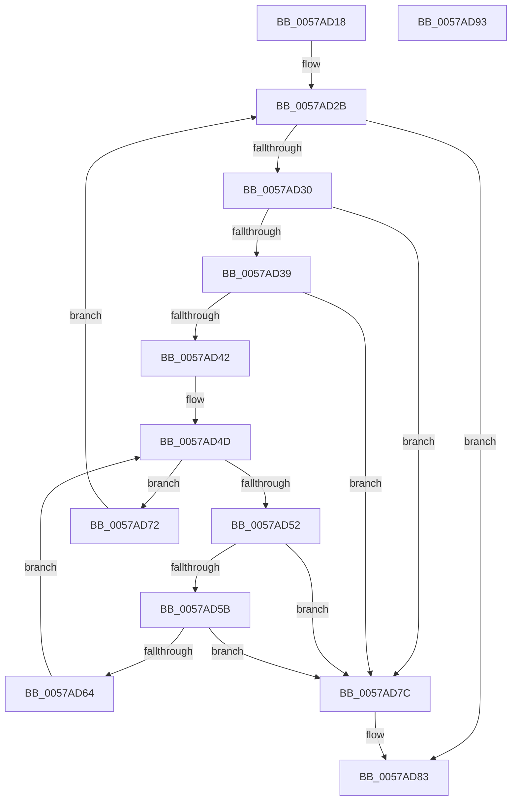

# DmrFreeRmrrTree

- RVA: `0x0057AD18`–`0x0057AD94` (길이 `124` bytes)
- VA: `0x000000014057AD18`
- 실행 섹션: `.text`
- PDB 이름 있음: `예`; PDB Function 태그: `아니요`
- unwind 정보 RVA: `0x00060BC4`
- 디코드: `39`개 명령, `124/124` bytes 표시
- 미해석 바이트: `0` (있으면 어셈블리에 `.byte`로 보존)

> 이 문서는 커널 이미지의 기계어와 PDB 기호를 분석해 생성했습니다. 4번과 5번은 함수 원형과 자료형을 바이너리 사용 방식에서 추정한 C 해석이며 원본 소스 복구 결과는 아닙니다.

## 1. Dependencies

- 직접 호출 지점: **2**; 고유 호출 대상: **1**
- 직접 호출자로 확인된 함수: **3**
- RIP 상대 이미지 참조: **0**

### Outgoing calls
- `0x0057AD6B` → [ExtEnvFreeMemory](../56/ExtEnvFreeMemory_function_00561320.md) (function, `0x00561320`)
- `0x0057AD75` → [ExtEnvFreeMemory](../56/ExtEnvFreeMemory_function_00561320.md) (function, `0x00561320`)

### Direct callers
- [HalpIvtLegacyProcessDrhdEntry](HalpIvtLegacyProcessDrhdEntry_function_00578C58.md) at `0x005793BF`
- [HalpIvtProcessDrhdEntry](HalpIvtProcessDrhdEntry_function_005794B4.md) at `0x00579CAA`
- [DmrEnumerateRmrrDomains](DmrEnumerateRmrrDomains_function_0057ABC0.md) at `0x0057ACF0`

### Static image references
- 디코드된 RIP-relative 메모리 참조가 없습니다.

## 2. Other-region calls and transfers

- 다른 실행 섹션으로 향하는 call: **0**
- 별도 외부 분기/꼬리 이동을 확인하지 못했습니다.

## 3. Assembly (complete function range)

```asm
0057AD18  48 89 5C 24 08                  mov qword ptr [rsp + 8], rbx
0057AD1D  48 89 74 24 10                  mov qword ptr [rsp + 0x10], rsi
0057AD22  57                              push rdi
0057AD23  48 83 EC 20                     sub rsp, 0x20
0057AD27  48 8D 59 08                     lea rbx, [rcx + 8]
0057AD2B  48 39 1B                        cmp qword ptr [rbx], rbx
0057AD2E  74 53                           je 0x14057ad83
0057AD30  48 8B 7B 08                     mov rdi, qword ptr [rbx + 8]
0057AD34  48 39 1F                        cmp qword ptr [rdi], rbx
0057AD37  75 43                           jne 0x14057ad7c
0057AD39  48 8B 47 08                     mov rax, qword ptr [rdi + 8]
0057AD3D  48 39 38                        cmp qword ptr [rax], rdi
0057AD40  75 3A                           jne 0x14057ad7c
0057AD42  48 89 43 08                     mov qword ptr [rbx + 8], rax
0057AD46  48 8D 77 10                     lea rsi, [rdi + 0x10]
0057AD4A  48 89 18                        mov qword ptr [rax], rbx
0057AD4D  48 39 36                        cmp qword ptr [rsi], rsi
0057AD50  74 20                           je 0x14057ad72
0057AD52  48 8B 56 08                     mov rdx, qword ptr [rsi + 8]
0057AD56  48 39 32                        cmp qword ptr [rdx], rsi
0057AD59  75 21                           jne 0x14057ad7c
0057AD5B  48 8B 42 08                     mov rax, qword ptr [rdx + 8]
0057AD5F  48 39 10                        cmp qword ptr [rax], rdx
0057AD62  75 18                           jne 0x14057ad7c
0057AD64  48 89 46 08                     mov qword ptr [rsi + 8], rax
0057AD68  48 89 30                        mov qword ptr [rax], rsi
0057AD6B  E8 B0 65 FE FF                  call 0x140561320
0057AD70  EB DB                           jmp 0x14057ad4d
0057AD72  48 8B D7                        mov rdx, rdi
0057AD75  E8 A6 65 FE FF                  call 0x140561320
0057AD7A  EB AF                           jmp 0x14057ad2b
0057AD7C  B9 03 00 00 00                  mov ecx, 3
0057AD81  CD 29                           int 0x29
0057AD83  48 8B 5C 24 30                  mov rbx, qword ptr [rsp + 0x30]
0057AD88  48 8B 74 24 38                  mov rsi, qword ptr [rsp + 0x38]
0057AD8D  48 83 C4 20                     add rsp, 0x20
0057AD91  5F                              pop rdi
0057AD92  C3                              ret
0057AD93  CC                              int3
```

## 4. C-style interpretation (structured pseudocode)

```c
__int64 __fastcall DmrFreeRmrrTree(__int64 a1)
{
    __int64 result;
    __int64 v_rsp;
    unsigned __int64 v_stack_p10;
    unsigned __int64 v_stack_p8;

    v_stack_p8 = v_rbx;
    v_stack_p10 = v_rsi;
    v_rsp = (v_rsp) - (32);
loc_0057AD2B:
    if ((*(unsigned __int64 *)(a1 + 8)) == (a1 + 8)) goto loc_0057AD83;
    if ((*(unsigned __int64 *)(*(unsigned __int64 *)(a1 + 8 + 8))) != (a1 + 8)) goto loc_0057AD7C;
    if ((*(unsigned __int64 *)(*(unsigned __int64 *)(*(unsigned __int64 *)(a1 + 8 + 8) + 8))) != (*(unsigned __int64 *)(a1 + 8 + 8))) goto loc_0057AD7C;
    *(unsigned __int64 *)(a1 + 8 + 8) = *(unsigned __int64 *)(*(unsigned __int64 *)(a1 + 8 + 8) + 8);
    *(unsigned __int64 *)(*(unsigned __int64 *)(*(unsigned __int64 *)(a1 + 8 + 8) + 8)) = a1 + 8;
loc_0057AD4D:
    if ((*(unsigned __int64 *)(*(unsigned __int64 *)(a1 + 8 + 8) + 16)) == (*(unsigned __int64 *)(a1 + 8 + 8) + 16)) goto loc_0057AD72;
    if ((*(unsigned __int64 *)(*(unsigned __int64 *)(*(unsigned __int64 *)(a1 + 8 + 8) + 16 + 8))) != (*(unsigned __int64 *)(a1 + 8 + 8) + 16)) goto loc_0057AD7C;
    if ((*(unsigned __int64 *)(*(unsigned __int64 *)(*(unsigned __int64 *)(*(unsigned __int64 *)(a1 + 8 + 8) + 16 + 8) + 8))) != (*(unsigned __int64 *)(*(unsigned __int64 *)(a1 + 8 + 8) + 16 + 8))) goto loc_0057AD7C;
    *(unsigned __int64 *)(*(unsigned __int64 *)(a1 + 8 + 8) + 16 + 8) = *(unsigned __int64 *)(*(unsigned __int64 *)(*(unsigned __int64 *)(a1 + 8 + 8) + 16 + 8) + 8);
    *(unsigned __int64 *)(*(unsigned __int64 *)(*(unsigned __int64 *)(*(unsigned __int64 *)(a1 + 8 + 8) + 16 + 8) + 8)) = *(unsigned __int64 *)(a1 + 8 + 8) + 16;
    result = ExtEnvFreeMemory(a1, *(unsigned __int64 *)(*(unsigned __int64 *)(a1 + 8 + 8) + 16 + 8), a3, a4);
    goto loc_0057AD4D;
loc_0057AD72:
    result = ExtEnvFreeMemory(a1, *(unsigned __int64 *)(a1 + 8 + 8), a3, a4);
    goto loc_0057AD2B;
loc_0057AD7C:
loc_0057AD83:
    v_rsp = (v_rsp) + (32);
    return result;
}
```

## 5. (Beta) C Style

```c
int64_t DmrFreeRmrrTree(void *Arg1)
{
    uint8_t *arg1 = (uint8_t *)Arg1;

    int64_t result;
    int64_t local_rsp;
    uint64_t v_stack_p10;
    uint64_t v_stack_p8;

    v_stack_p8 = local_rbx;
    v_stack_p10 = local_rsi;
    local_rsp = (local_rsp) - (32);
loc_0057AD2B:
    if ((*(uint64_t *)(arg1 + 0x8)) == (Arg1 + 8)) goto loc_0057AD83;
    if ((*(uint64_t *)(*(uint64_t *)(arg1 + 0x8 + 0x8))) != (Arg1 + 8)) goto loc_0057AD7C;
    if ((*(uint64_t *)(*(uint64_t *)(*(uint64_t *)(arg1 + 0x8 + 0x8) + 0x8))) != (*(uint64_t *)(arg1 + 0x8 + 0x8))) goto loc_0057AD7C;
    *(uint64_t *)(arg1 + 0x8 + 0x8) = *(uint64_t *)(*(uint64_t *)(arg1 + 0x8 + 0x8) + 0x8);
    *(void **)(*(uint64_t *)(*(uint64_t *)(arg1 + 0x8 + 0x8) + 0x8)) = Arg1 + 8;
loc_0057AD4D:
    if ((*(uint64_t *)(*(uint64_t *)(arg1 + 0x8 + 0x8) + 0x10)) == (*(uint64_t *)(arg1 + 0x8 + 0x8) + 16)) goto loc_0057AD72;
    if ((*(uint64_t *)(*(uint64_t *)(*(uint64_t *)(arg1 + 0x8 + 0x8) + 0x10 + 0x8))) != (*(uint64_t *)(arg1 + 0x8 + 0x8) + 16)) goto loc_0057AD7C;
    if ((*(uint64_t *)(*(uint64_t *)(*(uint64_t *)(*(uint64_t *)(arg1 + 0x8 + 0x8) + 0x10 + 0x8) + 0x8))) != (*(uint64_t *)(*(uint64_t *)(arg1 + 0x8 + 0x8) + 0x10 + 0x8))) goto loc_0057AD7C;
    *(uint64_t *)(*(uint64_t *)(arg1 + 0x8 + 0x8) + 0x10 + 0x8) = *(uint64_t *)(*(uint64_t *)(*(uint64_t *)(arg1 + 0x8 + 0x8) + 0x10 + 0x8) + 0x8);
    *(uint64_t *)(*(uint64_t *)(*(uint64_t *)(*(uint64_t *)(arg1 + 0x8 + 0x8) + 0x10 + 0x8) + 0x8)) = *(uint64_t *)(arg1 + 0x8 + 0x8) + 16;
    result = ExtEnvFreeMemory(Arg1, *(uint64_t *)(*(uint64_t *)(arg1 + 0x8 + 0x8) + 0x10 + 0x8), a3, a4);
    goto loc_0057AD4D;
loc_0057AD72:
    result = ExtEnvFreeMemory(Arg1, *(uint64_t *)(arg1 + 0x8 + 0x8), a3, a4);
    goto loc_0057AD2B;
loc_0057AD7C:
loc_0057AD83:
    local_rsp = (local_rsp) + (32);
    return result;
}
```

### 관측된 메모리 오프셋

구조체 형식이 확인되지 않은 접근은 인자 기준의 오프셋으로만 기록했습니다.

| 기준 인자 | 오프셋 표현 | 폭 (bit) | 접근 |
|---|---:|---:|---|
| `Arg1` | `+ 0x0` | `64` | `R` |
| `Arg1` | `+ 0x8` | `64` | `R` |
| `Arg1` | `+ 0x8` | `64` | `W` |

## 6. Execution-region graph

[열기: 2D/3D 그래프와 함수 탐색 컨트롤 패널](../../../control-panel.html?section=text&rva=0x0057AD18&view=graph)

- 2D 그래프는 위에서 아래로 흐르고, 3D 그래프는 빈 공간을 드래그해 회전합니다. Shift+드래그는 이동, 휠은 확대·축소, 함수 노드 선택은 대상 보고서 이동입니다.

### Static fallback


