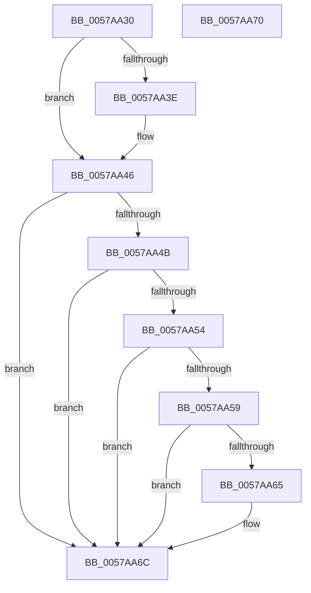

# DmrGetNextDeviceScope

- RVA: `0x0057AA30`–`0x0057AA71` (길이 `65` bytes)
- VA: `0x000000014057AA30`
- 실행 섹션: `.text`
- PDB 이름 있음: `예`; PDB Function 태그: `아니요`
- unwind 정보 RVA: `0x000DB714`
- 디코드: `23`개 명령, `65/65` bytes 표시
- 미해석 바이트: `0` (있으면 어셈블리에 `.byte`로 보존)

> 이 문서는 커널 이미지의 기계어와 PDB 기호를 분석해 생성했습니다. 4번과 5번은 함수 원형과 자료형을 바이너리 사용 방식에서 추정한 C 해석이며 원본 소스 복구 결과는 아닙니다.

## 1. Dependencies

- 직접 호출 지점: **0**; 고유 호출 대상: **0**
- 직접 호출자로 확인된 함수: **5**
- RIP 상대 이미지 참조: **0**

### Outgoing calls
- 직접 디코드된 call 명령이 없습니다.

### Direct callers
- [IvtpGetNextInternalDeviceScope](../4F/IvtpGetNextInternalDeviceScope_function_004F993C.md) at `0x004F995F`
- [DmrGetNextDrhdDeviceScope](DmrGetNextDrhdDeviceScope_function_0057A740.md) at `0x0057A75B`
- [DmrEnumerateSatcDevices](DmrEnumerateSatcDevices_function_0057A8D0.md) at `0x0057A92B`
- [DmrEnumerateRmrrDomains](DmrEnumerateRmrrDomains_function_0057ABC0.md) at `0x0057AC25`
- [IvtCheckForReservedRegion](../../page/70/IvtCheckForReservedRegion_function_0070DDB0.md) at `0x0070DE11`

### Static image references
- 디코드된 RIP-relative 메모리 참조가 없습니다.

## 2. Other-region calls and transfers

- 다른 실행 섹션으로 향하는 call: **0**
- 별도 외부 분기/꼬리 이동을 확인하지 못했습니다.

## 3. Assembly (complete function range)

```asm
0057AA30  45 33 C9                        xor r9d, r9d
0057AA33  4C 8B D2                        mov r10, rdx
0057AA36  48 8B C1                        mov rax, rcx
0057AA39  4D 85 C0                        test r8, r8
0057AA3C  74 08                           je 0x14057aa46
0057AA3E  41 0F B6 40 01                  movzx eax, byte ptr [r8 + 1]
0057AA43  49 03 C0                        add rax, r8
0057AA46  49 3B C0                        cmp rax, r8
0057AA49  76 21                           jbe 0x14057aa6c
0057AA4B  48 8D 48 02                     lea rcx, [rax + 2]
0057AA4F  48 3B C8                        cmp rcx, rax
0057AA52  76 18                           jbe 0x14057aa6c
0057AA54  49 3B CA                        cmp rcx, r10
0057AA57  77 13                           ja 0x14057aa6c
0057AA59  0F B6 50 01                     movzx edx, byte ptr [rax + 1]
0057AA5D  48 03 D0                        add rdx, rax
0057AA60  48 3B D0                        cmp rdx, rax
0057AA63  76 07                           jbe 0x14057aa6c
0057AA65  49 3B D2                        cmp rdx, r10
0057AA68  4C 0F 46 C8                     cmovbe r9, rax
0057AA6C  49 8B C1                        mov rax, r9
0057AA6F  C3                              ret
0057AA70  CC                              int3
```

## 4. C-style interpretation (structured pseudocode)

```c
__int64 __fastcall DmrGetNextDeviceScope(__int64 a1, __int64 a2, __int64 a3, int a4)
{
    __int64 result;

    a4 = 0;
    result = a1;
    if (a3 != 0) {
        result = *(unsigned __int8 *)(a3 + 1);
        result = (result) + (a3);
    }
    if (result <= a3) goto loc_0057AA6C;
    if ((result + 2) <= result) goto loc_0057AA6C;
    if ((result + 2) > a2) goto loc_0057AA6C;
    a2 = (*(unsigned __int8 *)(result + 1)) + (result);
    if (a2 >= = result) {
        if (a2 <= a2) { a4 = result; }
    }
    return a4;
}
```

## 5. (Beta) C Style

```c
int64_t DmrGetNextDeviceScope(int64_t Arg1, int64_t Arg2, int64_t Arg3, int32_t Arg4)
{
    int64_t result;

    Arg4 = 0;
    result = Arg1;
    if (Arg3 != 0) {
        result = *(uint8_t *)(Arg3 + 0x1);
        result = (result) + (Arg3);
    }
    if (result <= Arg3) goto loc_0057AA6C;
    if ((result + 2) <= result) goto loc_0057AA6C;
    if ((result + 2) > Arg2) goto loc_0057AA6C;
    Arg2 = (*(uint8_t *)(result + 0x1)) + (result);
    if (Arg2 >= = result) {
        if (Arg2 <= Arg2) { Arg4 = result; }
    }
    return Arg4;
}
```

## 6. Execution-region graph

[열기: 2D/3D 그래프와 함수 탐색 컨트롤 패널](../../../control-panel.html?section=text&rva=0x0057AA30&view=graph)

- 2D 그래프는 위에서 아래로 흐르고, 3D 그래프는 빈 공간을 드래그해 회전합니다. Shift+드래그는 이동, 휠은 확대·축소, 함수 노드 선택은 대상 보고서 이동입니다.

### Static fallback


