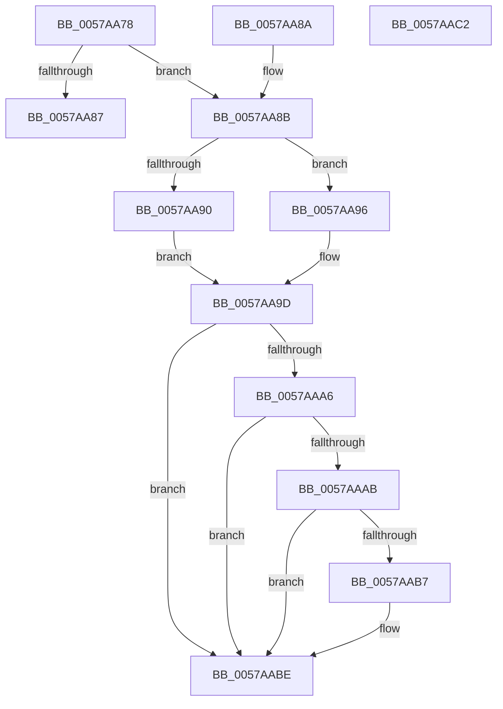

# DmrGetNextRemappingStructure

- RVA: `0x0057AA78`–`0x0057AAC3` (길이 `75` bytes)
- VA: `0x000000014057AA78`
- 실행 섹션: `.text`
- PDB 이름 있음: `예`; PDB Function 태그: `아니요`
- unwind 정보 RVA: `0x000DB714`
- 디코드: `28`개 명령, `75/75` bytes 표시
- 미해석 바이트: `0` (있으면 어셈블리에 `.byte`로 보존)

> 이 문서는 커널 이미지의 기계어와 PDB 기호를 분석해 생성했습니다. 4번과 5번은 함수 원형과 자료형을 바이너리 사용 방식에서 추정한 C 해석이며 원본 소스 복구 결과는 아닙니다.

## 1. Dependencies

- 직접 호출 지점: **0**; 고유 호출 대상: **0**
- 직접 호출자로 확인된 함수: **6**
- RIP 상대 이미지 참조: **0**

### Outgoing calls
- 직접 디코드된 call 명령이 없습니다.

### Direct callers
- [HalpIvtProcessDmarTable](HalpIvtProcessDmarTable_function_005793EC.md) at `0x0057942F`
- [HalpIvtProcessDmarTable](HalpIvtProcessDmarTable_function_005793EC.md) at `0x0057948D`
- [DmrFindDrhdForDeviceScope](DmrFindDrhdForDeviceScope_function_0057A6A0.md) at `0x0057A6CC`
- [DmrEnumerateSatcDevices](DmrEnumerateSatcDevices_function_0057A8D0.md) at `0x0057A8F5`
- [DmrEnumerateSatcDevices](DmrEnumerateSatcDevices_function_0057A8D0.md) at `0x0057A9ED`
- [DmrValidateDeviceScope](DmrValidateDeviceScope_function_0057AACC.md) at `0x0057AB46`
- [DmrEnumerateRmrrDomains](DmrEnumerateRmrrDomains_function_0057ABC0.md) at `0x0057ABF8`
- [IvtCheckForReservedRegion](../../page/70/IvtCheckForReservedRegion_function_0070DDB0.md) at `0x0070DDEA`

### Static image references
- 디코드된 RIP-relative 메모리 참조가 없습니다.

## 2. Other-region calls and transfers

- 다른 실행 섹션으로 향하는 call: **0**
- 별도 외부 분기/꼬리 이동을 확인하지 못했습니다.

## 3. Assembly (complete function range)

```asm
0057AA78  44 8B 49 04                     mov r9d, dword ptr [rcx + 4]
0057AA7C  45 33 C0                        xor r8d, r8d
0057AA7F  4C 03 C9                        add r9, rcx
0057AA82  4C 3B C9                        cmp r9, rcx
0057AA85  77 04                           ja 0x14057aa8b
0057AA87  33 C0                           xor eax, eax
0057AA89  C3                              ret
0057AA8A  CC                              int3
0057AA8B  48 85 D2                        test rdx, rdx
0057AA8E  75 06                           jne 0x14057aa96
0057AA90  48 8D 41 30                     lea rax, [rcx + 0x30]
0057AA94  EB 07                           jmp 0x14057aa9d
0057AA96  0F B7 42 02                     movzx eax, word ptr [rdx + 2]
0057AA9A  48 03 C2                        add rax, rdx
0057AA9D  48 8D 48 04                     lea rcx, [rax + 4]
0057AAA1  48 3B C8                        cmp rcx, rax
0057AAA4  76 18                           jbe 0x14057aabe
0057AAA6  49 3B C9                        cmp rcx, r9
0057AAA9  77 13                           ja 0x14057aabe
0057AAAB  0F B7 50 02                     movzx edx, word ptr [rax + 2]
0057AAAF  48 03 D0                        add rdx, rax
0057AAB2  48 3B D0                        cmp rdx, rax
0057AAB5  76 07                           jbe 0x14057aabe
0057AAB7  49 3B D1                        cmp rdx, r9
0057AABA  4C 0F 46 C0                     cmovbe r8, rax
0057AABE  49 8B C0                        mov rax, r8
0057AAC1  C3                              ret
0057AAC2  CC                              int3
```

## 4. C-style interpretation (structured pseudocode)

```c
__int64 __fastcall DmrGetNextRemappingStructure(__int64 a1, __int64 a2, int a3)
{
    __int64 result;

    a3 = 0;
    a4 = ((unsigned int)(*(unsigned int *)(a1 + 4))) + (a1);
    if (a4 > a1) goto loc_0057AA8B;
    result = 0;
    return result;
loc_0057AA8B:
    if (a2 != 0) goto loc_0057AA96;
    goto loc_0057AA9D;
loc_0057AA96:
    result = (*(unsigned __int16 *)(a2 + 2)) + (a2);
loc_0057AA9D:
    if ((result + 4) <= result) goto loc_0057AABE;
    if ((result + 4) > a4) goto loc_0057AABE;
    a2 = (*(unsigned __int16 *)(result + 2)) + (result);
    if (a2 >= = result) {
        if (a2 <= a4) { a3 = result; }
    }
    return a3;
}
```

## 5. (Beta) C Style

```c
int64_t DmrGetNextRemappingStructure(void *Arg1, int64_t Arg2, int32_t Arg3)
{
    uint8_t *arg1 = (uint8_t *)Arg1;

    int64_t result;

    Arg3 = 0;
    a4 = ((uint32_t)(*(uint32_t *)(arg1 + 0x4))) + (Arg1);
    if (a4 > Arg1) goto loc_0057AA8B;
    result = 0;
    return result;
loc_0057AA8B:
    if (Arg2 != 0) goto loc_0057AA96;
    goto loc_0057AA9D;
loc_0057AA96:
    result = (*(uint16_t *)(Arg2 + 0x2)) + (Arg2);
loc_0057AA9D:
    if ((result + 4) <= result) goto loc_0057AABE;
    if ((result + 4) > a4) goto loc_0057AABE;
    Arg2 = (*(uint16_t *)(result + 0x2)) + (result);
    if (Arg2 >= = result) {
        if (Arg2 <= a4) { Arg3 = result; }
    }
    return Arg3;
}
```

### 관측된 메모리 오프셋

구조체 형식이 확인되지 않은 접근은 인자 기준의 오프셋으로만 기록했습니다.

| 기준 인자 | 오프셋 표현 | 폭 (bit) | 접근 |
|---|---:|---:|---|
| `Arg1` | `+ 0x4` | `32` | `R` |
| `Arg1` | `+ 0x30` | `64` | `R` |

## 6. Execution-region graph

[열기: 2D/3D 그래프와 함수 탐색 컨트롤 패널](../../../control-panel.html?section=text&rva=0x0057AA78&view=graph)

- 2D 그래프는 위에서 아래로 흐르고, 3D 그래프는 빈 공간을 드래그해 회전합니다. Shift+드래그는 이동, 휠은 확대·축소, 함수 노드 선택은 대상 보고서 이동입니다.

### Static fallback


