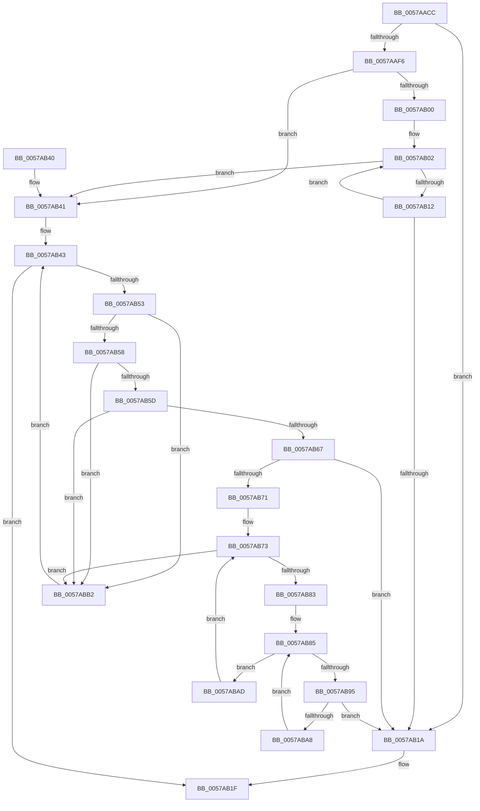

# DmrValidateDeviceScope

- RVA: `0x0057AACC`–`0x0057ABB7` (길이 `235` bytes)
- VA: `0x000000014057AACC`
- 실행 섹션: `.text`
- PDB 이름 있음: `예`; PDB Function 태그: `아니요`
- unwind 정보 RVA: `0x000A01DC`
- 디코드: `79`개 명령, `235/235` bytes 표시
- 미해석 바이트: `0` (있으면 어셈블리에 `.byte`로 보존)

> 이 문서는 커널 이미지의 기계어와 PDB 기호를 분석해 생성했습니다. 4번과 5번은 함수 원형과 자료형을 바이너리 사용 방식에서 추정한 C 해석이며 원본 소스 복구 결과는 아닙니다.

## 1. Dependencies

- 직접 호출 지점: **5**; 고유 호출 대상: **3**
- 직접 호출자로 확인된 함수: **2**
- RIP 상대 이미지 참조: **0**

### Outgoing calls
- `0x0057AB05` → [DmrGetNextDrhdDeviceScope](DmrGetNextDrhdDeviceScope_function_0057A740.md) (function, `0x0057A740`)
- `0x0057AB46` → [DmrGetNextRemappingStructure](DmrGetNextRemappingStructure_function_0057AA78.md) (function, `0x0057AA78`)
- `0x0057AB76` → [DmrGetNextDrhdDeviceScope](DmrGetNextDrhdDeviceScope_function_0057A740.md) (function, `0x0057A740`)
- `0x0057AB88` → [DmrGetNextDrhdDeviceScope](DmrGetNextDrhdDeviceScope_function_0057A740.md) (function, `0x0057A740`)
- `0x0057AB9B` → [DmrCheckPathMatch](DmrCheckPathMatch_function_0057A76C.md) (function, `0x0057A76C`)

### Direct callers
- [HalpIvtLegacyProcessDrhdEntry](HalpIvtLegacyProcessDrhdEntry_function_00578C58.md) at `0x0057923A`
- [HalpIvtProcessDrhdEntry](HalpIvtProcessDrhdEntry_function_005794B4.md) at `0x00579B1D`

### Static image references
- 디코드된 RIP-relative 메모리 참조가 없습니다.

## 2. Other-region calls and transfers

- 다른 실행 섹션으로 향하는 call: **0**
- 별도 외부 분기/꼬리 이동을 확인하지 못했습니다.

## 3. Assembly (complete function range)

```asm
0057AACC  48 8B C4                        mov rax, rsp
0057AACF  48 89 58 08                     mov qword ptr [rax + 8], rbx
0057AAD3  48 89 68 10                     mov qword ptr [rax + 0x10], rbp
0057AAD7  48 89 70 18                     mov qword ptr [rax + 0x18], rsi
0057AADB  48 89 78 20                     mov qword ptr [rax + 0x20], rdi
0057AADF  41 54                           push r12
0057AAE1  41 56                           push r14
0057AAE3  41 57                           push r15
0057AAE5  48 83 EC 20                     sub rsp, 0x20
0057AAE9  33 DB                           xor ebx, ebx
0057AAEB  48 8B F2                        mov rsi, rdx
0057AAEE  4C 8B E1                        mov r12, rcx
0057AAF1  66 39 1A                        cmp word ptr [rdx], bx
0057AAF4  75 24                           jne 0x14057ab1a
0057AAF6  44 8A 7A 04                     mov r15b, byte ptr [rdx + 4]
0057AAFA  41 F6 C7 01                     test r15b, 1
0057AAFE  74 41                           je 0x14057ab41
0057AB00  33 D2                           xor edx, edx
0057AB02  48 8B CE                        mov rcx, rsi
0057AB05  E8 36 FC FF FF                  call 0x14057a740
0057AB0A  48 8B D0                        mov rdx, rax
0057AB0D  48 85 C0                        test rax, rax
0057AB10  74 2F                           je 0x14057ab41
0057AB12  8A 00                           mov al, byte ptr [rax]
0057AB14  FE C8                           dec al
0057AB16  3C 01                           cmp al, 1
0057AB18  77 E8                           ja 0x14057ab02
0057AB1A  BB 01 00 00 C0                  mov ebx, 0xc0000001
0057AB1F  48 8B 6C 24 48                  mov rbp, qword ptr [rsp + 0x48]
0057AB24  8B C3                           mov eax, ebx
0057AB26  48 8B 5C 24 40                  mov rbx, qword ptr [rsp + 0x40]
0057AB2B  48 8B 74 24 50                  mov rsi, qword ptr [rsp + 0x50]
0057AB30  48 8B 7C 24 58                  mov rdi, qword ptr [rsp + 0x58]
0057AB35  48 83 C4 20                     add rsp, 0x20
0057AB39  41 5F                           pop r15
0057AB3B  41 5E                           pop r14
0057AB3D  41 5C                           pop r12
0057AB3F  C3                              ret
0057AB40  CC                              int3
0057AB41  33 D2                           xor edx, edx
0057AB43  49 8B CC                        mov rcx, r12
0057AB46  E8 2D FF FF FF                  call 0x14057aa78
0057AB4B  48 8B F8                        mov rdi, rax
0057AB4E  48 85 C0                        test rax, rax
0057AB51  74 CC                           je 0x14057ab1f
0057AB53  66 39 18                        cmp word ptr [rax], bx
0057AB56  75 5A                           jne 0x14057abb2
0057AB58  48 3B C6                        cmp rax, rsi
0057AB5B  74 55                           je 0x14057abb2
0057AB5D  0F B7 46 06                     movzx eax, word ptr [rsi + 6]
0057AB61  66 39 47 06                     cmp word ptr [rdi + 6], ax
0057AB65  75 4B                           jne 0x14057abb2
0057AB67  8A 47 04                        mov al, byte ptr [rdi + 4]
0057AB6A  41 22 C7                        and al, r15b
0057AB6D  A8 01                           test al, 1
0057AB6F  75 A9                           jne 0x14057ab1a
0057AB71  33 D2                           xor edx, edx
0057AB73  48 8B CE                        mov rcx, rsi
0057AB76  E8 C5 FB FF FF                  call 0x14057a740
0057AB7B  4C 8B F0                        mov r14, rax
0057AB7E  48 85 C0                        test rax, rax
0057AB81  74 2F                           je 0x14057abb2
0057AB83  33 D2                           xor edx, edx
0057AB85  48 8B CF                        mov rcx, rdi
0057AB88  E8 B3 FB FF FF                  call 0x14057a740
0057AB8D  48 8B E8                        mov rbp, rax
0057AB90  48 85 C0                        test rax, rax
0057AB93  74 18                           je 0x14057abad
0057AB95  48 8B D0                        mov rdx, rax
0057AB98  49 8B CE                        mov rcx, r14
0057AB9B  E8 CC FB FF FF                  call 0x14057a76c
0057ABA0  84 C0                           test al, al
0057ABA2  0F 85 72 FF FF FF               jne 0x14057ab1a
0057ABA8  48 8B D5                        mov rdx, rbp
0057ABAB  EB D8                           jmp 0x14057ab85
0057ABAD  49 8B D6                        mov rdx, r14
0057ABB0  EB C1                           jmp 0x14057ab73
0057ABB2  48 8B D7                        mov rdx, rdi
0057ABB5  EB 8C                           jmp 0x14057ab43
```

## 4. C-style interpretation (structured pseudocode)

```c
__int64 __fastcall DmrValidateDeviceScope(__int64 a1, __int64 a2)
{
    __int64 result;
    __int64 v_rbx;
    __int64 v_rsp;
    unsigned __int64 v_stack_p10;
    unsigned __int64 v_stack_p18;
    unsigned __int64 v_stack_p20;
    unsigned __int64 v_stack_p8;

    *(unsigned __int64 *)(v_rsp + 8) = v_rbx;
    *(unsigned __int64 *)(v_rsp + 16) = v_rbp;
    *(unsigned __int64 *)(v_rsp + 24) = v_rsi;
    *(unsigned __int64 *)(v_rsp + 32) = v_rdi;
    v_rsp = (v_rsp) - (32);
    v_rbx = 0;
    if ((*(unsigned __int16 *)(a2)) != 0) goto loc_0057AB1A;
    if ((((unsigned __int8)(*(unsigned __int8 *)(a2 + 4))) & (1)) == 0) goto loc_0057AB41;
    a2 = 0;
loc_0057AB02:
    result = DmrGetNextDrhdDeviceScope(0, a2, a3, a4);
    if (result == 0) goto loc_0057AB41;
    result = (unsigned __int8)((*(unsigned __int8 *)(result)) - 1);
    if (((unsigned __int8)(result)) > 1) goto loc_0057AB02;
loc_0057AB1A:
loc_0057AB1F:
    v_rsp = (v_rsp) + (32);
    return (unsigned int)((unsigned int)((unsigned int)(0xC0000001ULL)));
loc_0057AB41:
    a2 = 0;
loc_0057AB43:
    result = DmrGetNextRemappingStructure(a1, a2, a3, a4);
    if (result == 0) goto loc_0057AB1F;
    if ((*(unsigned __int16 *)(result)) != ((unsigned __int16)(v_stack_p8))) goto loc_0057ABB2;
    if (result == v_stack_p18) goto loc_0057ABB2;
    if ((*(unsigned __int16 *)(result + 6)) != ((unsigned __int16)(*(unsigned __int16 *)(v_stack_p18 + 6)))) goto loc_0057ABB2;
    result = (unsigned __int8)((*(unsigned __int8 *)(result + 4)) & ((unsigned __int8)(*(unsigned __int8 *)(a2 + 4))));
    if ((((unsigned __int8)(result)) & (1)) != 0) goto loc_0057AB1A;
    a2 = 0;
loc_0057AB73:
    result = DmrGetNextDrhdDeviceScope(v_stack_p18, a2, a3, a4);
    if (result == 0) goto loc_0057ABB2;
    a2 = 0;
loc_0057AB85:
    result = DmrGetNextDrhdDeviceScope(result, a2, a3, a4);
    if (result == 0) goto loc_0057ABAD;
    result = DmrCheckPathMatch(result, result, a3, a4);
    if ((unsigned __int8)(result) != 0) goto loc_0057AB1A;
    goto loc_0057AB85;
loc_0057ABAD:
    goto loc_0057AB73;
loc_0057ABB2:
    goto loc_0057AB43;
}
```

## 5. (Beta) C Style

```c
int64_t DmrValidateDeviceScope(int64_t Arg1, void *Arg2)
{
    uint8_t *arg2 = (uint8_t *)Arg2;

    int64_t result;
    int64_t local_rbx;
    int64_t local_rsp;
    uint64_t v_stack_p10;
    uint64_t v_stack_p18;
    uint64_t v_stack_p20;
    uint64_t v_stack_p8;

    *(uint64_t *)(local_rsp + 0x8) = local_rbx;
    *(uint64_t *)(local_rsp + 0x10) = local_rbp;
    *(uint64_t *)(local_rsp + 0x18) = local_rsi;
    *(uint64_t *)(local_rsp + 0x20) = local_rdi;
    local_rsp = (local_rsp) - (32);
    local_rbx = 0;
    if ((*(uint16_t *)(arg2)) != 0) goto loc_0057AB1A;
    if ((((uint8_t)(*(uint8_t *)(arg2 + 0x4))) & (1)) == 0) goto loc_0057AB41;
    Arg2 = 0;
loc_0057AB02:
    result = DmrGetNextDrhdDeviceScope(0, Arg2, a3, a4);
    if (result == 0) goto loc_0057AB41;
    result = (uint8_t)((*(uint8_t *)(result)) - 1);
    if (((uint8_t)(result)) > 1) goto loc_0057AB02;
loc_0057AB1A:
loc_0057AB1F:
    local_rsp = (local_rsp) + (32);
    return (uint32_t)((uint32_t)((uint32_t)(0xC0000001ULL)));
loc_0057AB41:
    Arg2 = 0;
loc_0057AB43:
    result = DmrGetNextRemappingStructure(Arg1, Arg2, a3, a4);
    if (result == 0) goto loc_0057AB1F;
    if ((*(uint16_t *)(result)) != ((uint16_t)(v_stack_p8))) goto loc_0057ABB2;
    if (result == v_stack_p18) goto loc_0057ABB2;
    if ((*(uint16_t *)(result + 0x6)) != ((uint16_t)(*(uint16_t *)(v_stack_p18 + 0x6)))) goto loc_0057ABB2;
    result = (uint8_t)((*(uint8_t *)(result + 0x4)) & ((uint8_t)(*(uint8_t *)(arg2 + 0x4))));
    if ((((uint8_t)(result)) & (1)) != 0) goto loc_0057AB1A;
    Arg2 = 0;
loc_0057AB73:
    result = DmrGetNextDrhdDeviceScope(v_stack_p18, Arg2, a3, a4);
    if (result == 0) goto loc_0057ABB2;
    Arg2 = 0;
loc_0057AB85:
    result = DmrGetNextDrhdDeviceScope(result, Arg2, a3, a4);
    if (result == 0) goto loc_0057ABAD;
    result = DmrCheckPathMatch(result, result, a3, a4);
    if ((uint8_t)(result) != 0) goto loc_0057AB1A;
    goto loc_0057AB85;
loc_0057ABAD:
    goto loc_0057AB73;
loc_0057ABB2:
    goto loc_0057AB43;
}
```

### 관측된 메모리 오프셋

구조체 형식이 확인되지 않은 접근은 인자 기준의 오프셋으로만 기록했습니다.

| 기준 인자 | 오프셋 표현 | 폭 (bit) | 접근 |
|---|---:|---:|---|
| `Arg2` | `+ 0x0` | `16` | `R` |
| `Arg2` | `+ 0x4` | `8` | `R` |
| `Arg2` | `+ 0x6` | `16` | `R` |

## 6. Execution-region graph

[열기: 2D/3D 그래프와 함수 탐색 컨트롤 패널](../../../control-panel.html?section=text&rva=0x0057AACC&view=graph)

- 2D 그래프는 위에서 아래로 흐르고, 3D 그래프는 빈 공간을 드래그해 회전합니다. Shift+드래그는 이동, 휠은 확대·축소, 함수 노드 선택은 대상 보고서 이동입니다.

### Static fallback


