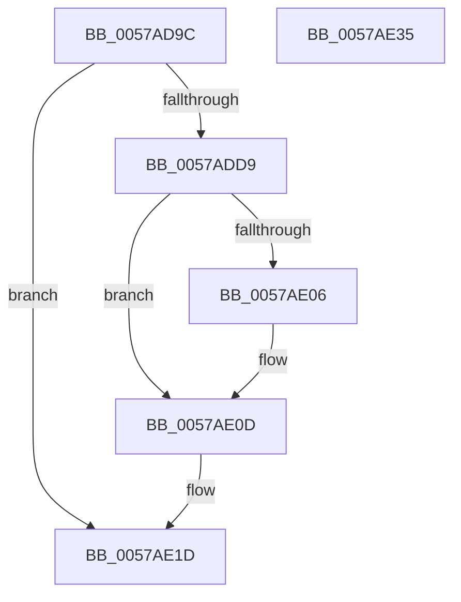

# DmrpRmrrTreeAddNewScope

- RVA: `0x0057AD9C`–`0x0057AE36` (길이 `154` bytes)
- VA: `0x000000014057AD9C`
- 실행 섹션: `.text`
- PDB 이름 있음: `예`; PDB Function 태그: `아니요`
- unwind 정보 RVA: `0x000AEEA8`
- 디코드: `44`개 명령, `154/154` bytes 표시
- 미해석 바이트: `0` (있으면 어셈블리에 `.byte`로 보존)

> 이 문서는 커널 이미지의 기계어와 PDB 기호를 분석해 생성했습니다. 4번과 5번은 함수 원형과 자료형을 바이너리 사용 방식에서 추정한 C 해석이며 원본 소스 복구 결과는 아닙니다.

## 1. Dependencies

- 직접 호출 지점: **2**; 고유 호출 대상: **2**
- 직접 호출자로 확인된 함수: **1**
- RIP 상대 이미지 참조: **0**

### Outgoing calls
- `0x0057ADCA` → [ExtEnvAllocateMemory](../56/ExtEnvAllocateMemory_function_005610B0.md) (function, `0x005610B0`)
- `0x0057ADF0` → [memcpy](../6C/memcpy_function_006C6840.md) (function, `0x006C6840`)

### Direct callers
- [DmrEnumerateRmrrDomains](DmrEnumerateRmrrDomains_function_0057ABC0.md) at `0x0057ACA8`

### Static image references
- 디코드된 RIP-relative 메모리 참조가 없습니다.

## 2. Other-region calls and transfers

- 다른 실행 섹션으로 향하는 call: **0**
- 별도 외부 분기/꼬리 이동을 확인하지 못했습니다.

## 3. Assembly (complete function range)

```asm
0057AD9C  48 8B C4                        mov rax, rsp
0057AD9F  48 89 58 08                     mov qword ptr [rax + 8], rbx
0057ADA3  48 89 68 10                     mov qword ptr [rax + 0x10], rbp
0057ADA7  48 89 70 20                     mov qword ptr [rax + 0x20], rsi
0057ADAB  57                              push rdi
0057ADAC  48 83 EC 20                     sub rsp, 0x20
0057ADB0  48 83 60 18 00                  and qword ptr [rax + 0x18], 0
0057ADB5  0F B7 EA                        movzx ebp, dx
0057ADB8  41 0F B6 50 01                  movzx edx, byte ptr [r8 + 1]
0057ADBD  49 8B F0                        mov rsi, r8
0057ADC0  83 C2 22                        add edx, 0x22
0057ADC3  4C 8D 40 18                     lea r8, [rax + 0x18]
0057ADC7  48 8B F9                        mov rdi, rcx
0057ADCA  E8 E1 62 FE FF                  call 0x1405610b0
0057ADCF  48 8B 5C 24 40                  mov rbx, qword ptr [rsp + 0x40]
0057ADD4  48 85 DB                        test rbx, rbx
0057ADD7  74 44                           je 0x14057ae1d
0057ADD9  48 8D 43 10                     lea rax, [rbx + 0x10]
0057ADDD  48 8B D6                        mov rdx, rsi
0057ADE0  48 89 40 08                     mov qword ptr [rax + 8], rax
0057ADE4  48 8D 4B 22                     lea rcx, [rbx + 0x22]
0057ADE8  48 89 00                        mov qword ptr [rax], rax
0057ADEB  44 0F B6 46 01                  movzx r8d, byte ptr [rsi + 1]
0057ADF0  E8 4B BA 14 00                  call 0x1406c6840
0057ADF5  48 8D 47 08                     lea rax, [rdi + 8]
0057ADF9  66 89 6B 20                     mov word ptr [rbx + 0x20], bp
0057ADFD  48 8B 48 08                     mov rcx, qword ptr [rax + 8]
0057AE01  48 39 01                        cmp qword ptr [rcx], rax
0057AE04  74 07                           je 0x14057ae0d
0057AE06  B9 03 00 00 00                  mov ecx, 3
0057AE0B  CD 29                           int 0x29
0057AE0D  48 89 03                        mov qword ptr [rbx], rax
0057AE10  48 89 4B 08                     mov qword ptr [rbx + 8], rcx
0057AE14  48 89 19                        mov qword ptr [rcx], rbx
0057AE17  48 89 58 08                     mov qword ptr [rax + 8], rbx
0057AE1B  FF 07                           inc dword ptr [rdi]
0057AE1D  48 8B 6C 24 38                  mov rbp, qword ptr [rsp + 0x38]
0057AE22  48 8B C3                        mov rax, rbx
0057AE25  48 8B 5C 24 30                  mov rbx, qword ptr [rsp + 0x30]
0057AE2A  48 8B 74 24 48                  mov rsi, qword ptr [rsp + 0x48]
0057AE2F  48 83 C4 20                     add rsp, 0x20
0057AE33  5F                              pop rdi
0057AE34  C3                              ret
0057AE35  CC                              int3
```

## 4. C-style interpretation (structured pseudocode)

```c
__int64 __fastcall DmrpRmrrTreeAddNewScope(__int64 a1, unsigned __int16 a2, __int64 a3)
{
    __int64 result;
    __int64 v_rsp;
    unsigned __int64 v_stack_p10;
    unsigned __int64 v_stack_p18;
    unsigned __int64 v_stack_p20;
    unsigned __int64 v_stack_p8;

    *(unsigned __int64 *)(v_rsp + 8) = v_rbx;
    *(unsigned __int64 *)(v_rsp + 16) = v_rbp;
    *(unsigned __int64 *)(v_rsp + 32) = v_rsi;
    v_rsp = (v_rsp) - (32);
    a2 = (unsigned int)((*(unsigned __int8 *)(a3 + 1)) + (34));
    result = ExtEnvAllocateMemory(a1, a2, v_rsp + 24, a4);
    if (v_stack_p18 == 0) goto loc_0057AE1D;
    *(unsigned __int64 *)(v_stack_p18 + 16 + 8) = v_stack_p18 + 16;
    *(unsigned __int64 *)(v_stack_p18 + 16) = v_stack_p18 + 16;
    result = memcpy(v_stack_p18 + 34, a3, *(unsigned __int8 *)(a3 + 1), a4);
    *(unsigned __int16 *)(v_stack_p18 + 32) = a2;
    if ((*(unsigned __int64 *)(*(unsigned __int64 *)(a1 + 8 + 8))) != (a1 + 8)) {
        a1 = 3;
    }
    *(unsigned __int64 *)(v_stack_p18) = a1 + 8;
    *(unsigned __int64 *)(v_stack_p18 + 8) = a1;
    *(unsigned __int64 *)(a1) = v_stack_p18;
    *(unsigned __int64 *)(a1 + 8 + 8) = v_stack_p18;
loc_0057AE1D:
    v_rsp = (v_rsp) + (32);
    return v_stack_p18;
}
```

## 5. (Beta) C Style

```c
int64_t DmrpRmrrTreeAddNewScope(void *Arg1, uint16_t Arg2, void *Arg3)
{
    uint8_t *arg1 = (uint8_t *)Arg1;
    uint8_t *arg3 = (uint8_t *)Arg3;

    int64_t result;
    int64_t local_rsp;
    uint64_t v_stack_p10;
    uint64_t v_stack_p18;
    uint64_t v_stack_p20;
    uint64_t v_stack_p8;

    *(uint64_t *)(local_rsp + 0x8) = local_rbx;
    *(uint64_t *)(local_rsp + 0x10) = local_rbp;
    *(uint64_t *)(local_rsp + 0x20) = local_rsi;
    local_rsp = (local_rsp) - (32);
    Arg2 = (uint32_t)((*(uint8_t *)(arg3 + 0x1)) + (34));
    result = ExtEnvAllocateMemory(Arg1, Arg2, local_rsp + 24, a4);
    if (v_stack_p18 == 0) goto loc_0057AE1D;
    *(uint64_t *)(v_stack_p18 + 0x10 + 0x8) = v_stack_p18 + 16;
    *(uint64_t *)(v_stack_p18 + 0x10) = v_stack_p18 + 16;
    result = memcpy(v_stack_p18 + 34, Arg3, *(uint8_t *)(arg3 + 0x1), a4);
    *(uint16_t *)(v_stack_p18 + 0x20) = Arg2;
    if ((*(uint64_t *)(*(uint64_t *)(arg1 + 0x8 + 0x8))) != (Arg1 + 8)) {
        Arg1 = 3;
    }
    *(void **)(v_stack_p18) = Arg1 + 8;
    *(void **)(v_stack_p18 + 0x8) = Arg1;
    *(uint64_t *)(arg1) = v_stack_p18;
    *(uint64_t *)(arg1 + 0x8 + 0x8) = v_stack_p18;
loc_0057AE1D:
    local_rsp = (local_rsp) + (32);
    return v_stack_p18;
}
```

### 관측된 메모리 오프셋

구조체 형식이 확인되지 않은 접근은 인자 기준의 오프셋으로만 기록했습니다.

| 기준 인자 | 오프셋 표현 | 폭 (bit) | 접근 |
|---|---:|---:|---|
| `Arg1` | `+ 0x0` | `32` | `R/W` |
| `Arg1` | `+ 0x8` | `64` | `R` |
| `Arg1` | `+ 0x8` | `64` | `W` |
| `Arg3` | `+ 0x1` | `8` | `R` |

## 6. Execution-region graph

[열기: 2D/3D 그래프와 함수 탐색 컨트롤 패널](../../../control-panel.html?section=text&rva=0x0057AD9C&view=graph)

- 2D 그래프는 위에서 아래로 흐르고, 3D 그래프는 빈 공간을 드래그해 회전합니다. Shift+드래그는 이동, 휠은 확대·축소, 함수 노드 선택은 대상 보고서 이동입니다.

### Static fallback


