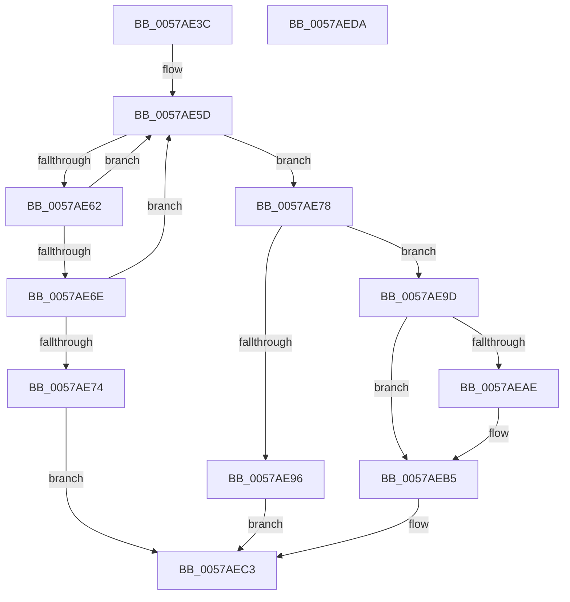

# DmrpRmrrTreeAddRegionToDevice

- RVA: `0x0057AE3C`–`0x0057AEDB` (길이 `159` bytes)
- VA: `0x000000014057AE3C`
- 실행 섹션: `.text`
- PDB 이름 있음: `예`; PDB Function 태그: `아니요`
- unwind 정보 RVA: `0x0006C8E8`
- 디코드: `48`개 명령, `159/159` bytes 표시
- 미해석 바이트: `0` (있으면 어셈블리에 `.byte`로 보존)

> 이 문서는 커널 이미지의 기계어와 PDB 기호를 분석해 생성했습니다. 4번과 5번은 함수 원형과 자료형을 바이너리 사용 방식에서 추정한 C 해석이며 원본 소스 복구 결과는 아닙니다.

## 1. Dependencies

- 직접 호출 지점: **1**; 고유 호출 대상: **1**
- 직접 호출자로 확인된 함수: **1**
- RIP 상대 이미지 참조: **0**

### Outgoing calls
- `0x0057AE87` → [ExtEnvAllocateMemory](../56/ExtEnvAllocateMemory_function_005610B0.md) (function, `0x005610B0`)

### Direct callers
- [DmrEnumerateRmrrDomains](DmrEnumerateRmrrDomains_function_0057ABC0.md) at `0x0057ACC0`

### Static image references
- 디코드된 RIP-relative 메모리 참조가 없습니다.

## 2. Other-region calls and transfers

- 다른 실행 섹션으로 향하는 call: **0**
- 별도 외부 분기/꼬리 이동을 확인하지 못했습니다.

## 3. Assembly (complete function range)

```asm
0057AE3C  48 89 5C 24 10                  mov qword ptr [rsp + 0x10], rbx
0057AE41  48 89 6C 24 18                  mov qword ptr [rsp + 0x18], rbp
0057AE46  48 89 74 24 20                  mov qword ptr [rsp + 0x20], rsi
0057AE4B  57                              push rdi
0057AE4C  48 83 EC 20                     sub rsp, 0x20
0057AE50  48 8D 79 10                     lea rdi, [rcx + 0x10]
0057AE54  49 8B F0                        mov rsi, r8
0057AE57  48 8B 07                        mov rax, qword ptr [rdi]
0057AE5A  48 8B EA                        mov rbp, rdx
0057AE5D  48 3B C7                        cmp rax, rdi
0057AE60  74 16                           je 0x14057ae78
0057AE62  48 8B C8                        mov rcx, rax
0057AE65  48 8B 00                        mov rax, qword ptr [rax]
0057AE68  48 39 69 10                     cmp qword ptr [rcx + 0x10], rbp
0057AE6C  75 EF                           jne 0x14057ae5d
0057AE6E  48 39 71 18                     cmp qword ptr [rcx + 0x18], rsi
0057AE72  75 E9                           jne 0x14057ae5d
0057AE74  33 DB                           xor ebx, ebx
0057AE76  EB 4B                           jmp 0x14057aec3
0057AE78  33 DB                           xor ebx, ebx
0057AE7A  4C 8D 44 24 30                  lea r8, [rsp + 0x30]
0057AE7F  48 89 5C 24 30                  mov qword ptr [rsp + 0x30], rbx
0057AE84  8D 53 20                        lea edx, [rbx + 0x20]
0057AE87  E8 24 62 FE FF                  call 0x1405610b0
0057AE8C  48 8B 44 24 30                  mov rax, qword ptr [rsp + 0x30]
0057AE91  48 85 C0                        test rax, rax
0057AE94  75 07                           jne 0x14057ae9d
0057AE96  BB 9A 00 00 C0                  mov ebx, 0xc000009a
0057AE9B  EB 26                           jmp 0x14057aec3
0057AE9D  48 89 68 10                     mov qword ptr [rax + 0x10], rbp
0057AEA1  48 89 70 18                     mov qword ptr [rax + 0x18], rsi
0057AEA5  48 8B 4F 08                     mov rcx, qword ptr [rdi + 8]
0057AEA9  48 39 39                        cmp qword ptr [rcx], rdi
0057AEAC  74 07                           je 0x14057aeb5
0057AEAE  B9 03 00 00 00                  mov ecx, 3
0057AEB3  CD 29                           int 0x29
0057AEB5  48 89 38                        mov qword ptr [rax], rdi
0057AEB8  48 89 48 08                     mov qword ptr [rax + 8], rcx
0057AEBC  48 89 01                        mov qword ptr [rcx], rax
0057AEBF  48 89 47 08                     mov qword ptr [rdi + 8], rax
0057AEC3  48 8B 6C 24 40                  mov rbp, qword ptr [rsp + 0x40]
0057AEC8  8B C3                           mov eax, ebx
0057AECA  48 8B 5C 24 38                  mov rbx, qword ptr [rsp + 0x38]
0057AECF  48 8B 74 24 48                  mov rsi, qword ptr [rsp + 0x48]
0057AED4  48 83 C4 20                     add rsp, 0x20
0057AED8  5F                              pop rdi
0057AED9  C3                              ret
0057AEDA  CC                              int3
```

## 4. C-style interpretation (structured pseudocode)

```c
__int64 __fastcall DmrpRmrrTreeAddRegionToDevice(__int64 a1, __int64 a2, __int64 a3)
{
    __int64 result;
    __int64 v_rbx;
    __int64 v_rsp;
    unsigned __int64 v_stack_p10;
    unsigned __int64 v_stack_p18;
    unsigned __int64 v_stack_p20;
    unsigned __int64 v_stack_p8;

    v_stack_p10 = v_rbx;
    v_stack_p18 = v_rbp;
    v_stack_p20 = v_rsi;
    v_rsp = (v_rsp) - (32);
loc_0057AE5D:
    if ((*(unsigned __int64 *)(a1 + 16)) == (a1 + 16)) goto loc_0057AE78;
    if ((*(unsigned __int64 *)(*(unsigned __int64 *)(a1 + 16) + 16)) != a2) goto loc_0057AE5D;
    if ((*(unsigned __int64 *)(*(unsigned __int64 *)(a1 + 16) + 24)) != a3) goto loc_0057AE5D;
    v_rbx = 0;
    goto loc_0057AEC3;
loc_0057AE78:
    v_rbx = 0;
    v_stack_p8 = 0;
    result = ExtEnvAllocateMemory(*(unsigned __int64 *)(a1 + 16), v_rbx + 32, v_stack_p8, a4);
    if (v_stack_p8 != 0) goto loc_0057AE9D;
    goto loc_0057AEC3;
loc_0057AE9D:
    *(unsigned __int64 *)(v_stack_p8 + 16) = a2;
    *(unsigned __int64 *)(v_stack_p8 + 24) = a3;
    if ((*(unsigned __int64 *)(*(unsigned __int64 *)(a1 + 16 + 8))) != (a1 + 16)) {
        a1 = 3;
    }
    *(unsigned __int64 *)(v_stack_p8) = a1 + 16;
    *(unsigned __int64 *)(v_stack_p8 + 8) = a1;
    *(unsigned __int64 *)(a1) = v_stack_p8;
    *(unsigned __int64 *)(a1 + 16 + 8) = v_stack_p8;
loc_0057AEC3:
    v_rsp = (v_rsp) + (32);
    return (unsigned int)((unsigned int)((unsigned int)(0xC000009AULL)));
}
```

## 5. (Beta) C Style

```c
int64_t DmrpRmrrTreeAddRegionToDevice(void *Arg1, int64_t Arg2, int64_t Arg3)
{
    uint8_t *arg1 = (uint8_t *)Arg1;

    int64_t result;
    int64_t local_rbx;
    int64_t local_rsp;
    uint64_t v_stack_p10;
    uint64_t v_stack_p18;
    uint64_t v_stack_p20;
    uint64_t v_stack_p8;

    v_stack_p10 = local_rbx;
    v_stack_p18 = local_rbp;
    v_stack_p20 = local_rsi;
    local_rsp = (local_rsp) - (32);
loc_0057AE5D:
    if ((*(uint64_t *)(arg1 + 0x10)) == (Arg1 + 16)) goto loc_0057AE78;
    if ((*(uint64_t *)(*(uint64_t *)(arg1 + 0x10) + 0x10)) != Arg2) goto loc_0057AE5D;
    if ((*(uint64_t *)(*(uint64_t *)(arg1 + 0x10) + 0x18)) != Arg3) goto loc_0057AE5D;
    local_rbx = 0;
    goto loc_0057AEC3;
loc_0057AE78:
    local_rbx = 0;
    v_stack_p8 = 0;
    result = ExtEnvAllocateMemory(*(uint64_t *)(arg1 + 0x10), local_rbx + 32, v_stack_p8, a4);
    if (v_stack_p8 != 0) goto loc_0057AE9D;
    goto loc_0057AEC3;
loc_0057AE9D:
    *(uint64_t *)(v_stack_p8 + 0x10) = Arg2;
    *(uint64_t *)(v_stack_p8 + 0x18) = Arg3;
    if ((*(uint64_t *)(*(uint64_t *)(arg1 + 0x10 + 0x8))) != (Arg1 + 16)) {
        Arg1 = 3;
    }
    *(void **)(v_stack_p8) = Arg1 + 16;
    *(void **)(v_stack_p8 + 0x8) = Arg1;
    *(uint64_t *)(arg1) = v_stack_p8;
    *(uint64_t *)(arg1 + 0x10 + 0x8) = v_stack_p8;
loc_0057AEC3:
    local_rsp = (local_rsp) + (32);
    return (uint32_t)((uint32_t)((uint32_t)(0xC000009AULL)));
}
```

### 관측된 메모리 오프셋

구조체 형식이 확인되지 않은 접근은 인자 기준의 오프셋으로만 기록했습니다.

| 기준 인자 | 오프셋 표현 | 폭 (bit) | 접근 |
|---|---:|---:|---|
| `Arg1` | `+ 0x0` | `64` | `R` |
| `Arg1` | `+ 0x8` | `64` | `R` |
| `Arg1` | `+ 0x8` | `64` | `W` |
| `Arg1` | `+ 0x10` | `64` | `R` |

## 6. Execution-region graph

[열기: 2D/3D 그래프와 함수 탐색 컨트롤 패널](../../../control-panel.html?section=text&rva=0x0057AE3C&view=graph)

- 2D 그래프는 위에서 아래로 흐르고, 3D 그래프는 빈 공간을 드래그해 회전합니다. Shift+드래그는 이동, 휠은 확대·축소, 함수 노드 선택은 대상 보고서 이동입니다.

### Static fallback


