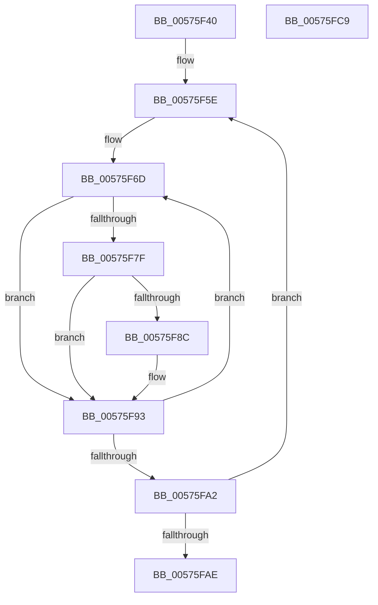

# HalpApicReplayLocalInterrupts

- RVA: `0x00575F40`–`0x00575FCA` (길이 `138` bytes)
- VA: `0x0000000140575F40`
- 실행 섹션: `.text`
- PDB 이름 있음: `예`; PDB Function 태그: `아니요`
- unwind 정보 RVA: `0x00060300`
- 디코드: `44`개 명령, `138/138` bytes 표시
- 미해석 바이트: `0` (있으면 어셈블리에 `.byte`로 보존)

> 이 문서는 커널 이미지의 기계어와 PDB 기호를 분석해 생성했습니다. 4번과 5번은 함수 원형과 자료형을 바이너리 사용 방식에서 추정한 C 해석이며 원본 소스 복구 결과는 아닙니다.

## 1. Dependencies

- 직접 호출 지점: **2**; 고유 호출 대상: **1**
- 직접 호출자로 확인된 함수: **0**
- RIP 상대 이미지 참조: **0**

### Outgoing calls
- `0x00575F81` → [HalpApicReplaySendSelfIpi](HalpApicReplaySendSelfIpi_function_00575FD0.md) (function, `0x00575FD0`)
- `0x00575F8E` → [HalpApicReplaySendSelfIpi](HalpApicReplaySendSelfIpi_function_00575FD0.md) (function, `0x00575FD0`)

### Direct callers
- 이 함수 시작 RVA로 연결되는 직접 call은 확인되지 않았습니다. 간접 호출은 완전히 역산할 수 없습니다.

### Static image references
- 디코드된 RIP-relative 메모리 참조가 없습니다.

## 2. Other-region calls and transfers

- 다른 실행 섹션으로 향하는 call: **0**
- 별도 외부 분기/꼬리 이동을 확인하지 못했습니다.

## 3. Assembly (complete function range)

```asm
00575F40  48 89 5C 24 08                  mov qword ptr [rsp + 8], rbx
00575F45  48 89 6C 24 10                  mov qword ptr [rsp + 0x10], rbp
00575F4A  48 89 74 24 18                  mov qword ptr [rsp + 0x18], rsi
00575F4F  57                              push rdi
00575F50  41 56                           push r14
00575F52  41 57                           push r15
00575F54  48 83 EC 20                     sub rsp, 0x20
00575F58  33 DB                           xor ebx, ebx
00575F5A  48 8D 7A 40                     lea rdi, [rdx + 0x40]
00575F5E  8B 77 C0                        mov esi, dword ptr [rdi - 0x40]
00575F61  41 BF 20 00 00 00               mov r15d, 0x20
00575F67  8B 6F E0                        mov ebp, dword ptr [rdi - 0x20]
00575F6A  44 8B 37                        mov r14d, dword ptr [rdi]
00575F6D  41 F6 C6 01                     test r14b, 1
00575F71  0F 94 C1                        sete cl
00575F74  40 F6 C6 01                     test sil, 1
00575F78  0F 95 C0                        setne al
00575F7B  84 C8                           test al, cl
00575F7D  74 14                           je 0x140575f93
00575F7F  8B CB                           mov ecx, ebx
00575F81  E8 4A 00 00 00                  call 0x140575fd0
00575F86  40 F6 C5 01                     test bpl, 1
00575F8A  74 07                           je 0x140575f93
00575F8C  8B CB                           mov ecx, ebx
00575F8E  E8 3D 00 00 00                  call 0x140575fd0
00575F93  D1 EE                           shr esi, 1
00575F95  FF C3                           inc ebx
00575F97  D1 ED                           shr ebp, 1
00575F99  41 D1 EE                        shr r14d, 1
00575F9C  49 83 EF 01                     sub r15, 1
00575FA0  75 CB                           jne 0x140575f6d
00575FA2  48 83 C7 04                     add rdi, 4
00575FA6  81 FB 00 01 00 00               cmp ebx, 0x100
00575FAC  72 B0                           jb 0x140575f5e
00575FAE  48 8B 5C 24 40                  mov rbx, qword ptr [rsp + 0x40]
00575FB3  33 C0                           xor eax, eax
00575FB5  48 8B 6C 24 48                  mov rbp, qword ptr [rsp + 0x48]
00575FBA  48 8B 74 24 50                  mov rsi, qword ptr [rsp + 0x50]
00575FBF  48 83 C4 20                     add rsp, 0x20
00575FC3  41 5F                           pop r15
00575FC5  41 5E                           pop r14
00575FC7  5F                              pop rdi
00575FC8  C3                              ret
00575FC9  CC                              int3
```

## 4. C-style interpretation (structured pseudocode)

```c
__int64 __fastcall HalpApicReplayLocalInterrupts(__int64 a1, __int64 a2)
{
    __int64 result;
    __int64 v_r14;
    __int64 v_r15;
    __int64 v_rbp;
    __int64 v_rbx;
    __int64 v_rdi;
    __int64 v_rsi;
    __int64 v_rsp;
    unsigned __int64 v_stack_p10;
    unsigned __int64 v_stack_p18;
    unsigned __int64 v_stack_p8;

    v_stack_p8 = v_rbx;
    v_stack_p10 = v_rbp;
    v_stack_p18 = v_rsi;
    v_rsp = (v_rsp) - (32);
    v_rbx = 0;
loc_00575F5E:
loc_00575F6D:
    a1 = ((((unsigned __int8)((unsigned int)(*(unsigned int *)(a2 + 64)))) & (1)) == 0) ? 1 : 0;
    result = ((((unsigned __int8)((unsigned int)(*(unsigned int *)(a2 + 64 - 64)))) & (1)) != 0) ? 1 : 0;
    if ((((unsigned __int8)(result)) & ((unsigned __int8)(a1))) == 0) goto loc_00575F93;
    result = HalpApicReplaySendSelfIpi(0, a2, a3, a4);
    if ((((unsigned __int8)((unsigned int)(*(unsigned int *)(a2 + 64 - 32)))) & (1)) != 0) {
        a1 = 0;
        result = HalpApicReplaySendSelfIpi(a1, a2, a3, a4);
    }
    v_rsi = (unsigned int)(((unsigned int)(*(unsigned int *)(a2 + 64 - 64))) >> (1));
    v_rbx = (unsigned int)((v_rbx) + 1);
    v_rbp = (unsigned int)(((unsigned int)(*(unsigned int *)(a2 + 64 - 32))) >> (1));
    v_r14 = (unsigned int)(((unsigned int)(*(unsigned int *)(a2 + 64))) >> (1));
    v_r15 = (32) - (1);
    if (condition_is_not_equal) goto loc_00575F6D;
    v_rdi = (a2 + 64) + (4);
    if (((unsigned int)(v_rbx)) < 256) goto loc_00575F5E;
    result = 0;
    v_rsp = (v_rsp) + (32);
    return result;
}
```

## 5. (Beta) C Style

```c
int64_t HalpApicReplayLocalInterrupts(int64_t Arg1, void *Arg2)
{
    uint8_t *arg2 = (uint8_t *)Arg2;

    int64_t result;
    int64_t local_r14;
    int64_t local_r15;
    int64_t local_rbp;
    int64_t local_rbx;
    int64_t local_rdi;
    int64_t local_rsi;
    int64_t local_rsp;
    uint64_t v_stack_p10;
    uint64_t v_stack_p18;
    uint64_t v_stack_p8;

    v_stack_p8 = local_rbx;
    v_stack_p10 = local_rbp;
    v_stack_p18 = local_rsi;
    local_rsp = (local_rsp) - (32);
    local_rbx = 0;
loc_00575F5E:
loc_00575F6D:
    Arg1 = ((((uint8_t)((uint32_t)(*(uint32_t *)(arg2 + 0x40)))) & (1)) == 0) ? 1 : 0;
    result = ((((uint8_t)((uint32_t)(*(uint32_t *)(arg2 + 0x40 - 0x40)))) & (1)) != 0) ? 1 : 0;
    if ((((uint8_t)(result)) & ((uint8_t)(Arg1))) == 0) goto loc_00575F93;
    result = HalpApicReplaySendSelfIpi(0, Arg2, a3, a4);
    if ((((uint8_t)((uint32_t)(*(uint32_t *)(arg2 + 0x40 - 0x20)))) & (1)) != 0) {
        Arg1 = 0;
        result = HalpApicReplaySendSelfIpi(Arg1, Arg2, a3, a4);
    }
    local_rsi = (uint32_t)(((uint32_t)(*(uint32_t *)(arg2 + 0x40 - 0x40))) >> (1));
    local_rbx = (uint32_t)((local_rbx) + 1);
    local_rbp = (uint32_t)(((uint32_t)(*(uint32_t *)(arg2 + 0x40 - 0x20))) >> (1));
    local_r14 = (uint32_t)(((uint32_t)(*(uint32_t *)(arg2 + 0x40))) >> (1));
    local_r15 = (32) - (1);
    if (condition_is_not_equal) goto loc_00575F6D;
    local_rdi = (Arg2 + 64) + (4);
    if (((uint32_t)(local_rbx)) < 256) goto loc_00575F5E;
    result = 0;
    local_rsp = (local_rsp) + (32);
    return result;
}
```

### 관측된 메모리 오프셋

구조체 형식이 확인되지 않은 접근은 인자 기준의 오프셋으로만 기록했습니다.

| 기준 인자 | 오프셋 표현 | 폭 (bit) | 접근 |
|---|---:|---:|---|
| `Arg2` | `- 0x40` | `32` | `R` |
| `Arg2` | `- 0x20` | `32` | `R` |
| `Arg2` | `+ 0x0` | `32` | `R` |
| `Arg2` | `+ 0x40` | `64` | `R` |

## 6. Execution-region graph

[열기: 2D/3D 그래프와 함수 탐색 컨트롤 패널](../../../control-panel.html?section=text&rva=0x00575F40&view=graph)

- 2D 그래프는 위에서 아래로 흐르고, 3D 그래프는 빈 공간을 드래그해 회전합니다. Shift+드래그는 이동, 휠은 확대·축소, 함수 노드 선택은 대상 보고서 이동입니다.

### Static fallback


