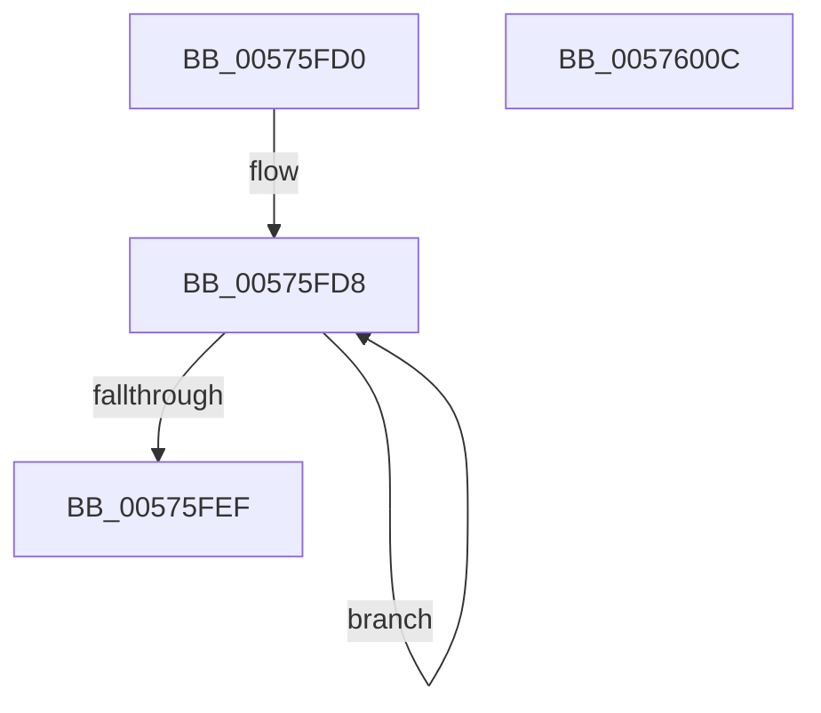

# HalpApicReplaySendSelfIpi

- RVA: `0x00575FD0`–`0x0057600D` (길이 `61` bytes)
- VA: `0x0000000140575FD0`
- 실행 섹션: `.text`
- PDB 이름 있음: `예`; PDB Function 태그: `아니요`
- unwind 정보 RVA: `0x0005CF00`
- 디코드: `17`개 명령, `61/61` bytes 표시
- 미해석 바이트: `0` (있으면 어셈블리에 `.byte`로 보존)

> 이 문서는 커널 이미지의 기계어와 PDB 기호를 분석해 생성했습니다. 4번과 5번은 함수 원형과 자료형을 바이너리 사용 방식에서 추정한 C 해석이며 원본 소스 복구 결과는 아닙니다.

## 1. Dependencies

- 직접 호출 지점: **2**; 고유 호출 대상: **1**
- 직접 호출자로 확인된 함수: **1**
- RIP 상대 이미지 참조: **2**

### Outgoing calls
- `0x00575FE4` → [guard_dispatch_icall](../6B/guard_dispatch_icall_function_006BAAD0.md) (function, `0x006BAAD0`)
- `0x00576001` → [guard_dispatch_icall](../6B/guard_dispatch_icall_function_006BAAD0.md) (function, `0x006BAAD0`)

### Direct callers
- [HalpApicReplayLocalInterrupts](HalpApicReplayLocalInterrupts_function_00575F40.md) at `0x00575F81`
- [HalpApicReplayLocalInterrupts](HalpApicReplayLocalInterrupts_function_00575F40.md) at `0x00575F8E`

### Static image references
- `0x00575FD8` → RVA `0x00E10438` (`.data`; read)
- `0x00575FEF` → RVA `0x00E10430` (`.data`; read)

## 2. Other-region calls and transfers

- 다른 실행 섹션으로 향하는 call: **0**
- 별도 외부 분기/꼬리 이동을 확인하지 못했습니다.

## 3. Assembly (complete function range)

```asm
00575FD0  40 53                           push rbx
00575FD2  48 83 EC 20                     sub rsp, 0x20
00575FD6  8B D9                           mov ebx, ecx
00575FD8  48 8B 05 59 A4 89 00            mov rax, qword ptr [rip + 0x89a459]
00575FDF  B9 00 03 00 00                  mov ecx, 0x300
00575FE4  E8 E7 4A 14 00                  call 0x1406baad0
00575FE9  0F BA E0 0C                     bt eax, 0xc
00575FED  72 E9                           jb 0x140575fd8
00575FEF  48 8B 05 3A A4 89 00            mov rax, qword ptr [rip + 0x89a43a]
00575FF6  0F BA EB 12                     bts ebx, 0x12
00575FFA  8B D3                           mov edx, ebx
00575FFC  B9 00 03 00 00                  mov ecx, 0x300
00576001  E8 CA 4A 14 00                  call 0x1406baad0
00576006  48 83 C4 20                     add rsp, 0x20
0057600A  5B                              pop rbx
0057600B  C3                              ret
0057600C  CC                              int3
```

## 4. C-style interpretation (structured pseudocode)

```c
__int64 __fastcall HalpApicReplaySendSelfIpi(int a1)
{
    __int64 result;
    __int64 v_rsp;

    v_rsp = (v_rsp) - (32);
loc_00575FD8:
    result = guard_dispatch_icall(768, a2, a3, a4);
    if (condition_is_below) goto loc_00575FD8;
    result = guard_dispatch_icall(768, (unsigned int)((unsigned int)((unsigned int)(a1))), a3, a4);
    v_rsp = (v_rsp) + (32);
    return result;
}
```

## 5. (Beta) C Style

```c
int64_t HalpApicReplaySendSelfIpi(int32_t Arg1)
{
    int64_t result;
    int64_t local_rsp;

    local_rsp = (local_rsp) - (32);
loc_00575FD8:
    result = guard_dispatch_icall(768, a2, a3, a4);
    if (condition_is_below) goto loc_00575FD8;
    result = guard_dispatch_icall(768, (uint32_t)((uint32_t)((uint32_t)(Arg1))), a3, a4);
    local_rsp = (local_rsp) + (32);
    return result;
}
```

## 6. Execution-region graph

[열기: 2D/3D 그래프와 함수 탐색 컨트롤 패널](../../../control-panel.html?section=text&rva=0x00575FD0&view=graph)

- 2D 그래프는 위에서 아래로 흐르고, 3D 그래프는 빈 공간을 드래그해 회전합니다. Shift+드래그는 이동, 휠은 확대·축소, 함수 노드 선택은 대상 보고서 이동입니다.

### Static fallback


