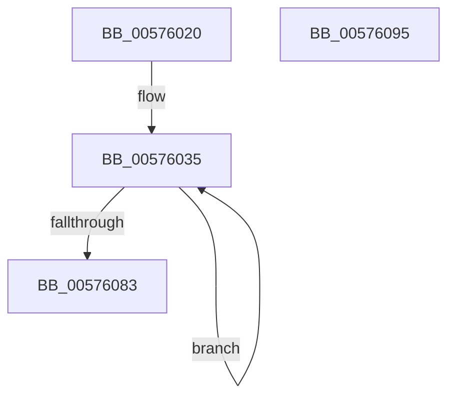

# HalpApicSaveLocalInterrupts

- RVA: `0x00576020`–`0x00576096` (길이 `118` bytes)
- VA: `0x0000000140576020`
- 실행 섹션: `.text`
- PDB 이름 있음: `예`; PDB Function 태그: `아니요`
- unwind 정보 RVA: `0x00060BC4`
- 디코드: `31`개 명령, `118/118` bytes 표시
- 미해석 바이트: `0` (있으면 어셈블리에 `.byte`로 보존)

> 이 문서는 커널 이미지의 기계어와 PDB 기호를 분석해 생성했습니다. 4번과 5번은 함수 원형과 자료형을 바이너리 사용 방식에서 추정한 C 해석이며 원본 소스 복구 결과는 아닙니다.

## 1. Dependencies

- 직접 호출 지점: **3**; 고유 호출 대상: **1**
- 직접 호출자로 확인된 함수: **0**
- RIP 상대 이미지 참조: **1**

### Outgoing calls
- `0x00576047` → [guard_dispatch_icall](../6B/guard_dispatch_icall_function_006BAAD0.md) (function, `0x006BAAD0`)
- `0x0057605C` → [guard_dispatch_icall](../6B/guard_dispatch_icall_function_006BAAD0.md) (function, `0x006BAAD0`)
- `0x00576071` → [guard_dispatch_icall](../6B/guard_dispatch_icall_function_006BAAD0.md) (function, `0x006BAAD0`)

### Direct callers
- 이 함수 시작 RVA로 연결되는 직접 call은 확인되지 않았습니다. 간접 호출은 완전히 역산할 수 없습니다.

### Static image references
- `0x00576035` → RVA `0x00E10438` (`.data`; read)

## 2. Other-region calls and transfers

- 다른 실행 섹션으로 향하는 call: **0**
- 별도 외부 분기/꼬리 이동을 확인하지 못했습니다.

## 3. Assembly (complete function range)

```asm
00576020  48 89 5C 24 08                  mov qword ptr [rsp + 8], rbx
00576025  48 89 74 24 10                  mov qword ptr [rsp + 0x10], rsi
0057602A  57                              push rdi
0057602B  48 83 EC 20                     sub rsp, 0x20
0057602F  33 F6                           xor esi, esi
00576031  48 8D 7A 40                     lea rdi, [rdx + 0x40]
00576035  48 8B 05 FC A3 89 00            mov rax, qword ptr [rip + 0x89a3fc]
0057603C  8B DE                           mov ebx, esi
0057603E  C1 E3 04                        shl ebx, 4
00576041  8D 8B 00 02 00 00               lea ecx, [rbx + 0x200]
00576047  E8 84 4A 14 00                  call 0x1406baad0
0057604C  89 47 C0                        mov dword ptr [rdi - 0x40], eax
0057604F  8D 8B 00 01 00 00               lea ecx, [rbx + 0x100]
00576055  48 8B 05 DC A3 89 00            mov rax, qword ptr [rip + 0x89a3dc]
0057605C  E8 6F 4A 14 00                  call 0x1406baad0
00576061  89 47 E0                        mov dword ptr [rdi - 0x20], eax
00576064  8D 8B 80 01 00 00               lea ecx, [rbx + 0x180]
0057606A  48 8B 05 C7 A3 89 00            mov rax, qword ptr [rip + 0x89a3c7]
00576071  E8 5A 4A 14 00                  call 0x1406baad0
00576076  FF C6                           inc esi
00576078  89 07                           mov dword ptr [rdi], eax
0057607A  48 8D 7F 04                     lea rdi, [rdi + 4]
0057607E  83 FE 08                        cmp esi, 8
00576081  72 B2                           jb 0x140576035
00576083  48 8B 5C 24 30                  mov rbx, qword ptr [rsp + 0x30]
00576088  33 C0                           xor eax, eax
0057608A  48 8B 74 24 38                  mov rsi, qword ptr [rsp + 0x38]
0057608F  48 83 C4 20                     add rsp, 0x20
00576093  5F                              pop rdi
00576094  C3                              ret
00576095  CC                              int3
```

## 4. C-style interpretation (structured pseudocode)

```c
__int64 __fastcall HalpApicSaveLocalInterrupts(__int64 a1, __int64 a2)
{
    __int64 result;
    __int64 v_rbx;
    __int64 v_rsi;
    __int64 v_rsp;
    unsigned __int64 v_stack_p10;
    unsigned __int64 v_stack_p8;

    v_stack_p8 = v_rbx;
    v_stack_p10 = v_rsi;
    v_rsp = (v_rsp) - (32);
    v_rsi = 0;
loc_00576035:
    v_rbx = (unsigned int)((0) << (4));
    result = guard_dispatch_icall(v_rbx + 512, a2, a3, a4);
    *(unsigned int *)(a2 + 64 - 64) = (unsigned int)(result);
    result = guard_dispatch_icall(v_rbx + 256, a2, a3, a4);
    *(unsigned int *)(a2 + 64 - 32) = (unsigned int)(result);
    result = guard_dispatch_icall(v_rbx + 384, a2, a3, a4);
    v_rsi = (unsigned int)((v_rsi) + 1);
    *(unsigned int *)(a2 + 64) = (unsigned int)(result);
    if (((unsigned int)(v_rsi)) < 8) goto loc_00576035;
    result = 0;
    v_rsp = (v_rsp) + (32);
    return result;
}
```

## 5. (Beta) C Style

```c
int64_t HalpApicSaveLocalInterrupts(int64_t Arg1, void *Arg2)
{
    uint8_t *arg2 = (uint8_t *)Arg2;

    int64_t result;
    int64_t local_rbx;
    int64_t local_rsi;
    int64_t local_rsp;
    uint64_t v_stack_p10;
    uint64_t v_stack_p8;

    v_stack_p8 = local_rbx;
    v_stack_p10 = local_rsi;
    local_rsp = (local_rsp) - (32);
    local_rsi = 0;
loc_00576035:
    local_rbx = (uint32_t)((0) << (4));
    result = guard_dispatch_icall(local_rbx + 512, Arg2, a3, a4);
    *(uint32_t *)(arg2 + 0x40 - 0x40) = (uint32_t)(result);
    result = guard_dispatch_icall(local_rbx + 256, Arg2, a3, a4);
    *(uint32_t *)(arg2 + 0x40 - 0x20) = (uint32_t)(result);
    result = guard_dispatch_icall(local_rbx + 384, Arg2, a3, a4);
    local_rsi = (uint32_t)((local_rsi) + 1);
    *(uint32_t *)(arg2 + 0x40) = (uint32_t)(result);
    if (((uint32_t)(local_rsi)) < 8) goto loc_00576035;
    result = 0;
    local_rsp = (local_rsp) + (32);
    return result;
}
```

### 관측된 메모리 오프셋

구조체 형식이 확인되지 않은 접근은 인자 기준의 오프셋으로만 기록했습니다.

| 기준 인자 | 오프셋 표현 | 폭 (bit) | 접근 |
|---|---:|---:|---|
| `Arg2` | `- 0x40` | `32` | `W` |
| `Arg2` | `- 0x20` | `32` | `W` |
| `Arg2` | `+ 0x0` | `32` | `W` |
| `Arg2` | `+ 0x4` | `64` | `R` |
| `Arg2` | `+ 0x40` | `64` | `R` |

## 6. Execution-region graph

[열기: 2D/3D 그래프와 함수 탐색 컨트롤 패널](../../../control-panel.html?section=text&rva=0x00576020&view=graph)

- 2D 그래프는 위에서 아래로 흐르고, 3D 그래프는 빈 공간을 드래그해 회전합니다. Shift+드래그는 이동, 휠은 확대·축소, 함수 노드 선택은 대상 보고서 이동입니다.

### Static fallback


