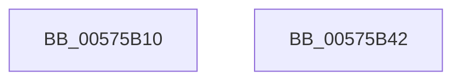

# HalpBuddyAllocatorCleanUp

- RVA: `0x00575B10`–`0x00575B43` (길이 `51` bytes)
- VA: `0x0000000140575B10`
- 실행 섹션: `.text`
- PDB 이름 있음: `예`; PDB Function 태그: `아니요`
- unwind 정보 RVA: `0x0005CF00`
- 디코드: `15`개 명령, `51/51` bytes 표시
- 미해석 바이트: `0` (있으면 어셈블리에 `.byte`로 보존)

> 이 문서는 커널 이미지의 기계어와 PDB 기호를 분석해 생성했습니다. 4번과 5번은 함수 원형과 자료형을 바이너리 사용 방식에서 추정한 C 해석이며 원본 소스 복구 결과는 아닙니다.

## 1. Dependencies

- 직접 호출 지점: **4**; 고유 호출 대상: **2**
- 직접 호출자로 확인된 함수: **0**
- RIP 상대 이미지 참조: **0**

### Outgoing calls
- `0x00575B1D` → [HalpBuddyAllocatorDeleteSubtree](../47/HalpBuddyAllocatorDeleteSubtree_function_0047A890.md) (function, `0x0047A890`)
- `0x00575B26` → [HalpMmAllocCtxFree](../3E/HalpMmAllocCtxFree_function_003E1904.md) (function, `0x003E1904`)
- `0x00575B2F` → [HalpMmAllocCtxFree](../3E/HalpMmAllocCtxFree_function_003E1904.md) (function, `0x003E1904`)
- `0x00575B37` → [HalpMmAllocCtxFree](../3E/HalpMmAllocCtxFree_function_003E1904.md) (function, `0x003E1904`)

### Direct callers
- 이 함수 시작 RVA로 연결되는 직접 call은 확인되지 않았습니다. 간접 호출은 완전히 역산할 수 없습니다.

### Static image references
- 디코드된 RIP-relative 메모리 참조가 없습니다.

## 2. Other-region calls and transfers

- 다른 실행 섹션으로 향하는 call: **0**
- 별도 외부 분기/꼬리 이동을 확인하지 못했습니다.

## 3. Assembly (complete function range)

```asm
00575B10  40 53                           push rbx
00575B12  48 83 EC 20                     sub rsp, 0x20
00575B16  48 8B 51 58                     mov rdx, qword ptr [rcx + 0x58]
00575B1A  48 8B D9                        mov rbx, rcx
00575B1D  E8 6E 4D F0 FF                  call 0x14047a890
00575B22  48 8B 53 60                     mov rdx, qword ptr [rbx + 0x60]
00575B26  E8 D9 BD E6 FF                  call 0x1403e1904
00575B2B  48 8B 53 58                     mov rdx, qword ptr [rbx + 0x58]
00575B2F  E8 D0 BD E6 FF                  call 0x1403e1904
00575B34  48 8B D3                        mov rdx, rbx
00575B37  E8 C8 BD E6 FF                  call 0x1403e1904
00575B3C  48 83 C4 20                     add rsp, 0x20
00575B40  5B                              pop rbx
00575B41  C3                              ret
00575B42  CC                              int3
```

## 4. C-style interpretation (structured pseudocode)

```c
__int64 __fastcall HalpBuddyAllocatorCleanUp(__int64 a1)
{
    __int64 result;
    __int64 v_rsp;

    v_rsp = (v_rsp) - (32);
    result = HalpBuddyAllocatorDeleteSubtree(a1, *(unsigned __int64 *)(a1 + 88), a3, a4);
    result = HalpMmAllocCtxFree(a1, *(unsigned __int64 *)(a1 + 96), a3, a4);
    result = HalpMmAllocCtxFree(a1, *(unsigned __int64 *)(a1 + 88), a3, a4);
    result = HalpMmAllocCtxFree(a1, a1, a3, a4);
    v_rsp = (v_rsp) + (32);
    return result;
}
```

## 5. (Beta) C Style

```c
int64_t HalpBuddyAllocatorCleanUp(void *Arg1)
{
    uint8_t *arg1 = (uint8_t *)Arg1;

    int64_t result;
    int64_t local_rsp;

    local_rsp = (local_rsp) - (32);
    result = HalpBuddyAllocatorDeleteSubtree(Arg1, *(uint64_t *)(arg1 + 0x58), a3, a4);
    result = HalpMmAllocCtxFree(Arg1, *(uint64_t *)(arg1 + 0x60), a3, a4);
    result = HalpMmAllocCtxFree(Arg1, *(uint64_t *)(arg1 + 0x58), a3, a4);
    result = HalpMmAllocCtxFree(Arg1, Arg1, a3, a4);
    local_rsp = (local_rsp) + (32);
    return result;
}
```

### 관측된 메모리 오프셋

구조체 형식이 확인되지 않은 접근은 인자 기준의 오프셋으로만 기록했습니다.

| 기준 인자 | 오프셋 표현 | 폭 (bit) | 접근 |
|---|---:|---:|---|
| `Arg1` | `+ 0x58` | `64` | `R` |
| `Arg1` | `+ 0x60` | `64` | `R` |

## 6. Execution-region graph

[열기: 2D/3D 그래프와 함수 탐색 컨트롤 패널](../../../control-panel.html?section=text&rva=0x00575B10&view=graph)

- 2D 그래프는 위에서 아래로 흐르고, 3D 그래프는 빈 공간을 드래그해 회전합니다. Shift+드래그는 이동, 휠은 확대·축소, 함수 노드 선택은 대상 보고서 이동입니다.

### Static fallback


