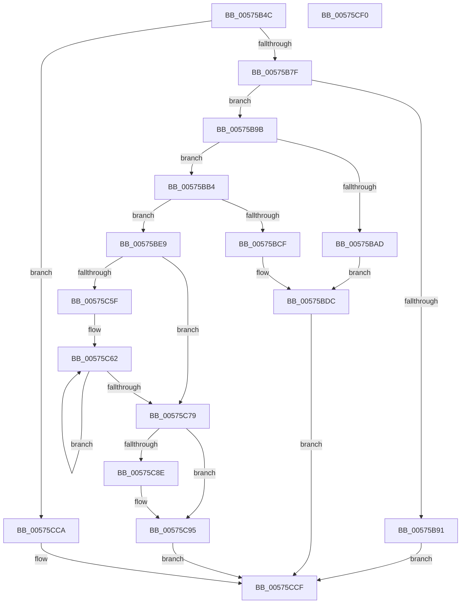

# HalpBuddyAllocatorCreateAllocator

- RVA: `0x00575B4C`–`0x00575CF1` (길이 `421` bytes)
- VA: `0x0000000140575B4C`
- 실행 섹션: `.text`
- PDB 이름 있음: `예`; PDB Function 태그: `아니요`
- unwind 정보 RVA: `0x0008A350`
- 디코드: `116`개 명령, `421/421` bytes 표시
- 미해석 바이트: `0` (있으면 어셈블리에 `.byte`로 보존)

> 이 문서는 커널 이미지의 기계어와 PDB 기호를 분석해 생성했습니다. 4번과 5번은 함수 원형과 자료형을 바이너리 사용 방식에서 추정한 C 해석이며 원본 소스 복구 결과는 아닙니다.

## 1. Dependencies

- 직접 호출 지점: **5**; 고유 호출 대상: **2**
- 직접 호출자로 확인된 함수: **1**
- RIP 상대 이미지 참조: **1**

### Outgoing calls
- `0x00575B84` → [HalpMmAllocCtxAlloc](../3E/HalpMmAllocCtxAlloc_function_003E10B8.md) (function, `0x003E10B8`)
- `0x00575BA0` → [HalpMmAllocCtxAlloc](../3E/HalpMmAllocCtxAlloc_function_003E10B8.md) (function, `0x003E10B8`)
- `0x00575BC2` → [HalpMmAllocCtxAlloc](../3E/HalpMmAllocCtxAlloc_function_003E10B8.md) (function, `0x003E10B8`)
- `0x00575BD7` → [HalpMmAllocCtxFree](../3E/HalpMmAllocCtxFree_function_003E1904.md) (function, `0x003E1904`)
- `0x00575BDF` → [HalpMmAllocCtxFree](../3E/HalpMmAllocCtxFree_function_003E1904.md) (function, `0x003E1904`)

### Direct callers
- [HalpIommuAllocateDmaDomain](../55/HalpIommuAllocateDmaDomain_function_00554904.md) at `0x00554BB2`

### Static image references
- `0x00575CA3` → RVA `0x00E00608` (`.data`; read)

## 2. Other-region calls and transfers

- 다른 실행 섹션으로 향하는 call: **0**
- 별도 외부 분기/꼬리 이동을 확인하지 못했습니다.

## 3. Assembly (complete function range)

```asm
00575B4C  48 8B C4                        mov rax, rsp
00575B4F  48 89 58 08                     mov qword ptr [rax + 8], rbx
00575B53  48 89 68 10                     mov qword ptr [rax + 0x10], rbp
00575B57  48 89 70 18                     mov qword ptr [rax + 0x18], rsi
00575B5B  48 89 78 20                     mov qword ptr [rax + 0x20], rdi
00575B5F  41 55                           push r13
00575B61  41 56                           push r14
00575B63  41 57                           push r15
00575B65  48 83 EC 20                     sub rsp, 0x20
00575B69  33 DB                           xor ebx, ebx
00575B6B  8D 41 F4                        lea eax, [rcx - 0xc]
00575B6E  48 89 1A                        mov qword ptr [rdx], rbx
00575B71  4C 8B F2                        mov r14, rdx
00575B74  8B E9                           mov ebp, ecx
00575B76  83 F8 33                        cmp eax, 0x33
00575B79  0F 87 4B 01 00 00               ja 0x140575cca
00575B7F  BA 80 00 00 00                  mov edx, 0x80
00575B84  E8 2F B5 E6 FF                  call 0x1403e10b8
00575B89  48 8B F8                        mov rdi, rax
00575B8C  48 85 C0                        test rax, rax
00575B8F  75 0A                           jne 0x140575b9b
00575B91  BB 9A 00 00 C0                  mov ebx, 0xc000009a
00575B96  E9 34 01 00 00                  jmp 0x140575ccf
00575B9B  BA 50 00 00 00                  mov edx, 0x50
00575BA0  E8 13 B5 E6 FF                  call 0x1403e10b8
00575BA5  48 8B F0                        mov rsi, rax
00575BA8  48 85 C0                        test rax, rax
00575BAB  75 07                           jne 0x140575bb4
00575BAD  BB 9A 00 00 C0                  mov ebx, 0xc000009a
00575BB2  EB 28                           jmp 0x140575bdc
00575BB4  44 8D 6D F5                     lea r13d, [rbp - 0xb]
00575BB8  41 8B D5                        mov edx, r13d
00575BBB  48 C1 E2 04                     shl rdx, 4
00575BBF  45 8B FD                        mov r15d, r13d
00575BC2  E8 F1 B4 E6 FF                  call 0x1403e10b8
00575BC7  4C 8B C0                        mov r8, rax
00575BCA  48 85 C0                        test rax, rax
00575BCD  75 1A                           jne 0x140575be9
00575BCF  48 8B D6                        mov rdx, rsi
00575BD2  BB 9A 00 00 C0                  mov ebx, 0xc000009a
00575BD7  E8 28 BD E6 FF                  call 0x1403e1904
00575BDC  48 8B D7                        mov rdx, rdi
00575BDF  E8 20 BD E6 FF                  call 0x1403e1904
00575BE4  E9 E6 00 00 00                  jmp 0x140575ccf
00575BE9  48 C7 47 18 00 10 00 00         mov qword ptr [rdi + 0x18], 0x1000
00575BF1  41 B9 01 00 00 00               mov r9d, 1
00575BF7  48 89 5F 48                     mov qword ptr [rdi + 0x48], rbx
00575BFB  41 8B D1                        mov edx, r9d
00575BFE  48 89 5F 50                     mov qword ptr [rdi + 0x50], rbx
00575C02  8B CD                           mov ecx, ebp
00575C04  48 89 77 58                     mov qword ptr [rdi + 0x58], rsi
00575C08  4C 89 47 60                     mov qword ptr [rdi + 0x60], r8
00575C0C  48 89 5F 70                     mov qword ptr [rdi + 0x70], rbx
00575C10  48 89 5F 68                     mov qword ptr [rdi + 0x68], rbx
00575C14  44 88 4F 78                     mov byte ptr [rdi + 0x78], r9b
00575C18  48 D3 E2                        shl rdx, cl
00575C1B  48 89 57 20                     mov qword ptr [rdi + 0x20], rdx
00575C1F  48 8D 42 FF                     lea rax, [rdx - 1]
00575C23  48 89 47 28                     mov qword ptr [rdi + 0x28], rax
00575C27  4C 89 4F 30                     mov qword ptr [rdi + 0x30], r9
00575C2B  48 89 5F 38                     mov qword ptr [rdi + 0x38], rbx
00575C2F  48 89 5F 40                     mov qword ptr [rdi + 0x40], rbx
00575C33  48 89 5E 10                     mov qword ptr [rsi + 0x10], rbx
00575C37  48 89 5E 18                     mov qword ptr [rsi + 0x18], rbx
00575C3B  48 89 5E 20                     mov qword ptr [rsi + 0x20], rbx
00575C3F  48 89 5E 30                     mov qword ptr [rsi + 0x30], rbx
00575C43  66 89 5E 48                     mov word ptr [rsi + 0x48], bx
00575C47  48 89 56 38                     mov qword ptr [rsi + 0x38], rdx
00575C4B  48 89 5E 40                     mov qword ptr [rsi + 0x40], rbx
00575C4F  48 89 5E 28                     mov qword ptr [rsi + 0x28], rbx
00575C53  48 89 76 08                     mov qword ptr [rsi + 8], rsi
00575C57  48 89 36                        mov qword ptr [rsi], rsi
00575C5A  45 85 ED                        test r13d, r13d
00575C5D  74 1A                           je 0x140575c79
00575C5F  48 8B D3                        mov rdx, rbx
00575C62  48 8B 4F 60                     mov rcx, qword ptr [rdi + 0x60]
00575C66  48 03 CA                        add rcx, rdx
00575C69  48 83 C2 10                     add rdx, 0x10
00575C6D  48 89 49 08                     mov qword ptr [rcx + 8], rcx
00575C71  48 89 09                        mov qword ptr [rcx], rcx
00575C74  4D 2B F9                        sub r15, r9
00575C77  75 E9                           jne 0x140575c62
00575C79  41 8D 4D FF                     lea ecx, [r13 - 1]
00575C7D  48 C1 E1 04                     shl rcx, 4
00575C81  48 03 4F 60                     add rcx, qword ptr [rdi + 0x60]
00575C85  48 8B 41 08                     mov rax, qword ptr [rcx + 8]
00575C89  48 39 08                        cmp qword ptr [rax], rcx
00575C8C  74 07                           je 0x140575c95
00575C8E  B9 03 00 00 00                  mov ecx, 3
00575C93  CD 29                           int 0x29
00575C95  48 89 0E                        mov qword ptr [rsi], rcx
00575C98  48 89 46 08                     mov qword ptr [rsi + 8], rax
00575C9C  48 89 30                        mov qword ptr [rax], rsi
00575C9F  48 89 71 08                     mov qword ptr [rcx + 8], rsi
00575CA3  48 8D 0D 5E A9 88 00            lea rcx, [rip + 0x88a95e]
00575CAA  49 89 3E                        mov qword ptr [r14], rdi
00575CAD  44 89 4F 08                     mov dword ptr [rdi + 8], r9d
00575CB1  49 8B 06                        mov rax, qword ptr [r14]
00575CB4  C7 40 0C 80 00 00 00            mov dword ptr [rax + 0xc], 0x80
00575CBB  49 8B 06                        mov rax, qword ptr [r14]
00575CBE  44 89 48 10                     mov dword ptr [rax + 0x10], r9d
00575CC2  49 8B 06                        mov rax, qword ptr [r14]
00575CC5  48 89 08                        mov qword ptr [rax], rcx
00575CC8  EB 05                           jmp 0x140575ccf
00575CCA  BB EF 00 00 C0                  mov ebx, 0xc00000ef
00575CCF  48 8B 6C 24 48                  mov rbp, qword ptr [rsp + 0x48]
00575CD4  8B C3                           mov eax, ebx
00575CD6  48 8B 5C 24 40                  mov rbx, qword ptr [rsp + 0x40]
00575CDB  48 8B 74 24 50                  mov rsi, qword ptr [rsp + 0x50]
00575CE0  48 8B 7C 24 58                  mov rdi, qword ptr [rsp + 0x58]
00575CE5  48 83 C4 20                     add rsp, 0x20
00575CE9  41 5F                           pop r15
00575CEB  41 5E                           pop r14
00575CED  41 5D                           pop r13
00575CEF  C3                              ret
00575CF0  CC                              int3
```

## 4. C-style interpretation (structured pseudocode)

```c
__int64 __fastcall HalpBuddyAllocatorCreateAllocator(__int64 a1, __int64 a2)
{
    __int64 result;
    __int64 v_r15;
    __int64 v_rbx;
    __int64 v_rsp;
    unsigned __int64 v_stack_p10;
    unsigned __int64 v_stack_p18;
    unsigned __int64 v_stack_p20;
    unsigned __int64 v_stack_p8;

    *(unsigned __int64 *)(v_rsp + 8) = v_rbx;
    *(unsigned __int64 *)(v_rsp + 16) = v_rbp;
    *(unsigned __int64 *)(v_rsp + 24) = v_rsi;
    *(unsigned __int64 *)(v_rsp + 32) = v_rdi;
    v_rsp = (v_rsp) - (32);
    v_rbx = 0;
    *(unsigned __int64 *)(a2) = 0;
    if (((unsigned int)(a1 - 12)) > 51) goto loc_00575CCA;
    result = HalpMmAllocCtxAlloc(a1, 128, a3, a4);
    if (result != 0) goto loc_00575B9B;
    goto loc_00575CCF;
loc_00575B9B:
    result = HalpMmAllocCtxAlloc(a1, 80, a3, a4);
    if (result != 0) goto loc_00575BB4;
    goto loc_00575BDC;
loc_00575BB4:
    a2 = ((unsigned int)((unsigned int)((unsigned int)((unsigned int)(a1)) - 11))) << (4);
    result = HalpMmAllocCtxAlloc(a1, a2, a3, a4);
    if (result != 0) goto loc_00575BE9;
    result = HalpMmAllocCtxFree(a1, result, result, a4);
loc_00575BDC:
    result = HalpMmAllocCtxFree(a1, result, result, a4);
    goto loc_00575CCF;
loc_00575BE9:
    *(unsigned __int64 *)(result + 24) = 0x1000ULL;
    *(unsigned __int64 *)(result + 72) = (unsigned int)(0xC000009AULL);
    *(unsigned __int64 *)(result + 80) = (unsigned int)(0xC000009AULL);
    *(unsigned __int64 *)(result + 88) = result;
    *(unsigned __int64 *)(result + 96) = result;
    *(unsigned __int64 *)(result + 112) = (unsigned int)(0xC000009AULL);
    *(unsigned __int64 *)(result + 104) = (unsigned int)(0xC000009AULL);
    *(unsigned __int8 *)(result + 120) = 1;
    a2 = (1) << ((unsigned __int8)((unsigned int)((unsigned int)((unsigned int)((unsigned int)(a1))))));
    *(unsigned __int64 *)(result + 32) = a2;
    *(unsigned __int64 *)(result + 40) = a2 - 1;
    *(unsigned __int64 *)(result + 48) = 1;
    *(unsigned __int64 *)(result + 56) = (unsigned int)(0xC000009AULL);
    *(unsigned __int64 *)(result + 64) = (unsigned int)(0xC000009AULL);
    *(unsigned __int64 *)(result + 16) = (unsigned int)(0xC000009AULL);
    *(unsigned __int64 *)(result + 24) = (unsigned int)(0xC000009AULL);
    *(unsigned __int64 *)(result + 32) = (unsigned int)(0xC000009AULL);
    *(unsigned __int64 *)(result + 48) = (unsigned int)(0xC000009AULL);
    *(unsigned __int16 *)(result + 72) = (unsigned __int16)((unsigned int)(0xC000009AULL));
    *(unsigned __int64 *)(result + 56) = a2;
    *(unsigned __int64 *)(result + 64) = (unsigned int)(0xC000009AULL);
    *(unsigned __int64 *)(result + 40) = (unsigned int)(0xC000009AULL);
    *(unsigned __int64 *)(result + 8) = result;
    *(unsigned __int64 *)(result) = result;
    if ((unsigned int)((unsigned int)((unsigned int)(a1)) - 11) == 0) goto loc_00575C79;
loc_00575C62:
    a1 = (*(unsigned __int64 *)(result + 96)) + ((unsigned int)(0xC000009AULL));
    a2 = ((unsigned int)(0xC000009AULL)) + (16);
    *(unsigned __int64 *)(a1 + 8) = a1;
    *(unsigned __int64 *)(a1) = a1;
    v_r15 = ((unsigned int)((unsigned int)((unsigned int)((unsigned int)(a1)) - 11))) - (1);
    if (condition_is_not_equal) goto loc_00575C62;
loc_00575C79:
    a1 = ((unsigned int)((unsigned int)(a1)) - 11 - 1) << (4);
    a1 = (a1) + (*(unsigned __int64 *)(result + 96));
    if ((*(unsigned __int64 *)(*(unsigned __int64 *)(a1 + 8))) != a1) {
        a1 = 3;
    }
    *(unsigned __int64 *)(result) = a1;
    *(unsigned __int64 *)(result + 8) = *(unsigned __int64 *)(a1 + 8);
    *(unsigned __int64 *)(*(unsigned __int64 *)(a1 + 8)) = result;
    *(unsigned __int64 *)(a1 + 8) = result;
    *(unsigned __int64 *)(a2) = result;
    *(unsigned int *)(result + 8) = 1;
    *(unsigned int *)(*(unsigned __int64 *)(a2) + 12) = 128;
    *(unsigned int *)(*(unsigned __int64 *)(a2) + 16) = 1;
    *(unsigned __int64 *)(*(unsigned __int64 *)(a2)) = v_rip + 8956254;
    goto loc_00575CCF;
loc_00575CCA:
loc_00575CCF:
    v_rsp = (v_rsp) + (32);
    return (unsigned int)((unsigned int)((unsigned int)(0xC00000EFULL)));
}
```

## 5. (Beta) C Style

```c
int64_t HalpBuddyAllocatorCreateAllocator(void *Arg1, void *Arg2)
{
    uint8_t *arg1 = (uint8_t *)Arg1;
    uint8_t *arg2 = (uint8_t *)Arg2;

    int64_t result;
    int64_t local_r15;
    int64_t local_rbx;
    int64_t local_rsp;
    uint64_t v_stack_p10;
    uint64_t v_stack_p18;
    uint64_t v_stack_p20;
    uint64_t v_stack_p8;

    *(uint64_t *)(local_rsp + 0x8) = local_rbx;
    *(uint64_t *)(local_rsp + 0x10) = local_rbp;
    *(uint64_t *)(local_rsp + 0x18) = local_rsi;
    *(uint64_t *)(local_rsp + 0x20) = local_rdi;
    local_rsp = (local_rsp) - (32);
    local_rbx = 0;
    *(uint64_t *)(arg2) = 0;
    if (((uint32_t)(Arg1 - 12)) > 51) goto loc_00575CCA;
    result = HalpMmAllocCtxAlloc(Arg1, 128, a3, a4);
    if (result != 0) goto loc_00575B9B;
    goto loc_00575CCF;
loc_00575B9B:
    result = HalpMmAllocCtxAlloc(Arg1, 80, a3, a4);
    if (result != 0) goto loc_00575BB4;
    goto loc_00575BDC;
loc_00575BB4:
    Arg2 = ((uint32_t)((uint32_t)((uint32_t)((uint32_t)(Arg1)) - 11))) << (4);
    result = HalpMmAllocCtxAlloc(Arg1, Arg2, a3, a4);
    if (result != 0) goto loc_00575BE9;
    result = HalpMmAllocCtxFree(Arg1, result, result, a4);
loc_00575BDC:
    result = HalpMmAllocCtxFree(Arg1, result, result, a4);
    goto loc_00575CCF;
loc_00575BE9:
    *(uint64_t *)(result + 0x18) = 0x1000ULL;
    *(uint64_t *)(result + 0x48) = (uint32_t)(0xC000009AULL);
    *(uint64_t *)(result + 0x50) = (uint32_t)(0xC000009AULL);
    *(uint64_t *)(result + 0x58) = result;
    *(uint64_t *)(result + 0x60) = result;
    *(uint64_t *)(result + 0x70) = (uint32_t)(0xC000009AULL);
    *(uint64_t *)(result + 0x68) = (uint32_t)(0xC000009AULL);
    *(uint8_t *)(result + 0x78) = 1;
    Arg2 = (1) << ((uint8_t)((uint32_t)((uint32_t)((uint32_t)((uint32_t)(Arg1))))));
    *(void **)(result + 0x20) = Arg2;
    *(void **)(result + 0x28) = Arg2 - 1;
    *(uint64_t *)(result + 0x30) = 1;
    *(uint64_t *)(result + 0x38) = (uint32_t)(0xC000009AULL);
    *(uint64_t *)(result + 0x40) = (uint32_t)(0xC000009AULL);
    *(uint64_t *)(result + 0x10) = (uint32_t)(0xC000009AULL);
    *(uint64_t *)(result + 0x18) = (uint32_t)(0xC000009AULL);
    *(uint64_t *)(result + 0x20) = (uint32_t)(0xC000009AULL);
    *(uint64_t *)(result + 0x30) = (uint32_t)(0xC000009AULL);
    *(uint16_t *)(result + 0x48) = (uint16_t)((uint32_t)(0xC000009AULL));
    *(void **)(result + 0x38) = Arg2;
    *(uint64_t *)(result + 0x40) = (uint32_t)(0xC000009AULL);
    *(uint64_t *)(result + 0x28) = (uint32_t)(0xC000009AULL);
    *(uint64_t *)(result + 0x8) = result;
    *(uint64_t *)(result) = result;
    if ((uint32_t)((uint32_t)((uint32_t)(Arg1)) - 11) == 0) goto loc_00575C79;
loc_00575C62:
    Arg1 = (*(uint64_t *)(result + 0x60)) + ((uint32_t)(0xC000009AULL));
    Arg2 = ((uint32_t)(0xC000009AULL)) + (16);
    *(void **)(arg1 + 0x8) = Arg1;
    *(void **)(arg1) = Arg1;
    local_r15 = ((uint32_t)((uint32_t)((uint32_t)((uint32_t)(Arg1)) - 11))) - (1);
    if (condition_is_not_equal) goto loc_00575C62;
loc_00575C79:
    Arg1 = ((uint32_t)((uint32_t)(Arg1)) - 11 - 1) << (4);
    Arg1 = (Arg1) + (*(uint64_t *)(result + 0x60));
    if ((*(uint64_t *)(*(uint64_t *)(arg1 + 0x8))) != Arg1) {
        Arg1 = 3;
    }
    *(void **)(result) = Arg1;
    *(uint64_t *)(result + 0x8) = *(uint64_t *)(arg1 + 0x8);
    *(uint64_t *)(*(uint64_t *)(arg1 + 0x8)) = result;
    *(uint64_t *)(arg1 + 0x8) = result;
    *(uint64_t *)(arg2) = result;
    *(uint32_t *)(result + 0x8) = 1;
    *(uint32_t *)(*(uint64_t *)(arg2) + 0xC) = 128;
    *(uint32_t *)(*(uint64_t *)(arg2) + 0x10) = 1;
    *(uint64_t *)(*(uint64_t *)(arg2)) = v_rip + 8956254;
    goto loc_00575CCF;
loc_00575CCA:
loc_00575CCF:
    local_rsp = (local_rsp) + (32);
    return (uint32_t)((uint32_t)((uint32_t)(0xC00000EFULL)));
}
```

### 관측된 메모리 오프셋

구조체 형식이 확인되지 않은 접근은 인자 기준의 오프셋으로만 기록했습니다.

| 기준 인자 | 오프셋 표현 | 폭 (bit) | 접근 |
|---|---:|---:|---|
| `Arg1` | `- 0xC` | `32` | `R` |
| `Arg1` | `- 0xB` | `32` | `R` |
| `Arg2` | `+ 0x0` | `64` | `R` |
| `Arg2` | `+ 0x0` | `64` | `W` |

## 6. Execution-region graph

[열기: 2D/3D 그래프와 함수 탐색 컨트롤 패널](../../../control-panel.html?section=text&rva=0x00575B4C&view=graph)

- 2D 그래프는 위에서 아래로 흐르고, 3D 그래프는 빈 공간을 드래그해 회전합니다. Shift+드래그는 이동, 휠은 확대·축소, 함수 노드 선택은 대상 보고서 이동입니다.

### Static fallback


