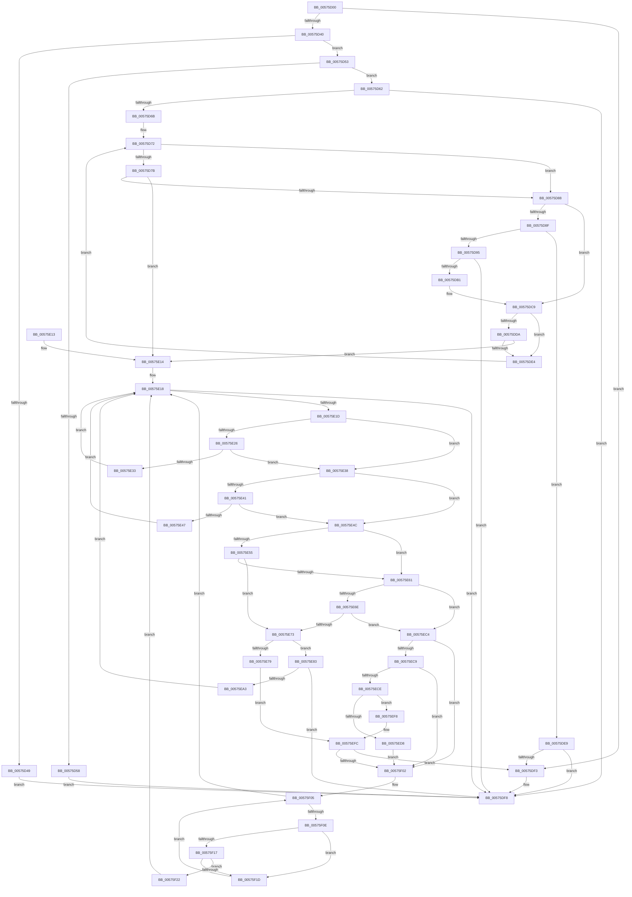

# HalpBuddyAllocatorReserveLogicalAddress

- RVA: `0x00575D00`–`0x00575F2B` (길이 `555` bytes)
- VA: `0x0000000140575D00`
- 실행 섹션: `.text`
- PDB 이름 있음: `예`; PDB Function 태그: `아니요`
- unwind 정보 RVA: `0x000C553C`
- 디코드: `163`개 명령, `555/555` bytes 표시
- 미해석 바이트: `0` (있으면 어셈블리에 `.byte`로 보존)

> 이 문서는 커널 이미지의 기계어와 PDB 기호를 분석해 생성했습니다. 4번과 5번은 함수 원형과 자료형을 바이너리 사용 방식에서 추정한 C 해석이며 원본 소스 복구 결과는 아닙니다.

## 1. Dependencies

- 직접 호출 지점: **9**; 고유 호출 대상: **3**
- 직접 호출자로 확인된 함수: **0**
- RIP 상대 이미지 참조: **0**

### Outgoing calls
- `0x00575D9B` → [HalpBuddyAllocatorBltRemove](HalpBuddyAllocatorBltRemove_function_00575AC0.md) (function, `0x00575AC0`)
- `0x00575DA6` → [HalpBuddyAllocatorSplitNode](../3E/HalpBuddyAllocatorSplitNode_function_003E0BD0.md) (function, `0x003E0BD0`)
- `0x00575DB8` → [HalpBuddyAllocatorBltAdd](../47/HalpBuddyAllocatorBltAdd_function_0047A968.md) (function, `0x0047A968`)
- `0x00575DC4` → [HalpBuddyAllocatorBltAdd](../47/HalpBuddyAllocatorBltAdd_function_0047A968.md) (function, `0x0047A968`)
- `0x00575E89` → [HalpBuddyAllocatorBltRemove](HalpBuddyAllocatorBltRemove_function_00575AC0.md) (function, `0x00575AC0`)
- `0x00575E94` → [HalpBuddyAllocatorSplitNode](../3E/HalpBuddyAllocatorSplitNode_function_003E0BD0.md) (function, `0x003E0BD0`)
- `0x00575EAA` → [HalpBuddyAllocatorBltAdd](../47/HalpBuddyAllocatorBltAdd_function_0047A968.md) (function, `0x0047A968`)
- `0x00575EB6` → [HalpBuddyAllocatorBltAdd](../47/HalpBuddyAllocatorBltAdd_function_0047A968.md) (function, `0x0047A968`)
- `0x00575EF1` → [HalpBuddyAllocatorBltRemove](HalpBuddyAllocatorBltRemove_function_00575AC0.md) (function, `0x00575AC0`)

### Direct callers
- 이 함수 시작 RVA로 연결되는 직접 call은 확인되지 않았습니다. 간접 호출은 완전히 역산할 수 없습니다.

### Static image references
- 디코드된 RIP-relative 메모리 참조가 없습니다.

## 2. Other-region calls and transfers

- 다른 실행 섹션으로 향하는 call: **0**
- 별도 외부 분기/꼬리 이동을 확인하지 못했습니다.

## 3. Assembly (complete function range)

```asm
00575D00  48 89 5C 24 08                  mov qword ptr [rsp + 8], rbx
00575D05  48 89 6C 24 10                  mov qword ptr [rsp + 0x10], rbp
00575D0A  48 89 74 24 18                  mov qword ptr [rsp + 0x18], rsi
00575D0F  57                              push rdi
00575D10  41 56                           push r14
00575D12  41 57                           push r15
00575D14  48 83 EC 20                     sub rsp, 0x20
00575D18  48 8B 59 58                     mov rbx, qword ptr [rcx + 0x58]
00575D1C  49 8B F0                        mov rsi, r8
00575D1F  48 C1 E6 0C                     shl rsi, 0xc
00575D23  33 FF                           xor edi, edi
00575D25  48 03 F2                        add rsi, rdx
00575D28  4C 8B F2                        mov r14, rdx
00575D2B  48 8B E9                        mov rbp, rcx
00575D2E  48 8B 43 38                     mov rax, qword ptr [rbx + 0x38]
00575D32  48 03 43 30                     add rax, qword ptr [rbx + 0x30]
00575D36  40 38 79 78                     cmp byte ptr [rcx + 0x78], dil
00575D3A  0F 84 B3 00 00 00               je 0x140575df3
00575D40  41 F7 C6 FF 0F 00 00            test r14d, 0xfff
00575D47  74 0A                           je 0x140575d53
00575D49  BF F0 00 00 C0                  mov edi, 0xc00000f0
00575D4E  E9 A5 00 00 00                  jmp 0x140575df8
00575D53  49 3B F6                        cmp rsi, r14
00575D56  75 0A                           jne 0x140575d62
00575D58  BF F1 00 00 C0                  mov edi, 0xc00000f1
00575D5D  E9 96 00 00 00                  jmp 0x140575df8
00575D62  4C 3B F0                        cmp r14, rax
00575D65  0F 83 8D 00 00 00               jae 0x140575df8
00575D6B  48 3B F0                        cmp rsi, rax
00575D6E  48 0F 47 F0                     cmova rsi, rax
00575D72  48 8B 4B 30                     mov rcx, qword ptr [rbx + 0x30]
00575D76  49 3B CE                        cmp rcx, r14
00575D79  75 0D                           jne 0x140575d88
00575D7B  48 03 4B 38                     add rcx, qword ptr [rbx + 0x38]
00575D7F  48 3B CE                        cmp rcx, rsi
00575D82  0F 84 8C 00 00 00               je 0x140575e14
00575D88  48 83 7B 18 00                  cmp qword ptr [rbx + 0x18], 0
00575D8D  75 3A                           jne 0x140575dc9
00575D8F  80 7B 48 00                     cmp byte ptr [rbx + 0x48], 0
00575D93  75 54                           jne 0x140575de9
00575D95  48 8B D5                        mov rdx, rbp
00575D98  48 8B CB                        mov rcx, rbx
00575D9B  E8 20 FD FF FF                  call 0x140575ac0
00575DA0  48 8B D3                        mov rdx, rbx
00575DA3  48 8B CD                        mov rcx, rbp
00575DA6  E8 25 AE E6 FF                  call 0x1403e0bd0
00575DAB  8B F8                           mov edi, eax
00575DAD  85 C0                           test eax, eax
00575DAF  78 47                           js 0x140575df8
00575DB1  48 8B 4B 20                     mov rcx, qword ptr [rbx + 0x20]
00575DB5  48 8B D5                        mov rdx, rbp
00575DB8  E8 AB 4B F0 FF                  call 0x14047a968
00575DBD  48 8B 4B 18                     mov rcx, qword ptr [rbx + 0x18]
00575DC1  48 8B D5                        mov rdx, rbp
00575DC4  E8 9F 4B F0 FF                  call 0x14047a968
00575DC9  48 8B 43 18                     mov rax, qword ptr [rbx + 0x18]
00575DCD  48 8B 48 38                     mov rcx, qword ptr [rax + 0x38]
00575DD1  48 03 48 30                     add rcx, qword ptr [rax + 0x30]
00575DD5  48 3B F1                        cmp rsi, rcx
00575DD8  76 0A                           jbe 0x140575de4
00575DDA  48 8B 43 20                     mov rax, qword ptr [rbx + 0x20]
00575DDE  4C 3B 70 30                     cmp r14, qword ptr [rax + 0x30]
00575DE2  72 30                           jb 0x140575e14
00575DE4  48 8B D8                        mov rbx, rax
00575DE7  EB 89                           jmp 0x140575d72
00575DE9  48 8D 45 50                     lea rax, [rbp + 0x50]
00575DED  48 39 43 28                     cmp qword ptr [rbx + 0x28], rax
00575DF1  74 05                           je 0x140575df8
00575DF3  BF 01 00 00 C0                  mov edi, 0xc0000001
00575DF8  48 8B 5C 24 40                  mov rbx, qword ptr [rsp + 0x40]
00575DFD  8B C7                           mov eax, edi
00575DFF  48 8B 6C 24 48                  mov rbp, qword ptr [rsp + 0x48]
00575E04  48 8B 74 24 50                  mov rsi, qword ptr [rsp + 0x50]
00575E09  48 83 C4 20                     add rsp, 0x20
00575E0D  41 5F                           pop r15
00575E0F  41 5E                           pop r14
00575E11  5F                              pop rdi
00575E12  C3                              ret
00575E13  CC                              int3
00575E14  4C 8D 7B 10                     lea r15, [rbx + 0x10]
00575E18  49 3B 1F                        cmp rbx, qword ptr [r15]
00575E1B  74 DB                           je 0x140575df8
00575E1D  48 8B 4B 18                     mov rcx, qword ptr [rbx + 0x18]
00575E21  48 85 C9                        test rcx, rcx
00575E24  74 12                           je 0x140575e38
00575E26  48 8B 41 38                     mov rax, qword ptr [rcx + 0x38]
00575E2A  48 03 41 30                     add rax, qword ptr [rcx + 0x30]
00575E2E  4C 3B F0                        cmp r14, rax
00575E31  73 05                           jae 0x140575e38
00575E33  48 8B D9                        mov rbx, rcx
00575E36  EB E0                           jmp 0x140575e18
00575E38  48 8B 43 20                     mov rax, qword ptr [rbx + 0x20]
00575E3C  48 85 C0                        test rax, rax
00575E3F  74 0B                           je 0x140575e4c
00575E41  48 3B 70 30                     cmp rsi, qword ptr [rax + 0x30]
00575E45  76 05                           jbe 0x140575e4c
00575E47  48 8B D8                        mov rbx, rax
00575E4A  EB CC                           jmp 0x140575e18
00575E4C  48 8B 53 30                     mov rdx, qword ptr [rbx + 0x30]
00575E50  4C 3B F2                        cmp r14, rdx
00575E53  76 0C                           jbe 0x140575e61
00575E55  48 8B 4B 38                     mov rcx, qword ptr [rbx + 0x38]
00575E59  48 03 CA                        add rcx, rdx
00575E5C  4C 3B F1                        cmp r14, rcx
00575E5F  72 12                           jb 0x140575e73
00575E61  4C 8B 43 38                     mov r8, qword ptr [rbx + 0x38]
00575E65  49 8D 04 10                     lea rax, [r8 + rdx]
00575E69  48 3B F0                        cmp rsi, rax
00575E6C  73 56                           jae 0x140575ec4
00575E6E  48 3B F2                        cmp rsi, rdx
00575E71  76 51                           jbe 0x140575ec4
00575E73  80 7B 48 00                     cmp byte ptr [rbx + 0x48], 0
00575E77  74 0A                           je 0x140575e83
00575E79  48 8D 45 50                     lea rax, [rbp + 0x50]
00575E7D  48 39 43 28                     cmp qword ptr [rbx + 0x28], rax
00575E81  EB 79                           jmp 0x140575efc
00575E83  48 8B D5                        mov rdx, rbp
00575E86  48 8B CB                        mov rcx, rbx
00575E89  E8 32 FC FF FF                  call 0x140575ac0
00575E8E  48 8B D3                        mov rdx, rbx
00575E91  48 8B CD                        mov rcx, rbp
00575E94  E8 37 AD E6 FF                  call 0x1403e0bd0
00575E99  8B F8                           mov edi, eax
00575E9B  85 C0                           test eax, eax
00575E9D  0F 88 55 FF FF FF               js 0x140575df8
00575EA3  48 8B 4B 20                     mov rcx, qword ptr [rbx + 0x20]
00575EA7  48 8B D5                        mov rdx, rbp
00575EAA  E8 B9 4A F0 FF                  call 0x14047a968
00575EAF  48 8B 4B 18                     mov rcx, qword ptr [rbx + 0x18]
00575EB3  48 8B D5                        mov rdx, rbp
00575EB6  E8 AD 4A F0 FF                  call 0x14047a968
00575EBB  48 8B 5B 18                     mov rbx, qword ptr [rbx + 0x18]
00575EBF  E9 54 FF FF FF                  jmp 0x140575e18
00575EC4  4C 3B F2                        cmp r14, rdx
00575EC7  77 39                           ja 0x140575f02
00575EC9  48 3B F0                        cmp rsi, rax
00575ECC  72 34                           jb 0x140575f02
00575ECE  80 7B 48 00                     cmp byte ptr [rbx + 0x48], 0
00575ED2  48 8D 4D 50                     lea rcx, [rbp + 0x50]
00575ED6  75 20                           jne 0x140575ef8
00575ED8  48 89 4B 28                     mov qword ptr [rbx + 0x28], rcx
00575EDC  48 8B D5                        mov rdx, rbp
00575EDF  C6 43 48 01                     mov byte ptr [rbx + 0x48], 1
00575EE3  4C 89 43 40                     mov qword ptr [rbx + 0x40], r8
00575EE7  48 FF 01                        inc qword ptr [rcx]
00575EEA  48 8B CB                        mov rcx, rbx
00575EED  4C 01 45 48                     add qword ptr [rbp + 0x48], r8
00575EF1  E8 CA FB FF FF                  call 0x140575ac0
00575EF6  EB 0A                           jmp 0x140575f02
00575EF8  48 39 4B 28                     cmp qword ptr [rbx + 0x28], rcx
00575EFC  0F 85 F1 FE FF FF               jne 0x140575df3
00575F02  49 8B 0F                        mov rcx, qword ptr [r15]
00575F05  48 3B D9                        cmp rbx, rcx
00575F08  0F 84 0A FF FF FF               je 0x140575e18
00575F0E  48 8B 43 10                     mov rax, qword ptr [rbx + 0x10]
00575F12  48 85 C0                        test rax, rax
00575F15  74 06                           je 0x140575f1d
00575F17  48 39 58 18                     cmp qword ptr [rax + 0x18], rbx
00575F1B  74 05                           je 0x140575f22
00575F1D  48 8B D8                        mov rbx, rax
00575F20  EB E3                           jmp 0x140575f05
00575F22  48 8B 58 20                     mov rbx, qword ptr [rax + 0x20]
00575F26  E9 ED FE FF FF                  jmp 0x140575e18
```

## 4. C-style interpretation (structured pseudocode)

```c
__int64 __fastcall HalpBuddyAllocatorReserveLogicalAddress(__int64 a1, __int64 a2, __int64 a3)
{
    __int64 result;
    __int64 v_rdi;
    __int64 v_rsi;
    __int64 v_rsp;
    unsigned __int64 v_stack_p10;
    unsigned __int64 v_stack_p18;
    unsigned __int64 v_stack_p8;

    v_stack_p8 = v_rbx;
    v_stack_p10 = v_rbp;
    v_stack_p18 = v_rsi;
    v_rsp = (v_rsp) - (32);
    v_rsi = (a3) << (12);
    v_rdi = 0;
    v_rsi = (v_rsi) + (a2);
    result = (*(unsigned __int64 *)(*(unsigned __int64 *)(a1 + 88) + 56)) + (*(unsigned __int64 *)(*(unsigned __int64 *)(a1 + 88) + 48));
    if ((*(unsigned __int8 *)(a1 + 120)) == 0) goto loc_00575DF3;
    if ((((unsigned int)(a2)) & (0xFFFULL)) == 0) goto loc_00575D53;
    goto loc_00575DF8;
loc_00575D53:
    if (v_rsi != a2) goto loc_00575D62;
    goto loc_00575DF8;
loc_00575D62:
    if (a2 >= result) goto loc_00575DF8;
    if (v_rsi > result) { v_rsi = result; }
loc_00575D72:
    if ((*(unsigned __int64 *)(*(unsigned __int64 *)(a1 + 88) + 48)) != a2) goto loc_00575D88;
    a1 = (*(unsigned __int64 *)(*(unsigned __int64 *)(a1 + 88) + 48)) + (*(unsigned __int64 *)(*(unsigned __int64 *)(a1 + 88) + 56));
    if (a1 == v_rsi) goto loc_00575E14;
loc_00575D88:
    if ((*(unsigned __int64 *)(*(unsigned __int64 *)(a1 + 88) + 24)) != 0) goto loc_00575DC9;
    if ((*(unsigned __int8 *)(*(unsigned __int64 *)(a1 + 88) + 72)) != 0) goto loc_00575DE9;
    result = HalpBuddyAllocatorBltRemove(*(unsigned __int64 *)(a1 + 88), a1, a3, a4);
    result = HalpBuddyAllocatorSplitNode(a1, *(unsigned __int64 *)(a1 + 88), a3, a4);
    if (sign_flag) goto loc_00575DF8;
    result = HalpBuddyAllocatorBltAdd(*(unsigned __int64 *)(*(unsigned __int64 *)(a1 + 88) + 32), a1, a3, a4);
    result = HalpBuddyAllocatorBltAdd(*(unsigned __int64 *)(*(unsigned __int64 *)(a1 + 88) + 24), a1, a3, a4);
loc_00575DC9:
    a1 = (*(unsigned __int64 *)(*(unsigned __int64 *)(*(unsigned __int64 *)(a1 + 88) + 24) + 56)) + (*(unsigned __int64 *)(*(unsigned __int64 *)(*(unsigned __int64 *)(a1 + 88) + 24) + 48));
    if (v_rsi <= a1) goto loc_00575DE4;
    if (a2 < (*(unsigned __int64 *)(*(unsigned __int64 *)(*(unsigned __int64 *)(a1 + 88) + 32) + 48))) goto loc_00575E14;
loc_00575DE4:
    goto loc_00575D72;
loc_00575DE9:
    v_rdi = (unsigned int)((unsigned int)(result));
    if ((*(unsigned __int64 *)(*(unsigned __int64 *)(*(unsigned __int64 *)(a1 + 88) + 32) + 40)) != (a1 + 80)) {
        v_rdi = 0xC0000001ULL;
    }
    v_rsp = (v_rsp) + (32);
    return (unsigned int)((unsigned int)(v_rdi));
loc_00575E14:
loc_00575E18:
    if (v_stack_p8 == (*(unsigned __int64 *)(v_stack_p8 + 16))) goto loc_00575DF8;
    if (*(unsigned __int64 *)(v_stack_p8 + 24) == 0) goto loc_00575E38;
    result = (*(unsigned __int64 *)(*(unsigned __int64 *)(v_stack_p8 + 24) + 56)) + (*(unsigned __int64 *)(*(unsigned __int64 *)(v_stack_p8 + 24) + 48));
    if (a2 >= result) goto loc_00575E38;
    goto loc_00575E18;
loc_00575E38:
    if (*(unsigned __int64 *)(*(unsigned __int64 *)(v_stack_p8 + 24) + 32) == 0) goto loc_00575E4C;
    if (v_stack_p18 <= (*(unsigned __int64 *)(*(unsigned __int64 *)(*(unsigned __int64 *)(v_stack_p8 + 24) + 32) + 48))) goto loc_00575E4C;
    goto loc_00575E18;
loc_00575E4C:
    if (a2 <= (*(unsigned __int64 *)(*(unsigned __int64 *)(*(unsigned __int64 *)(v_stack_p8 + 24) + 32) + 48))) goto loc_00575E61;
    a1 = (*(unsigned __int64 *)(*(unsigned __int64 *)(*(unsigned __int64 *)(v_stack_p8 + 24) + 32) + 56)) + (*(unsigned __int64 *)(*(unsigned __int64 *)(*(unsigned __int64 *)(v_stack_p8 + 24) + 32) + 48));
    if (a2 < a1) goto loc_00575E73;
loc_00575E61:
    if (v_stack_p18 >= (*(unsigned __int64 *)(*(unsigned __int64 *)(*(unsigned __int64 *)(v_stack_p8 + 24) + 32) + 56) + *(unsigned __int64 *)(*(unsigned __int64 *)(*(unsigned __int64 *)(v_stack_p8 + 24) + 32) + 48) * 1)) goto loc_00575EC4;
    if (v_stack_p18 <= (*(unsigned __int64 *)(*(unsigned __int64 *)(*(unsigned __int64 *)(v_stack_p8 + 24) + 32) + 48))) goto loc_00575EC4;
loc_00575E73:
    if ((*(unsigned __int8 *)(*(unsigned __int64 *)(*(unsigned __int64 *)(v_stack_p8 + 24) + 32) + 72)) == 0) goto loc_00575E83;
    goto loc_00575EFC;
loc_00575E83:
    result = HalpBuddyAllocatorBltRemove(*(unsigned __int64 *)(*(unsigned __int64 *)(v_stack_p8 + 24) + 32), v_stack_p10, *(unsigned __int64 *)(*(unsigned __int64 *)(*(unsigned __int64 *)(v_stack_p8 + 24) + 32) + 56), a4);
    result = HalpBuddyAllocatorSplitNode(v_stack_p10, *(unsigned __int64 *)(*(unsigned __int64 *)(v_stack_p8 + 24) + 32), *(unsigned __int64 *)(*(unsigned __int64 *)(*(unsigned __int64 *)(v_stack_p8 + 24) + 32) + 56), a4);
    if (sign_flag) goto loc_00575DF8;
    result = HalpBuddyAllocatorBltAdd(*(unsigned __int64 *)(*(unsigned __int64 *)(*(unsigned __int64 *)(v_stack_p8 + 24) + 32) + 32), v_stack_p10, *(unsigned __int64 *)(*(unsigned __int64 *)(*(unsigned __int64 *)(v_stack_p8 + 24) + 32) + 56), a4);
    result = HalpBuddyAllocatorBltAdd(*(unsigned __int64 *)(*(unsigned __int64 *)(*(unsigned __int64 *)(v_stack_p8 + 24) + 32) + 24), v_stack_p10, *(unsigned __int64 *)(*(unsigned __int64 *)(*(unsigned __int64 *)(v_stack_p8 + 24) + 32) + 56), a4);
    goto loc_00575E18;
loc_00575EC4:
    if (a2 > v_stack_p10) goto loc_00575F02;
    if (v_stack_p18 < result) goto loc_00575F02;
    if ((*(unsigned __int8 *)(*(unsigned __int64 *)(*(unsigned __int64 *)(*(unsigned __int64 *)(v_stack_p8 + 24) + 32) + 24) + 72)) != 0) goto loc_00575EF8;
    *(unsigned __int64 *)(*(unsigned __int64 *)(*(unsigned __int64 *)(*(unsigned __int64 *)(v_stack_p8 + 24) + 32) + 24) + 40) = v_stack_p10 + 80;
    *(unsigned __int8 *)(*(unsigned __int64 *)(*(unsigned __int64 *)(*(unsigned __int64 *)(v_stack_p8 + 24) + 32) + 24) + 72) = 1;
    *(unsigned __int64 *)(*(unsigned __int64 *)(*(unsigned __int64 *)(*(unsigned __int64 *)(v_stack_p8 + 24) + 32) + 24) + 64) = *(unsigned __int64 *)(*(unsigned __int64 *)(*(unsigned __int64 *)(v_stack_p8 + 24) + 32) + 56);
    result = HalpBuddyAllocatorBltRemove(*(unsigned __int64 *)(*(unsigned __int64 *)(*(unsigned __int64 *)(v_stack_p8 + 24) + 32) + 24), v_stack_p10, *(unsigned __int64 *)(*(unsigned __int64 *)(*(unsigned __int64 *)(v_stack_p8 + 24) + 32) + 56), a4);
    goto loc_00575F02;
loc_00575EF8:
loc_00575EFC:
    if ((*(unsigned __int64 *)(*(unsigned __int64 *)(*(unsigned __int64 *)(*(unsigned __int64 *)(v_stack_p8 + 24) + 32) + 24) + 40)) != (*(unsigned __int64 *)(*(unsigned __int64 *)(*(unsigned __int64 *)(v_stack_p8 + 24) + 32) + 24))) goto loc_00575DF3;
loc_00575F02:
loc_00575F05:
    if ((*(unsigned __int64 *)(*(unsigned __int64 *)(*(unsigned __int64 *)(v_stack_p8 + 24) + 32) + 24)) == (*(unsigned __int64 *)(v_stack_p8 + 16))) goto loc_00575E18;
    if (*(unsigned __int64 *)(*(unsigned __int64 *)(*(unsigned __int64 *)(*(unsigned __int64 *)(v_stack_p8 + 24) + 32) + 24) + 16) == 0) goto loc_00575F1D;
    if ((*(unsigned __int64 *)(*(unsigned __int64 *)(*(unsigned __int64 *)(*(unsigned __int64 *)(*(unsigned __int64 *)(v_stack_p8 + 24) + 32) + 24) + 16) + 24)) == (*(unsigned __int64 *)(*(unsigned __int64 *)(*(unsigned __int64 *)(v_stack_p8 + 24) + 32) + 24))) goto loc_00575F22;
loc_00575F1D:
    goto loc_00575F05;
loc_00575F22:
    goto loc_00575E18;
}
```

## 5. (Beta) C Style

```c
int64_t HalpBuddyAllocatorReserveLogicalAddress(void *Arg1, int64_t Arg2, int64_t Arg3)
{
    uint8_t *arg1 = (uint8_t *)Arg1;

    int64_t result;
    int64_t local_rdi;
    int64_t local_rsi;
    int64_t local_rsp;
    uint64_t v_stack_p10;
    uint64_t v_stack_p18;
    uint64_t v_stack_p8;

    v_stack_p8 = local_rbx;
    v_stack_p10 = local_rbp;
    v_stack_p18 = local_rsi;
    local_rsp = (local_rsp) - (32);
    local_rsi = (Arg3) << (12);
    local_rdi = 0;
    local_rsi = (local_rsi) + (Arg2);
    result = (*(uint64_t *)(*(uint64_t *)(arg1 + 0x58) + 0x38)) + (*(uint64_t *)(*(uint64_t *)(arg1 + 0x58) + 0x30));
    if ((*(uint8_t *)(arg1 + 0x78)) == 0) goto loc_00575DF3;
    if ((((uint32_t)(Arg2)) & (0xFFFULL)) == 0) goto loc_00575D53;
    goto loc_00575DF8;
loc_00575D53:
    if (local_rsi != Arg2) goto loc_00575D62;
    goto loc_00575DF8;
loc_00575D62:
    if (Arg2 >= result) goto loc_00575DF8;
    if (local_rsi > result) { local_rsi = result; }
loc_00575D72:
    if ((*(uint64_t *)(*(uint64_t *)(arg1 + 0x58) + 0x30)) != Arg2) goto loc_00575D88;
    Arg1 = (*(uint64_t *)(*(uint64_t *)(arg1 + 0x58) + 0x30)) + (*(uint64_t *)(*(uint64_t *)(arg1 + 0x58) + 0x38));
    if (Arg1 == local_rsi) goto loc_00575E14;
loc_00575D88:
    if ((*(uint64_t *)(*(uint64_t *)(arg1 + 0x58) + 0x18)) != 0) goto loc_00575DC9;
    if ((*(uint8_t *)(*(uint64_t *)(arg1 + 0x58) + 0x48)) != 0) goto loc_00575DE9;
    result = HalpBuddyAllocatorBltRemove(*(uint64_t *)(arg1 + 0x58), Arg1, Arg3, a4);
    result = HalpBuddyAllocatorSplitNode(Arg1, *(uint64_t *)(arg1 + 0x58), Arg3, a4);
    if (sign_flag) goto loc_00575DF8;
    result = HalpBuddyAllocatorBltAdd(*(uint64_t *)(*(uint64_t *)(arg1 + 0x58) + 0x20), Arg1, Arg3, a4);
    result = HalpBuddyAllocatorBltAdd(*(uint64_t *)(*(uint64_t *)(arg1 + 0x58) + 0x18), Arg1, Arg3, a4);
loc_00575DC9:
    Arg1 = (*(uint64_t *)(*(uint64_t *)(*(uint64_t *)(arg1 + 0x58) + 0x18) + 0x38)) + (*(uint64_t *)(*(uint64_t *)(*(uint64_t *)(arg1 + 0x58) + 0x18) + 0x30));
    if (local_rsi <= Arg1) goto loc_00575DE4;
    if (Arg2 < (*(uint64_t *)(*(uint64_t *)(*(uint64_t *)(arg1 + 0x58) + 0x20) + 0x30))) goto loc_00575E14;
loc_00575DE4:
    goto loc_00575D72;
loc_00575DE9:
    local_rdi = (uint32_t)((uint32_t)(result));
    if ((*(uint64_t *)(*(uint64_t *)(*(uint64_t *)(arg1 + 0x58) + 0x20) + 0x28)) != (Arg1 + 80)) {
        local_rdi = 0xC0000001ULL;
    }
    local_rsp = (local_rsp) + (32);
    return (uint32_t)((uint32_t)(local_rdi));
loc_00575E14:
loc_00575E18:
    if (v_stack_p8 == (*(uint64_t *)(v_stack_p8 + 0x10))) goto loc_00575DF8;
    if (*(uint64_t *)(v_stack_p8 + 0x18) == 0) goto loc_00575E38;
    result = (*(uint64_t *)(*(uint64_t *)(v_stack_p8 + 0x18) + 0x38)) + (*(uint64_t *)(*(uint64_t *)(v_stack_p8 + 0x18) + 0x30));
    if (Arg2 >= result) goto loc_00575E38;
    goto loc_00575E18;
loc_00575E38:
    if (*(uint64_t *)(*(uint64_t *)(v_stack_p8 + 0x18) + 0x20) == 0) goto loc_00575E4C;
    if (v_stack_p18 <= (*(uint64_t *)(*(uint64_t *)(*(uint64_t *)(v_stack_p8 + 0x18) + 0x20) + 0x30))) goto loc_00575E4C;
    goto loc_00575E18;
loc_00575E4C:
    if (Arg2 <= (*(uint64_t *)(*(uint64_t *)(*(uint64_t *)(v_stack_p8 + 0x18) + 0x20) + 0x30))) goto loc_00575E61;
    Arg1 = (*(uint64_t *)(*(uint64_t *)(*(uint64_t *)(v_stack_p8 + 0x18) + 0x20) + 0x38)) + (*(uint64_t *)(*(uint64_t *)(*(uint64_t *)(v_stack_p8 + 0x18) + 0x20) + 0x30));
    if (Arg2 < Arg1) goto loc_00575E73;
loc_00575E61:
    if (v_stack_p18 >= (*(uint64_t *)(*(uint64_t *)(*(uint64_t *)(v_stack_p8 + 0x18) + 0x20) + 0x38) + *(uint64_t *)(*(uint64_t *)(*(uint64_t *)(v_stack_p8 + 0x18) + 0x20) + 0x30) * 1)) goto loc_00575EC4;
    if (v_stack_p18 <= (*(uint64_t *)(*(uint64_t *)(*(uint64_t *)(v_stack_p8 + 0x18) + 0x20) + 0x30))) goto loc_00575EC4;
loc_00575E73:
    if ((*(uint8_t *)(*(uint64_t *)(*(uint64_t *)(v_stack_p8 + 0x18) + 0x20) + 0x48)) == 0) goto loc_00575E83;
    goto loc_00575EFC;
loc_00575E83:
    result = HalpBuddyAllocatorBltRemove(*(uint64_t *)(*(uint64_t *)(v_stack_p8 + 0x18) + 0x20), v_stack_p10, *(uint64_t *)(*(uint64_t *)(*(uint64_t *)(v_stack_p8 + 0x18) + 0x20) + 0x38), a4);
    result = HalpBuddyAllocatorSplitNode(v_stack_p10, *(uint64_t *)(*(uint64_t *)(v_stack_p8 + 0x18) + 0x20), *(uint64_t *)(*(uint64_t *)(*(uint64_t *)(v_stack_p8 + 0x18) + 0x20) + 0x38), a4);
    if (sign_flag) goto loc_00575DF8;
    result = HalpBuddyAllocatorBltAdd(*(uint64_t *)(*(uint64_t *)(*(uint64_t *)(v_stack_p8 + 0x18) + 0x20) + 0x20), v_stack_p10, *(uint64_t *)(*(uint64_t *)(*(uint64_t *)(v_stack_p8 + 0x18) + 0x20) + 0x38), a4);
    result = HalpBuddyAllocatorBltAdd(*(uint64_t *)(*(uint64_t *)(*(uint64_t *)(v_stack_p8 + 0x18) + 0x20) + 0x18), v_stack_p10, *(uint64_t *)(*(uint64_t *)(*(uint64_t *)(v_stack_p8 + 0x18) + 0x20) + 0x38), a4);
    goto loc_00575E18;
loc_00575EC4:
    if (Arg2 > v_stack_p10) goto loc_00575F02;
    if (v_stack_p18 < result) goto loc_00575F02;
    if ((*(uint8_t *)(*(uint64_t *)(*(uint64_t *)(*(uint64_t *)(v_stack_p8 + 0x18) + 0x20) + 0x18) + 0x48)) != 0) goto loc_00575EF8;
    *(uint64_t *)(*(uint64_t *)(*(uint64_t *)(*(uint64_t *)(v_stack_p8 + 0x18) + 0x20) + 0x18) + 0x28) = v_stack_p10 + 80;
    *(uint8_t *)(*(uint64_t *)(*(uint64_t *)(*(uint64_t *)(v_stack_p8 + 0x18) + 0x20) + 0x18) + 0x48) = 1;
    *(uint64_t *)(*(uint64_t *)(*(uint64_t *)(*(uint64_t *)(v_stack_p8 + 0x18) + 0x20) + 0x18) + 0x40) = *(uint64_t *)(*(uint64_t *)(*(uint64_t *)(v_stack_p8 + 0x18) + 0x20) + 0x38);
    result = HalpBuddyAllocatorBltRemove(*(uint64_t *)(*(uint64_t *)(*(uint64_t *)(v_stack_p8 + 0x18) + 0x20) + 0x18), v_stack_p10, *(uint64_t *)(*(uint64_t *)(*(uint64_t *)(v_stack_p8 + 0x18) + 0x20) + 0x38), a4);
    goto loc_00575F02;
loc_00575EF8:
loc_00575EFC:
    if ((*(uint64_t *)(*(uint64_t *)(*(uint64_t *)(*(uint64_t *)(v_stack_p8 + 0x18) + 0x20) + 0x18) + 0x28)) != (*(uint64_t *)(*(uint64_t *)(*(uint64_t *)(v_stack_p8 + 0x18) + 0x20) + 0x18))) goto loc_00575DF3;
loc_00575F02:
loc_00575F05:
    if ((*(uint64_t *)(*(uint64_t *)(*(uint64_t *)(v_stack_p8 + 0x18) + 0x20) + 0x18)) == (*(uint64_t *)(v_stack_p8 + 0x10))) goto loc_00575E18;
    if (*(uint64_t *)(*(uint64_t *)(*(uint64_t *)(*(uint64_t *)(v_stack_p8 + 0x18) + 0x20) + 0x18) + 0x10) == 0) goto loc_00575F1D;
    if ((*(uint64_t *)(*(uint64_t *)(*(uint64_t *)(*(uint64_t *)(*(uint64_t *)(v_stack_p8 + 0x18) + 0x20) + 0x18) + 0x10) + 0x18)) == (*(uint64_t *)(*(uint64_t *)(*(uint64_t *)(v_stack_p8 + 0x18) + 0x20) + 0x18))) goto loc_00575F22;
loc_00575F1D:
    goto loc_00575F05;
loc_00575F22:
    goto loc_00575E18;
}
```

### 관측된 메모리 오프셋

구조체 형식이 확인되지 않은 접근은 인자 기준의 오프셋으로만 기록했습니다.

| 기준 인자 | 오프셋 표현 | 폭 (bit) | 접근 |
|---|---:|---:|---|
| `Arg1` | `+ 0x0` | `64` | `R/W` |
| `Arg1` | `+ 0x48` | `64` | `R/W` |
| `Arg1` | `+ 0x50` | `64` | `R` |
| `Arg1` | `+ 0x58` | `64` | `R` |
| `Arg1` | `+ 0x78` | `8` | `R` |

## 6. Execution-region graph

[열기: 2D/3D 그래프와 함수 탐색 컨트롤 패널](../../../control-panel.html?section=text&rva=0x00575D00&view=graph)

- 2D 그래프는 위에서 아래로 흐르고, 3D 그래프는 빈 공간을 드래그해 회전합니다. Shift+드래그는 이동, 휠은 확대·축소, 함수 노드 선택은 대상 보고서 이동입니다.

### Static fallback


