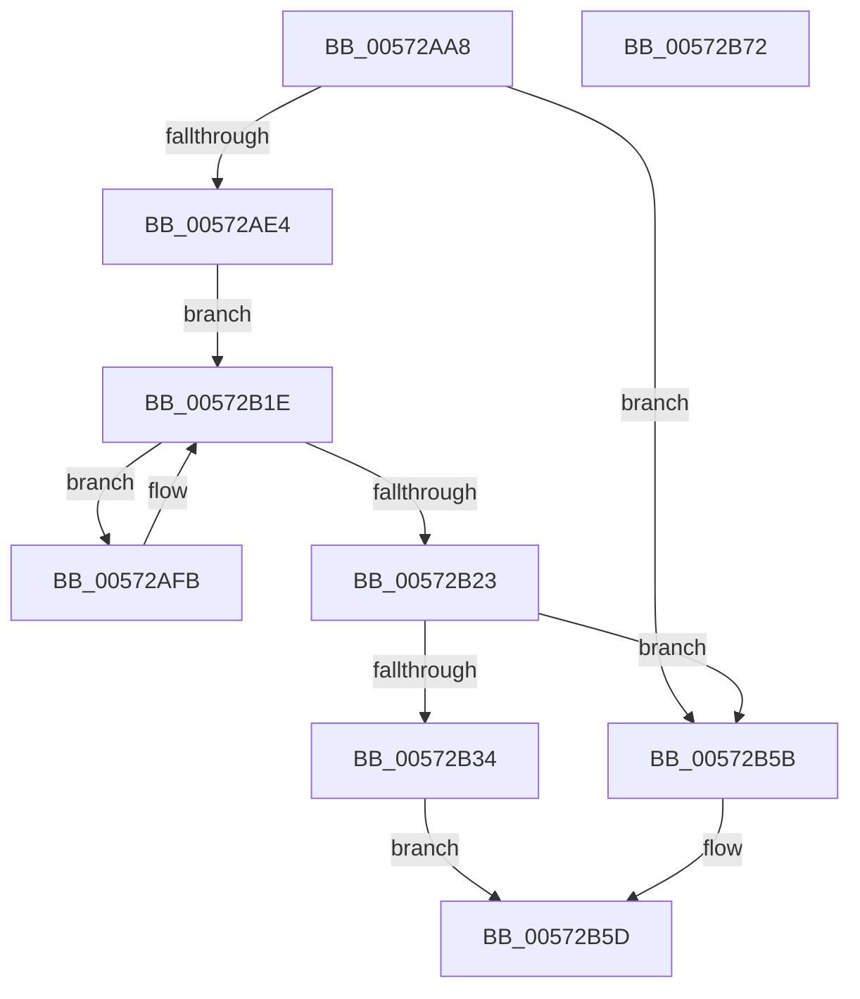

# HalpHsaCreateReservedDevice

- RVA: `0x00572AA8`–`0x00572B73` (길이 `203` bytes)
- VA: `0x0000000140572AA8`
- 실행 섹션: `.text`
- PDB 이름 있음: `예`; PDB Function 태그: `아니요`
- unwind 정보 RVA: `0x000B6A1C`
- 디코드: `59`개 명령, `203/203` bytes 표시
- 미해석 바이트: `0` (있으면 어셈블리에 `.byte`로 보존)

> 이 문서는 커널 이미지의 기계어와 PDB 기호를 분석해 생성했습니다. 4번과 5번은 함수 원형과 자료형을 바이너리 사용 방식에서 추정한 C 해석이며 원본 소스 복구 결과는 아닙니다.

## 1. Dependencies

- 직접 호출 지점: **2**; 고유 호출 대상: **1**
- 직접 호출자로 확인된 함수: **1**
- RIP 상대 이미지 참조: **0**

### Outgoing calls
- `0x00572ADB` → [ExtEnvAllocateMemory](../56/ExtEnvAllocateMemory_function_005610B0.md) (function, `0x005610B0`)
- `0x00572B2B` → [ExtEnvAllocateMemory](../56/ExtEnvAllocateMemory_function_005610B0.md) (function, `0x005610B0`)

### Direct callers
- [HsaEnumerateIvmdDevices](HsaEnumerateIvmdDevices_function_00573E90.md) at `0x00573EEA`

### Static image references
- 디코드된 RIP-relative 메모리 참조가 없습니다.

## 2. Other-region calls and transfers

- 다른 실행 섹션으로 향하는 call: **0**
- 별도 외부 분기/꼬리 이동을 확인하지 못했습니다.

## 3. Assembly (complete function range)

```asm
00572AA8  4C 8B DC                        mov r11, rsp
00572AAB  49 89 5B 08                     mov qword ptr [r11 + 8], rbx
00572AAF  49 89 6B 18                     mov qword ptr [r11 + 0x18], rbp
00572AB3  49 89 73 20                     mov qword ptr [r11 + 0x20], rsi
00572AB7  57                              push rdi
00572AB8  48 83 EC 20                     sub rsp, 0x20
00572ABC  8B 42 14                        mov eax, dword ptr [rdx + 0x14]
00572ABF  48 8B FA                        mov rdi, rdx
00572AC2  33 ED                           xor ebp, ebp
00572AC4  0F B7 F1                        movzx esi, cx
00572AC7  49 89 6B 10                     mov qword ptr [r11 + 0x10], rbp
00572ACB  44 8D 04 40                     lea r8d, [rax + rax*2]
00572ACF  42 8D 14 C5 28 00 00 00         lea edx, [r8*8 + 0x28]
00572AD7  4D 8D 43 10                     lea r8, [r11 + 0x10]
00572ADB  E8 D0 E5 FE FF                  call 0x1405610b0
00572AE0  85 C0                           test eax, eax
00572AE2  78 77                           js 0x140572b5b
00572AE4  48 8B 5C 24 38                  mov rbx, qword ptr [rsp + 0x38]
00572AE9  4C 8D 4F 18                     lea r9, [rdi + 0x18]
00572AED  8B 47 14                        mov eax, dword ptr [rdi + 0x14]
00572AF0  44 8B D5                        mov r10d, ebp
00572AF3  89 43 20                        mov dword ptr [rbx + 0x20], eax
00572AF6  4D 8B 01                        mov r8, qword ptr [r9]
00572AF9  EB 23                           jmp 0x140572b1e
00572AFB  49 8B 40 10                     mov rax, qword ptr [r8 + 0x10]
00572AFF  41 8B D2                        mov edx, r10d
00572B02  41 FF C2                        inc r10d
00572B05  48 8D 0C 52                     lea rcx, [rdx + rdx*2]
00572B09  48 89 44 CB 28                  mov qword ptr [rbx + rcx*8 + 0x28], rax
00572B0E  48 8D 0C 52                     lea rcx, [rdx + rdx*2]
00572B12  49 8B 40 18                     mov rax, qword ptr [r8 + 0x18]
00572B16  48 89 44 CB 30                  mov qword ptr [rbx + rcx*8 + 0x30], rax
00572B1B  4D 8B 00                        mov r8, qword ptr [r8]
00572B1E  4D 3B C1                        cmp r8, r9
00572B21  75 D8                           jne 0x140572afb
00572B23  4C 8B C3                        mov r8, rbx
00572B26  BA 18 00 00 00                  mov edx, 0x18
00572B2B  E8 80 E5 FE FF                  call 0x1405610b0
00572B30  85 C0                           test eax, eax
00572B32  78 27                           js 0x140572b5b
00572B34  48 8B 0B                        mov rcx, qword ptr [rbx]
00572B37  48 8B C3                        mov rax, rbx
00572B3A  C7 01 01 00 00 00               mov dword ptr [rcx], 1
00572B40  48 8B 0B                        mov rcx, qword ptr [rbx]
00572B43  66 89 71 08                     mov word ptr [rcx + 8], si
00572B47  48 8B 0B                        mov rcx, qword ptr [rbx]
00572B4A  66 89 69 0E                     mov word ptr [rcx + 0xe], bp
00572B4E  48 8B 13                        mov rdx, qword ptr [rbx]
00572B51  0F B7 4F 10                     movzx ecx, word ptr [rdi + 0x10]
00572B55  66 89 4A 0C                     mov word ptr [rdx + 0xc], cx
00572B59  EB 02                           jmp 0x140572b5d
00572B5B  33 C0                           xor eax, eax
00572B5D  48 8B 5C 24 30                  mov rbx, qword ptr [rsp + 0x30]
00572B62  48 8B 6C 24 40                  mov rbp, qword ptr [rsp + 0x40]
00572B67  48 8B 74 24 48                  mov rsi, qword ptr [rsp + 0x48]
00572B6C  48 83 C4 20                     add rsp, 0x20
00572B70  5F                              pop rdi
00572B71  C3                              ret
00572B72  CC                              int3
```

## 4. C-style interpretation (structured pseudocode)

```c
__int64 __fastcall HalpHsaCreateReservedDevice(unsigned __int16 a1, __int64 a2)
{
    __int64 result;
    __int64 v_r10;
    __int64 v_rbp;
    __int64 v_rsp;
    unsigned __int64 v_stack_p10;
    unsigned __int64 v_stack_p18;
    unsigned __int64 v_stack_p20;
    unsigned __int64 v_stack_p8;

    *(unsigned __int64 *)(v_rsp + 8) = v_rbx;
    *(unsigned __int64 *)(v_rsp + 24) = v_rbp;
    *(unsigned __int64 *)(v_rsp + 32) = v_rsi;
    v_rsp = (v_rsp) - (32);
    v_rbp = 0;
    *(unsigned __int64 *)(v_rsp + 16) = 0;
    result = ExtEnvAllocateMemory(a1, (unsigned int)(*(unsigned int *)(a2 + 20)) + (unsigned int)(*(unsigned int *)(a2 + 20)) * 2 * 8 + 40, v_rsp + 16, a4);
    if (sign_flag) goto loc_00572B5B;
    *(unsigned int *)(v_stack_p10 + 32) = (unsigned int)((unsigned int)(*(unsigned int *)(a2 + 20)));
    goto loc_00572B1E;
loc_00572AFB:
    v_r10 = (unsigned int)((0) + 1);
    *(unsigned __int64 *)(v_stack_p10 + 0 + 0 * 2 * 8 + 40) = *(unsigned __int64 *)(*(unsigned __int64 *)(a2 + 24) + 16);
    *(unsigned __int64 *)(v_stack_p10 + 0 + 0 * 2 * 8 + 48) = *(unsigned __int64 *)(*(unsigned __int64 *)(a2 + 24) + 24);
loc_00572B1E:
    if ((*(unsigned __int64 *)(*(unsigned __int64 *)(a2 + 24))) != (a2 + 24)) goto loc_00572AFB;
    result = ExtEnvAllocateMemory(0 + 0 * 2, 24, v_stack_p10, a2 + 24);
    if (sign_flag) goto loc_00572B5B;
    *(unsigned int *)(*(unsigned __int64 *)(v_stack_p10)) = 1;
    *(unsigned __int16 *)(*(unsigned __int64 *)(v_stack_p10) + 8) = a1;
    *(unsigned __int16 *)(*(unsigned __int64 *)(v_stack_p10) + 14) = 0;
    *(unsigned __int16 *)(*(unsigned __int64 *)(v_stack_p10) + 12) = (unsigned __int16)(*(unsigned __int16 *)(a2 + 16));
    goto loc_00572B5D;
loc_00572B5B:
    result = 0;
loc_00572B5D:
    v_rsp = (v_rsp) + (32);
    return result;
}
```

## 5. (Beta) C Style

```c
int64_t HalpHsaCreateReservedDevice(uint16_t Arg1, void *Arg2)
{
    uint8_t *arg2 = (uint8_t *)Arg2;

    int64_t result;
    int64_t local_r10;
    int64_t local_rbp;
    int64_t local_rsp;
    uint64_t v_stack_p10;
    uint64_t v_stack_p18;
    uint64_t v_stack_p20;
    uint64_t v_stack_p8;

    *(uint64_t *)(local_rsp + 0x8) = local_rbx;
    *(uint64_t *)(local_rsp + 0x18) = local_rbp;
    *(uint64_t *)(local_rsp + 0x20) = local_rsi;
    local_rsp = (local_rsp) - (32);
    local_rbp = 0;
    *(uint64_t *)(local_rsp + 0x10) = 0;
    result = ExtEnvAllocateMemory(Arg1, (uint32_t)(*(uint32_t *)(arg2 + 0x14)) + (uint32_t)(*(uint32_t *)(arg2 + 0x14)) * 2 * 8 + 40, local_rsp + 16, a4);
    if (sign_flag) goto loc_00572B5B;
    *(uint32_t *)(v_stack_p10 + 0x20) = (uint32_t)((uint32_t)(*(uint32_t *)(arg2 + 0x14)));
    goto loc_00572B1E;
loc_00572AFB:
    local_r10 = (uint32_t)((0) + 1);
    *(uint64_t *)(v_stack_p10 + 0x0 + 0x0 * 2 * 8 + 0x28) = *(uint64_t *)(*(uint64_t *)(arg2 + 0x18) + 0x10);
    *(uint64_t *)(v_stack_p10 + 0x0 + 0x0 * 2 * 8 + 0x30) = *(uint64_t *)(*(uint64_t *)(arg2 + 0x18) + 0x18);
loc_00572B1E:
    if ((*(uint64_t *)(*(uint64_t *)(arg2 + 0x18))) != (Arg2 + 24)) goto loc_00572AFB;
    result = ExtEnvAllocateMemory(0 + 0 * 2, 24, v_stack_p10, Arg2 + 24);
    if (sign_flag) goto loc_00572B5B;
    *(uint32_t *)(*(uint64_t *)(v_stack_p10)) = 1;
    *(uint16_t *)(*(uint64_t *)(v_stack_p10) + 0x8) = Arg1;
    *(uint16_t *)(*(uint64_t *)(v_stack_p10) + 0xE) = 0;
    *(uint16_t *)(*(uint64_t *)(v_stack_p10) + 0xC) = (uint16_t)(*(uint16_t *)(arg2 + 0x10));
    goto loc_00572B5D;
loc_00572B5B:
    result = 0;
loc_00572B5D:
    local_rsp = (local_rsp) + (32);
    return result;
}
```

### 관측된 메모리 오프셋

구조체 형식이 확인되지 않은 접근은 인자 기준의 오프셋으로만 기록했습니다.

| 기준 인자 | 오프셋 표현 | 폭 (bit) | 접근 |
|---|---:|---:|---|
| `Arg2` | `+ 0x0` | `64` | `R` |
| `Arg2` | `+ 0x10` | `16` | `R` |
| `Arg2` | `+ 0x14` | `32` | `R` |
| `Arg2` | `+ 0x18` | `64` | `R` |

## 6. Execution-region graph

[열기: 2D/3D 그래프와 함수 탐색 컨트롤 패널](../../../control-panel.html?section=text&rva=0x00572AA8&view=graph)

- 2D 그래프는 위에서 아래로 흐르고, 3D 그래프는 빈 공간을 드래그해 회전합니다. Shift+드래그는 이동, 휠은 확대·축소, 함수 노드 선택은 대상 보고서 이동입니다.

### Static fallback


