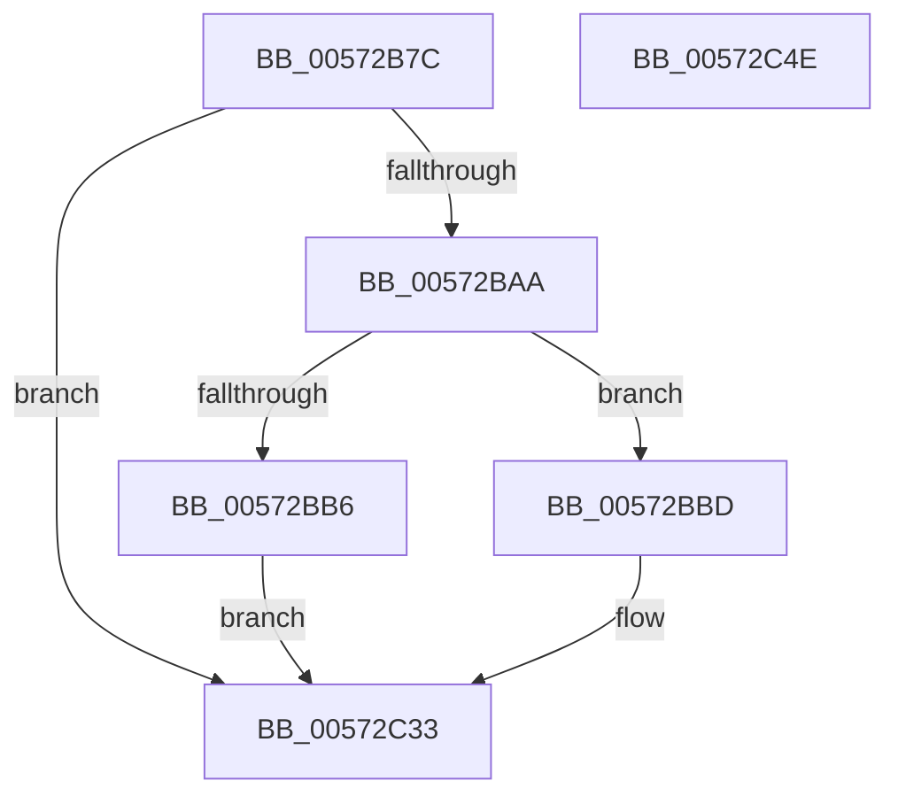

# HalpHsapInitializeReservedDomain

- RVA: `0x00572B7C`–`0x00572C4F` (길이 `211` bytes)
- VA: `0x0000000140572B7C`
- 실행 섹션: `.text`
- PDB 이름 있음: `예`; PDB Function 태그: `아니요`
- unwind 정보 RVA: `0x000C54E4`
- 디코드: `51`개 명령, `211/211` bytes 표시
- 미해석 바이트: `0` (있으면 어셈블리에 `.byte`로 보존)

> 이 문서는 커널 이미지의 기계어와 PDB 기호를 분석해 생성했습니다. 4번과 5번은 함수 원형과 자료형을 바이너리 사용 방식에서 추정한 C 해석이며 원본 소스 복구 결과는 아닙니다.

## 1. Dependencies

- 직접 호출 지점: **2**; 고유 호출 대상: **2**
- 직접 호출자로 확인된 함수: **1**
- RIP 상대 이미지 참조: **0**

### Outgoing calls
- `0x00572BC8` → [memset](../6C/memset_function_006C6C40.md) (function, `0x006C6C40`)
- `0x00572C2E` → [HsaUpdateDeviceTableEntry](../44/HsaUpdateDeviceTableEntry_function_0044E404.md) (function, `0x0044E404`)

### Direct callers
- [HsaProcessDeviceExceptions](HsaProcessDeviceExceptions_function_005747DC.md) at `0x0057482E`

### Static image references
- 디코드된 RIP-relative 메모리 참조가 없습니다.

## 2. Other-region calls and transfers

- 다른 실행 섹션으로 향하는 call: **0**
- 별도 외부 분기/꼬리 이동을 확인하지 못했습니다.

## 3. Assembly (complete function range)

```asm
00572B7C  48 89 5C 24 08                  mov qword ptr [rsp + 8], rbx
00572B81  48 89 74 24 18                  mov qword ptr [rsp + 0x18], rsi
00572B86  57                              push rdi
00572B87  41 56                           push r14
00572B89  41 57                           push r15
00572B8B  48 81 EC C0 00 00 00            sub rsp, 0xc0
00572B92  4C 8B 7A 08                     mov r15, qword ptr [rdx + 8]
00572B96  33 DB                           xor ebx, ebx
00572B98  4C 8B F2                        mov r14, rdx
00572B9B  48 8B F1                        mov rsi, rcx
00572B9E  49 8B 3F                        mov rdi, qword ptr [r15]
00572BA1  83 3F 01                        cmp dword ptr [rdi], 1
00572BA4  0F 85 89 00 00 00               jne 0x140572c33
00572BAA  0F B7 47 08                     movzx eax, word ptr [rdi + 8]
00572BAE  3B 81 A0 00 00 00               cmp eax, dword ptr [rcx + 0xa0]
00572BB4  74 07                           je 0x140572bbd
00572BB6  BB 0D 00 00 C0                  mov ebx, 0xc000000d
00572BBB  EB 76                           jmp 0x140572c33
00572BBD  33 D2                           xor edx, edx
00572BBF  48 8D 4C 24 50                  lea rcx, [rsp + 0x50]
00572BC4  44 8D 42 70                     lea r8d, [rdx + 0x70]
00572BC8  E8 73 40 15 00                  call 0x1406c6c40
00572BCD  41 8B 06                        mov eax, dword ptr [r14]
00572BD0  48 8D 94 24 E8 00 00 00         lea rdx, [rsp + 0xe8]
00572BD8  0F B7 4F 0C                     movzx ecx, word ptr [rdi + 0xc]
00572BDC  41 B1 01                        mov r9b, 1
00572BDF  89 84 24 80 00 00 00            mov dword ptr [rsp + 0x80], eax
00572BE6  45 33 C0                        xor r8d, r8d
00572BE9  49 8B 47 10                     mov rax, qword ptr [r15 + 0x10]
00572BED  48 89 5C 24 48                  mov qword ptr [rsp + 0x48], rbx
00572BF2  48 89 44 24 78                  mov qword ptr [rsp + 0x78], rax
00572BF7  48 8D 44 24 50                  lea rax, [rsp + 0x50]
00572BFC  89 8C 24 E8 00 00 00            mov dword ptr [rsp + 0xe8], ecx
00572C03  48 8B CE                        mov rcx, rsi
00572C06  C7 44 24 30 01 00 00 00         mov dword ptr [rsp + 0x30], 1
00572C0E  89 5C 24 28                     mov dword ptr [rsp + 0x28], ebx
00572C12  48 89 44 24 20                  mov qword ptr [rsp + 0x20], rax
00572C17  C7 44 24 50 01 00 00 00         mov dword ptr [rsp + 0x50], 1
00572C1F  C7 44 24 54 02 00 00 00         mov dword ptr [rsp + 0x54], 2
00572C27  89 9C 24 EC 00 00 00            mov dword ptr [rsp + 0xec], ebx
00572C2E  E8 D1 B7 ED FF                  call 0x14044e404
00572C33  4C 8D 9C 24 C0 00 00 00         lea r11, [rsp + 0xc0]
00572C3B  8B C3                           mov eax, ebx
00572C3D  49 8B 5B 20                     mov rbx, qword ptr [r11 + 0x20]
00572C41  49 8B 73 30                     mov rsi, qword ptr [r11 + 0x30]
00572C45  49 8B E3                        mov rsp, r11
00572C48  41 5F                           pop r15
00572C4A  41 5E                           pop r14
00572C4C  5F                              pop rdi
00572C4D  C3                              ret
00572C4E  CC                              int3
```

## 4. C-style interpretation (structured pseudocode)

```c
__int64 __fastcall HalpHsapInitializeReservedDomain(__int64 a1, __int64 a2)
{
    __int64 result;
    __int64 v_rbx;
    __int64 v_rsp;
    unsigned __int64 v_stack_m18;
    unsigned int v_stack_m58;
    unsigned __int64 v_stack_m60;
    unsigned int v_stack_m84;
    unsigned __int64 v_stack_m88;
    unsigned __int64 v_stack_m90;
    unsigned int v_stack_mA8;
    unsigned int v_stack_mB0;
    unsigned __int64 v_stack_mB8;
    unsigned __int64 v_stack_p10;
    unsigned int v_stack_p14;
    unsigned __int64 v_stack_p18;
    unsigned __int64 v_stack_p8;

    v_stack_p8 = v_rbx;
    v_stack_p18 = v_rsi;
    v_rsp = (v_rsp) - (192);
    v_rbx = 0;
    if ((*(unsigned int *)(*(unsigned __int64 *)(*(unsigned __int64 *)(a2 + 8)))) != 1) goto loc_00572C33;
    if (((unsigned int)(*(unsigned __int16 *)(*(unsigned __int64 *)(*(unsigned __int64 *)(a2 + 8)) + 8))) == (*(unsigned int *)(a1 + 160))) goto loc_00572BBD;
    goto loc_00572C33;
loc_00572BBD:
    a2 = 0;
    result = memset(v_stack_m88, a2, a2 + 112, a4);
    v_stack_m58 = (unsigned int)((unsigned int)(*(unsigned int *)(a2)));
    a3 = 0;
    v_stack_m90 = (unsigned int)(0xC000000DULL);
    v_stack_m60 = *(unsigned __int64 *)(*(unsigned __int64 *)(a2 + 8) + 16);
    v_stack_p10 = (unsigned int)(*(unsigned __int16 *)(*(unsigned __int64 *)(*(unsigned __int64 *)(a2 + 8)) + 12));
    v_stack_mA8 = 1;
    v_stack_mB0 = (unsigned int)((unsigned int)(0xC000000DULL));
    v_stack_mB8 = v_stack_m88;
    v_stack_m88 = 1;
    v_stack_m84 = 2;
    v_stack_p14 = (unsigned int)((unsigned int)(0xC000000DULL));
    result = HsaUpdateDeviceTableEntry(a1, v_stack_p10, a3, 1);
loc_00572C33:
    return (unsigned int)((unsigned int)((unsigned int)(0xC000000DULL)));
}
```

## 5. (Beta) C Style

```c
int64_t HalpHsapInitializeReservedDomain(void *Arg1, void *Arg2)
{
    uint8_t *arg1 = (uint8_t *)Arg1;
    uint8_t *arg2 = (uint8_t *)Arg2;

    int64_t result;
    int64_t local_rbx;
    int64_t local_rsp;
    uint64_t v_stack_m18;
    uint32_t v_stack_m58;
    uint64_t v_stack_m60;
    uint32_t v_stack_m84;
    uint64_t v_stack_m88;
    uint64_t v_stack_m90;
    uint32_t v_stack_mA8;
    uint32_t v_stack_mB0;
    uint64_t v_stack_mB8;
    uint64_t v_stack_p10;
    uint32_t v_stack_p14;
    uint64_t v_stack_p18;
    uint64_t v_stack_p8;

    v_stack_p8 = local_rbx;
    v_stack_p18 = local_rsi;
    local_rsp = (local_rsp) - (192);
    local_rbx = 0;
    if ((*(uint32_t *)(*(uint64_t *)(*(uint64_t *)(arg2 + 0x8)))) != 1) goto loc_00572C33;
    if (((uint32_t)(*(uint16_t *)(*(uint64_t *)(*(uint64_t *)(arg2 + 0x8)) + 0x8))) == (*(uint32_t *)(arg1 + 0xA0))) goto loc_00572BBD;
    goto loc_00572C33;
loc_00572BBD:
    Arg2 = 0;
    result = memset(v_stack_m88, Arg2, Arg2 + 112, a4);
    v_stack_m58 = (uint32_t)((uint32_t)(*(uint32_t *)(arg2)));
    a3 = 0;
    v_stack_m90 = (uint32_t)(0xC000000DULL);
    v_stack_m60 = *(uint64_t *)(*(uint64_t *)(arg2 + 0x8) + 0x10);
    v_stack_p10 = (uint32_t)(*(uint16_t *)(*(uint64_t *)(*(uint64_t *)(arg2 + 0x8)) + 0xC));
    v_stack_mA8 = 1;
    v_stack_mB0 = (uint32_t)((uint32_t)(0xC000000DULL));
    v_stack_mB8 = v_stack_m88;
    v_stack_m88 = 1;
    v_stack_m84 = 2;
    v_stack_p14 = (uint32_t)((uint32_t)(0xC000000DULL));
    result = HsaUpdateDeviceTableEntry(Arg1, v_stack_p10, a3, 1);
loc_00572C33:
    return (uint32_t)((uint32_t)((uint32_t)(0xC000000DULL)));
}
```

### 관측된 메모리 오프셋

구조체 형식이 확인되지 않은 접근은 인자 기준의 오프셋으로만 기록했습니다.

| 기준 인자 | 오프셋 표현 | 폭 (bit) | 접근 |
|---|---:|---:|---|
| `Arg1` | `+ 0xA0` | `32` | `R` |
| `Arg2` | `+ 0x0` | `32` | `R` |
| `Arg2` | `+ 0x8` | `64` | `R` |

## 6. Execution-region graph

[열기: 2D/3D 그래프와 함수 탐색 컨트롤 패널](../../../control-panel.html?section=text&rva=0x00572B7C&view=graph)

- 2D 그래프는 위에서 아래로 흐르고, 3D 그래프는 빈 공간을 드래그해 회전합니다. Shift+드래그는 이동, 휠은 확대·축소, 함수 노드 선택은 대상 보고서 이동입니다.

### Static fallback


