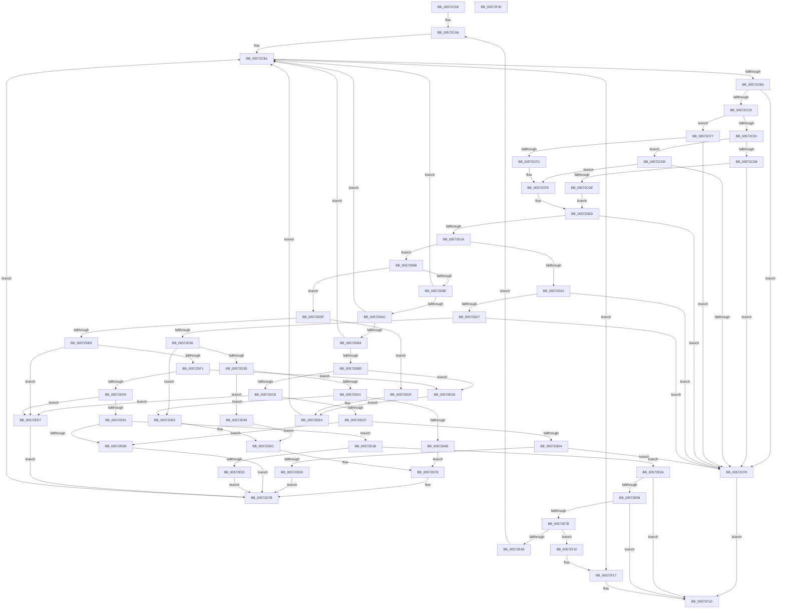

# HalpIommuProcessDeviceEntries

- RVA: `0x00572C58`–`0x00572F31` (길이 `729` bytes)
- VA: `0x0000000140572C58`
- 실행 섹션: `.text`
- PDB 이름 있음: `예`; PDB Function 태그: `아니요`
- unwind 정보 RVA: `0x000C5520`
- 디코드: `199`개 명령, `729/729` bytes 표시
- 미해석 바이트: `0` (있으면 어셈블리에 `.byte`로 보존)

> 이 문서는 커널 이미지의 기계어와 PDB 기호를 분석해 생성했습니다. 4번과 5번은 함수 원형과 자료형을 바이너리 사용 방식에서 추정한 C 해석이며 원본 소스 복구 결과는 아닙니다.

## 1. Dependencies

- 직접 호출 지점: **6**; 고유 호출 대상: **3**
- 직접 호출자로 확인된 함수: **1**
- RIP 상대 이미지 참조: **0**

### Outgoing calls
- `0x00572D63` → [RtlSetBits](../3E/RtlSetBits_function_003E1610.md) (function, `0x003E1610`)
- `0x00572E3B` → [RtlSetBits](../3E/RtlSetBits_function_003E1610.md) (function, `0x003E1610`)
- `0x00572E4A` → [ExtEnvAllocateMemory](../56/ExtEnvAllocateMemory_function_005610B0.md) (function, `0x005610B0`)
- `0x00572E6C` → [ExtEnvAllocateMemory](../56/ExtEnvAllocateMemory_function_005610B0.md) (function, `0x005610B0`)
- `0x00572E88` → [memcpy](../6C/memcpy_function_006C6840.md) (function, `0x006C6840`)
- `0x00572EEE` → [RtlSetBits](../3E/RtlSetBits_function_003E1610.md) (function, `0x003E1610`)

### Direct callers
- [HalpIommuProcessIvhdEntry](HalpIommuProcessIvhdEntry_function_00572F38.md) at `0x0057321C`

### Static image references
- 디코드된 RIP-relative 메모리 참조가 없습니다.

## 2. Other-region calls and transfers

- 다른 실행 섹션으로 향하는 call: **0**
- 별도 외부 분기/꼬리 이동을 확인하지 못했습니다.

## 3. Assembly (complete function range)

```asm
00572C58  4C 8B DC                        mov r11, rsp
00572C5B  4D 89 43 18                     mov qword ptr [r11 + 0x18], r8
00572C5F  49 89 53 10                     mov qword ptr [r11 + 0x10], rdx
00572C63  49 89 4B 08                     mov qword ptr [r11 + 8], rcx
00572C67  53                              push rbx
00572C68  55                              push rbp
00572C69  56                              push rsi
00572C6A  57                              push rdi
00572C6B  41 54                           push r12
00572C6D  41 55                           push r13
00572C6F  41 56                           push r14
00572C71  41 57                           push r15
00572C73  48 83 EC 38                     sub rsp, 0x38
00572C77  44 0F B7 62 02                  movzx r12d, word ptr [rdx + 2]
00572C7C  48 8D 72 28                     lea rsi, [rdx + 0x28]
00572C80  33 DB                           xor ebx, ebx
00572C82  45 33 FF                        xor r15d, r15d
00572C85  49 21 5B A8                     and qword ptr [r11 - 0x58], rbx
00572C89  4C 03 E2                        add r12, rdx
00572C8C  45 32 DB                        xor r11b, r11b
00572C8F  41 88 18                        mov byte ptr [r8], bl
00572C92  44 88 9C 24 98 00 00 00         mov byte ptr [rsp + 0x98], r11b
00572C9A  45 33 ED                        xor r13d, r13d
00572C9D  49 8B F8                        mov rdi, r8
00572CA0  48 8B C2                        mov rax, rdx
00572CA3  4C 8B D1                        mov r10, rcx
00572CA6  41 BE 01 00 00 00               mov r14d, 1
00572CAC  BD 0D 00 00 C0                  mov ebp, 0xc000000d
00572CB1  49 3B F4                        cmp rsi, r12
00572CB4  0F 83 5D 02 00 00               jae 0x140572f17
00572CBA  49 8B CC                        mov rcx, r12
00572CBD  4C 8B CE                        mov r9, rsi
00572CC0  48 2B CE                        sub rcx, rsi
00572CC3  49 3B CE                        cmp rcx, r14
00572CC6  72 28                           jb 0x140572cf0
00572CC8  8A 00                           mov al, byte ptr [rax]
00572CCA  2C 10                           sub al, 0x10
00572CCC  41 3A C6                        cmp al, r14b
00572CCF  76 26                           jbe 0x140572cf7
00572CD1  8A 16                           mov dl, byte ptr [rsi]
00572CD3  80 FA F0                        cmp dl, 0xf0
00572CD6  75 13                           jne 0x140572ceb
00572CD8  48 83 F9 16                     cmp rcx, 0x16
00572CDC  72 12                           jb 0x140572cf0
00572CDE  0F B6 46 15                     movzx eax, byte ptr [rsi + 0x15]
00572CE2  4C 8B EE                        mov r13, rsi
00572CE5  48 83 C0 16                     add rax, 0x16
00572CE9  EB 22                           jmp 0x140572d0d
00572CEB  80 FA 7F                        cmp dl, 0x7f
00572CEE  76 0E                           jbe 0x140572cfe
00572CF0  8B DD                           mov ebx, ebp
00572CF2  E9 26 02 00 00                  jmp 0x140572f1d
00572CF7  80 3E 7F                        cmp byte ptr [rsi], 0x7f
00572CFA  77 F4                           ja 0x140572cf0
00572CFC  8A 16                           mov dl, byte ptr [rsi]
00572CFE  0F B6 CA                        movzx ecx, dl
00572D01  49 8B C6                        mov rax, r14
00572D04  C1 E9 06                        shr ecx, 6
00572D07  83 C1 02                        add ecx, 2
00572D0A  48 D3 E0                        shl rax, cl
00572D0D  8B C8                           mov ecx, eax
00572D0F  49 8B C4                        mov rax, r12
00572D12  48 2B C6                        sub rax, rsi
00572D15  48 3B C8                        cmp rcx, rax
00572D18  77 D6                           ja 0x140572cf0
00572D1A  48 03 F1                        add rsi, rcx
00572D1D  4D 85 FF                        test r15, r15
00572D20  74 66                           je 0x140572d88
00572D22  80 FA 04                        cmp dl, 4
00572D25  75 C9                           jne 0x140572cf0
00572D27  41 0F B7 49 01                  movzx ecx, word ptr [r9 + 1]
00572D2C  41 0F B7 57 01                  movzx edx, word ptr [r15 + 1]
00572D31  66 3B CA                        cmp cx, dx
00572D34  72 BA                           jb 0x140572cf0
00572D36  41 8A 07                        mov al, byte ptr [r15]
00572D39  3C 03                           cmp al, 3
00572D3B  74 16                           je 0x140572d53
00572D3D  3C 43                           cmp al, 0x43
00572D3F  74 08                           je 0x140572d49
00572D41  3C 47                           cmp al, 0x47
00572D43  74 0E                           je 0x140572d53
00572D45  8B DD                           mov ebx, ebp
00572D47  EB 2F                           jmp 0x140572d78
00572D49  41 0F B7 57 05                  movzx edx, word ptr [r15 + 5]
00572D4E  45 8B C6                        mov r8d, r14d
00572D51  EB 09                           jmp 0x140572d5c
00572D53  44 8B C1                        mov r8d, ecx
00572D56  44 2B C2                        sub r8d, edx
00572D59  45 03 C6                        add r8d, r14d
00572D5C  49 8D 8A B8 00 00 00            lea rcx, [r10 + 0xb8]
00572D63  E8 A8 E8 E6 FF                  call 0x1403e1610
00572D68  44 8A 9C 24 98 00 00 00         mov r11b, byte ptr [rsp + 0x98]
00572D70  4C 8B 94 24 80 00 00 00         mov r10, qword ptr [rsp + 0x80]
00572D78  45 33 FF                        xor r15d, r15d
00572D7B  48 8B 84 24 88 00 00 00         mov rax, qword ptr [rsp + 0x88]
00572D83  E9 29 FF FF FF                  jmp 0x140572cb1
00572D88  45 8A C3                        mov r8b, r11b
00572D8B  0F B6 CA                        movzx ecx, dl
00572D8E  45 32 DB                        xor r11b, r11b
00572D91  44 88 9C 24 98 00 00 00         mov byte ptr [rsp + 0x98], r11b
00572D99  83 F9 40                        cmp ecx, 0x40
00572D9C  77 41                           ja 0x140572ddf
00572D9E  48 8B 84 24 88 00 00 00         mov rax, qword ptr [rsp + 0x88]
00572DA6  0F 84 05 FF FF FF               je 0x140572cb1
00572DAC  84 D2                           test dl, dl
00572DAE  0F 84 FD FE FF FF               je 0x140572cb1
00572DB4  83 E9 01                        sub ecx, 1
00572DB7  0F 84 F4 FE FF FF               je 0x140572cb1
00572DBD  83 E9 01                        sub ecx, 1
00572DC0  0F 84 0A 01 00 00               je 0x140572ed0
00572DC6  83 E9 01                        sub ecx, 1
00572DC9  0F 84 08 01 00 00               je 0x140572ed7
00572DCF  83 F9 01                        cmp ecx, 1
00572DD2  75 37                           jne 0x140572e0b
00572DD4  45 84 C0                        test r8b, r8b
00572DD7  0F 84 13 FF FF FF               je 0x140572cf0
00572DDD  EB 9C                           jmp 0x140572d7b
00572DDF  83 E9 42                        sub ecx, 0x42
00572DE2  0F 84 F7 00 00 00               je 0x140572edf
00572DE8  83 E9 01                        sub ecx, 1
00572DEB  0F 84 E6 00 00 00               je 0x140572ed7
00572DF1  83 E9 03                        sub ecx, 3
00572DF4  0F 84 D6 00 00 00               je 0x140572ed0
00572DFA  83 E9 01                        sub ecx, 1
00572DFD  0F 84 D4 00 00 00               je 0x140572ed7
00572E03  81 F9 A9 00 00 00               cmp ecx, 0xa9
00572E09  74 10                           je 0x140572e1b
00572E0B  45 8A DE                        mov r11b, r14b
00572E0E  44 88 B4 24 98 00 00 00         mov byte ptr [rsp + 0x98], r14b
00572E16  E9 60 FF FF FF                  jmp 0x140572d7b
00572E1B  41 80 7D 14 02                  cmp byte ptr [r13 + 0x14], 2
00572E20  74 08                           je 0x140572e2a
00572E22  44 88 37                        mov byte ptr [rdi], r14b
00572E25  E9 51 FF FF FF                  jmp 0x140572d7b
00572E2A  41 0F B7 6D 01                  movzx ebp, word ptr [r13 + 1]
00572E2F  49 8D 8A B8 00 00 00            lea rcx, [r10 + 0xb8]
00572E36  8B D5                           mov edx, ebp
00572E38  45 8B C6                        mov r8d, r14d
00572E3B  E8 D0 E7 E6 FF                  call 0x1403e1610
00572E40  4C 8D 44 24 20                  lea r8, [rsp + 0x20]
00572E45  BA 20 00 00 00                  mov edx, 0x20
00572E4A  E8 61 E2 FE FF                  call 0x1405610b0
00572E4F  8B D8                           mov ebx, eax
00572E51  85 C0                           test eax, eax
00572E53  0F 88 C4 00 00 00               js 0x140572f1d
00572E59  48 8B 7C 24 20                  mov rdi, qword ptr [rsp + 0x20]
00572E5E  89 6F 18                        mov dword ptr [rdi + 0x18], ebp
00572E61  4C 8D 47 10                     lea r8, [rdi + 0x10]
00572E65  41 0F B6 55 15                  movzx edx, byte ptr [r13 + 0x15]
00572E6A  FF C2                           inc edx
00572E6C  E8 3F E2 FE FF                  call 0x1405610b0
00572E71  8B D8                           mov ebx, eax
00572E73  85 C0                           test eax, eax
00572E75  0F 88 A2 00 00 00               js 0x140572f1d
00572E7B  45 0F B6 45 15                  movzx r8d, byte ptr [r13 + 0x15]
00572E80  49 8D 55 16                     lea rdx, [r13 + 0x16]
00572E84  48 8B 4F 10                     mov rcx, qword ptr [rdi + 0x10]
00572E88  E8 B3 39 15 00                  call 0x1406c6840
00572E8D  4C 8B 94 24 80 00 00 00         mov r10, qword ptr [rsp + 0x80]
00572E95  49 8D 82 E0 00 00 00            lea rax, [r10 + 0xe0]
00572E9C  48 8B 48 08                     mov rcx, qword ptr [rax + 8]
00572EA0  48 39 01                        cmp qword ptr [rcx], rax
00572EA3  75 6B                           jne 0x140572f10
00572EA5  44 8A 9C 24 98 00 00 00         mov r11b, byte ptr [rsp + 0x98]
00572EAD  48 89 07                        mov qword ptr [rdi], rax
00572EB0  48 89 4F 08                     mov qword ptr [rdi + 8], rcx
00572EB4  48 89 39                        mov qword ptr [rcx], rdi
00572EB7  48 89 78 08                     mov qword ptr [rax + 8], rdi
00572EBB  48 8B 84 24 88 00 00 00         mov rax, qword ptr [rsp + 0x88]
00572EC3  48 8B BC 24 90 00 00 00         mov rdi, qword ptr [rsp + 0x90]
00572ECB  E9 D6 FD FF FF                  jmp 0x140572ca6
00572ED0  41 0F B7 51 01                  movzx edx, word ptr [r9 + 1]
00572ED5  EB 0D                           jmp 0x140572ee4
00572ED7  4D 8B F9                        mov r15, r9
00572EDA  E9 9C FE FF FF                  jmp 0x140572d7b
00572EDF  41 0F B7 51 05                  movzx edx, word ptr [r9 + 5]
00572EE4  49 8D 8A B8 00 00 00            lea rcx, [r10 + 0xb8]
00572EEB  45 8B C6                        mov r8d, r14d
00572EEE  E8 1D E7 E6 FF                  call 0x1403e1610
00572EF3  4C 8B 94 24 80 00 00 00         mov r10, qword ptr [rsp + 0x80]
00572EFB  48 8B 84 24 88 00 00 00         mov rax, qword ptr [rsp + 0x88]
00572F03  44 8A 9C 24 98 00 00 00         mov r11b, byte ptr [rsp + 0x98]
00572F0B  E9 A1 FD FF FF                  jmp 0x140572cb1
00572F10  B9 03 00 00 00                  mov ecx, 3
00572F15  CD 29                           int 0x29
00572F17  4D 85 FF                        test r15, r15
00572F1A  0F 45 DD                        cmovne ebx, ebp
00572F1D  8B C3                           mov eax, ebx
00572F1F  48 83 C4 38                     add rsp, 0x38
00572F23  41 5F                           pop r15
00572F25  41 5E                           pop r14
00572F27  41 5D                           pop r13
00572F29  41 5C                           pop r12
00572F2B  5F                              pop rdi
00572F2C  5E                              pop rsi
00572F2D  5D                              pop rbp
00572F2E  5B                              pop rbx
00572F2F  C3                              ret
00572F30  CC                              int3
```

## 4. C-style interpretation (structured pseudocode)

```c
__int64 __fastcall HalpIommuProcessDeviceEntries(__int64 a1, __int64 a2, __int64 a3)
{
    __int64 result;
    __int64 v_r11;
    __int64 v_r12;
    __int64 v_r13;
    __int64 v_r15;
    __int64 v_rbx;
    __int64 v_rsi;
    __int64 v_rsp;
    unsigned __int64 v_stack_m58;
    unsigned __int64 v_stack_p10;
    unsigned __int64 v_stack_p18;
    unsigned __int8 v_stack_p20;
    unsigned __int64 v_stack_p8;

    *(unsigned __int64 *)(v_rsp + 24) = a3;
    *(unsigned __int64 *)(v_rsp + 16) = a2;
    *(unsigned __int64 *)(v_rsp + 8) = a1;
    v_rsp = (v_rsp) - (56);
    v_rbx = 0;
    v_r15 = 0;
    v_r12 = (*(unsigned __int16 *)(a2 + 2)) + (a2);
    v_r11 = 0;
    *(unsigned __int8 *)(a3) = 0;
    v_stack_p20 = 0;
    v_r13 = 0;
loc_00572CA6:
loc_00572CB1:
    if ((a2 + 40) >= v_r12) goto loc_00572F17;
    a1 = (v_r12) - (a2 + 40);
    if (a1 < 1) goto loc_00572CF0;
    result = (unsigned __int8)((*(unsigned __int8 *)(a2)) - (16));
    if (((unsigned __int8)(result)) <= 1) goto loc_00572CF7;
    if (((unsigned __int8)(*(unsigned __int8 *)(a2 + 40))) != 240) goto loc_00572CEB;
    if (a1 < 22) goto loc_00572CF0;
    result = (*(unsigned __int8 *)(a2 + 40 + 21)) + (22);
    goto loc_00572D0D;
loc_00572CEB:
    if (((unsigned __int8)(*(unsigned __int8 *)(a2 + 40))) <= 127) goto loc_00572CFE;
loc_00572CF0:
    goto loc_00572F1D;
loc_00572CF7:
    if ((*(unsigned __int8 *)(a2 + 40)) > 127) goto loc_00572CF0;
loc_00572CFE:
    a1 = (unsigned int)(((unsigned __int8)(*(unsigned __int8 *)(a2 + 40))) >> (6));
    a1 = (unsigned int)((a1) + (2));
    result = (1) << ((unsigned __int8)(a1));
loc_00572D0D:
    result = (v_r12) - (a2 + 40);
    if (((unsigned int)((unsigned int)(result))) > result) goto loc_00572CF0;
    v_rsi = (a2 + 40) + ((unsigned int)((unsigned int)(result)));
    if (0 == 0) goto loc_00572D88;
    if (((unsigned __int8)(*(unsigned __int8 *)(a2 + 40))) != 4) goto loc_00572CF0;
    if (((unsigned __int16)(*(unsigned __int16 *)(a2 + 40 + 1))) < ((unsigned __int16)(*(unsigned __int16 *)(v_r15 + 1)))) goto loc_00572CF0;
    if (((unsigned __int8)(*(unsigned __int8 *)(v_r15))) == 3) goto loc_00572D53;
    if (((unsigned __int8)(*(unsigned __int8 *)(v_r15))) == 67) goto loc_00572D49;
    if (((unsigned __int8)(*(unsigned __int8 *)(v_r15))) == 71) goto loc_00572D53;
    goto loc_00572D78;
loc_00572D49:
    goto loc_00572D5C;
loc_00572D53:
    a3 = (unsigned int)(((unsigned int)((unsigned int)(*(unsigned __int16 *)(a2 + 40 + 1)))) - ((unsigned int)(*(unsigned __int16 *)(v_r15 + 5))));
    a3 = (unsigned int)((a3) + (1));
loc_00572D5C:
    result = RtlSetBits(a1 + 184, *(unsigned __int16 *)(v_r15 + 5), a3, a2 + 40);
loc_00572D78:
    v_r15 = 0;
loc_00572D7B:
    goto loc_00572CB1;
loc_00572D88:
    v_r11 = 0;
    v_stack_p20 = 0;
    if (((unsigned int)((unsigned __int8)(*(unsigned __int16 *)(v_r15 + 5)))) > 64) goto loc_00572DDF;
    if (((unsigned int)((unsigned __int8)(*(unsigned __int16 *)(v_r15 + 5)))) == 64) goto loc_00572CB1;
    if ((unsigned __int8)(*(unsigned __int16 *)(v_r15 + 5)) == 0) goto loc_00572CB1;
    a1 = (unsigned int)(((unsigned __int8)(*(unsigned __int16 *)(v_r15 + 5))) - (1));
    if (condition_is_equal) goto loc_00572CB1;
    a1 = (unsigned int)((a1) - (1));
    if (condition_is_equal) goto loc_00572ED0;
    a1 = (unsigned int)((a1) - (1));
    if (condition_is_equal) goto loc_00572ED7;
    if (((unsigned int)(a1)) != 1) goto loc_00572E0B;
    if ((unsigned __int8)((unsigned __int8)(v_stack_p20)) == 0) goto loc_00572CF0;
    goto loc_00572D7B;
loc_00572DDF:
    a1 = (unsigned int)((a1) - (66));
    if (condition_is_equal) goto loc_00572EDF;
    a1 = (unsigned int)((a1) - (1));
    if (condition_is_equal) goto loc_00572ED7;
    a1 = (unsigned int)((a1) - (3));
    if (condition_is_equal) goto loc_00572ED0;
    a1 = (unsigned int)((a1) - (1));
    if (condition_is_equal) goto loc_00572ED7;
    if (((unsigned int)(a1)) == 169) goto loc_00572E1B;
loc_00572E0B:
    v_stack_p20 = 1;
    goto loc_00572D7B;
loc_00572E1B:
    if ((*(unsigned __int8 *)(a2 + 40 + 20)) == 2) goto loc_00572E2A;
    *(unsigned __int8 *)(a3) = 1;
    goto loc_00572D7B;
loc_00572E2A:
    result = RtlSetBits(v_stack_p8 + 184, (unsigned int)((unsigned int)(*(unsigned __int16 *)(a2 + 40 + 1))), 1, a2 + 40);
    result = ExtEnvAllocateMemory(v_stack_p8 + 184, 32, v_stack_m58, a2 + 40);
    if (sign_flag) goto loc_00572F1D;
    *(unsigned int *)(v_stack_m58 + 24) = (unsigned int)(*(unsigned __int16 *)(a2 + 40 + 1));
    a2 = (unsigned int)((*(unsigned __int8 *)(a2 + 40 + 21)) + 1);
    result = ExtEnvAllocateMemory(v_stack_p8 + 184, a2, v_stack_m58 + 16, a2 + 40);
    if (sign_flag) goto loc_00572F1D;
    result = memcpy(*(unsigned __int64 *)(v_stack_m58 + 16), a2 + 40 + 22, *(unsigned __int8 *)(a2 + 40 + 21), a2 + 40);
    if ((*(unsigned __int64 *)(*(unsigned __int64 *)(v_stack_p8 + 224 + 8))) != (v_stack_p8 + 224)) goto loc_00572F10;
    *(unsigned __int64 *)(v_stack_m58) = v_stack_p8 + 224;
    *(unsigned __int64 *)(v_stack_m58 + 8) = *(unsigned __int64 *)(v_stack_p8 + 224 + 8);
    *(unsigned __int64 *)(*(unsigned __int64 *)(v_stack_p8 + 224 + 8)) = v_stack_m58;
    *(unsigned __int64 *)(v_stack_p8 + 224 + 8) = v_stack_m58;
    goto loc_00572CA6;
loc_00572ED0:
    goto loc_00572EE4;
loc_00572ED7:
    goto loc_00572D7B;
loc_00572EDF:
loc_00572EE4:
    result = RtlSetBits(v_stack_p8 + 184, *(unsigned __int16 *)(a2 + 40 + 5), 1, a2 + 40);
    goto loc_00572CB1;
loc_00572F10:
loc_00572F17:
    v_rbx = (unsigned int)((unsigned int)(result));
    if (a2 + 40 != 0) { v_rbx = (unsigned int)(*(unsigned __int16 *)(a2 + 40 + 1)); }
loc_00572F1D:
    v_rsp = (v_rsp) + (56);
    return (unsigned int)((unsigned int)(v_rbx));
}
```

## 5. (Beta) C Style

```c
int64_t HalpIommuProcessDeviceEntries(int64_t Arg1, void *Arg2, void *Arg3)
{
    uint8_t *arg2 = (uint8_t *)Arg2;
    uint8_t *arg3 = (uint8_t *)Arg3;

    int64_t result;
    int64_t local_r11;
    int64_t local_r12;
    int64_t local_r13;
    int64_t local_r15;
    int64_t local_rbx;
    int64_t local_rsi;
    int64_t local_rsp;
    uint64_t v_stack_m58;
    uint64_t v_stack_p10;
    uint64_t v_stack_p18;
    uint8_t v_stack_p20;
    uint64_t v_stack_p8;

    *(void **)(local_rsp + 0x18) = Arg3;
    *(void **)(local_rsp + 0x10) = Arg2;
    *(uint64_t *)(local_rsp + 0x8) = Arg1;
    local_rsp = (local_rsp) - (56);
    local_rbx = 0;
    local_r15 = 0;
    local_r12 = (*(uint16_t *)(arg2 + 0x2)) + (Arg2);
    local_r11 = 0;
    *(uint8_t *)(arg3) = 0;
    v_stack_p20 = 0;
    local_r13 = 0;
loc_00572CA6:
loc_00572CB1:
    if ((Arg2 + 40) >= local_r12) goto loc_00572F17;
    Arg1 = (local_r12) - (Arg2 + 40);
    if (Arg1 < 1) goto loc_00572CF0;
    result = (uint8_t)((*(uint8_t *)(arg2)) - (16));
    if (((uint8_t)(result)) <= 1) goto loc_00572CF7;
    if (((uint8_t)(*(uint8_t *)(arg2 + 0x28))) != 240) goto loc_00572CEB;
    if (Arg1 < 22) goto loc_00572CF0;
    result = (*(uint8_t *)(arg2 + 0x28 + 0x15)) + (22);
    goto loc_00572D0D;
loc_00572CEB:
    if (((uint8_t)(*(uint8_t *)(arg2 + 0x28))) <= 127) goto loc_00572CFE;
loc_00572CF0:
    goto loc_00572F1D;
loc_00572CF7:
    if ((*(uint8_t *)(arg2 + 0x28)) > 127) goto loc_00572CF0;
loc_00572CFE:
    Arg1 = (uint32_t)(((uint8_t)(*(uint8_t *)(arg2 + 0x28))) >> (6));
    Arg1 = (uint32_t)((Arg1) + (2));
    result = (1) << ((uint8_t)(Arg1));
loc_00572D0D:
    result = (local_r12) - (Arg2 + 40);
    if (((uint32_t)((uint32_t)(result))) > result) goto loc_00572CF0;
    local_rsi = (Arg2 + 40) + ((uint32_t)((uint32_t)(result)));
    if (0 == 0) goto loc_00572D88;
    if (((uint8_t)(*(uint8_t *)(arg2 + 0x28))) != 4) goto loc_00572CF0;
    if (((uint16_t)(*(uint16_t *)(arg2 + 0x28 + 0x1))) < ((uint16_t)(*(uint16_t *)(local_r15 + 0x1)))) goto loc_00572CF0;
    if (((uint8_t)(*(uint8_t *)(local_r15))) == 3) goto loc_00572D53;
    if (((uint8_t)(*(uint8_t *)(local_r15))) == 67) goto loc_00572D49;
    if (((uint8_t)(*(uint8_t *)(local_r15))) == 71) goto loc_00572D53;
    goto loc_00572D78;
loc_00572D49:
    goto loc_00572D5C;
loc_00572D53:
    Arg3 = (uint32_t)(((uint32_t)((uint32_t)(*(uint16_t *)(arg2 + 0x28 + 0x1)))) - ((uint32_t)(*(uint16_t *)(local_r15 + 0x5))));
    Arg3 = (uint32_t)((Arg3) + (1));
loc_00572D5C:
    result = RtlSetBits(Arg1 + 184, *(uint16_t *)(local_r15 + 0x5), Arg3, Arg2 + 40);
loc_00572D78:
    local_r15 = 0;
loc_00572D7B:
    goto loc_00572CB1;
loc_00572D88:
    local_r11 = 0;
    v_stack_p20 = 0;
    if (((uint32_t)((uint8_t)(*(uint16_t *)(local_r15 + 0x5)))) > 64) goto loc_00572DDF;
    if (((uint32_t)((uint8_t)(*(uint16_t *)(local_r15 + 0x5)))) == 64) goto loc_00572CB1;
    if ((uint8_t)(*(uint16_t *)(local_r15 + 0x5)) == 0) goto loc_00572CB1;
    Arg1 = (uint32_t)(((uint8_t)(*(uint16_t *)(local_r15 + 0x5))) - (1));
    if (condition_is_equal) goto loc_00572CB1;
    Arg1 = (uint32_t)((Arg1) - (1));
    if (condition_is_equal) goto loc_00572ED0;
    Arg1 = (uint32_t)((Arg1) - (1));
    if (condition_is_equal) goto loc_00572ED7;
    if (((uint32_t)(Arg1)) != 1) goto loc_00572E0B;
    if ((uint8_t)((uint8_t)(v_stack_p20)) == 0) goto loc_00572CF0;
    goto loc_00572D7B;
loc_00572DDF:
    Arg1 = (uint32_t)((Arg1) - (66));
    if (condition_is_equal) goto loc_00572EDF;
    Arg1 = (uint32_t)((Arg1) - (1));
    if (condition_is_equal) goto loc_00572ED7;
    Arg1 = (uint32_t)((Arg1) - (3));
    if (condition_is_equal) goto loc_00572ED0;
    Arg1 = (uint32_t)((Arg1) - (1));
    if (condition_is_equal) goto loc_00572ED7;
    if (((uint32_t)(Arg1)) == 169) goto loc_00572E1B;
loc_00572E0B:
    v_stack_p20 = 1;
    goto loc_00572D7B;
loc_00572E1B:
    if ((*(uint8_t *)(arg2 + 0x28 + 0x14)) == 2) goto loc_00572E2A;
    *(uint8_t *)(arg3) = 1;
    goto loc_00572D7B;
loc_00572E2A:
    result = RtlSetBits(v_stack_p8 + 184, (uint32_t)((uint32_t)(*(uint16_t *)(arg2 + 0x28 + 0x1))), 1, Arg2 + 40);
    result = ExtEnvAllocateMemory(v_stack_p8 + 184, 32, v_stack_m58, Arg2 + 40);
    if (sign_flag) goto loc_00572F1D;
    *(uint32_t *)(v_stack_m58 + 0x18) = (uint32_t)(*(uint16_t *)(arg2 + 0x28 + 0x1));
    Arg2 = (uint32_t)((*(uint8_t *)(arg2 + 0x28 + 0x15)) + 1);
    result = ExtEnvAllocateMemory(v_stack_p8 + 184, Arg2, v_stack_m58 + 16, Arg2 + 40);
    if (sign_flag) goto loc_00572F1D;
    result = memcpy(*(uint64_t *)(v_stack_m58 + 0x10), Arg2 + 40 + 22, *(uint8_t *)(arg2 + 0x28 + 0x15), Arg2 + 40);
    if ((*(uint64_t *)(*(uint64_t *)(v_stack_p8 + 0xE0 + 0x8))) != (v_stack_p8 + 224)) goto loc_00572F10;
    *(uint64_t *)(v_stack_m58) = v_stack_p8 + 224;
    *(uint64_t *)(v_stack_m58 + 0x8) = *(uint64_t *)(v_stack_p8 + 0xE0 + 0x8);
    *(uint64_t *)(*(uint64_t *)(v_stack_p8 + 0xE0 + 0x8)) = v_stack_m58;
    *(uint64_t *)(v_stack_p8 + 0xE0 + 0x8) = v_stack_m58;
    goto loc_00572CA6;
loc_00572ED0:
    goto loc_00572EE4;
loc_00572ED7:
    goto loc_00572D7B;
loc_00572EDF:
loc_00572EE4:
    result = RtlSetBits(v_stack_p8 + 184, *(uint16_t *)(arg2 + 0x28 + 0x5), 1, Arg2 + 40);
    goto loc_00572CB1;
loc_00572F10:
loc_00572F17:
    local_rbx = (uint32_t)((uint32_t)(result));
    if (Arg2 + 40 != 0) { local_rbx = (uint32_t)(*(uint16_t *)(arg2 + 0x28 + 0x1)); }
loc_00572F1D:
    local_rsp = (local_rsp) + (56);
    return (uint32_t)((uint32_t)(local_rbx));
}
```

### 관측된 메모리 오프셋

구조체 형식이 확인되지 않은 접근은 인자 기준의 오프셋으로만 기록했습니다.

| 기준 인자 | 오프셋 표현 | 폭 (bit) | 접근 |
|---|---:|---:|---|
| `Arg2` | `+ 0x2` | `16` | `R` |
| `Arg2` | `+ 0x28` | `64` | `R` |
| `Arg3` | `+ 0x0` | `8` | `W` |

## 6. Execution-region graph

[열기: 2D/3D 그래프와 함수 탐색 컨트롤 패널](../../../control-panel.html?section=text&rva=0x00572C58&view=graph)

- 2D 그래프는 위에서 아래로 흐르고, 3D 그래프는 빈 공간을 드래그해 회전합니다. Shift+드래그는 이동, 휠은 확대·축소, 함수 노드 선택은 대상 보고서 이동입니다.

### Static fallback


