# HalpIommuProcessIvhdEntry

- RVA: `0x00572F38`–`0x005735D6` (길이 `1,694` bytes)
- VA: `0x0000000140572F38`
- 실행 섹션: `.text`
- PDB 이름 있음: `예`; PDB Function 태그: `아니요`
- unwind 정보 RVA: `0x000C5500`
- 디코드: `391`개 명령, `1,694/1,694` bytes 표시
- 미해석 바이트: `0` (있으면 어셈블리에 `.byte`로 보존)

> 이 문서는 커널 이미지의 기계어와 PDB 기호를 분석해 생성했습니다. 4번과 5번은 함수 원형과 자료형을 바이너리 사용 방식에서 추정한 C 해석이며 원본 소스 복구 결과는 아닙니다.

## 1. Dependencies

- 직접 호출 지점: **12**; 고유 호출 대상: **7**
- 직접 호출자로 확인된 함수: **1**
- RIP 상대 이미지 참조: **35**

### Outgoing calls
- `0x00572F78` → [memset](../6C/memset_function_006C6C40.md) (function, `0x006C6C40`)
- `0x00572F89` → [memset](../6C/memset_function_006C6C40.md) (function, `0x006C6C40`)
- `0x0057312A` → [HsaProcessIvmd](HsaProcessIvmd_function_00574900.md) (function, `0x00574900`)
- `0x00573141` → [ExtEnvAllocateMemory](../56/ExtEnvAllocateMemory_function_005610B0.md) (function, `0x005610B0`)
- `0x005731CD` → [ExtEnvAllocateMemory](../56/ExtEnvAllocateMemory_function_005610B0.md) (function, `0x005610B0`)
- `0x005731F5` → [RtlClearBits](../3E/RtlClearBits_function_003E1A90.md) (function, `0x003E1A90`)
- `0x0057321C` → [HalpIommuProcessDeviceEntries](HalpIommuProcessDeviceEntries_function_00572C58.md) (function, `0x00572C58`)
- `0x00573232` → [HalRegisterPermanentAddressUsage](../56/HalRegisterPermanentAddressUsage_function_00561500.md) (function, `0x00561500`)
- `0x0057324F` → [memset](../6C/memset_function_006C6C40.md) (function, `0x006C6C40`)
- `0x005734F1` → [ExtEnvAllocateMemory](../56/ExtEnvAllocateMemory_function_005610B0.md) (function, `0x005610B0`)
- `0x0057353D` → [ExtEnvRegisterIommu](../../init/C2/ExtEnvRegisterIommu_function_00C213EC.md) (function, `0x00C213EC`)
- `0x00573550` → [ExtEnvAllocateMemory](../56/ExtEnvAllocateMemory_function_005610B0.md) (function, `0x005610B0`)

### Direct callers
- [HalpIommuHsaDiscover](../../init/C2/HalpIommuHsaDiscover_function_00C25BE8.md) at `0x00C25CB4`
- [HalpIommuHsaDiscover](../../init/C2/HalpIommuHsaDiscover_function_00C25BE8.md) at `0x00C25D04`

### Static image references
- `0x00572FC9` → RVA `0x00F8F7A0` (`.data`; read)
- `0x00573289` → RVA `0x00B62F20` (`HsaConfigureSettings`; read)
- `0x00573294` → RVA `0x00B63140` (`HsaInitializeIommu`; read)
- `0x005732C4` → RVA `0x00573B50` (`HsaCreateDevice`; read)
- `0x005732D2` → RVA `0x00573C70` (`HsaDeleteDevice`; read)
- `0x005732E0` → RVA `0x00573F40` (`HsaFindDevice`; read)
- `0x005732EB` → RVA `0x00573FE0` (`HsaFlushTb`; read)
- `0x005732F6` → RVA `0x00573F70` (`HsaFlushDeviceTbOnly`; read)
- `0x00573301` → RVA `0x00574AA0` (`HsaQueryAcpiDeviceMapping`; read)
- `0x0057330C` → RVA `0x005745E0` (`HsaGetRidAcpiMapCount`; read)
- `0x00573320` → RVA `0x00573E90` (`HsaEnumerateIvmdDevices`; read)
- `0x00573334` → RVA `0x00574A50` (`HsaProcessReservedDomains`; read)
- `0x0057333F` → RVA `0x00573B30` (`HsaAttachDeviceDomain`; read)
- `0x0057334D` → RVA `0x00573CB0` (`HsaDetachDeviceDomain`; read)
- `0x00573364` → RVA `0x0044DEB0` (`HsaFlushDomainTb`; read)
- `0x00573379` → RVA `0x0049E550` (`EmpCheckErrataList`; read)
- `0x005733E2` → RVA `0x00574C00` (`HsaSetDeviceSvmCapabilities`; read)
- `0x005733ED` → RVA `0x005747B0` (`HsaLegacySetDeviceSvmCapabilities`; read)
- `0x005733F8` → RVA `0x00574B30` (`HsaSetDevicePasidTable`; read)
- `0x00573403` → RVA `0x00574640` (`HsaGrowPasidTable`; read)
- `0x0057340E` → RVA `0x00574C40` (`HsaSetPasidAddressSpace`; read)
- `0x00573419` → RVA `0x00B636B0` (`HsaMarkHiberRegions`; read)
- `0x00573429` → RVA `0x00575000` (`HsaUpdateRemappingTableEntry`; read)
- `0x0057343F` → RVA `0x00574790` (`HsaInvalidateRemappingTableEntry`; read)
- `0x00573452` → RVA `0x00574DB0` (`HsaUpdateRemappingDestination`; read)
- `0x00573460` → RVA `0x00573820` (`HsaAllocateRemappingTableEntry`; read)
- `0x0057346E` → RVA `0x00574140` (`HsaFreeRemappingTableEntry`; read)
- `0x00573481` → RVA `0x00B63770` (`HsaSetMessageInterruptRouting`; read)
- `0x00573490` → RVA `0x00B62F80` (`HsaEnableInterrupt`; read)
- `0x0057349B` → RVA `0x0070DD80` (`HsaDisableInterrupt`; read)
- `0x005734A6` → RVA `0x00574680` (`HsaHandleInterrupt`; read)
- `0x005734B1` → RVA `0x00573CD0` (`HsaDismissPageFault`; read)
- `0x005734BC` → RVA `0x005742E0` (`HsaGetPageFault`; read)
- `0x0057356D` → RVA `0x00F8F7A8` (`.data`; read)
- `0x0057358A` → RVA `0x00F8F7A8` (`.data`; write)

## 2. Other-region calls and transfers

- 다른 실행 섹션으로 향하는 call: **1**
  - `0x0057353D` → [ExtEnvRegisterIommu](../../init/C2/ExtEnvRegisterIommu_function_00C213EC.md) (`.text` → `INIT`)
- 별도 외부 분기/꼬리 이동을 확인하지 못했습니다.

## 3. Assembly (complete function range)

```asm
00572F38  48 89 5C 24 08                  mov qword ptr [rsp + 8], rbx
00572F3D  4C 89 44 24 18                  mov qword ptr [rsp + 0x18], r8
00572F42  55                              push rbp
00572F43  56                              push rsi
00572F44  57                              push rdi
00572F45  41 54                           push r12
00572F47  41 55                           push r13
00572F49  41 56                           push r14
00572F4B  41 57                           push r15
00572F4D  48 8D AC 24 F0 FE FF FF         lea rbp, [rsp - 0x110]
00572F55  48 81 EC 10 02 00 00            sub rsp, 0x210
00572F5C  49 8B D8                        mov rbx, r8
00572F5F  4C 8B FA                        mov r15, rdx
00572F62  4C 8B F1                        mov r14, rcx
00572F65  33 F6                           xor esi, esi
00572F67  33 D2                           xor edx, edx
00572F69  48 89 74 24 28                  mov qword ptr [rsp + 0x28], rsi
00572F6E  41 B8 98 00 00 00               mov r8d, 0x98
00572F74  48 8D 4D 70                     lea rcx, [rbp + 0x70]
00572F78  E8 C3 3C 15 00                  call 0x1406c6c40
00572F7D  33 D2                           xor edx, edx
00572F7F  48 8D 4D B0                     lea rcx, [rbp - 0x50]
00572F83  41 B8 B8 00 00 00               mov r8d, 0xb8
00572F89  E8 B2 3C 15 00                  call 0x1406c6c40
00572F8E  66 41 83 7F 02 28               cmp word ptr [r15 + 2], 0x28
00572F94  48 89 74 24 38                  mov qword ptr [rsp + 0x38], rsi
00572F99  48 89 74 24 20                  mov qword ptr [rsp + 0x20], rsi
00572F9E  48 89 74 24 30                  mov qword ptr [rsp + 0x30], rsi
00572FA3  40 88 33                        mov byte ptr [rbx], sil
00572FA6  40 88 B5 68 01 00 00            mov byte ptr [rbp + 0x168], sil
00572FAD  40 88 B5 58 01 00 00            mov byte ptr [rbp + 0x158], sil
00572FB4  0F 82 FB 05 00 00               jb 0x1405735b5
00572FBA  41 8A 07                        mov al, byte ptr [r15]
00572FBD  3C 11                           cmp al, 0x11
00572FBF  74 08                           je 0x140572fc9
00572FC1  3C 40                           cmp al, 0x40
00572FC3  0F 85 EC 05 00 00               jne 0x1405735b5
00572FC9  48 8B 0D D0 C7 A1 00            mov rcx, qword ptr [rip + 0xa1c7d0]
00572FD0  48 8D 05 C9 C7 A1 00            lea rax, [rip + 0xa1c7c9]
00572FD7  48 3B C8                        cmp rcx, rax
00572FDA  74 13                           je 0x140572fef
00572FDC  49 8B 47 08                     mov rax, qword ptr [r15 + 8]
00572FE0  48 39 41 10                     cmp qword ptr [rcx + 0x10], rax
00572FE4  0F 84 23 01 00 00               je 0x14057310d
00572FEA  48 8B 09                        mov rcx, qword ptr [rcx]
00572FED  EB E1                           jmp 0x140572fd0
00572FEF  49 8B 7F 18                     mov rdi, qword ptr [r15 + 0x18]
00572FF3  41 BD 01 00 00 00               mov r13d, 1
00572FF9  41 8A 57 01                     mov dl, byte ptr [r15 + 1]
00572FFD  48 B9 08 00 00 00 00 60 00 00   movabs rcx, 0x600000000008
00573007  4C 8B C7                        mov r8, rdi
0057300A  4C 8B D7                        mov r10, rdi
0057300D  49 C1 E8 2D                     shr r8, 0x2d
00573011  4C 8B CF                        mov r9, rdi
00573014  66 45 23 C5                     and r8w, r13w
00573018  48 8D 04 BD 00 00 00 00         lea rax, [rdi*4]
00573020  66 41 C1 E0 04                  shl r8w, 4
00573025  45 8D 5D 07                     lea r11d, [r13 + 7]
00573029  66 41 23 C3                     and ax, r11w
0057302D  66 44 0B C0                     or r8w, ax
00573031  48 8B C7                        mov rax, rdi
00573034  48 23 C1                        and rax, rcx
00573037  48 3B C1                        cmp rax, rcx
0057303A  8A C2                           mov al, dl
0057303C  0F 94 C1                        sete cl
0057303F  C0 E8 04                        shr al, 4
00573042  22 C8                           and cl, al
00573044  41 0F B7 C0                     movzx eax, r8w
00573048  66 41 0B C5                     or ax, r13w
0057304C  41 84 CD                        test r13b, cl
0057304F  48 B9 12 00 00 00 00 02 00 00   movabs rcx, 0x20000000012
00573059  66 44 0F 45 C0                  cmovne r8w, ax
0057305E  C0 EA 04                        shr dl, 4
00573061  41 22 D5                        and dl, r13b
00573064  49 C1 E9 20                     shr r9, 0x20
00573068  41 81 E2 00 C0 00 00            and r10d, 0xc000
0057306F  0F B6 C2                        movzx eax, dl
00573072  66 C1 E0 06                     shl ax, 6
00573076  41 8B D2                        mov edx, r10d
00573079  66 44 0B C0                     or r8w, ax
0057307D  48 8B C7                        mov rax, rdi
00573080  48 23 C1                        and rax, rcx
00573083  66 41 83 C8 04                  or r8w, 4
00573088  48 3B C1                        cmp rax, rcx
0057308B  0F 94 C1                        sete cl
0057308E  66 41 0F A3 F0                  bt r8w, si
00573093  0F 92 C0                        setb al
00573096  22 C8                           and cl, al
00573098  48 F7 DA                        neg rdx
0057309B  1A C0                           sbb al, al
0057309D  84 C1                           test cl, al
0057309F  74 0A                           je 0x1405730ab
005730A1  41 8A C1                        mov al, r9b
005730A4  24 1F                           and al, 0x1f
005730A6  41 3A C3                        cmp al, r11b
005730A9  73 09                           jae 0x1405730b4
005730AB  B8 FB FF 00 00                  mov eax, 0xfffb
005730B0  66 44 23 C0                     and r8w, ax
005730B4  66 41 83 C8 20                  or r8w, 0x20
005730B9  48 B9 10 00 00 00 00 00 01 00   movabs rcx, 0x1000000000010
005730C3  48 8B C7                        mov rax, rdi
005730C6  BA DF FF 00 00                  mov edx, 0xffdf
005730CB  48 23 C1                        and rax, rcx
005730CE  48 3B C1                        cmp rax, rcx
005730D1  0F 94 C1                        sete cl
005730D4  66 41 0F A3 F0                  bt r8w, si
005730D9  0F 92 C0                        setb al
005730DC  22 C8                           and cl, al
005730DE  49 F7 DA                        neg r10
005730E1  1A C0                           sbb al, al
005730E3  84 C1                           test cl, al
005730E5  74 09                           je 0x1405730f0
005730E7  41 80 E1 1F                     and r9b, 0x1f
005730EB  45 3A CB                        cmp r9b, r11b
005730EE  73 04                           jae 0x1405730f4
005730F0  66 44 23 C2                     and r8w, dx
005730F4  40 8A C7                        mov al, dil
005730F7  41 0F B7 D8                     movzx ebx, r8w
005730FB  66 83 CB 02                     or bx, 2
005730FF  24 84                           and al, 0x84
00573101  3C 84                           cmp al, 0x84
00573103  66 41 0F 45 D8                  cmovne bx, r8w
00573108  F6 C3 03                        test bl, 3
0057310B  75 07                           jne 0x140573114
0057310D  33 C0                           xor eax, eax
0057310F  E9 A6 04 00 00                  jmp 0x1405735ba
00573114  41 8B 56 04                     mov edx, dword ptr [r14 + 4]
00573118  4C 8D 4C 24 30                  lea r9, [rsp + 0x30]
0057311D  49 03 D6                        add rdx, r14
00573120  4C 8D 85 58 01 00 00            lea r8, [rbp + 0x158]
00573127  49 8B CF                        mov rcx, r15
0057312A  E8 D1 17 00 00                  call 0x140574900
0057312F  85 C0                           test eax, eax
00573131  0F 88 83 04 00 00               js 0x1405735ba
00573137  4C 8D 44 24 20                  lea r8, [rsp + 0x20]
0057313C  BA 00 01 00 00                  mov edx, 0x100
00573141  E8 6A DF FE FF                  call 0x1405610b0
00573146  85 C0                           test eax, eax
00573148  0F 88 6C 04 00 00               js 0x1405735ba
0057314E  4C 8B 74 24 20                  mov r14, qword ptr [rsp + 0x20]
00573153  4C 8D 44 24 28                  lea r8, [rsp + 0x28]
00573158  BA 00 20 00 00                  mov edx, 0x2000
0057315D  49 8D 86 E0 00 00 00            lea rax, [r14 + 0xe0]
00573164  48 89 40 08                     mov qword ptr [rax + 8], rax
00573168  48 89 00                        mov qword ptr [rax], rax
0057316B  41 8A 47 01                     mov al, byte ptr [r15 + 1]
0057316F  41 88 46 10                     mov byte ptr [r14 + 0x10], al
00573173  66 41 89 5E 12                  mov word ptr [r14 + 0x12], bx
00573178  49 8B 47 08                     mov rax, qword ptr [r15 + 8]
0057317C  49 89 46 08                     mov qword ptr [r14 + 8], rax
00573180  41 0F B7 47 10                  movzx eax, word ptr [r15 + 0x10]
00573185  41 89 86 A0 00 00 00            mov dword ptr [r14 + 0xa0], eax
0057318C  41 0F B6 47 05                  movzx eax, byte ptr [r15 + 5]
00573191  41 89 86 A4 00 00 00            mov dword ptr [r14 + 0xa4], eax
00573198  41 8B 86 A8 00 00 00            mov eax, dword ptr [r14 + 0xa8]
0057319F  41 0F B7 4F 04                  movzx ecx, word ptr [r15 + 4]
005731A4  C1 E9 03                        shr ecx, 3
005731A7  33 C8                           xor ecx, eax
005731A9  83 E1 1F                        and ecx, 0x1f
005731AC  33 C8                           xor ecx, eax
005731AE  41 89 8E A8 00 00 00            mov dword ptr [r14 + 0xa8], ecx
005731B5  41 0F B7 47 04                  movzx eax, word ptr [r15 + 4]
005731BA  C1 E0 05                        shl eax, 5
005731BD  33 C1                           xor eax, ecx
005731BF  25 E0 00 00 00                  and eax, 0xe0
005731C4  33 C1                           xor eax, ecx
005731C6  41 89 86 A8 00 00 00            mov dword ptr [r14 + 0xa8], eax
005731CD  E8 DE DE FE FF                  call 0x1405610b0
005731D2  85 C0                           test eax, eax
005731D4  0F 88 E0 03 00 00               js 0x1405735ba
005731DA  48 8B 44 24 28                  mov rax, qword ptr [rsp + 0x28]
005731DF  49 8D 8E B8 00 00 00            lea rcx, [r14 + 0xb8]
005731E6  41 B8 00 00 01 00               mov r8d, 0x10000
005731EC  48 89 41 08                     mov qword ptr [rcx + 8], rax
005731F0  33 D2                           xor edx, edx
005731F2  44 89 01                        mov dword ptr [rcx], r8d
005731F5  E8 96 E8 E6 FF                  call 0x1403e1a90
005731FA  49 8D 86 F0 00 00 00            lea rax, [r14 + 0xf0]
00573201  49 89 B6 98 00 00 00            mov qword ptr [r14 + 0x98], rsi
00573208  4C 8D 85 68 01 00 00            lea r8, [rbp + 0x168]
0057320F  48 89 40 08                     mov qword ptr [rax + 8], rax
00573213  49 8B D7                        mov rdx, r15
00573216  48 89 00                        mov qword ptr [rax], rax
00573219  49 8B CE                        mov rcx, r14
0057321C  E8 37 FA FF FF                  call 0x140572c58
00573221  85 C0                           test eax, eax
00573223  0F 88 91 03 00 00               js 0x1405735ba
00573229  49 8B 4E 08                     mov rcx, qword ptr [r14 + 8]
0057322D  BA 40 20 00 00                  mov edx, 0x2040
00573232  E8 C9 E2 FE FF                  call 0x140561500
00573237  85 C0                           test eax, eax
00573239  0F 88 7B 03 00 00               js 0x1405735ba
0057323F  41 BC 68 00 00 00               mov r12d, 0x68
00573245  48 8D 4C 24 40                  lea rcx, [rsp + 0x40]
0057324A  45 8B C4                        mov r8d, r12d
0057324D  33 D2                           xor edx, edx
0057324F  E8 EC 39 15 00                  call 0x1406c6c40
00573254  41 8B 86 A0 00 00 00            mov eax, dword ptr [r14 + 0xa0]
0057325B  41 B8 1C 08 00 00               mov r8d, 0x81c
00573261  89 45 8C                        mov dword ptr [rbp - 0x74], eax
00573264  41 8B 86 A4 00 00 00            mov eax, dword ptr [r14 + 0xa4]
0057326B  89 45 90                        mov dword ptr [rbp - 0x70], eax
0057326E  41 8B 86 A8 00 00 00            mov eax, dword ptr [r14 + 0xa8]
00573275  89 45 94                        mov dword ptr [rbp - 0x6c], eax
00573278  48 8D 45 70                     lea rax, [rbp + 0x70]
0057327C  48 89 44 24 78                  mov qword ptr [rsp + 0x78], rax
00573281  48 8D 45 B0                     lea rax, [rbp - 0x50]
00573285  48 89 45 80                     mov qword ptr [rbp - 0x80], rax
00573289  48 8D 05 90 FC 5E 00            lea rax, [rip + 0x5efc90]
00573290  48 89 45 70                     mov qword ptr [rbp + 0x70], rax
00573294  48 8D 05 A5 FE 5E 00            lea rax, [rip + 0x5efea5]
0057329B  48 89 45 78                     mov qword ptr [rbp + 0x78], rax
0057329F  44 89 6C 24 40                  mov dword ptr [rsp + 0x40], r13d
005732A4  44 89 64 24 44                  mov dword ptr [rsp + 0x44], r12d
005732A9  4C 89 74 24 48                  mov qword ptr [rsp + 0x48], r14
005732AE  89 74 24 50                     mov dword ptr [rsp + 0x50], esi
005732B2  44 89 6D 88                     mov dword ptr [rbp - 0x78], r13d
005732B6  44 89 44 24 54                  mov dword ptr [rsp + 0x54], r8d
005732BB  41 84 DD                        test r13b, bl
005732BE  0F 84 D6 00 00 00               je 0x14057339a
005732C4  48 8D 05 85 08 00 00            lea rax, [rip + 0x885]
005732CB  48 89 85 90 00 00 00            mov qword ptr [rbp + 0x90], rax
005732D2  48 8D 05 97 09 00 00            lea rax, [rip + 0x997]
005732D9  48 89 85 98 00 00 00            mov qword ptr [rbp + 0x98], rax
005732E0  48 8D 05 59 0C 00 00            lea rax, [rip + 0xc59]
005732E7  48 89 45 B0                     mov qword ptr [rbp - 0x50], rax
005732EB  48 8D 05 EE 0C 00 00            lea rax, [rip + 0xcee]
005732F2  48 89 45 D8                     mov qword ptr [rbp - 0x28], rax
005732F6  48 8D 05 73 0C 00 00            lea rax, [rip + 0xc73]
005732FD  48 89 45 E0                     mov qword ptr [rbp - 0x20], rax
00573301  48 8D 05 98 17 00 00            lea rax, [rip + 0x1798]
00573308  48 89 45 48                     mov qword ptr [rbp + 0x48], rax
0057330C  48 8D 05 CD 12 00 00            lea rax, [rip + 0x12cd]
00573313  48 89 45 50                     mov qword ptr [rbp + 0x50], rax
00573317  40 38 B5 58 01 00 00            cmp byte ptr [rbp + 0x158], sil
0057331E  75 44                           jne 0x140573364
00573320  48 8D 05 69 0B 00 00            lea rax, [rip + 0xb69]
00573327  F6 C3 20                        test bl, 0x20
0057332A  48 89 45 38                     mov qword ptr [rbp + 0x38], rax
0057332E  41 B8 1C 09 00 00               mov r8d, 0x91c
00573334  48 8D 05 15 17 00 00            lea rax, [rip + 0x1715]
0057333B  48 89 45 40                     mov qword ptr [rbp + 0x40], rax
0057333F  48 8D 05 EA 07 00 00            lea rax, [rip + 0x7ea]
00573346  48 89 85 B0 00 00 00            mov qword ptr [rbp + 0xb0], rax
0057334D  48 8D 05 5C 09 00 00            lea rax, [rip + 0x95c]
00573354  48 89 85 B8 00 00 00            mov qword ptr [rbp + 0xb8], rax
0057335B  B8 9C 09 00 00                  mov eax, 0x99c
00573360  44 0F 45 C0                     cmovne r8d, eax
00573364  48 8D 05 45 AB ED FF            lea rax, [rip - 0x1254bb]
0057336B  41 81 C8 00 60 00 00            or r8d, 0x6000
00573372  48 89 85 C0 00 00 00            mov qword ptr [rbp + 0xc0], rax
00573379  48 8D 05 D0 B1 F2 FF            lea rax, [rip - 0xd4e30]
00573380  48 89 85 C8 00 00 00            mov qword ptr [rbp + 0xc8], rax
00573387  48 8D 05 C2 B1 F2 FF            lea rax, [rip - 0xd4e3e]
0057338E  48 89 85 D0 00 00 00            mov qword ptr [rbp + 0xd0], rax
00573395  44 89 44 24 54                  mov dword ptr [rsp + 0x54], r8d
0057339A  45 84 C0                        test r8b, r8b
0057339D  78 08                           js 0x1405733a7
0057339F  B8 DF FF 00 00                  mov eax, 0xffdf
005733A4  66 23 D8                        and bx, ax
005733A7  48 C1 EF 20                     shr rdi, 0x20
005733AB  BA 00 00 04 00                  mov edx, 0x40000
005733B0  40 80 E7 1F                     and dil, 0x1f
005733B4  41 8B C5                        mov eax, r13d
005733B7  42 8D 0C 2F                     lea ecx, [rdi + r13]
005733BB  D3 E0                           shl eax, cl
005733BD  41 2B C5                        sub eax, r13d
005733C0  3B C2                           cmp eax, edx
005733C2  0F 42 D0                        cmovb edx, eax
005733C5  0F B7 C3                        movzx eax, bx
005733C8  89 55 98                        mov dword ptr [rbp - 0x68], edx
005733CB  66 83 E0 04                     and ax, 4
005733CF  74 0C                           je 0x1405733dd
005733D1  41 81 C8 20 00 02 00            or r8d, 0x20020
005733D8  44 89 44 24 54                  mov dword ptr [rsp + 0x54], r8d
005733DD  F6 C3 24                        test bl, 0x24
005733E0  74 42                           je 0x140573424
005733E2  48 8D 0D 17 18 00 00            lea rcx, [rip + 0x1817]
005733E9  48 89 4D B8                     mov qword ptr [rbp - 0x48], rcx
005733ED  48 8D 0D BC 13 00 00            lea rcx, [rip + 0x13bc]
005733F4  48 89 4D 60                     mov qword ptr [rbp + 0x60], rcx
005733F8  48 8D 0D 31 17 00 00            lea rcx, [rip + 0x1731]
005733FF  48 89 4D C0                     mov qword ptr [rbp - 0x40], rcx
00573403  48 8D 0D 36 12 00 00            lea rcx, [rip + 0x1236]
0057340A  48 89 4D C8                     mov qword ptr [rbp - 0x38], rcx
0057340E  48 8D 0D 2B 18 00 00            lea rcx, [rip + 0x182b]
00573415  48 89 4D D0                     mov qword ptr [rbp - 0x30], rcx
00573419  48 8D 0D 90 02 5F 00            lea rcx, [rip + 0x5f0290]
00573420  48 89 4D 20                     mov qword ptr [rbp + 0x20], rcx
00573424  F6 C3 02                        test bl, 2
00573427  74 53                           je 0x14057347c
00573429  48 8D 0D D0 1B 00 00            lea rcx, [rip + 0x1bd0]
00573430  41 83 E0 EF                     and r8d, 0xffffffef
00573434  48 89 8D E8 00 00 00            mov qword ptr [rbp + 0xe8], rcx
0057343B  41 83 C8 40                     or r8d, 0x40
0057343F  48 8D 0D 4A 13 00 00            lea rcx, [rip + 0x134a]
00573446  44 89 44 24 54                  mov dword ptr [rsp + 0x54], r8d
0057344B  48 89 8D F0 00 00 00            mov qword ptr [rbp + 0xf0], rcx
00573452  48 8D 0D 57 19 00 00            lea rcx, [rip + 0x1957]
00573459  48 89 8D F8 00 00 00            mov qword ptr [rbp + 0xf8], rcx
00573460  48 8D 0D B9 03 00 00            lea rcx, [rip + 0x3b9]
00573467  48 89 8D D8 00 00 00            mov qword ptr [rbp + 0xd8], rcx
0057346E  48 8D 0D CB 0C 00 00            lea rcx, [rip + 0xccb]
00573475  48 89 8D E0 00 00 00            mov qword ptr [rbp + 0xe0], rcx
0057347C  66 85 C0                        test ax, ax
0057347F  74 4B                           je 0x1405734cc
00573481  48 8D 05 E8 02 5F 00            lea rax, [rip + 0x5f02e8]
00573488  41 83 C8 02                     or r8d, 2
0057348C  48 89 45 F8                     mov qword ptr [rbp - 8], rax
00573490  48 8D 05 E9 FA 5E 00            lea rax, [rip + 0x5efae9]
00573497  48 89 45 00                     mov qword ptr [rbp], rax
0057349B  48 8D 05 DE A8 19 00            lea rax, [rip + 0x19a8de]
005734A2  48 89 45 08                     mov qword ptr [rbp + 8], rax
005734A6  48 8D 05 D3 11 00 00            lea rax, [rip + 0x11d3]
005734AD  48 89 45 10                     mov qword ptr [rbp + 0x10], rax
005734B1  48 8D 05 18 08 00 00            lea rax, [rip + 0x818]
005734B8  48 89 45 E8                     mov qword ptr [rbp - 0x18], rax
005734BC  48 8D 05 1D 0E 00 00            lea rax, [rip + 0xe1d]
005734C3  48 89 45 F0                     mov qword ptr [rbp - 0x10], rax
005734C7  44 89 44 24 54                  mov dword ptr [rsp + 0x54], r8d
005734CC  4C 8B 6C 24 30                  mov r13, qword ptr [rsp + 0x30]
005734D1  4D 8D A6 D8 00 00 00            lea r12, [r14 + 0xd8]
005734D8  BF FE FF 00 00                  mov edi, 0xfffe
005734DD  4D 8B C4                        mov r8, r12
005734E0  41 8B 5D 00                     mov ebx, dword ptr [r13]
005734E4  8B D3                           mov edx, ebx
005734E6  C1 E2 04                        shl edx, 4
005734E9  2B FB                           sub edi, ebx
005734EB  83 C2 08                        add edx, 8
005734EE  89 7D 9C                        mov dword ptr [rbp - 0x64], edi
005734F1  E8 BA DB FE FF                  call 0x1405610b0
005734F6  85 C0                           test eax, eax
005734F8  0F 88 BC 00 00 00               js 0x1405735ba
005734FE  49 8B 04 24                     mov rax, qword ptr [r12]
00573502  8B D6                           mov edx, esi
00573504  89 18                           mov dword ptr [rax], ebx
00573506  85 DB                           test ebx, ebx
00573508  74 19                           je 0x140573523
0057350A  4C 8B C6                        mov r8, rsi
0057350D  49 8B 04 24                     mov rax, qword ptr [r12]
00573511  8D 0C 17                        lea ecx, [rdi + rdx]
00573514  FF C2                           inc edx
00573516  4D 8D 40 10                     lea r8, [r8 + 0x10]
0057351A  41 89 4C 00 F8                  mov dword ptr [r8 + rax - 8], ecx
0057351F  3B D3                           cmp edx, ebx
00573521  72 EA                           jb 0x14057350d
00573523  41 C7 86 C8 00 00 00 FE FF 00 00  mov dword ptr [r14 + 0xc8], 0xfffe
0057352E  48 8D 4C 24 40                  lea rcx, [rsp + 0x40]
00573533  45 33 C0                        xor r8d, r8d
00573536  4D 89 AE D0 00 00 00            mov qword ptr [r14 + 0xd0], r13
0057353D  E8 AA DE 6A 00                  call 0x140c213ec
00573542  85 C0                           test eax, eax
00573544  78 74                           js 0x1405735ba
00573546  4C 8D 44 24 38                  lea r8, [rsp + 0x38]
0057354B  BA 18 00 00 00                  mov edx, 0x18
00573550  E8 5B DB FE FF                  call 0x1405610b0
00573555  85 C0                           test eax, eax
00573557  78 61                           js 0x1405735ba
00573559  49 8B 47 08                     mov rax, qword ptr [r15 + 8]
0057355D  4C 8D 05 3C C2 A1 00            lea r8, [rip + 0xa1c23c]
00573564  48 8B 54 24 38                  mov rdx, qword ptr [rsp + 0x38]
00573569  48 89 42 10                     mov qword ptr [rdx + 0x10], rax
0057356D  48 8B 05 34 C2 A1 00            mov rax, qword ptr [rip + 0xa1c234]
00573574  4C 39 00                        cmp qword ptr [rax], r8
00573577  74 07                           je 0x140573580
00573579  B9 03 00 00 00                  mov ecx, 3
0057357E  CD 29                           int 0x29
00573580  4C 89 02                        mov qword ptr [rdx], r8
00573583  48 89 42 08                     mov qword ptr [rdx + 8], rax
00573587  48 89 10                        mov qword ptr [rax], rdx
0057358A  48 89 15 17 C2 A1 00            mov qword ptr [rip + 0xa1c217], rdx
00573591  40 38 B5 58 01 00 00            cmp byte ptr [rbp + 0x158], sil
00573598  75 09                           jne 0x1405735a3
0057359A  40 38 B5 68 01 00 00            cmp byte ptr [rbp + 0x168], sil
005735A1  74 03                           je 0x1405735a6
005735A3  40 B6 01                        mov sil, 1
005735A6  48 8B 85 60 01 00 00            mov rax, qword ptr [rbp + 0x160]
005735AD  40 88 30                        mov byte ptr [rax], sil
005735B0  E9 58 FB FF FF                  jmp 0x14057310d
005735B5  B8 0D 00 00 C0                  mov eax, 0xc000000d
005735BA  48 8B 9C 24 50 02 00 00         mov rbx, qword ptr [rsp + 0x250]
005735C2  48 81 C4 10 02 00 00            add rsp, 0x210
005735C9  41 5F                           pop r15
005735CB  41 5E                           pop r14
005735CD  41 5D                           pop r13
005735CF  41 5C                           pop r12
005735D1  5F                              pop rdi
005735D2  5E                              pop rsi
005735D3  5D                              pop rbp
005735D4  C3                              ret
005735D5  CC                              int3
```

## 4. C-style interpretation (structured pseudocode)

```c
__int64 __fastcall HalpIommuProcessIvhdEntry(__int64 a1, __int64 a2, __int64 a3)
{
    __int64 result;
    __int64 v_r10;
    __int64 v_rbx;
    __int64 v_rdi;
    __int64 v_rsi;
    __int64 v_rsp;
    unsigned __int64 v_stack_m100;
    unsigned __int64 v_stack_m108;
    unsigned __int64 v_stack_m110;
    unsigned __int64 v_stack_m128;
    unsigned __int64 v_stack_m138;
    unsigned __int64 v_stack_m140;
    unsigned __int64 v_stack_m148;
    unsigned __int64 v_stack_m150;
    unsigned __int64 v_stack_m158;
    unsigned __int64 v_stack_m160;
    unsigned __int64 v_stack_m168;
    unsigned __int64 v_stack_m170;
    unsigned __int64 v_stack_m178;
    unsigned __int64 v_stack_m180;
    unsigned __int64 v_stack_m188;
    unsigned __int64 v_stack_m190;
    unsigned __int64 v_stack_m198;
    unsigned int v_stack_m1AC;
    unsigned int v_stack_m1B0;
    unsigned int v_stack_m1B4;
    unsigned int v_stack_m1B8;
    unsigned int v_stack_m1BC;
    unsigned int v_stack_m1C0;
    unsigned __int64 v_stack_m1C8;
    unsigned __int64 v_stack_m1D0;
    unsigned int v_stack_m1F4;
    unsigned int v_stack_m1F8;
    unsigned __int64 v_stack_m200;
    unsigned int v_stack_m204;
    unsigned __int64 v_stack_m208;
    unsigned __int64 v_stack_m210;
    unsigned __int64 v_stack_m218;
    unsigned __int64 v_stack_m220;
    unsigned __int64 v_stack_m228;
    unsigned __int64 v_stack_m50;
    unsigned __int64 v_stack_m58;
    unsigned __int64 v_stack_m60;
    unsigned __int64 v_stack_m68;
    unsigned __int64 v_stack_m70;
    unsigned __int64 v_stack_m78;
    unsigned __int64 v_stack_m80;
    unsigned __int64 v_stack_m88;
    unsigned __int64 v_stack_m90;
    unsigned __int64 v_stack_m98;
    unsigned __int64 v_stack_mB0;
    unsigned __int64 v_stack_mB8;
    unsigned __int64 v_stack_mD0;
    unsigned __int64 v_stack_mD8;
    unsigned __int64 v_stack_mE8;
    unsigned __int64 v_stack_mF8;
    unsigned __int8 v_stack_p10;
    unsigned __int64 v_stack_p18;
    unsigned __int8 v_stack_p20;
    unsigned __int64 v_stack_p8;

    v_stack_p8 = v_rbx;
    v_stack_p18 = a3;
    v_rsp = (v_rsp) - (528);
    v_rsi = 0;
    a2 = 0;
    v_stack_m220 = 0;
    result = memset(v_stack_mD8, a2, 152, a4);
    a2 = 0;
    result = memset(v_stack_m198, a2, 184, a4);
    v_stack_m210 = 0;
    v_stack_m228 = 0;
    v_stack_m218 = 0;
    *(unsigned __int8 *)(a3) = 0;
    v_stack_p20 = 0;
    v_stack_p10 = 0;
    if ((*(unsigned __int16 *)(a2 + 2)) < 40) goto loc_005735B5;
    if (((unsigned __int8)(*(unsigned __int8 *)(a2))) == 17) goto loc_00572FC9;
    if (((unsigned __int8)(*(unsigned __int8 *)(a2))) != 64) goto loc_005735B5;
loc_00572FC9:
loc_00572FD0:
    if ((*(unsigned __int64 *)(v_rip + 10602448)) == (v_rip + 10602441)) goto loc_00572FEF;
    if ((*(unsigned __int64 *)(*(unsigned __int64 *)(v_rip + 10602448) + 16)) == (*(unsigned __int64 *)(a2 + 8))) goto loc_0057310D;
    goto loc_00572FD0;
loc_00572FEF:
    a3 = (*(unsigned __int64 *)(a2 + 24)) >> (45);
    a3 = (unsigned __int16)((a3) & (1));
    a3 = (unsigned __int16)((a3) << (4));
    result = (unsigned __int16)((*(unsigned __int64 *)(a2 + 24) * 4) & ((unsigned __int16)(1 + 7)));
    a3 = (unsigned __int16)((a3) | ((unsigned __int16)(result)));
    result = (*(unsigned __int64 *)(a2 + 24)) & (*(unsigned __int64 *)(*(unsigned __int64 *)(v_rip + 10602448)));
    a1 = (result == (*(unsigned __int64 *)(*(unsigned __int64 *)(v_rip + 10602448)))) ? 1 : 0;
    result = (unsigned __int8)(((unsigned __int8)(*(unsigned __int8 *)(a2 + 1))) >> (4));
    a1 = (unsigned __int8)((a1) & ((unsigned __int8)(result)));
    result = (unsigned __int16)(((unsigned __int16)(a3)) | (1));
    if (((1) & ((unsigned __int8)(a1))) != 0) { a3 = (unsigned __int16)(result); }
    a2 = (unsigned __int8)((*(unsigned __int8 *)(a2 + 1)) >> (4));
    a2 = (unsigned __int8)((a2) & (1));
    a4 = (*(unsigned __int64 *)(a2 + 24)) >> (32);
    v_r10 = (unsigned int)((*(unsigned __int64 *)(a2 + 24)) & (0xC000ULL));
    result = (unsigned __int16)(((unsigned __int8)(a2)) << (6));
    a3 = (unsigned __int16)((a3) | ((unsigned __int16)(result)));
    result = (*(unsigned __int64 *)(a2 + 24)) & (a1);
    a3 = (unsigned __int16)((a3) | (4));
    a1 = (result == a1) ? 1 : 0;
    result = (result < a1) ? 1 : 0;
    a1 = (unsigned __int8)((a1) & ((unsigned __int8)(result)));
    a2 = -((unsigned int)((unsigned int)(v_r10)));
    if ((((unsigned __int8)(a1)) & ((unsigned __int8)(result))) == 0) goto loc_005730AB;
    result = (unsigned __int8)(((unsigned __int8)(a4)) & (31));
    if (((unsigned __int8)(result)) < ((unsigned __int8)(1 + 7))) {
        result = 0xFFFBULL;
        a3 = (unsigned __int16)((a3) & ((unsigned __int16)(result)));
    }
    a3 = (unsigned __int16)((a3) | (32));
    result = (*(unsigned __int64 *)(a2 + 24)) & (a1);
    a1 = (result == a1) ? 1 : 0;
    result = (result < a1) ? 1 : 0;
    a1 = (unsigned __int8)((a1) & ((unsigned __int8)(result)));
    v_r10 = -(v_r10);
    if ((((unsigned __int8)(a1)) & ((unsigned __int8)(result))) == 0) goto loc_005730F0;
    a4 = (unsigned __int8)((a4) & (31));
    if (((unsigned __int8)(a4)) < ((unsigned __int8)(1 + 7))) {
        a3 = (unsigned __int16)((a3) & ((unsigned __int16)((unsigned int)(0xFFDFULL))));
    }
    v_rbx = (unsigned __int16)(((unsigned __int16)(a3)) | (2));
    result = (unsigned __int8)(((unsigned __int8)(*(unsigned __int64 *)(a2 + 24))) & (132));
    if (((unsigned __int8)(result)) != 132) { v_rbx = (unsigned __int16)(a3); }
    if ((((unsigned __int8)(v_rbx)) & (3)) != 0) goto loc_00573114;
loc_0057310D:
    result = 0;
    goto loc_005735BA;
loc_00573114:
    a2 = ((unsigned int)(*(unsigned int *)(a1 + 4))) + (a1);
    result = HsaProcessIvmd(a2, a2, v_stack_p10, v_stack_m218);
    if (sign_flag) goto loc_005735BA;
    result = ExtEnvAllocateMemory(a2, 256, v_stack_m228, v_stack_m218);
    if (sign_flag) goto loc_005735BA;
    *(unsigned __int64 *)(v_stack_m228 + 224 + 8) = v_stack_m228 + 224;
    *(unsigned __int64 *)(v_stack_m228 + 224) = v_stack_m228 + 224;
    *(unsigned __int8 *)(v_stack_m228 + 16) = (unsigned __int8)(*(unsigned __int8 *)(a2 + 1));
    *(unsigned __int16 *)(v_stack_m228 + 18) = (unsigned __int16)(v_rbx);
    *(unsigned __int64 *)(v_stack_m228 + 8) = *(unsigned __int64 *)(a2 + 8);
    *(unsigned int *)(v_stack_m228 + 160) = (unsigned int)(*(unsigned __int16 *)(a2 + 16));
    *(unsigned int *)(v_stack_m228 + 164) = (unsigned int)(*(unsigned __int8 *)(a2 + 5));
    a1 = (unsigned int)((*(unsigned __int16 *)(a2 + 4)) >> (3));
    a1 = (unsigned int)((a1) ^ ((unsigned int)((unsigned int)(*(unsigned int *)(v_stack_m228 + 168)))));
    a1 = (unsigned int)((a1) & (31));
    a1 = (unsigned int)((a1) ^ ((unsigned int)((unsigned int)(*(unsigned int *)(v_stack_m228 + 168)))));
    *(unsigned int *)(v_stack_m228 + 168) = (unsigned int)(a1);
    result = (unsigned int)((*(unsigned __int16 *)(a2 + 4)) << (5));
    result = (unsigned int)((result) ^ ((unsigned int)(a1)));
    result = (unsigned int)((result) & (224));
    result = (unsigned int)((result) ^ ((unsigned int)(a1)));
    *(unsigned int *)(v_stack_m228 + 168) = (unsigned int)(result);
    result = ExtEnvAllocateMemory(a1, (unsigned int)(0x2000ULL), v_stack_m220, v_stack_m218);
    if (sign_flag) goto loc_005735BA;
    *(unsigned __int64 *)(v_stack_m228 + 184 + 8) = v_stack_m220;
    a2 = 0;
    *(unsigned int *)(v_stack_m228 + 184) = (unsigned int)((unsigned int)(0x10000ULL));
    result = RtlClearBits(v_stack_m228 + 184, a2, (unsigned int)(0x10000ULL), v_stack_m218);
    *(unsigned __int64 *)(v_stack_m228 + 152) = 0;
    *(unsigned __int64 *)(v_stack_m228 + 240 + 8) = v_stack_m228 + 240;
    *(unsigned __int64 *)(v_stack_m228 + 240) = v_stack_m228 + 240;
    result = HalpIommuProcessDeviceEntries(v_stack_m228, 0, v_stack_p20, v_stack_m218);
    if (sign_flag) goto loc_005735BA;
    result = HalRegisterPermanentAddressUsage(*(unsigned __int64 *)(v_stack_m228 + 8), (unsigned int)(0x2040ULL), v_stack_p20, v_stack_m218);
    if (sign_flag) goto loc_005735BA;
    a2 = 0;
    result = memset(v_stack_m208, a2, 104, v_stack_m218);
    v_stack_m1BC = (unsigned int)((unsigned int)(*(unsigned int *)(v_stack_m228 + 160)));
    v_stack_m1B8 = (unsigned int)((unsigned int)(*(unsigned int *)(v_stack_m228 + 164)));
    v_stack_m1B4 = (unsigned int)((unsigned int)(*(unsigned int *)(v_stack_m228 + 168)));
    v_stack_m1D0 = v_stack_mD8;
    v_stack_m1C8 = v_stack_m198;
    v_stack_mD8 = v_rip + 6225040;
    v_stack_mD0 = v_rip + 6225573;
    v_stack_m208 = 1;
    v_stack_m204 = 104;
    v_stack_m200 = v_stack_m228;
    v_stack_m1F8 = 0;
    v_stack_m1C0 = 1;
    v_stack_m1F4 = (unsigned int)((unsigned int)(0x81CULL));
    if (((1) & ((unsigned __int8)(v_rbx))) == 0) goto loc_0057339A;
    v_stack_mB8 = v_rip + 2181;
    v_stack_mB0 = v_rip + 2455;
    v_stack_m198 = v_rip + 3161;
    v_stack_m170 = v_rip + 3310;
    v_stack_m168 = v_rip + 3187;
    v_stack_m100 = v_rip + 6040;
    v_stack_mF8 = v_rip + 4813;
    result = v_rip + 4813;
    if (v_stack_p10 == 0) {
        result = v_rip + 2921;
        v_stack_m110 = result;
        a3 = 0x91CULL;
        result = v_rip + 5909;
        v_stack_m108 = result;
        result = v_rip + 2026;
        v_stack_m98 = result;
        result = v_rip + 2396;
        v_stack_m90 = result;
        result = 0x99CULL;
        if ((((unsigned __int8)(v_rbx)) & (32)) != 0) { a3 = (unsigned int)(result); }
    }
    a3 = (unsigned int)((a3) | (0x6000ULL));
    v_stack_m88 = v_rip - 1201339;
    v_stack_m80 = v_rip - 871984;
    v_stack_m78 = v_rip - 871998;
    v_stack_m1F4 = (unsigned int)(a3);
loc_0057339A:
    result = v_rip - 871998;
    if (!(sign_flag)) {
        result = 0xFFDFULL;
        v_rbx = (unsigned __int16)((v_rbx) & ((unsigned __int16)(result)));
    }
    v_rdi = (*(unsigned __int64 *)(a2 + 24)) >> (32);
    v_rdi = (unsigned __int8)((v_rdi) & (31));
    result = (unsigned int)((1) << ((unsigned __int8)(v_rdi + 1 * 1)));
    result = (unsigned int)((result) - (1));
    a2 = (unsigned int)(0x40000ULL);
    if (((unsigned int)(result)) < ((unsigned int)((unsigned int)(0x40000ULL)))) { a2 = (unsigned int)(result); }
    v_stack_m1B0 = (unsigned int)(a2);
    result = (unsigned __int16)(((unsigned __int16)(v_rbx)) & (4));
    if (!(condition_is_equal)) {
        a3 = (unsigned int)((a3) | (0x20020ULL));
        v_stack_m1F4 = (unsigned int)(a3);
    }
    if ((((unsigned __int8)(v_rbx)) & (36)) != 0) {
        a1 = v_rip + 6167;
        v_stack_m190 = a1;
        a1 = v_rip + 5052;
        v_stack_mE8 = a1;
        a1 = v_rip + 5937;
        v_stack_m188 = a1;
        a1 = v_rip + 4662;
        v_stack_m180 = a1;
        a1 = v_rip + 6187;
        v_stack_m178 = a1;
        a1 = v_rip + 6226576;
        v_stack_m128 = a1;
    }
    if ((((unsigned __int8)(v_rbx)) & (2)) != 0) {
        a1 = v_rip + 7120;
        a3 = (unsigned int)((a3) & (0xFFFFFFEFULL));
        v_stack_m60 = a1;
        a3 = (unsigned int)((a3) | (64));
        a1 = v_rip + 4938;
        v_stack_m1F4 = (unsigned int)(a3);
        v_stack_m58 = a1;
        a1 = v_rip + 6487;
        v_stack_m50 = a1;
        a1 = v_rip + 953;
        v_stack_m70 = a1;
        a1 = v_rip + 3275;
        v_stack_m68 = a1;
    }
    if ((unsigned __int16)(result) != 0) {
        result = v_rip + 6226664;
        a3 = (unsigned int)((a3) | (2));
        v_stack_m150 = result;
        result = v_rip + 6224617;
        v_stack_m148 = result;
        result = v_rip + 1681630;
        v_stack_m140 = result;
        result = v_rip + 4563;
        v_stack_m138 = result;
        result = v_rip + 2072;
        v_stack_m160 = result;
        result = v_rip + 3613;
        v_stack_m158 = result;
        v_stack_m1F4 = (unsigned int)(a3);
    }
    a2 = (unsigned int)(((unsigned int)((unsigned int)((unsigned int)(*(unsigned int *)(v_stack_m218))))) << (4));
    v_rdi = (unsigned int)(((unsigned int)(0xFFFEULL)) - ((unsigned int)((unsigned int)(*(unsigned int *)(v_stack_m218)))));
    a2 = (unsigned int)((a2) + (8));
    v_stack_m1AC = (unsigned int)(v_rdi);
    result = ExtEnvAllocateMemory(a1, a2, v_stack_m228 + 216, v_stack_m218);
    if (sign_flag) goto loc_005735BA;
    *(unsigned int *)(*(unsigned __int64 *)(v_stack_m228 + 216)) = (unsigned int)((unsigned int)(*(unsigned int *)(v_stack_m218)));
    if ((unsigned int)((unsigned int)(*(unsigned int *)(v_stack_m218))) == 0) goto loc_00573523;
loc_0057350D:
    a2 = (unsigned int)((0) + 1);
    *(unsigned int *)(0 + 16 + *(unsigned __int64 *)(v_stack_m228 + 216) * 1 - 8) = (unsigned int)(v_rdi + 0 * 1);
    if (((unsigned int)(a2)) < ((unsigned int)((unsigned int)(*(unsigned int *)(v_stack_m218))))) goto loc_0057350D;
loc_00573523:
    *(unsigned int *)(v_stack_m228 + 200) = 0xFFFEULL;
    a3 = 0;
    *(unsigned __int64 *)(v_stack_m228 + 208) = v_stack_m218;
    result = ExtEnvRegisterIommu(v_stack_m208, a2, a3, v_stack_m218);
    if (sign_flag) goto loc_005735BA;
    result = ExtEnvAllocateMemory(v_stack_m208, 24, v_stack_m210, v_stack_m218);
    if (sign_flag) goto loc_005735BA;
    *(unsigned __int64 *)(v_stack_m210 + 16) = *(unsigned __int64 *)(a2 + 8);
    if ((*(unsigned __int64 *)(*(unsigned __int64 *)(v_rip + 10601012))) != (v_rip + 10601020)) {
        a1 = 3;
    }
    *(unsigned __int64 *)(v_stack_m210) = v_rip + 10601020;
    *(unsigned __int64 *)(v_stack_m210 + 8) = *(unsigned __int64 *)(v_rip + 10601012);
    *(unsigned __int64 *)(*(unsigned __int64 *)(v_rip + 10601012)) = v_stack_m210;
    *(unsigned __int64 *)(v_rip + 10600983) = v_stack_m210;
    if (v_stack_p10 != 0) goto loc_005735A3;
    if (v_stack_p20 != 0) {
        v_rsi = 1;
    }
    *(unsigned __int8 *)(v_stack_p18) = (unsigned __int8)(v_rsi);
    goto loc_0057310D;
loc_005735B5:
loc_005735BA:
    v_rsp = (v_rsp) + (528);
    return (unsigned int)(0xC000000DULL);
}
```

## 5. (Beta) C Style

```c
int64_t HalpIommuProcessIvhdEntry(void *Arg1, void *Arg2, void *Arg3)
{
    uint8_t *arg1 = (uint8_t *)Arg1;
    uint8_t *arg2 = (uint8_t *)Arg2;
    uint8_t *arg3 = (uint8_t *)Arg3;

    int64_t result;
    int64_t local_r10;
    int64_t local_rbx;
    int64_t local_rdi;
    int64_t local_rsi;
    int64_t local_rsp;
    uint64_t v_stack_m100;
    uint64_t v_stack_m108;
    uint64_t v_stack_m110;
    uint64_t v_stack_m128;
    uint64_t v_stack_m138;
    uint64_t v_stack_m140;
    uint64_t v_stack_m148;
    uint64_t v_stack_m150;
    uint64_t v_stack_m158;
    uint64_t v_stack_m160;
    uint64_t v_stack_m168;
    uint64_t v_stack_m170;
    uint64_t v_stack_m178;
    uint64_t v_stack_m180;
    uint64_t v_stack_m188;
    uint64_t v_stack_m190;
    uint64_t v_stack_m198;
    uint32_t v_stack_m1AC;
    uint32_t v_stack_m1B0;
    uint32_t v_stack_m1B4;
    uint32_t v_stack_m1B8;
    uint32_t v_stack_m1BC;
    uint32_t v_stack_m1C0;
    uint64_t v_stack_m1C8;
    uint64_t v_stack_m1D0;
    uint32_t v_stack_m1F4;
    uint32_t v_stack_m1F8;
    uint64_t v_stack_m200;
    uint32_t v_stack_m204;
    uint64_t v_stack_m208;
    uint64_t v_stack_m210;
    uint64_t v_stack_m218;
    uint64_t v_stack_m220;
    uint64_t v_stack_m228;
    uint64_t v_stack_m50;
    uint64_t v_stack_m58;
    uint64_t v_stack_m60;
    uint64_t v_stack_m68;
    uint64_t v_stack_m70;
    uint64_t v_stack_m78;
    uint64_t v_stack_m80;
    uint64_t v_stack_m88;
    uint64_t v_stack_m90;
    uint64_t v_stack_m98;
    uint64_t v_stack_mB0;
    uint64_t v_stack_mB8;
    uint64_t v_stack_mD0;
    uint64_t v_stack_mD8;
    uint64_t v_stack_mE8;
    uint64_t v_stack_mF8;
    uint8_t v_stack_p10;
    uint64_t v_stack_p18;
    uint8_t v_stack_p20;
    uint64_t v_stack_p8;

    v_stack_p8 = local_rbx;
    v_stack_p18 = Arg3;
    local_rsp = (local_rsp) - (528);
    local_rsi = 0;
    Arg2 = 0;
    v_stack_m220 = 0;
    result = memset(v_stack_mD8, Arg2, 152, a4);
    Arg2 = 0;
    result = memset(v_stack_m198, Arg2, 184, a4);
    v_stack_m210 = 0;
    v_stack_m228 = 0;
    v_stack_m218 = 0;
    *(uint8_t *)(arg3) = 0;
    v_stack_p20 = 0;
    v_stack_p10 = 0;
    if ((*(uint16_t *)(arg2 + 0x2)) < 40) goto loc_005735B5;
    if (((uint8_t)(*(uint8_t *)(arg2))) == 17) goto loc_00572FC9;
    if (((uint8_t)(*(uint8_t *)(arg2))) != 64) goto loc_005735B5;
loc_00572FC9:
loc_00572FD0:
    if ((*(uint64_t *)(v_rip + 0xA1C7D0)) == (v_rip + 10602441)) goto loc_00572FEF;
    if ((*(uint64_t *)(*(uint64_t *)(v_rip + 0xA1C7D0) + 0x10)) == (*(uint64_t *)(arg2 + 0x8))) goto loc_0057310D;
    goto loc_00572FD0;
loc_00572FEF:
    Arg3 = (*(uint64_t *)(arg2 + 0x18)) >> (45);
    Arg3 = (uint16_t)((Arg3) & (1));
    Arg3 = (uint16_t)((Arg3) << (4));
    result = (uint16_t)((*(uint64_t *)(arg2 + 0x18) * 4) & ((uint16_t)(1 + 7)));
    Arg3 = (uint16_t)((Arg3) | ((uint16_t)(result)));
    result = (*(uint64_t *)(arg2 + 0x18)) & (*(uint64_t *)(*(uint64_t *)(v_rip + 0xA1C7D0)));
    Arg1 = (result == (*(uint64_t *)(*(uint64_t *)(v_rip + 0xA1C7D0)))) ? 1 : 0;
    result = (uint8_t)(((uint8_t)(*(uint8_t *)(arg2 + 0x1))) >> (4));
    Arg1 = (uint8_t)((Arg1) & ((uint8_t)(result)));
    result = (uint16_t)(((uint16_t)(Arg3)) | (1));
    if (((1) & ((uint8_t)(Arg1))) != 0) { Arg3 = (uint16_t)(result); }
    Arg2 = (uint8_t)((*(uint8_t *)(arg2 + 0x1)) >> (4));
    Arg2 = (uint8_t)((Arg2) & (1));
    a4 = (*(uint64_t *)(arg2 + 0x18)) >> (32);
    local_r10 = (uint32_t)((*(uint64_t *)(arg2 + 0x18)) & (0xC000ULL));
    result = (uint16_t)(((uint8_t)(Arg2)) << (6));
    Arg3 = (uint16_t)((Arg3) | ((uint16_t)(result)));
    result = (*(uint64_t *)(arg2 + 0x18)) & (Arg1);
    Arg3 = (uint16_t)((Arg3) | (4));
    Arg1 = (result == Arg1) ? 1 : 0;
    result = (result < Arg1) ? 1 : 0;
    Arg1 = (uint8_t)((Arg1) & ((uint8_t)(result)));
    Arg2 = -((uint32_t)((uint32_t)(local_r10)));
    if ((((uint8_t)(Arg1)) & ((uint8_t)(result))) == 0) goto loc_005730AB;
    result = (uint8_t)(((uint8_t)(a4)) & (31));
    if (((uint8_t)(result)) < ((uint8_t)(1 + 7))) {
        result = 0xFFFBULL;
        Arg3 = (uint16_t)((Arg3) & ((uint16_t)(result)));
    }
    Arg3 = (uint16_t)((Arg3) | (32));
    result = (*(uint64_t *)(arg2 + 0x18)) & (Arg1);
    Arg1 = (result == Arg1) ? 1 : 0;
    result = (result < Arg1) ? 1 : 0;
    Arg1 = (uint8_t)((Arg1) & ((uint8_t)(result)));
    local_r10 = -(local_r10);
    if ((((uint8_t)(Arg1)) & ((uint8_t)(result))) == 0) goto loc_005730F0;
    a4 = (uint8_t)((a4) & (31));
    if (((uint8_t)(a4)) < ((uint8_t)(1 + 7))) {
        Arg3 = (uint16_t)((Arg3) & ((uint16_t)((uint32_t)(0xFFDFULL))));
    }
    local_rbx = (uint16_t)(((uint16_t)(Arg3)) | (2));
    result = (uint8_t)(((uint8_t)(*(uint64_t *)(arg2 + 0x18))) & (132));
    if (((uint8_t)(result)) != 132) { local_rbx = (uint16_t)(Arg3); }
    if ((((uint8_t)(local_rbx)) & (3)) != 0) goto loc_00573114;
loc_0057310D:
    result = 0;
    goto loc_005735BA;
loc_00573114:
    Arg2 = ((uint32_t)(*(uint32_t *)(arg1 + 0x4))) + (Arg1);
    result = HsaProcessIvmd(Arg2, Arg2, v_stack_p10, v_stack_m218);
    if (sign_flag) goto loc_005735BA;
    result = ExtEnvAllocateMemory(Arg2, 256, v_stack_m228, v_stack_m218);
    if (sign_flag) goto loc_005735BA;
    *(uint64_t *)(v_stack_m228 + 0xE0 + 0x8) = v_stack_m228 + 224;
    *(uint64_t *)(v_stack_m228 + 0xE0) = v_stack_m228 + 224;
    *(uint8_t *)(v_stack_m228 + 0x10) = (uint8_t)(*(uint8_t *)(arg2 + 0x1));
    *(uint16_t *)(v_stack_m228 + 0x12) = (uint16_t)(local_rbx);
    *(uint64_t *)(v_stack_m228 + 0x8) = *(uint64_t *)(arg2 + 0x8);
    *(uint32_t *)(v_stack_m228 + 0xA0) = (uint32_t)(*(uint16_t *)(arg2 + 0x10));
    *(uint32_t *)(v_stack_m228 + 0xA4) = (uint32_t)(*(uint8_t *)(arg2 + 0x5));
    Arg1 = (uint32_t)((*(uint16_t *)(arg2 + 0x4)) >> (3));
    Arg1 = (uint32_t)((Arg1) ^ ((uint32_t)((uint32_t)(*(uint32_t *)(v_stack_m228 + 0xA8)))));
    Arg1 = (uint32_t)((Arg1) & (31));
    Arg1 = (uint32_t)((Arg1) ^ ((uint32_t)((uint32_t)(*(uint32_t *)(v_stack_m228 + 0xA8)))));
    *(uint32_t *)(v_stack_m228 + 0xA8) = (uint32_t)(Arg1);
    result = (uint32_t)((*(uint16_t *)(arg2 + 0x4)) << (5));
    result = (uint32_t)((result) ^ ((uint32_t)(Arg1)));
    result = (uint32_t)((result) & (224));
    result = (uint32_t)((result) ^ ((uint32_t)(Arg1)));
    *(uint32_t *)(v_stack_m228 + 0xA8) = (uint32_t)(result);
    result = ExtEnvAllocateMemory(Arg1, (uint32_t)(0x2000ULL), v_stack_m220, v_stack_m218);
    if (sign_flag) goto loc_005735BA;
    *(uint64_t *)(v_stack_m228 + 0xB8 + 0x8) = v_stack_m220;
    Arg2 = 0;
    *(uint32_t *)(v_stack_m228 + 0xB8) = (uint32_t)((uint32_t)(0x10000ULL));
    result = RtlClearBits(v_stack_m228 + 184, Arg2, (uint32_t)(0x10000ULL), v_stack_m218);
    *(uint64_t *)(v_stack_m228 + 0x98) = 0;
    *(uint64_t *)(v_stack_m228 + 0xF0 + 0x8) = v_stack_m228 + 240;
    *(uint64_t *)(v_stack_m228 + 0xF0) = v_stack_m228 + 240;
    result = HalpIommuProcessDeviceEntries(v_stack_m228, 0, v_stack_p20, v_stack_m218);
    if (sign_flag) goto loc_005735BA;
    result = HalRegisterPermanentAddressUsage(*(uint64_t *)(v_stack_m228 + 0x8), (uint32_t)(0x2040ULL), v_stack_p20, v_stack_m218);
    if (sign_flag) goto loc_005735BA;
    Arg2 = 0;
    result = memset(v_stack_m208, Arg2, 104, v_stack_m218);
    v_stack_m1BC = (uint32_t)((uint32_t)(*(uint32_t *)(v_stack_m228 + 0xA0)));
    v_stack_m1B8 = (uint32_t)((uint32_t)(*(uint32_t *)(v_stack_m228 + 0xA4)));
    v_stack_m1B4 = (uint32_t)((uint32_t)(*(uint32_t *)(v_stack_m228 + 0xA8)));
    v_stack_m1D0 = v_stack_mD8;
    v_stack_m1C8 = v_stack_m198;
    v_stack_mD8 = v_rip + 6225040;
    v_stack_mD0 = v_rip + 6225573;
    v_stack_m208 = 1;
    v_stack_m204 = 104;
    v_stack_m200 = v_stack_m228;
    v_stack_m1F8 = 0;
    v_stack_m1C0 = 1;
    v_stack_m1F4 = (uint32_t)((uint32_t)(0x81CULL));
    if (((1) & ((uint8_t)(local_rbx))) == 0) goto loc_0057339A;
    v_stack_mB8 = v_rip + 2181;
    v_stack_mB0 = v_rip + 2455;
    v_stack_m198 = v_rip + 3161;
    v_stack_m170 = v_rip + 3310;
    v_stack_m168 = v_rip + 3187;
    v_stack_m100 = v_rip + 6040;
    v_stack_mF8 = v_rip + 4813;
    result = v_rip + 4813;
    if (v_stack_p10 == 0) {
        result = v_rip + 2921;
        v_stack_m110 = result;
        Arg3 = 0x91CULL;
        result = v_rip + 5909;
        v_stack_m108 = result;
        result = v_rip + 2026;
        v_stack_m98 = result;
        result = v_rip + 2396;
        v_stack_m90 = result;
        result = 0x99CULL;
        if ((((uint8_t)(local_rbx)) & (32)) != 0) { Arg3 = (uint32_t)(result); }
    }
    Arg3 = (uint32_t)((Arg3) | (0x6000ULL));
    v_stack_m88 = v_rip - 1201339;
    v_stack_m80 = v_rip - 871984;
    v_stack_m78 = v_rip - 871998;
    v_stack_m1F4 = (uint32_t)(Arg3);
loc_0057339A:
    result = v_rip - 871998;
    if (!(sign_flag)) {
        result = 0xFFDFULL;
        local_rbx = (uint16_t)((local_rbx) & ((uint16_t)(result)));
    }
    local_rdi = (*(uint64_t *)(arg2 + 0x18)) >> (32);
    local_rdi = (uint8_t)((local_rdi) & (31));
    result = (uint32_t)((1) << ((uint8_t)(local_rdi + 1 * 1)));
    result = (uint32_t)((result) - (1));
    Arg2 = (uint32_t)(0x40000ULL);
    if (((uint32_t)(result)) < ((uint32_t)((uint32_t)(0x40000ULL)))) { Arg2 = (uint32_t)(result); }
    v_stack_m1B0 = (uint32_t)(Arg2);
    result = (uint16_t)(((uint16_t)(local_rbx)) & (4));
    if (!(condition_is_equal)) {
        Arg3 = (uint32_t)((Arg3) | (0x20020ULL));
        v_stack_m1F4 = (uint32_t)(Arg3);
    }
    if ((((uint8_t)(local_rbx)) & (36)) != 0) {
        Arg1 = v_rip + 6167;
        v_stack_m190 = Arg1;
        Arg1 = v_rip + 5052;
        v_stack_mE8 = Arg1;
        Arg1 = v_rip + 5937;
        v_stack_m188 = Arg1;
        Arg1 = v_rip + 4662;
        v_stack_m180 = Arg1;
        Arg1 = v_rip + 6187;
        v_stack_m178 = Arg1;
        Arg1 = v_rip + 6226576;
        v_stack_m128 = Arg1;
    }
    if ((((uint8_t)(local_rbx)) & (2)) != 0) {
        Arg1 = v_rip + 7120;
        Arg3 = (uint32_t)((Arg3) & (0xFFFFFFEFULL));
        v_stack_m60 = Arg1;
        Arg3 = (uint32_t)((Arg3) | (64));
        Arg1 = v_rip + 4938;
        v_stack_m1F4 = (uint32_t)(Arg3);
        v_stack_m58 = Arg1;
        Arg1 = v_rip + 6487;
        v_stack_m50 = Arg1;
        Arg1 = v_rip + 953;
        v_stack_m70 = Arg1;
        Arg1 = v_rip + 3275;
        v_stack_m68 = Arg1;
    }
    if ((uint16_t)(result) != 0) {
        result = v_rip + 6226664;
        Arg3 = (uint32_t)((Arg3) | (2));
        v_stack_m150 = result;
        result = v_rip + 6224617;
        v_stack_m148 = result;
        result = v_rip + 1681630;
        v_stack_m140 = result;
        result = v_rip + 4563;
        v_stack_m138 = result;
        result = v_rip + 2072;
        v_stack_m160 = result;
        result = v_rip + 3613;
        v_stack_m158 = result;
        v_stack_m1F4 = (uint32_t)(Arg3);
    }
    Arg2 = (uint32_t)(((uint32_t)((uint32_t)((uint32_t)(*(uint32_t *)(v_stack_m218))))) << (4));
    local_rdi = (uint32_t)(((uint32_t)(0xFFFEULL)) - ((uint32_t)((uint32_t)(*(uint32_t *)(v_stack_m218)))));
    Arg2 = (uint32_t)((Arg2) + (8));
    v_stack_m1AC = (uint32_t)(local_rdi);
    result = ExtEnvAllocateMemory(Arg1, Arg2, v_stack_m228 + 216, v_stack_m218);
    if (sign_flag) goto loc_005735BA;
    *(uint32_t *)(*(uint64_t *)(v_stack_m228 + 0xD8)) = (uint32_t)((uint32_t)(*(uint32_t *)(v_stack_m218)));
    if ((uint32_t)((uint32_t)(*(uint32_t *)(v_stack_m218))) == 0) goto loc_00573523;
loc_0057350D:
    Arg2 = (uint32_t)((0) + 1);
    *(uint32_t *)(0 + 0x10 + *(uint64_t *)(v_stack_m228 + 0xD8) * 1 - 0x8) = (uint32_t)(local_rdi + 0 * 1);
    if (((uint32_t)(Arg2)) < ((uint32_t)((uint32_t)(*(uint32_t *)(v_stack_m218))))) goto loc_0057350D;
loc_00573523:
    *(uint32_t *)(v_stack_m228 + 0xC8) = 0xFFFEULL;
    Arg3 = 0;
    *(uint64_t *)(v_stack_m228 + 0xD0) = v_stack_m218;
    result = ExtEnvRegisterIommu(v_stack_m208, Arg2, Arg3, v_stack_m218);
    if (sign_flag) goto loc_005735BA;
    result = ExtEnvAllocateMemory(v_stack_m208, 24, v_stack_m210, v_stack_m218);
    if (sign_flag) goto loc_005735BA;
    *(uint64_t *)(v_stack_m210 + 0x10) = *(uint64_t *)(arg2 + 0x8);
    if ((*(uint64_t *)(*(uint64_t *)(v_rip + 0xA1C234))) != (v_rip + 10601020)) {
        Arg1 = 3;
    }
    *(uint64_t *)(v_stack_m210) = v_rip + 10601020;
    *(uint64_t *)(v_stack_m210 + 0x8) = *(uint64_t *)(v_rip + 0xA1C234);
    *(uint64_t *)(*(uint64_t *)(v_rip + 0xA1C234)) = v_stack_m210;
    *(uint64_t *)(v_rip + 0xA1C217) = v_stack_m210;
    if (v_stack_p10 != 0) goto loc_005735A3;
    if (v_stack_p20 != 0) {
        local_rsi = 1;
    }
    *(uint8_t *)(v_stack_p18) = (uint8_t)(local_rsi);
    goto loc_0057310D;
loc_005735B5:
loc_005735BA:
    local_rsp = (local_rsp) + (528);
    return (uint32_t)(0xC000000DULL);
}
```

### 관측된 메모리 오프셋

구조체 형식이 확인되지 않은 접근은 인자 기준의 오프셋으로만 기록했습니다.

| 기준 인자 | 오프셋 표현 | 폭 (bit) | 접근 |
|---|---:|---:|---|
| `Arg1` | `+ 0x4` | `32` | `R` |
| `Arg2` | `+ 0x0` | `8` | `R` |
| `Arg2` | `+ 0x1` | `8` | `R` |
| `Arg2` | `+ 0x2` | `16` | `R` |
| `Arg2` | `+ 0x4` | `16` | `R` |
| `Arg2` | `+ 0x5` | `8` | `R` |
| `Arg2` | `+ 0x8` | `64` | `R` |
| `Arg2` | `+ 0x10` | `16` | `R` |
| `Arg2` | `+ 0x18` | `64` | `R` |
| `Arg3` | `+ 0x0` | `8` | `W` |

## 6. Execution-region graph

[열기: 2D/3D 그래프와 함수 탐색 컨트롤 패널](../../../control-panel.html?section=text&rva=0x00572F38&view=graph)

- 2D 그래프는 위에서 아래로 흐르고, 3D 그래프는 빈 공간을 드래그해 회전합니다. Shift+드래그는 이동, 휠은 확대·축소, 함수 노드 선택은 대상 보고서 이동입니다.

### Static fallback

```mermaid
flowchart TD
  bb_00572F38[BB_00572F38]
  bb_00572FBA[BB_00572FBA]
  bb_00572FC1[BB_00572FC1]
  bb_00572FC9[BB_00572FC9]
  bb_00572FD0[BB_00572FD0]
  bb_00572FDC[BB_00572FDC]
  bb_00572FEA[BB_00572FEA]
  bb_00572FEF[BB_00572FEF]
  bb_005730A1[BB_005730A1]
  bb_005730AB[BB_005730AB]
  bb_005730B4[BB_005730B4]
  bb_005730E7[BB_005730E7]
  bb_005730F0[BB_005730F0]
  bb_005730F4[BB_005730F4]
  bb_0057310D[BB_0057310D]
  bb_00573114[BB_00573114]
  bb_00573137[BB_00573137]
  bb_0057314E[BB_0057314E]
  bb_005731DA[BB_005731DA]
  bb_00573229[BB_00573229]
  bb_0057323F[BB_0057323F]
  bb_005732C4[BB_005732C4]
  bb_00573320[BB_00573320]
  bb_00573364[BB_00573364]
  bb_0057339A[BB_0057339A]
  bb_0057339F[BB_0057339F]
  bb_005733A7[BB_005733A7]
  bb_005733D1[BB_005733D1]
  bb_005733DD[BB_005733DD]
  bb_005733E2[BB_005733E2]
  bb_00573424[BB_00573424]
  bb_00573429[BB_00573429]
  bb_0057347C[BB_0057347C]
  bb_00573481[BB_00573481]
  bb_005734CC[BB_005734CC]
  bb_005734FE[BB_005734FE]
  bb_0057350A[BB_0057350A]
  bb_0057350D[BB_0057350D]
  bb_00573523[BB_00573523]
  bb_00573546[BB_00573546]
  bb_00573559[BB_00573559]
  bb_00573579[BB_00573579]
  bb_00573580[BB_00573580]
  bb_0057359A[BB_0057359A]
  bb_005735A3[BB_005735A3]
  bb_005735A6[BB_005735A6]
  bb_005735B5[BB_005735B5]
  bb_005735BA[BB_005735BA]
  bb_005735D5[BB_005735D5]
  bb_00572F38 -->|branch| bb_005735B5
  bb_00572F38 -->|fallthrough| bb_00572FBA
  bb_00572FBA -->|branch| bb_00572FC9
  bb_00572FBA -->|fallthrough| bb_00572FC1
  bb_00572FC1 -->|branch| bb_005735B5
  bb_00572FC1 -->|fallthrough| bb_00572FC9
  bb_00572FC9 -->|flow| bb_00572FD0
  bb_00572FD0 -->|branch| bb_00572FEF
  bb_00572FD0 -->|fallthrough| bb_00572FDC
  bb_00572FDC -->|branch| bb_0057310D
  bb_00572FDC -->|fallthrough| bb_00572FEA
  bb_00572FEA -->|branch| bb_00572FD0
  bb_00572FEF -->|branch| bb_005730AB
  bb_00572FEF -->|fallthrough| bb_005730A1
  bb_005730A1 -->|branch| bb_005730B4
  bb_005730A1 -->|fallthrough| bb_005730AB
  bb_005730AB -->|flow| bb_005730B4
  bb_005730B4 -->|branch| bb_005730F0
  bb_005730B4 -->|fallthrough| bb_005730E7
  bb_005730E7 -->|branch| bb_005730F4
  bb_005730E7 -->|fallthrough| bb_005730F0
  bb_005730F0 -->|flow| bb_005730F4
  bb_005730F4 -->|branch| bb_00573114
  bb_005730F4 -->|fallthrough| bb_0057310D
  bb_0057310D -->|branch| bb_005735BA
  bb_00573114 -->|branch| bb_005735BA
  bb_00573114 -->|fallthrough| bb_00573137
  bb_00573137 -->|branch| bb_005735BA
  bb_00573137 -->|fallthrough| bb_0057314E
  bb_0057314E -->|branch| bb_005735BA
  bb_0057314E -->|fallthrough| bb_005731DA
  bb_005731DA -->|branch| bb_005735BA
  bb_005731DA -->|fallthrough| bb_00573229
  bb_00573229 -->|branch| bb_005735BA
  bb_00573229 -->|fallthrough| bb_0057323F
  bb_0057323F -->|branch| bb_0057339A
  bb_0057323F -->|fallthrough| bb_005732C4
  bb_005732C4 -->|branch| bb_00573364
  bb_005732C4 -->|fallthrough| bb_00573320
  bb_00573320 -->|flow| bb_00573364
  bb_00573364 -->|flow| bb_0057339A
  bb_0057339A -->|branch| bb_005733A7
  bb_0057339A -->|fallthrough| bb_0057339F
  bb_0057339F -->|flow| bb_005733A7
  bb_005733A7 -->|branch| bb_005733DD
  bb_005733A7 -->|fallthrough| bb_005733D1
  bb_005733D1 -->|flow| bb_005733DD
  bb_005733DD -->|branch| bb_00573424
  bb_005733DD -->|fallthrough| bb_005733E2
  bb_005733E2 -->|flow| bb_00573424
  bb_00573424 -->|branch| bb_0057347C
  bb_00573424 -->|fallthrough| bb_00573429
  bb_00573429 -->|flow| bb_0057347C
  bb_0057347C -->|branch| bb_005734CC
  bb_0057347C -->|fallthrough| bb_00573481
  bb_00573481 -->|flow| bb_005734CC
  bb_005734CC -->|branch| bb_005735BA
  bb_005734CC -->|fallthrough| bb_005734FE
  bb_005734FE -->|branch| bb_00573523
  bb_005734FE -->|fallthrough| bb_0057350A
  bb_0057350A -->|flow| bb_0057350D
  bb_0057350D -->|branch| bb_0057350D
  bb_0057350D -->|fallthrough| bb_00573523
  bb_00573523 -->|branch| bb_005735BA
  bb_00573523 -->|fallthrough| bb_00573546
  bb_00573546 -->|branch| bb_005735BA
  bb_00573546 -->|fallthrough| bb_00573559
  bb_00573559 -->|branch| bb_00573580
  bb_00573559 -->|fallthrough| bb_00573579
  bb_00573579 -->|flow| bb_00573580
  bb_00573580 -->|branch| bb_005735A3
  bb_00573580 -->|fallthrough| bb_0057359A
  bb_0057359A -->|branch| bb_005735A6
  bb_0057359A -->|fallthrough| bb_005735A3
  bb_005735A3 -->|flow| bb_005735A6
  bb_005735A6 -->|branch| bb_0057310D
  bb_005735B5 -->|flow| bb_005735BA
```


