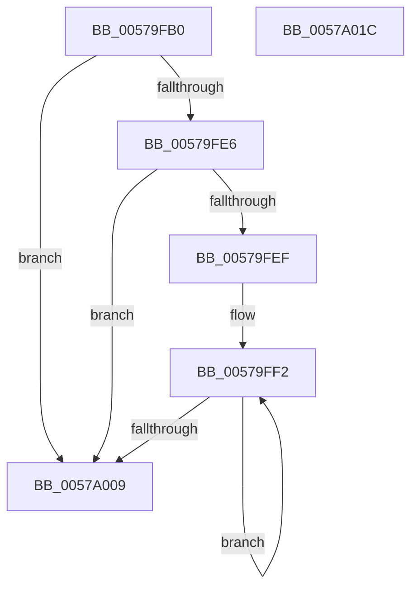

# HalpIvtAllocateReservedDomainList

- RVA: `0x00579FB0`–`0x0057A01D` (길이 `109` bytes)
- VA: `0x0000000140579FB0`
- 실행 섹션: `.text`
- PDB 이름 있음: `예`; PDB Function 태그: `아니요`
- unwind 정보 RVA: `0x00060BC4`
- 디코드: `35`개 명령, `109/109` bytes 표시
- 미해석 바이트: `0` (있으면 어셈블리에 `.byte`로 보존)

> 이 문서는 커널 이미지의 기계어와 PDB 기호를 분석해 생성했습니다. 4번과 5번은 함수 원형과 자료형을 바이너리 사용 방식에서 추정한 C 해석이며 원본 소스 복구 결과는 아닙니다.

## 1. Dependencies

- 직접 호출 지점: **1**; 고유 호출 대상: **1**
- 직접 호출자로 확인된 함수: **2**
- RIP 상대 이미지 참조: **0**

### Outgoing calls
- `0x00579FD7` → [ExtEnvAllocateMemory](../56/ExtEnvAllocateMemory_function_005610B0.md) (function, `0x005610B0`)

### Direct callers
- [HalpIvtLegacyProcessDrhdEntry](HalpIvtLegacyProcessDrhdEntry_function_00578C58.md) at `0x00579382`
- [HalpIvtProcessDrhdEntry](HalpIvtProcessDrhdEntry_function_005794B4.md) at `0x00579C6D`

### Static image references
- 디코드된 RIP-relative 메모리 참조가 없습니다.

## 2. Other-region calls and transfers

- 다른 실행 섹션으로 향하는 call: **0**
- 별도 외부 분기/꼬리 이동을 확인하지 못했습니다.

## 3. Assembly (complete function range)

```asm
00579FB0  48 89 5C 24 08                  mov qword ptr [rsp + 8], rbx
00579FB5  48 89 74 24 10                  mov qword ptr [rsp + 0x10], rsi
00579FBA  57                              push rdi
00579FBB  48 83 EC 20                     sub rsp, 0x20
00579FBF  8B F2                           mov esi, edx
00579FC1  48 8D B9 60 01 00 00            lea rdi, [rcx + 0x160]
00579FC8  41 8B D0                        mov edx, r8d
00579FCB  41 8B D8                        mov ebx, r8d
00579FCE  C1 E2 04                        shl edx, 4
00579FD1  4C 8B C7                        mov r8, rdi
00579FD4  83 C2 08                        add edx, 8
00579FD7  E8 D4 70 FE FF                  call 0x1405610b0
00579FDC  45 33 C9                        xor r9d, r9d
00579FDF  44 8B C0                        mov r8d, eax
00579FE2  85 C0                           test eax, eax
00579FE4  78 23                           js 0x14057a009
00579FE6  48 8B 0F                        mov rcx, qword ptr [rdi]
00579FE9  89 19                           mov dword ptr [rcx], ebx
00579FEB  85 DB                           test ebx, ebx
00579FED  74 1A                           je 0x14057a009
00579FEF  41 8B D1                        mov edx, r9d
00579FF2  48 8B 07                        mov rax, qword ptr [rdi]
00579FF5  41 8D 0C 31                     lea ecx, [r9 + rsi]
00579FF9  41 FF C1                        inc r9d
00579FFC  48 8D 52 10                     lea rdx, [rdx + 0x10]
0057A000  89 4C 10 F8                     mov dword ptr [rax + rdx - 8], ecx
0057A004  44 3B CB                        cmp r9d, ebx
0057A007  72 E9                           jb 0x140579ff2
0057A009  48 8B 5C 24 30                  mov rbx, qword ptr [rsp + 0x30]
0057A00E  41 8B C0                        mov eax, r8d
0057A011  48 8B 74 24 38                  mov rsi, qword ptr [rsp + 0x38]
0057A016  48 83 C4 20                     add rsp, 0x20
0057A01A  5F                              pop rdi
0057A01B  C3                              ret
0057A01C  CC                              int3
```

## 4. C-style interpretation (structured pseudocode)

```c
__int64 __fastcall HalpIvtAllocateReservedDomainList(__int64 a1, int a2, int a3, int a4)
{
    __int64 result;
    __int64 v_rsp;
    unsigned __int64 v_stack_p10;
    unsigned __int64 v_stack_p8;

    v_stack_p8 = v_rbx;
    v_stack_p10 = v_rsi;
    v_rsp = (v_rsp) - (32);
    a2 = (unsigned int)(((unsigned int)(a3)) << (4));
    a2 = (unsigned int)((a2) + (8));
    result = ExtEnvAllocateMemory(a1, a2, a1 + 352, a4);
    a4 = 0;
    if (sign_flag) goto loc_0057A009;
    *(unsigned int *)(*(unsigned __int64 *)(a1 + 352)) = (unsigned int)((unsigned int)(a3));
    if ((unsigned int)((unsigned int)(a3)) == 0) goto loc_0057A009;
loc_00579FF2:
    a4 = (unsigned int)((a4) + 1);
    *(unsigned int *)(*(unsigned __int64 *)(a1 + 352) + 0 + 16 * 1 - 8) = (unsigned int)(a4 + (unsigned int)(a2) * 1);
    if (a4 < ((unsigned int)((unsigned int)(a3)))) goto loc_00579FF2;
loc_0057A009:
    v_rsp = (v_rsp) + (32);
    return (unsigned int)((unsigned int)((unsigned int)((unsigned int)(result))));
}
```

## 5. (Beta) C Style

```c
int64_t HalpIvtAllocateReservedDomainList(void *Arg1, int32_t Arg2, int32_t Arg3, int32_t Arg4)
{
    uint8_t *arg1 = (uint8_t *)Arg1;

    int64_t result;
    int64_t local_rsp;
    uint64_t v_stack_p10;
    uint64_t v_stack_p8;

    v_stack_p8 = local_rbx;
    v_stack_p10 = local_rsi;
    local_rsp = (local_rsp) - (32);
    Arg2 = (uint32_t)(((uint32_t)(Arg3)) << (4));
    Arg2 = (uint32_t)((Arg2) + (8));
    result = ExtEnvAllocateMemory(Arg1, Arg2, Arg1 + 352, Arg4);
    Arg4 = 0;
    if (sign_flag) goto loc_0057A009;
    *(uint32_t *)(*(uint64_t *)(arg1 + 0x160)) = (uint32_t)((uint32_t)(Arg3));
    if ((uint32_t)((uint32_t)(Arg3)) == 0) goto loc_0057A009;
loc_00579FF2:
    Arg4 = (uint32_t)((Arg4) + 1);
    *(uint32_t *)(*(uint64_t *)(arg1 + 0x160) + 0x0 + 0x10 * 1 - 0x8) = (uint32_t)(Arg4 + (uint32_t)(Arg2) * 1);
    if (Arg4 < ((uint32_t)((uint32_t)(Arg3)))) goto loc_00579FF2;
loc_0057A009:
    local_rsp = (local_rsp) + (32);
    return (uint32_t)((uint32_t)((uint32_t)((uint32_t)(result))));
}
```

### 관측된 메모리 오프셋

구조체 형식이 확인되지 않은 접근은 인자 기준의 오프셋으로만 기록했습니다.

| 기준 인자 | 오프셋 표현 | 폭 (bit) | 접근 |
|---|---:|---:|---|
| `Arg1` | `+ 0x0` | `64` | `R` |
| `Arg1` | `+ 0x160` | `64` | `R` |

## 6. Execution-region graph

[열기: 2D/3D 그래프와 함수 탐색 컨트롤 패널](../../../control-panel.html?section=text&rva=0x00579FB0&view=graph)

- 2D 그래프는 위에서 아래로 흐르고, 3D 그래프는 빈 공간을 드래그해 회전합니다. Shift+드래그는 이동, 휠은 확대·축소, 함수 노드 선택은 대상 보고서 이동입니다.

### Static fallback


