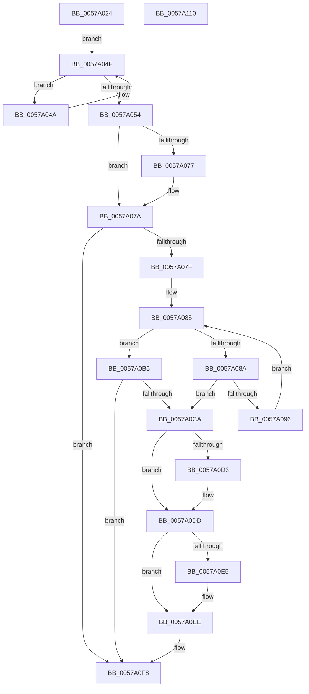

# HalpIvtCreateReservedDevice

- RVA: `0x0057A024`–`0x0057A111` (길이 `237` bytes)
- VA: `0x000000014057A024`
- 실행 섹션: `.text`
- PDB 이름 있음: `예`; PDB Function 태그: `아니요`
- unwind 정보 RVA: `0x000C55E8`
- 디코드: `71`개 명령, `237/237` bytes 표시
- 미해석 바이트: `0` (있으면 어셈블리에 `.byte`로 보존)

> 이 문서는 커널 이미지의 기계어와 PDB 기호를 분석해 생성했습니다. 4번과 5번은 함수 원형과 자료형을 바이너리 사용 방식에서 추정한 C 해석이며 원본 소스 복구 결과는 아닙니다.

## 1. Dependencies

- 직접 호출 지점: **5**; 고유 호출 대상: **4**
- 직접 호출자로 확인된 함수: **1**
- RIP 상대 이미지 참조: **0**

### Outgoing calls
- `0x0057A069` → [ExtEnvAllocateMemory](../56/ExtEnvAllocateMemory_function_005610B0.md) (function, `0x005610B0`)
- `0x0057A0BD` → [DmrConvertDeviceScope](DmrConvertDeviceScope_function_0057A834.md) (function, `0x0057A834`)
- `0x0057A0D8` → [IvtDeleteDevice](IvtDeleteDevice_function_00579ED0.md) (function, `0x00579ED0`)
- `0x0057A0E5` → [ExtEnvFreeMemory](../56/ExtEnvFreeMemory_function_00561320.md) (function, `0x00561320`)
- `0x0057A0F1` → [ExtEnvFreeMemory](../56/ExtEnvFreeMemory_function_00561320.md) (function, `0x00561320`)

### Direct callers
- [IvtEnumerateRmrrDevices](IvtEnumerateRmrrDevices_function_0057A170.md) at `0x0057A1BE`

### Static image references
- 디코드된 RIP-relative 메모리 참조가 없습니다.

## 2. Other-region calls and transfers

- 다른 실행 섹션으로 향하는 call: **0**
- 별도 외부 분기/꼬리 이동을 확인하지 못했습니다.

## 3. Assembly (complete function range)

```asm
0057A024  48 8B C4                        mov rax, rsp
0057A027  48 89 58 10                     mov qword ptr [rax + 0x10], rbx
0057A02B  48 89 68 18                     mov qword ptr [rax + 0x18], rbp
0057A02F  48 89 70 20                     mov qword ptr [rax + 0x20], rsi
0057A033  48 89 48 08                     mov qword ptr [rax + 8], rcx
0057A037  57                              push rdi
0057A038  48 83 EC 20                     sub rsp, 0x20
0057A03C  48 8D 72 10                     lea rsi, [rdx + 0x10]
0057A040  48 8B EA                        mov rbp, rdx
0057A043  48 8B 06                        mov rax, qword ptr [rsi]
0057A046  33 FF                           xor edi, edi
0057A048  EB 05                           jmp 0x14057a04f
0057A04A  48 8B 00                        mov rax, qword ptr [rax]
0057A04D  FF C7                           inc edi
0057A04F  48 3B C6                        cmp rax, rsi
0057A052  75 F6                           jne 0x14057a04a
0057A054  48 83 64 24 30 00               and qword ptr [rsp + 0x30], 0
0057A05A  8D 14 7F                        lea edx, [rdi + rdi*2]
0057A05D  8D 14 D5 28 00 00 00            lea edx, [rdx*8 + 0x28]
0057A064  4C 8D 44 24 30                  lea r8, [rsp + 0x30]
0057A069  E8 42 70 FE FF                  call 0x1405610b0
0057A06E  48 8B 5C 24 30                  mov rbx, qword ptr [rsp + 0x30]
0057A073  85 C0                           test eax, eax
0057A075  78 03                           js 0x14057a07a
0057A077  89 7B 20                        mov dword ptr [rbx + 0x20], edi
0057A07A  48 85 DB                        test rbx, rbx
0057A07D  74 79                           je 0x14057a0f8
0057A07F  4C 8B 06                        mov r8, qword ptr [rsi]
0057A082  45 33 C9                        xor r9d, r9d
0057A085  4C 3B C6                        cmp r8, rsi
0057A088  74 2B                           je 0x14057a0b5
0057A08A  4D 8B D0                        mov r10, r8
0057A08D  4D 8B 00                        mov r8, qword ptr [r8]
0057A090  44 3B 4B 20                     cmp r9d, dword ptr [rbx + 0x20]
0057A094  73 34                           jae 0x14057a0ca
0057A096  49 8B 42 10                     mov rax, qword ptr [r10 + 0x10]
0057A09A  4B 8D 0C 49                     lea rcx, [r9 + r9*2]
0057A09E  48 89 44 CB 28                  mov qword ptr [rbx + rcx*8 + 0x28], rax
0057A0A3  4B 8D 0C 49                     lea rcx, [r9 + r9*2]
0057A0A7  49 8B 42 18                     mov rax, qword ptr [r10 + 0x18]
0057A0AB  41 FF C1                        inc r9d
0057A0AE  48 89 44 CB 30                  mov qword ptr [rbx + rcx*8 + 0x30], rax
0057A0B3  EB D0                           jmp 0x14057a085
0057A0B5  0F B7 4D 20                     movzx ecx, word ptr [rbp + 0x20]
0057A0B9  48 8D 55 22                     lea rdx, [rbp + 0x22]
0057A0BD  E8 72 07 00 00                  call 0x14057a834
0057A0C2  48 89 03                        mov qword ptr [rbx], rax
0057A0C5  48 85 C0                        test rax, rax
0057A0C8  75 2E                           jne 0x14057a0f8
0057A0CA  48 8B 53 18                     mov rdx, qword ptr [rbx + 0x18]
0057A0CE  48 85 D2                        test rdx, rdx
0057A0D1  74 0A                           je 0x14057a0dd
0057A0D3  45 33 C0                        xor r8d, r8d
0057A0D6  33 C9                           xor ecx, ecx
0057A0D8  E8 F3 FD FF FF                  call 0x140579ed0
0057A0DD  48 8B 13                        mov rdx, qword ptr [rbx]
0057A0E0  48 85 D2                        test rdx, rdx
0057A0E3  74 09                           je 0x14057a0ee
0057A0E5  E8 36 72 FE FF                  call 0x140561320
0057A0EA  48 83 23 00                     and qword ptr [rbx], 0
0057A0EE  48 8B D3                        mov rdx, rbx
0057A0F1  E8 2A 72 FE FF                  call 0x140561320
0057A0F6  33 DB                           xor ebx, ebx
0057A0F8  48 8B 6C 24 40                  mov rbp, qword ptr [rsp + 0x40]
0057A0FD  48 8B C3                        mov rax, rbx
0057A100  48 8B 5C 24 38                  mov rbx, qword ptr [rsp + 0x38]
0057A105  48 8B 74 24 48                  mov rsi, qword ptr [rsp + 0x48]
0057A10A  48 83 C4 20                     add rsp, 0x20
0057A10E  5F                              pop rdi
0057A10F  C3                              ret
0057A110  CC                              int3
```

## 4. C-style interpretation (structured pseudocode)

```c
__int64 __fastcall HalpIvtCreateReservedDevice(__int64 a1, __int64 a2, __int64 a3, int a4)
{
    __int64 result;
    __int64 v_rbx;
    __int64 v_rdi;
    __int64 v_rsp;
    unsigned __int64 v_stack_p10;
    unsigned __int64 v_stack_p18;
    unsigned __int64 v_stack_p20;
    unsigned __int64 v_stack_p8;

    *(unsigned __int64 *)(v_rsp + 16) = v_rbx;
    *(unsigned __int64 *)(v_rsp + 24) = v_rbp;
    *(unsigned __int64 *)(v_rsp + 32) = v_rsi;
    *(unsigned __int64 *)(v_rsp + 8) = a1;
    v_rsp = (v_rsp) - (32);
    v_rdi = 0;
    goto loc_0057A04F;
loc_0057A04A:
    v_rdi = (unsigned int)((v_rdi) + 1);
loc_0057A04F:
    if ((*(unsigned __int64 *)(*(unsigned __int64 *)(a2 + 16))) != (a2 + 16)) goto loc_0057A04A;
    result = ExtEnvAllocateMemory(a1, v_rdi + v_rdi * 2 * 8 + 40, v_stack_p8, a4);
    if (!(sign_flag)) {
        *(unsigned int *)(v_stack_p8 + 32) = (unsigned int)(v_rdi);
    }
    if (v_stack_p8 == 0) goto loc_0057A0F8;
    a4 = 0;
loc_0057A085:
    if ((*(unsigned __int64 *)(a2 + 16)) == (a2 + 16)) goto loc_0057A0B5;
    if (0 >= (*(unsigned int *)(v_stack_p8 + 32))) goto loc_0057A0CA;
    *(unsigned __int64 *)(v_stack_p8 + a4 + a4 * 2 * 8 + 40) = *(unsigned __int64 *)(*(unsigned __int64 *)(a2 + 16) + 16);
    a4 = (unsigned int)((a4) + 1);
    *(unsigned __int64 *)(v_stack_p8 + a4 + a4 * 2 * 8 + 48) = *(unsigned __int64 *)(*(unsigned __int64 *)(a2 + 16) + 24);
    goto loc_0057A085;
loc_0057A0B5:
    result = DmrConvertDeviceScope(*(unsigned __int16 *)(a2 + 32), a2 + 34, *(unsigned __int64 *)(*(unsigned __int64 *)(a2 + 16)), a4);
    *(unsigned __int64 *)(v_stack_p8) = result;
    if (result != 0) goto loc_0057A0F8;
loc_0057A0CA:
    if (*(unsigned __int64 *)(v_stack_p8 + 24) != 0) {
        a3 = 0;
        a1 = 0;
        result = IvtDeleteDevice(a1, *(unsigned __int64 *)(v_stack_p8 + 24), a3, a4);
    }
    if (*(unsigned __int64 *)(v_stack_p8) != 0) {
        result = ExtEnvFreeMemory(a1, *(unsigned __int64 *)(v_stack_p8), a3, a4);
    }
    result = ExtEnvFreeMemory(a1, v_stack_p8, a3, a4);
    v_rbx = 0;
loc_0057A0F8:
    v_rsp = (v_rsp) + (32);
    return 0;
}
```

## 5. (Beta) C Style

```c
int64_t HalpIvtCreateReservedDevice(int64_t Arg1, void *Arg2, int64_t Arg3, int32_t Arg4)
{
    uint8_t *arg2 = (uint8_t *)Arg2;

    int64_t result;
    int64_t local_rbx;
    int64_t local_rdi;
    int64_t local_rsp;
    uint64_t v_stack_p10;
    uint64_t v_stack_p18;
    uint64_t v_stack_p20;
    uint64_t v_stack_p8;

    *(uint64_t *)(local_rsp + 0x10) = local_rbx;
    *(uint64_t *)(local_rsp + 0x18) = local_rbp;
    *(uint64_t *)(local_rsp + 0x20) = local_rsi;
    *(uint64_t *)(local_rsp + 0x8) = Arg1;
    local_rsp = (local_rsp) - (32);
    local_rdi = 0;
    goto loc_0057A04F;
loc_0057A04A:
    local_rdi = (uint32_t)((local_rdi) + 1);
loc_0057A04F:
    if ((*(uint64_t *)(*(uint64_t *)(arg2 + 0x10))) != (Arg2 + 16)) goto loc_0057A04A;
    result = ExtEnvAllocateMemory(Arg1, local_rdi + local_rdi * 2 * 8 + 40, v_stack_p8, Arg4);
    if (!(sign_flag)) {
        *(uint32_t *)(v_stack_p8 + 0x20) = (uint32_t)(local_rdi);
    }
    if (v_stack_p8 == 0) goto loc_0057A0F8;
    Arg4 = 0;
loc_0057A085:
    if ((*(uint64_t *)(arg2 + 0x10)) == (Arg2 + 16)) goto loc_0057A0B5;
    if (0 >= (*(uint32_t *)(v_stack_p8 + 0x20))) goto loc_0057A0CA;
    *(uint64_t *)(v_stack_p8 + Arg4 + Arg4 * 2 * 8 + 0x28) = *(uint64_t *)(*(uint64_t *)(arg2 + 0x10) + 0x10);
    Arg4 = (uint32_t)((Arg4) + 1);
    *(uint64_t *)(v_stack_p8 + Arg4 + Arg4 * 2 * 8 + 0x30) = *(uint64_t *)(*(uint64_t *)(arg2 + 0x10) + 0x18);
    goto loc_0057A085;
loc_0057A0B5:
    result = DmrConvertDeviceScope(*(uint16_t *)(arg2 + 0x20), Arg2 + 34, *(uint64_t *)(*(uint64_t *)(arg2 + 0x10)), Arg4);
    *(uint64_t *)(v_stack_p8) = result;
    if (result != 0) goto loc_0057A0F8;
loc_0057A0CA:
    if (*(uint64_t *)(v_stack_p8 + 0x18) != 0) {
        Arg3 = 0;
        Arg1 = 0;
        result = IvtDeleteDevice(Arg1, *(uint64_t *)(v_stack_p8 + 0x18), Arg3, Arg4);
    }
    if (*(uint64_t *)(v_stack_p8) != 0) {
        result = ExtEnvFreeMemory(Arg1, *(uint64_t *)(v_stack_p8), Arg3, Arg4);
    }
    result = ExtEnvFreeMemory(Arg1, v_stack_p8, Arg3, Arg4);
    local_rbx = 0;
loc_0057A0F8:
    local_rsp = (local_rsp) + (32);
    return 0;
}
```

### 관측된 메모리 오프셋

구조체 형식이 확인되지 않은 접근은 인자 기준의 오프셋으로만 기록했습니다.

| 기준 인자 | 오프셋 표현 | 폭 (bit) | 접근 |
|---|---:|---:|---|
| `Arg2` | `+ 0x0` | `64` | `R` |
| `Arg2` | `+ 0x10` | `64` | `R` |
| `Arg2` | `+ 0x20` | `16` | `R` |
| `Arg2` | `+ 0x22` | `64` | `R` |

## 6. Execution-region graph

[열기: 2D/3D 그래프와 함수 탐색 컨트롤 패널](../../../control-panel.html?section=text&rva=0x0057A024&view=graph)

- 2D 그래프는 위에서 아래로 흐르고, 3D 그래프는 빈 공간을 드래그해 회전합니다. Shift+드래그는 이동, 휠은 확대·축소, 함수 노드 선택은 대상 보고서 이동입니다.

### Static fallback


