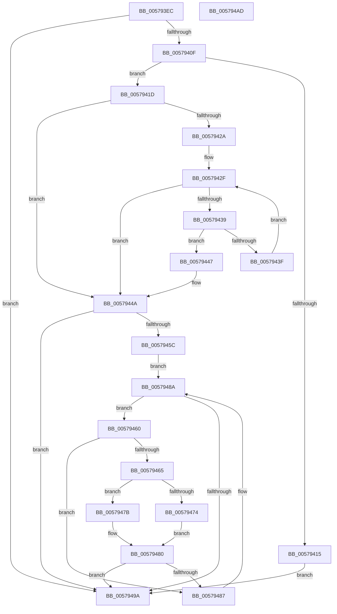

# HalpIvtProcessDmarTable

- RVA: `0x005793EC`–`0x005794AE` (길이 `194` bytes)
- VA: `0x00000001405793EC`
- 실행 섹션: `.text`
- PDB 이름 있음: `예`; PDB Function 태그: `아니요`
- unwind 정보 RVA: `0x00060BC4`
- 디코드: `62`개 명령, `194/194` bytes 표시
- 미해석 바이트: `0` (있으면 어셈블리에 `.byte`로 보존)

> 이 문서는 커널 이미지의 기계어와 PDB 기호를 분석해 생성했습니다. 4번과 5번은 함수 원형과 자료형을 바이너리 사용 방식에서 추정한 C 해석이며 원본 소스 복구 결과는 아닙니다.

## 1. Dependencies

- 직접 호출 지점: **6**; 고유 호출 대상: **5**
- 직접 호출자로 확인된 함수: **1**
- RIP 상대 이미지 참조: **1**

### Outgoing calls
- `0x0057942F` → [DmrGetNextRemappingStructure](DmrGetNextRemappingStructure_function_0057AA78.md) (function, `0x0057AA78`)
- `0x00579450` → [DmrEnumerateSatcDevices](DmrEnumerateSatcDevices_function_0057A8D0.md) (function, `0x0057A8D0`)
- `0x00579465` → [Feature_Test57481295__private_IsEnabledDeviceUsageNoInline](../4F/Feature_Test57481295__private_IsEnabledDeviceUsageNoInline_function_004F7B90.md) (function, `0x004F7B90`)
- `0x00579474` → [HalpIvtLegacyProcessDrhdEntry](HalpIvtLegacyProcessDrhdEntry_function_00578C58.md) (function, `0x00578C58`)
- `0x0057947B` → [HalpIvtProcessDrhdEntry](HalpIvtProcessDrhdEntry_function_005794B4.md) (function, `0x005794B4`)
- `0x0057948D` → [DmrGetNextRemappingStructure](DmrGetNextRemappingStructure_function_0057AA78.md) (function, `0x0057AA78`)

### Direct callers
- [HalpIommuRegisterBuiltinPlugins](../56/HalpIommuRegisterBuiltinPlugins_function_005689EC.md) at `0x00568A48`

### Static image references
- `0x00579421` → RVA `0x00E65AD0` (`.data`; write)

## 2. Other-region calls and transfers

- 다른 실행 섹션으로 향하는 call: **0**
- 별도 외부 분기/꼬리 이동을 확인하지 못했습니다.

## 3. Assembly (complete function range)

```asm
005793EC  48 89 5C 24 08                  mov qword ptr [rsp + 8], rbx
005793F1  48 89 74 24 10                  mov qword ptr [rsp + 0x10], rsi
005793F6  57                              push rdi
005793F7  48 83 EC 20                     sub rsp, 0x20
005793FB  33 F6                           xor esi, esi
005793FD  4C 8B DA                        mov r11, rdx
00579400  48 8B D9                        mov rbx, rcx
00579403  44 8B D6                        mov r10d, esi
00579406  48 85 C9                        test rcx, rcx
00579409  0F 84 8B 00 00 00               je 0x14057949a
0057940F  83 79 04 40                     cmp dword ptr [rcx + 4], 0x40
00579413  73 08                           jae 0x14057941d
00579415  41 BA 0D 00 00 C0               mov r10d, 0xc000000d
0057941B  EB 7D                           jmp 0x14057949a
0057941D  F6 41 25 04                     test byte ptr [rcx + 0x25], 4
00579421  48 89 1D A8 C6 8E 00            mov qword ptr [rip + 0x8ec6a8], rbx
00579428  74 20                           je 0x14057944a
0057942A  41 B2 01                        mov r10b, 1
0057942D  33 D2                           xor edx, edx
0057942F  E8 44 16 00 00                  call 0x14057aa78
00579434  48 85 C0                        test rax, rax
00579437  74 11                           je 0x14057944a
00579439  66 83 38 04                     cmp word ptr [rax], 4
0057943D  74 08                           je 0x140579447
0057943F  48 8B D0                        mov rdx, rax
00579442  48 8B CB                        mov rcx, rbx
00579445  EB E8                           jmp 0x14057942f
00579447  44 8A D6                        mov r10b, sil
0057944A  48 8B CB                        mov rcx, rbx
0057944D  45 88 13                        mov byte ptr [r11], r10b
00579450  E8 7B 14 00 00                  call 0x14057a8d0
00579455  44 8B D0                        mov r10d, eax
00579458  85 C0                           test eax, eax
0057945A  78 3E                           js 0x14057949a
0057945C  33 D2                           xor edx, edx
0057945E  EB 2A                           jmp 0x14057948a
00579460  66 39 37                        cmp word ptr [rdi], si
00579463  75 22                           jne 0x140579487
00579465  E8 26 E7 F7 FF                  call 0x1404f7b90
0057946A  48 8B D7                        mov rdx, rdi
0057946D  48 8B CB                        mov rcx, rbx
00579470  85 C0                           test eax, eax
00579472  75 07                           jne 0x14057947b
00579474  E8 DF F7 FF FF                  call 0x140578c58
00579479  EB 05                           jmp 0x140579480
0057947B  E8 34 00 00 00                  call 0x1405794b4
00579480  44 8B D0                        mov r10d, eax
00579483  85 C0                           test eax, eax
00579485  78 13                           js 0x14057949a
00579487  48 8B D7                        mov rdx, rdi
0057948A  48 8B CB                        mov rcx, rbx
0057948D  E8 E6 15 00 00                  call 0x14057aa78
00579492  48 8B F8                        mov rdi, rax
00579495  48 85 C0                        test rax, rax
00579498  75 C6                           jne 0x140579460
0057949A  48 8B 5C 24 30                  mov rbx, qword ptr [rsp + 0x30]
0057949F  41 8B C2                        mov eax, r10d
005794A2  48 8B 74 24 38                  mov rsi, qword ptr [rsp + 0x38]
005794A7  48 83 C4 20                     add rsp, 0x20
005794AB  5F                              pop rdi
005794AC  C3                              ret
005794AD  CC                              int3
```

## 4. C-style interpretation (structured pseudocode)

```c
__int64 __fastcall HalpIvtProcessDmarTable(__int64 a1, __int64 a2)
{
    __int64 result;
    __int64 v_rsi;
    __int64 v_rsp;
    unsigned __int64 v_stack_p10;
    unsigned __int64 v_stack_p8;

    v_stack_p8 = v_rbx;
    v_stack_p10 = v_rsi;
    v_rsp = (v_rsp) - (32);
    v_rsi = 0;
    if (a1 == 0) goto loc_0057949A;
    if ((*(unsigned int *)(a1 + 4)) >= 64) goto loc_0057941D;
    goto loc_0057949A;
loc_0057941D:
    *(unsigned __int64 *)(v_rip + 9356968) = a1;
    if (((*(unsigned __int8 *)(a1 + 37)) & (4)) == 0) goto loc_0057944A;
    a2 = 0;
loc_0057942F:
    result = DmrGetNextRemappingStructure(a1, a2, a3, a4);
    if (result == 0) goto loc_0057944A;
    if ((*(unsigned __int16 *)(result)) == 4) goto loc_00579447;
    goto loc_0057942F;
loc_00579447:
loc_0057944A:
    *(unsigned __int8 *)(a2) = 0;
    result = DmrEnumerateSatcDevices(a1, result, a3, a4);
    if (sign_flag) goto loc_0057949A;
    a2 = 0;
    goto loc_0057948A;
loc_00579460:
    if ((*(unsigned __int16 *)(v_rdi)) != 0) goto loc_00579487;
    result = Feature_Test57481295__private_IsEnabledDeviceUsageNoInline(a1, a2, a3, a4);
    if ((unsigned int)(result) != 0) goto loc_0057947B;
    result = HalpIvtLegacyProcessDrhdEntry(a1, v_rdi, a3, a4);
    goto loc_00579480;
loc_0057947B:
    result = HalpIvtProcessDrhdEntry(a1, v_rdi, a3, a4);
loc_00579480:
    if (sign_flag) goto loc_0057949A;
loc_00579487:
loc_0057948A:
    result = DmrGetNextRemappingStructure(a1, v_rdi, a3, a4);
    if (result != 0) goto loc_00579460;
loc_0057949A:
    v_rsp = (v_rsp) + (32);
    return (unsigned int)((unsigned int)((unsigned int)((unsigned int)(result))));
}
```

## 5. (Beta) C Style

```c
int64_t HalpIvtProcessDmarTable(int64_t Arg1, int64_t Arg2)
{
    int64_t result;
    int64_t local_rsi;
    int64_t local_rsp;
    uint64_t v_stack_p10;
    uint64_t v_stack_p8;

    v_stack_p8 = local_rbx;
    v_stack_p10 = local_rsi;
    local_rsp = (local_rsp) - (32);
    local_rsi = 0;
    if (Arg1 == 0) goto loc_0057949A;
    if ((*(uint32_t *)(Arg1 + 0x4)) >= 64) goto loc_0057941D;
    goto loc_0057949A;
loc_0057941D:
    *(uint64_t *)(v_rip + 0x8EC6A8) = Arg1;
    if (((*(uint8_t *)(Arg1 + 0x25)) & (4)) == 0) goto loc_0057944A;
    Arg2 = 0;
loc_0057942F:
    result = DmrGetNextRemappingStructure(Arg1, Arg2, a3, a4);
    if (result == 0) goto loc_0057944A;
    if ((*(uint16_t *)(result)) == 4) goto loc_00579447;
    goto loc_0057942F;
loc_00579447:
loc_0057944A:
    *(uint8_t *)(Arg2) = 0;
    result = DmrEnumerateSatcDevices(Arg1, result, a3, a4);
    if (sign_flag) goto loc_0057949A;
    Arg2 = 0;
    goto loc_0057948A;
loc_00579460:
    if ((*(uint16_t *)(local_rdi)) != 0) goto loc_00579487;
    result = Feature_Test57481295__private_IsEnabledDeviceUsageNoInline(Arg1, Arg2, a3, a4);
    if ((uint32_t)(result) != 0) goto loc_0057947B;
    result = HalpIvtLegacyProcessDrhdEntry(Arg1, local_rdi, a3, a4);
    goto loc_00579480;
loc_0057947B:
    result = HalpIvtProcessDrhdEntry(Arg1, local_rdi, a3, a4);
loc_00579480:
    if (sign_flag) goto loc_0057949A;
loc_00579487:
loc_0057948A:
    result = DmrGetNextRemappingStructure(Arg1, local_rdi, a3, a4);
    if (result != 0) goto loc_00579460;
loc_0057949A:
    local_rsp = (local_rsp) + (32);
    return (uint32_t)((uint32_t)((uint32_t)((uint32_t)(result))));
}
```

## 6. Execution-region graph

[열기: 2D/3D 그래프와 함수 탐색 컨트롤 패널](../../../control-panel.html?section=text&rva=0x005793EC&view=graph)

- 2D 그래프는 위에서 아래로 흐르고, 3D 그래프는 빈 공간을 드래그해 회전합니다. Shift+드래그는 이동, 휠은 확대·축소, 함수 노드 선택은 대상 보고서 이동입니다.

### Static fallback


