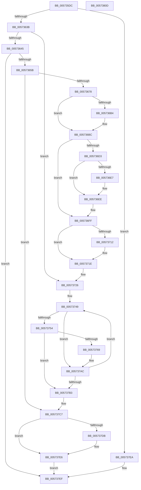

# HsaAllocatePasidTables

- RVA: `0x005735DC`–`0x0057380E` (길이 `562` bytes)
- VA: `0x00000001405735DC`
- 실행 섹션: `.text`
- PDB 이름 있음: `예`; PDB Function 태그: `아니요`
- unwind 정보 RVA: `0x000C3AF8`
- 디코드: `142`개 명령, `562/562` bytes 표시
- 미해석 바이트: `0` (있으면 어셈블리에 `.byte`로 보존)

> 이 문서는 커널 이미지의 기계어와 PDB 기호를 분석해 생성했습니다. 4번과 5번은 함수 원형과 자료형을 바이너리 사용 방식에서 추정한 C 해석이며 원본 소스 복구 결과는 아닙니다.

## 1. Dependencies

- 직접 호출 지점: **11**; 고유 호출 대상: **9**
- 직접 호출자로 확인된 함수: **1**
- RIP 상대 이미지 참조: **1**

### Outgoing calls
- `0x0057364E` → [ExtEnvAllocateMemory](../56/ExtEnvAllocateMemory_function_005610B0.md) (function, `0x005610B0`)
- `0x00573669` → [ExtEnvAllocateMemory](../56/ExtEnvAllocateMemory_function_005610B0.md) (function, `0x005610B0`)
- `0x005736B7` → [KiRaiseIrqlProcessIrqlFlags](../4F/KiRaiseIrqlProcessIrqlFlags_function_004F56FC.md) (function, `0x004F56FC`)
- `0x005736C8` → [KeAcquireInStackQueuedSpinLockAtDpcLevel](../27/KeAcquireInStackQueuedSpinLockAtDpcLevel_function_00275740.md) (function, `0x00275740`)
- `0x00573704` → [KeReleaseInStackQueuedSpinLockFromDpcLevel](../21/KeReleaseInStackQueuedSpinLockFromDpcLevel_function_002171B0.md) (function, `0x002171B0`)
- `0x00573719` → [KiLowerIrqlProcessIrqlFlags](../4F/KiLowerIrqlProcessIrqlFlags_function_004F5698.md) (function, `0x004F5698`)
- `0x0057372E` → [KeAcquireSpinLockRaiseToDpc](../20/KeAcquireSpinLockRaiseToDpc_function_00208470.md) (function, `0x00208470`)
- `0x0057375E` → [ExtEnvAllocateMemory](../56/ExtEnvAllocateMemory_function_005610B0.md) (function, `0x005610B0`)
- `0x00573776` → [MmGetPhysicalAddress](../23/MmGetPhysicalAddress_function_0023A500.md) (function, `0x0023A500`)
- `0x005737C2` → [KeReleaseSpinLock](../39/KeReleaseSpinLock_function_00392BA0.md) (function, `0x00392BA0`)
- `0x005737E1` → [HsaFreePasidTables](HsaFreePasidTables_function_0057401C.md) (function, `0x0057401C`)

### Direct callers
- [HsaGrowPasidTable](HsaGrowPasidTable_function_00574640.md) at `0x00574664`

### Static image references
- `0x005736AB` → RVA `0x00FC6D20` (`ALMOSTRO`; read)

## 2. Other-region calls and transfers

- 다른 실행 섹션으로 향하는 call: **0**
- 별도 외부 분기/꼬리 이동을 확인하지 못했습니다.

## 3. Assembly (complete function range)

```asm
005735DC  4C 8B DC                        mov r11, rsp
005735DF  49 89 5B 08                     mov qword ptr [r11 + 8], rbx
005735E3  49 89 6B 10                     mov qword ptr [r11 + 0x10], rbp
005735E7  49 89 73 18                     mov qword ptr [r11 + 0x18], rsi
005735EB  57                              push rdi
005735EC  41 54                           push r12
005735EE  41 55                           push r13
005735F0  41 56                           push r14
005735F2  41 57                           push r15
005735F4  48 83 EC 50                     sub rsp, 0x50
005735F8  45 33 E4                        xor r12d, r12d
005735FB  33 C0                           xor eax, eax
005735FD  4D 89 63 B0                     mov qword ptr [r11 - 0x50], r12
00573601  0F 57 C0                        xorps xmm0, xmm0
00573604  4D 89 63 A8                     mov qword ptr [r11 - 0x58], r12
00573608  45 8B F1                        mov r14d, r9d
0057360B  41 8B E8                        mov ebp, r8d
0057360E  48 8B FA                        mov rdi, rdx
00573611  4C 8B F9                        mov r15, rcx
00573614  41 8B DC                        mov ebx, r12d
00573617  41 8B F4                        mov esi, r12d
0057361A  0F 11 44 24 30                  movups xmmword ptr [rsp + 0x30], xmm0
0057361F  49 89 43 C8                     mov qword ptr [r11 - 0x38], rax
00573623  48 8B 84 24 B0 00 00 00         mov rax, qword ptr [rsp + 0xb0]
0057362B  4C 89 20                        mov qword ptr [rax], r12
0057362E  41 81 F9 00 00 04 00            cmp r9d, 0x40000
00573635  0F 83 AF 01 00 00               jae 0x1405737ea
0057363B  4C 39 62 30                     cmp qword ptr [rdx + 0x30], r12
0057363F  0F 85 E1 00 00 00               jne 0x140573726
00573645  4D 8D 43 A8                     lea r8, [r11 - 0x58]
00573649  41 8D 54 24 38                  lea edx, [r12 + 0x38]
0057364E  E8 5D DA FE FF                  call 0x1405610b0
00573653  85 C0                           test eax, eax
00573655  0F 88 94 01 00 00               js 0x1405737ef
0057365B  48 8B 5C 24 20                  mov rbx, qword ptr [rsp + 0x20]
00573660  BA 00 20 00 00                  mov edx, 0x2000
00573665  4C 8D 43 30                     lea r8, [rbx + 0x30]
00573669  E8 42 DA FE FF                  call 0x1405610b0
0057366E  8B F0                           mov esi, eax
00573670  85 C0                           test eax, eax
00573672  0F 88 4F 01 00 00               js 0x1405737c7
00573678  8B 84 24 A0 00 00 00            mov eax, dword ptr [rsp + 0xa0]
0057367F  48 89 5B 08                     mov qword ptr [rbx + 8], rbx
00573683  48 89 1B                        mov qword ptr [rbx], rbx
00573686  4C 89 63 10                     mov qword ptr [rbx + 0x10], r12
0057368A  89 6B 20                        mov dword ptr [rbx + 0x20], ebp
0057368D  89 43 24                        mov dword ptr [rbx + 0x24], eax
00573690  8B 84 24 A8 00 00 00            mov eax, dword ptr [rsp + 0xa8]
00573697  89 43 28                        mov dword ptr [rbx + 0x28], eax
0057369A  48 89 7B 18                     mov qword ptr [rbx + 0x18], rdi
0057369E  44 0F 20 C5                     mov rbp, cr8
005736A2  41 8D 54 24 0F                  lea edx, [r12 + 0xf]
005736A7  44 0F 22 C2                     mov cr8, rdx
005736AB  44 39 25 6E 36 A5 00            cmp dword ptr [rip + 0xa5366e], r12d
005736B2  74 08                           je 0x1405736bc
005736B4  40 8A CD                        mov cl, bpl
005736B7  E8 40 20 F8 FF                  call 0x1404f56fc
005736BC  49 8D 8F 98 00 00 00            lea rcx, [r15 + 0x98]
005736C3  48 8D 54 24 30                  lea rdx, [rsp + 0x30]
005736C8  E8 73 20 D0 FF                  call 0x140275740
005736CD  4C 39 67 30                     cmp qword ptr [rdi + 0x30], r12
005736D1  75 2C                           jne 0x1405736ff
005736D3  49 8D 87 F0 00 00 00            lea rax, [r15 + 0xf0]
005736DA  48 89 5F 30                     mov qword ptr [rdi + 0x30], rbx
005736DE  48 8B 08                        mov rcx, qword ptr [rax]
005736E1  48 39 41 08                     cmp qword ptr [rcx + 8], rax
005736E5  74 07                           je 0x1405736ee
005736E7  B9 03 00 00 00                  mov ecx, 3
005736EC  CD 29                           int 0x29
005736EE  48 89 0B                        mov qword ptr [rbx], rcx
005736F1  48 89 43 08                     mov qword ptr [rbx + 8], rax
005736F5  48 89 59 08                     mov qword ptr [rcx + 8], rbx
005736F9  48 89 18                        mov qword ptr [rax], rbx
005736FC  49 8B DC                        mov rbx, r12
005736FF  48 8D 4C 24 30                  lea rcx, [rsp + 0x30]
00573704  E8 A7 3A CA FF                  call 0x1402171b0
00573709  44 39 25 10 36 A5 00            cmp dword ptr [rip + 0xa53610], r12d
00573710  74 0C                           je 0x14057371e
00573712  44 0F 20 C1                     mov rcx, cr8
00573716  40 8A D5                        mov dl, bpl
00573719  E8 7A 1F F8 FF                  call 0x1404f5698
0057371E  40 0F B6 C5                     movzx eax, bpl
00573722  44 0F 22 C0                     mov cr8, rax
00573726  48 8B 4F 30                     mov rcx, qword ptr [rdi + 0x30]
0057372A  48 83 C1 10                     add rcx, 0x10
0057372E  E8 3D 4D C9 FF                  call 0x140208470
00573733  48 8B 4F 30                     mov rcx, qword ptr [rdi + 0x30]
00573737  41 8B EC                        mov ebp, r12d
0057373A  88 84 24 98 00 00 00            mov byte ptr [rsp + 0x98], al
00573741  41 C1 EE 09                     shr r14d, 9
00573745  4C 8B 69 30                     mov r13, qword ptr [rcx + 0x30]
00573749  44 8B E5                        mov r12d, ebp
0057374C  43 F6 44 E5 00 01               test byte ptr [r13 + r12*8], 1
00573752  75 58                           jne 0x1405737ac
00573754  4C 8D 44 24 28                  lea r8, [rsp + 0x28]
00573759  BA 00 10 00 00                  mov edx, 0x1000
0057375E  E8 4D D9 FE FF                  call 0x1405610b0
00573763  8B F0                           mov esi, eax
00573765  85 C0                           test eax, eax
00573767  78 4A                           js 0x1405737b3
00573769  48 8B 4C 24 28                  mov rcx, qword ptr [rsp + 0x28]
0057376E  4B 89 8C E5 00 10 00 00         mov qword ptr [r13 + r12*8 + 0x1000], rcx
00573776  E8 85 6D CC FF                  call 0x14023a500
0057377B  4B 8B 4C E5 00                  mov rcx, qword ptr [r13 + r12*8]
00573780  48 BA FF 0F 00 00 00 00 F0 FF   movabs rdx, 0xfff0000000000fff
0057378A  48 23 CA                        and rcx, rdx
0057378D  48 25 00 F0 FF FF               and rax, 0xfffffffffffff000
00573793  48 BA 00 F0 FF FF FF FF 0F 00   movabs rdx, 0xffffffffff000
0057379D  48 83 C9 01                     or rcx, 1
005737A1  48 23 C2                        and rax, rdx
005737A4  48 33 C8                        xor rcx, rax
005737A7  4B 89 4C E5 00                  mov qword ptr [r13 + r12*8], rcx
005737AC  FF C5                           inc ebp
005737AE  41 3B EE                        cmp ebp, r14d
005737B1  76 96                           jbe 0x140573749
005737B3  48 8B 4F 30                     mov rcx, qword ptr [rdi + 0x30]
005737B7  8A 94 24 98 00 00 00            mov dl, byte ptr [rsp + 0x98]
005737BE  48 83 C1 10                     add rcx, 0x10
005737C2  E8 D9 F3 E1 FF                  call 0x140392ba0
005737C7  48 8B 8C 24 B0 00 00 00         mov rcx, qword ptr [rsp + 0xb0]
005737CF  48 8B 47 30                     mov rax, qword ptr [rdi + 0x30]
005737D3  48 89 01                        mov qword ptr [rcx], rax
005737D6  48 85 DB                        test rbx, rbx
005737D9  74 0B                           je 0x1405737e6
005737DB  48 8B D3                        mov rdx, rbx
005737DE  49 8B CF                        mov rcx, r15
005737E1  E8 36 08 00 00                  call 0x14057401c
005737E6  8B C6                           mov eax, esi
005737E8  EB 05                           jmp 0x1405737ef
005737EA  B8 BB 00 00 C0                  mov eax, 0xc00000bb
005737EF  4C 8D 5C 24 50                  lea r11, [rsp + 0x50]
005737F4  49 8B 5B 30                     mov rbx, qword ptr [r11 + 0x30]
005737F8  49 8B 6B 38                     mov rbp, qword ptr [r11 + 0x38]
005737FC  49 8B 73 40                     mov rsi, qword ptr [r11 + 0x40]
00573800  49 8B E3                        mov rsp, r11
00573803  41 5F                           pop r15
00573805  41 5E                           pop r14
00573807  41 5D                           pop r13
00573809  41 5C                           pop r12
0057380B  5F                              pop rdi
0057380C  C3                              ret
0057380D  CC                              int3
```

## 4. C-style interpretation (structured pseudocode)

```c
__int64 __fastcall HsaAllocatePasidTables(__int64 a1, __int64 a2, int a3, int a4, unsigned int a5, unsigned int a6, __int64 a7)
{
    __int64 result;
    __int64 v_r12;
    __int64 v_r14;
    __int64 v_rbp;
    __int64 v_rsp;
    unsigned __int64 v_stack_m28;
    unsigned __int64 v_stack_m48;
    unsigned __int64 v_stack_m50;
    unsigned __int64 v_stack_m58;
    unsigned __int8 v_stack_p20;

    *(unsigned __int64 *)(v_rsp + 8) = v_rbx;
    *(unsigned __int64 *)(v_rsp + 16) = v_rbp;
    *(unsigned __int64 *)(v_rsp + 24) = v_rsi;
    v_rsp = (v_rsp) - (80);
    v_r12 = 0;
    result = 0;
    *(unsigned __int64 *)(v_rsp - 80) = 0;
    *(unsigned __int64 *)(v_rsp - 88) = 0;
    v_stack_m48 = v_xmm0;
    *(unsigned __int64 *)(v_rsp - 56) = 0;
    *(unsigned __int64 *)(a7) = 0;
    if (a4 >= 0x40000ULL) goto loc_005737EA;
    if ((*(unsigned __int64 *)(a2 + 48)) != 0) goto loc_00573726;
    result = ExtEnvAllocateMemory(a1, v_r12 + 56, v_rsp - 88, a4);
    if (sign_flag) goto loc_005737EF;
    result = ExtEnvAllocateMemory(a1, (unsigned int)(0x2000ULL), v_stack_m58 + 48, a4);
    if (sign_flag) goto loc_005737C7;
    *(unsigned __int64 *)(v_stack_m58 + 8) = v_stack_m58;
    *(unsigned __int64 *)(v_stack_m58) = v_stack_m58;
    *(unsigned __int64 *)(v_stack_m58 + 16) = 0;
    *(unsigned int *)(v_stack_m58 + 32) = (unsigned int)((unsigned int)(a3));
    *(unsigned int *)(v_stack_m58 + 36) = (unsigned int)((unsigned int)(a5));
    *(unsigned int *)(v_stack_m58 + 40) = (unsigned int)((unsigned int)(a6));
    *(unsigned __int64 *)(v_stack_m58 + 24) = a2;
    result = (unsigned int)(a6);
    if ((*(unsigned int *)(v_rip + 10827374)) != 0) {
        a1 = (unsigned __int8)(v_cr8);
        result = KiRaiseIrqlProcessIrqlFlags(a1, v_r12 + 15, v_stack_m58 + 48, a4);
    }
    result = KeAcquireInStackQueuedSpinLockAtDpcLevel(a1 + 152, v_stack_m48, v_stack_m58 + 48, a4);
    if ((*(unsigned __int64 *)(a2 + 48)) != 0) goto loc_005736FF;
    *(unsigned __int64 *)(a2 + 48) = v_stack_m58;
    if ((*(unsigned __int64 *)(*(unsigned __int64 *)(a1 + 240) + 8)) != (a1 + 240)) {
        a1 = 3;
    }
    *(unsigned __int64 *)(v_stack_m58) = a1;
    *(unsigned __int64 *)(v_stack_m58 + 8) = a1 + 240;
    *(unsigned __int64 *)(a1 + 8) = v_stack_m58;
    *(unsigned __int64 *)(a1 + 240) = v_stack_m58;
loc_005736FF:
    result = KeReleaseInStackQueuedSpinLockFromDpcLevel(v_stack_m48, v_stack_m48, v_stack_m58 + 48, a4);
    if ((*(unsigned int *)(v_rip + 10827280)) != 0) {
        a1 = v_r12 + 15;
        a2 = (unsigned __int8)(v_cr8);
        result = KiLowerIrqlProcessIrqlFlags(a1, a2, v_stack_m58 + 48, a4);
    }
loc_00573726:
    a1 = (*(unsigned __int64 *)(a2 + 48)) + (16);
    result = KeAcquireSpinLockRaiseToDpc(a1, a2, v_stack_m58 + 48, a4);
    v_stack_p20 = (unsigned __int8)(result);
    v_r14 = (unsigned int)(((unsigned int)(a4)) >> (9));
loc_00573749:
    if (((*(unsigned __int8 *)(*(unsigned __int64 *)(*(unsigned __int64 *)(a2 + 48) + 48) + 0 * 8)) & (1)) != 0) goto loc_005737AC;
    result = ExtEnvAllocateMemory(*(unsigned __int64 *)(a2 + 48), (unsigned int)(0x1000ULL), v_stack_m50, a4);
    if (sign_flag) goto loc_005737B3;
    *(unsigned __int64 *)(*(unsigned __int64 *)(*(unsigned __int64 *)(a2 + 48) + 48) + 0 * 8 + 4096) = v_stack_m50;
    result = MmGetPhysicalAddress(v_stack_m50, (unsigned int)(0x1000ULL), v_stack_m50, a4);
    a1 = (*(unsigned __int64 *)(*(unsigned __int64 *)(*(unsigned __int64 *)(a2 + 48) + 48) + 0 * 8)) & ((unsigned int)(0x1000ULL));
    result = (result) & (0xFFFFFFFFFFFFF000ULL);
    a1 = (a1) | (1);
    result = (result) & ((unsigned int)(0x1000ULL));
    a1 = (a1) ^ (result);
    *(unsigned __int64 *)(*(unsigned __int64 *)(*(unsigned __int64 *)(a2 + 48) + 48) + 0 * 8) = a1;
loc_005737AC:
    v_rbp = (unsigned int)((0) + 1);
    if (((unsigned int)(v_rbp)) <= ((unsigned int)(v_r14))) goto loc_00573749;
loc_005737B3:
    a1 = (*(unsigned __int64 *)(a2 + 48)) + (16);
    result = KeReleaseSpinLock(a1, v_stack_p20, v_stack_m50, a4);
loc_005737C7:
    *(unsigned __int64 *)(a7) = *(unsigned __int64 *)(a2 + 48);
    result = *(unsigned __int64 *)(a2 + 48);
    if (0 != 0) {
        a2 = 0;
        a1 = a1;
        result = HsaFreePasidTables(a1, a2, v_stack_m50, a4);
    }
    goto loc_005737EF;
loc_005737EA:
loc_005737EF:
    return (unsigned int)(0xC00000BBULL);
}
```

## 5. (Beta) C Style

```c
int64_t HsaAllocatePasidTables(void *Arg1, void *Arg2, int32_t Arg3, int32_t Arg4, uint32_t Arg5, uint32_t Arg6, void *Arg7)
{
    uint8_t *arg1 = (uint8_t *)Arg1;
    uint8_t *arg2 = (uint8_t *)Arg2;
    uint8_t *arg7 = (uint8_t *)Arg7;

    int64_t result;
    int64_t local_r12;
    int64_t local_r14;
    int64_t local_rbp;
    int64_t local_rsp;
    uint64_t v_stack_m28;
    uint64_t v_stack_m48;
    uint64_t v_stack_m50;
    uint64_t v_stack_m58;
    uint8_t v_stack_p20;

    *(uint64_t *)(local_rsp + 0x8) = local_rbx;
    *(uint64_t *)(local_rsp + 0x10) = local_rbp;
    *(uint64_t *)(local_rsp + 0x18) = local_rsi;
    local_rsp = (local_rsp) - (80);
    local_r12 = 0;
    result = 0;
    *(uint64_t *)(local_rsp - 0x50) = 0;
    *(uint64_t *)(local_rsp - 0x58) = 0;
    v_stack_m48 = v_xmm0;
    *(uint64_t *)(local_rsp - 0x38) = 0;
    *(uint64_t *)(arg7) = 0;
    if (Arg4 >= 0x40000ULL) goto loc_005737EA;
    if ((*(uint64_t *)(arg2 + 0x30)) != 0) goto loc_00573726;
    result = ExtEnvAllocateMemory(Arg1, local_r12 + 56, local_rsp - 88, Arg4);
    if (sign_flag) goto loc_005737EF;
    result = ExtEnvAllocateMemory(Arg1, (uint32_t)(0x2000ULL), v_stack_m58 + 48, Arg4);
    if (sign_flag) goto loc_005737C7;
    *(uint64_t *)(v_stack_m58 + 0x8) = v_stack_m58;
    *(uint64_t *)(v_stack_m58) = v_stack_m58;
    *(uint64_t *)(v_stack_m58 + 0x10) = 0;
    *(uint32_t *)(v_stack_m58 + 0x20) = (uint32_t)((uint32_t)(Arg3));
    *(uint32_t *)(v_stack_m58 + 0x24) = (uint32_t)((uint32_t)(Arg5));
    *(uint32_t *)(v_stack_m58 + 0x28) = (uint32_t)((uint32_t)(Arg6));
    *(void **)(v_stack_m58 + 0x18) = Arg2;
    result = (uint32_t)(Arg6);
    if ((*(uint32_t *)(v_rip + 0xA5366E)) != 0) {
        Arg1 = (uint8_t)(v_cr8);
        result = KiRaiseIrqlProcessIrqlFlags(Arg1, local_r12 + 15, v_stack_m58 + 48, Arg4);
    }
    result = KeAcquireInStackQueuedSpinLockAtDpcLevel(Arg1 + 152, v_stack_m48, v_stack_m58 + 48, Arg4);
    if ((*(uint64_t *)(arg2 + 0x30)) != 0) goto loc_005736FF;
    *(uint64_t *)(arg2 + 0x30) = v_stack_m58;
    if ((*(uint64_t *)(*(uint64_t *)(arg1 + 0xF0) + 0x8)) != (Arg1 + 240)) {
        Arg1 = 3;
    }
    *(void **)(v_stack_m58) = Arg1;
    *(void **)(v_stack_m58 + 0x8) = Arg1 + 240;
    *(uint64_t *)(arg1 + 0x8) = v_stack_m58;
    *(uint64_t *)(arg1 + 0xF0) = v_stack_m58;
loc_005736FF:
    result = KeReleaseInStackQueuedSpinLockFromDpcLevel(v_stack_m48, v_stack_m48, v_stack_m58 + 48, Arg4);
    if ((*(uint32_t *)(v_rip + 0xA53610)) != 0) {
        Arg1 = local_r12 + 15;
        Arg2 = (uint8_t)(v_cr8);
        result = KiLowerIrqlProcessIrqlFlags(Arg1, Arg2, v_stack_m58 + 48, Arg4);
    }
loc_00573726:
    Arg1 = (*(uint64_t *)(arg2 + 0x30)) + (16);
    result = KeAcquireSpinLockRaiseToDpc(Arg1, Arg2, v_stack_m58 + 48, Arg4);
    v_stack_p20 = (uint8_t)(result);
    local_r14 = (uint32_t)(((uint32_t)(Arg4)) >> (9));
loc_00573749:
    if (((*(uint8_t *)(*(uint64_t *)(*(uint64_t *)(arg2 + 0x30) + 0x30) + 0x0 * 8)) & (1)) != 0) goto loc_005737AC;
    result = ExtEnvAllocateMemory(*(uint64_t *)(arg2 + 0x30), (uint32_t)(0x1000ULL), v_stack_m50, Arg4);
    if (sign_flag) goto loc_005737B3;
    *(uint64_t *)(*(uint64_t *)(*(uint64_t *)(arg2 + 0x30) + 0x30) + 0x0 * 8 + 0x1000) = v_stack_m50;
    result = MmGetPhysicalAddress(v_stack_m50, (uint32_t)(0x1000ULL), v_stack_m50, Arg4);
    Arg1 = (*(uint64_t *)(*(uint64_t *)(*(uint64_t *)(arg2 + 0x30) + 0x30) + 0x0 * 8)) & ((uint32_t)(0x1000ULL));
    result = (result) & (0xFFFFFFFFFFFFF000ULL);
    Arg1 = (Arg1) | (1);
    result = (result) & ((uint32_t)(0x1000ULL));
    Arg1 = (Arg1) ^ (result);
    *(void **)(*(uint64_t *)(*(uint64_t *)(arg2 + 0x30) + 0x30) + 0x0 * 8) = Arg1;
loc_005737AC:
    local_rbp = (uint32_t)((0) + 1);
    if (((uint32_t)(local_rbp)) <= ((uint32_t)(local_r14))) goto loc_00573749;
loc_005737B3:
    Arg1 = (*(uint64_t *)(arg2 + 0x30)) + (16);
    result = KeReleaseSpinLock(Arg1, v_stack_p20, v_stack_m50, Arg4);
loc_005737C7:
    *(uint64_t *)(arg7) = *(uint64_t *)(arg2 + 0x30);
    result = *(uint64_t *)(arg2 + 0x30);
    if (0 != 0) {
        Arg2 = 0;
        Arg1 = Arg1;
        result = HsaFreePasidTables(Arg1, Arg2, v_stack_m50, Arg4);
    }
    goto loc_005737EF;
loc_005737EA:
loc_005737EF:
    return (uint32_t)(0xC00000BBULL);
}
```

### 관측된 메모리 오프셋

구조체 형식이 확인되지 않은 접근은 인자 기준의 오프셋으로만 기록했습니다.

| 기준 인자 | 오프셋 표현 | 폭 (bit) | 접근 |
|---|---:|---:|---|
| `Arg1` | `+ 0x0` | `64` | `R` |
| `Arg1` | `+ 0x0` | `64` | `W` |
| `Arg1` | `+ 0x98` | `64` | `R` |
| `Arg1` | `+ 0xF0` | `64` | `R` |
| `Arg2` | `+ 0x30` | `64` | `R` |
| `Arg2` | `+ 0x30` | `64` | `W` |
| `Arg7` | `+ 0x0` | `64` | `W` |

## 6. Execution-region graph

[열기: 2D/3D 그래프와 함수 탐색 컨트롤 패널](../../../control-panel.html?section=text&rva=0x005735DC&view=graph)

- 2D 그래프는 위에서 아래로 흐르고, 3D 그래프는 빈 공간을 드래그해 회전합니다. Shift+드래그는 이동, 휠은 확대·축소, 함수 노드 선택은 대상 보고서 이동입니다.

### Static fallback


