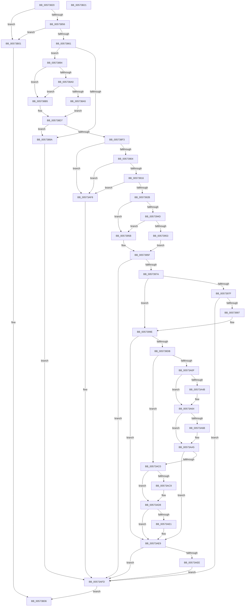

# HsaAllocateRemappingTableEntry

- RVA: `0x00573820`–`0x00573B22` (길이 `770` bytes)
- VA: `0x0000000140573820`
- 실행 섹션: `.text`
- PDB 이름 있음: `예`; PDB Function 태그: `아니요`
- unwind 정보 RVA: `0x000BC564`
- 디코드: `206`개 명령, `770/770` bytes 표시
- 미해석 바이트: `0` (있으면 어셈블리에 `.byte`로 보존)

> 이 문서는 커널 이미지의 기계어와 PDB 기호를 분석해 생성했습니다. 4번과 5번은 함수 원형과 자료형을 바이너리 사용 방식에서 추정한 C 해석이며 원본 소스 복구 결과는 아닙니다.

## 1. Dependencies

- 직접 호출 지점: **15**; 고유 호출 대상: **10**
- 직접 호출자로 확인된 함수: **0**
- RIP 상대 이미지 참조: **6**

### Outgoing calls
- `0x00573932` → [HalpAcquireHighLevelLock](../2D/HalpAcquireHighLevelLock_function_002D2390.md) (function, `0x002D2390`)
- `0x00573940` → [HsaGetDeviceAperture](HsaGetDeviceAperture_function_00574288.md) (function, `0x00574288`)
- `0x0057396C` → [HalpReleaseHighLevelLock](../2D/HalpReleaseHighLevelLock_function_002D1C58.md) (function, `0x002D1C58`)
- `0x00573988` → [ExtEnvAllocateMemory](../56/ExtEnvAllocateMemory_function_005610B0.md) (function, `0x005610B0`)
- `0x005739CC` → [ExtEnvAllocatePhysicalMemory](../56/ExtEnvAllocatePhysicalMemory_function_00561124.md) (function, `0x00561124`)
- `0x005739E5` → [memset](../6C/memset_function_006C6C40.md) (function, `0x006C6C40`)
- `0x00573A00` → [ExtEnvAllocateMemory](../56/ExtEnvAllocateMemory_function_005610B0.md) (function, `0x005610B0`)
- `0x00573A26` → [RtlClearBits](../3E/RtlClearBits_function_003E1A90.md) (function, `0x003E1A90`)
- `0x00573A32` → [HalpAcquireHighLevelLock](../2D/HalpAcquireHighLevelLock_function_002D2390.md) (function, `0x002D2390`)
- `0x00573A52` → [HsaGetDeviceAperture](HsaGetDeviceAperture_function_00574288.md) (function, `0x00574288`)
- `0x00573A9C` → [HsaUpdateRemappingTableInDeviceTableEntry](HsaUpdateRemappingTableInDeviceTableEntry_function_005751DC.md) (function, `0x005751DC`)
- `0x00573AB5` → [HalpReleaseHighLevelLock](../2D/HalpReleaseHighLevelLock_function_002D1C58.md) (function, `0x002D1C58`)
- `0x00573AD3` → [ExtEnvFreePhysicalMemory](../56/ExtEnvFreePhysicalMemory_function_00561360.md) (function, `0x00561360`)
- `0x00573AE4` → [ExtEnvFreeMemory](../56/ExtEnvFreeMemory_function_00561320.md) (function, `0x00561320`)
- `0x00573AF1` → [ExtEnvFreeMemory](../56/ExtEnvFreeMemory_function_00561320.md) (function, `0x00561320`)

### Direct callers
- 이 함수 시작 RVA로 연결되는 직접 call은 확인되지 않았습니다. 간접 호출은 완전히 역산할 수 없습니다.

### Static image references
- `0x0057390A` → RVA `0x00F8F688` (`.data`; read)
- `0x0057392B` → RVA `0x00F8F630` (`.data`; read)
- `0x0057393A` → RVA `0x00F8F638` (`.data`; write)
- `0x0057395F` → RVA `0x00F8F638` (`.data`; read)
- `0x00573A37` → RVA `0x00F8F6A0` (`.data`; read)
- `0x00573A57` → RVA `0x00F8F644` (`.data`; read/write)

## 2. Other-region calls and transfers

- 다른 실행 섹션으로 향하는 call: **0**
- 별도 외부 분기/꼬리 이동을 확인하지 못했습니다.

## 3. Assembly (complete function range)

```asm
00573820  48 89 5C 24 10                  mov qword ptr [rsp + 0x10], rbx
00573825  48 89 4C 24 08                  mov qword ptr [rsp + 8], rcx
0057382A  55                              push rbp
0057382B  56                              push rsi
0057382C  57                              push rdi
0057382D  41 54                           push r12
0057382F  41 55                           push r13
00573831  41 56                           push r14
00573833  41 57                           push r15
00573835  48 8B EC                        mov rbp, rsp
00573838  48 81 EC 80 00 00 00            sub rsp, 0x80
0057383F  41 8B F0                        mov esi, r8d
00573842  44 8B FA                        mov r15d, edx
00573845  33 D2                           xor edx, edx
00573847  4C 8B C1                        mov r8, rcx
0057384A  48 89 55 B8                     mov qword ptr [rbp - 0x48], rdx
0057384E  85 F6                           test esi, esi
00573850  0F 84 AB 02 00 00               je 0x140573b01
00573856  8D 46 FF                        lea eax, [rsi - 1]
00573859  85 C6                           test esi, eax
0057385B  0F 85 A0 02 00 00               jne 0x140573b01
00573861  0F 57 C0                        xorps xmm0, xmm0
00573864  44 8B EA                        mov r13d, edx
00573867  44 8A F2                        mov r14b, dl
0057386A  48 89 55 C8                     mov qword ptr [rbp - 0x38], rdx
0057386E  8B DA                           mov ebx, edx
00573870  48 89 55 C0                     mov qword ptr [rbp - 0x40], rdx
00573874  F3 0F 7F 45 E8                  movdqu xmmword ptr [rbp - 0x18], xmm0
00573879  48 89 55 D0                     mov qword ptr [rbp - 0x30], rdx
0057387D  48 89 55 D8                     mov qword ptr [rbp - 0x28], rdx
00573881  44 39 89 A0 00 00 00            cmp dword ptr [rcx + 0xa0], r9d
00573888  74 0A                           je 0x140573894
0057388A  BB E6 00 00 C0                  mov ebx, 0xc00000e6
0057388F  E9 69 02 00 00                  jmp 0x140573afd
00573894  48 8B 85 80 00 00 00            mov rax, qword ptr [rbp + 0x80]
0057389B  48 85 C0                        test rax, rax
0057389E  74 15                           je 0x1405738b5
005738A0  83 38 01                        cmp dword ptr [rax], 1
005738A3  75 10                           jne 0x1405738b5
005738A5  0F B7 48 0C                     movzx ecx, word ptr [rax + 0xc]
005738A9  0F B7 40 0A                     movzx eax, word ptr [rax + 0xa]
005738AD  83 E0 03                        and eax, 3
005738B0  89 45 BC                        mov dword ptr [rbp - 0x44], eax
005738B3  EB 22                           jmp 0x1405738d7
005738B5  0F B7 45 60                     movzx eax, word ptr [rbp + 0x60]
005738B9  0F B6 C8                        movzx ecx, al
005738BC  0F B6 45 68                     movzx eax, byte ptr [rbp + 0x68]
005738C0  83 E0 1F                        and eax, 0x1f
005738C3  C1 E1 05                        shl ecx, 5
005738C6  0B C8                           or ecx, eax
005738C8  89 55 BC                        mov dword ptr [rbp - 0x44], edx
005738CB  0F B6 45 70                     movzx eax, byte ptr [rbp + 0x70]
005738CF  83 E0 07                        and eax, 7
005738D2  C1 E1 03                        shl ecx, 3
005738D5  0B C8                           or ecx, eax
005738D7  49 8B 80 C0 00 00 00            mov rax, qword ptr [r8 + 0xc0]
005738DE  8B D1                           mov edx, ecx
005738E0  48 C1 EA 03                     shr rdx, 3
005738E4  89 4D B8                        mov dword ptr [rbp - 0x48], ecx
005738E7  80 E1 07                        and cl, 7
005738EA  8A 04 02                        mov al, byte ptr [rdx + rax]
005738ED  D2 F8                           sar al, cl
005738EF  A8 01                           test al, 1
005738F1  74 97                           je 0x14057388a
005738F3  45 8B E7                        mov r12d, r15d
005738F6  41 C1 EC 10                     shr r12d, 0x10
005738FA  41 83 FC 20                     cmp r12d, 0x20
005738FE  0F 83 F4 01 00 00               jae 0x140573af8
00573904  41 8B C7                        mov eax, r15d
00573907  C1 E8 09                        shr eax, 9
0057390A  3B 05 78 BD A1 00               cmp eax, dword ptr [rip + 0xa1bd78]
00573910  0F 83 E2 01 00 00               jae 0x140573af8
00573916  41 8B C7                        mov eax, r15d
00573919  25 FF 01 00 00                  and eax, 0x1ff
0057391E  03 C6                           add eax, esi
00573920  3D 00 02 00 00                  cmp eax, 0x200
00573925  0F 87 CD 01 00 00               ja 0x140573af8
0057392B  48 8D 0D FE BC A1 00            lea rcx, [rip + 0xa1bcfe]
00573932  E8 59 EA D5 FF                  call 0x1402d2390
00573937  41 8B CF                        mov ecx, r15d
0057393A  88 05 F8 BC A1 00               mov byte ptr [rip + 0xa1bcf8], al
00573940  E8 43 09 00 00                  call 0x140574288
00573945  48 8B F8                        mov rdi, rax
00573948  48 85 C0                        test rax, rax
0057394B  74 0E                           je 0x14057395b
0057394D  48 39 58 10                     cmp qword ptr [rax + 0x10], rbx
00573951  74 08                           je 0x14057395b
00573953  01 70 30                        add dword ptr [rax + 0x30], esi
00573956  88 5D 50                        mov byte ptr [rbp + 0x50], bl
00573959  EB 04                           jmp 0x14057395f
0057395B  C6 45 50 01                     mov byte ptr [rbp + 0x50], 1
0057395F  8A 15 D3 BC A1 00               mov dl, byte ptr [rip + 0xa1bcd3]
00573965  48 8D 0D C4 BC A1 00            lea rcx, [rip + 0xa1bcc4]
0057396C  E8 E7 E2 D5 FF                  call 0x1402d1c58
00573971  38 5D 50                        cmp byte ptr [rbp + 0x50], bl
00573974  0F 84 83 01 00 00               je 0x140573afd
0057397A  48 85 FF                        test rdi, rdi
0057397D  75 1F                           jne 0x14057399e
0057397F  4C 8D 45 C8                     lea r8, [rbp - 0x38]
00573983  BA 00 20 00 00                  mov edx, 0x2000
00573988  E8 23 D7 FE FF                  call 0x1405610b0
0057398D  8B D8                           mov ebx, eax
0057398F  85 C0                           test eax, eax
00573991  0F 88 66 01 00 00               js 0x140573afd
00573997  4C 8B 6D C8                     mov r13, qword ptr [rbp - 0x38]
0057399B  41 B6 01                        mov r14b, 1
0057399E  48 8D 45 D8                     lea rax, [rbp - 0x28]
005739A2  C7 45 E4 00 02 00 00            mov dword ptr [rbp - 0x1c], 0x200
005739A9  48 89 44 24 28                  mov qword ptr [rsp + 0x28], rax
005739AE  41 B9 01 00 00 00               mov r9d, 1
005739B4  48 8D 45 D0                     lea rax, [rbp - 0x30]
005739B8  C7 45 E0 00 20 00 00            mov dword ptr [rbp - 0x20], 0x2000
005739BF  45 33 C0                        xor r8d, r8d
005739C2  48 89 44 24 20                  mov qword ptr [rsp + 0x20], rax
005739C7  BA 00 20 00 00                  mov edx, 0x2000
005739CC  E8 53 D7 FE FF                  call 0x140561124
005739D1  8B D8                           mov ebx, eax
005739D3  85 C0                           test eax, eax
005739D5  0F 88 0E 01 00 00               js 0x140573ae9
005739DB  44 8B 45 E0                     mov r8d, dword ptr [rbp - 0x20]
005739DF  33 D2                           xor edx, edx
005739E1  48 8B 4D D8                     mov rcx, qword ptr [rbp - 0x28]
005739E5  E8 56 32 15 00                  call 0x1406c6c40
005739EA  8B 55 E4                        mov edx, dword ptr [rbp - 0x1c]
005739ED  4C 8D 45 C0                     lea r8, [rbp - 0x40]
005739F1  48 83 C2 1F                     add rdx, 0x1f
005739F5  C6 45 50 01                     mov byte ptr [rbp + 0x50], 1
005739F9  48 C1 EA 05                     shr rdx, 5
005739FD  C1 E2 02                        shl edx, 2
00573A00  E8 AB D6 FE FF                  call 0x1405610b0
00573A05  8B D8                           mov ebx, eax
00573A07  85 C0                           test eax, eax
00573A09  0F 88 B1 00 00 00               js 0x140573ac0
00573A0F  8B 4D E4                        mov ecx, dword ptr [rbp - 0x1c]
00573A12  33 D2                           xor edx, edx
00573A14  48 8B 45 C0                     mov rax, qword ptr [rbp - 0x40]
00573A18  44 8B C1                        mov r8d, ecx
00573A1B  89 4D E8                        mov dword ptr [rbp - 0x18], ecx
00573A1E  48 8D 4D E8                     lea rcx, [rbp - 0x18]
00573A22  48 89 45 F0                     mov qword ptr [rbp - 0x10], rax
00573A26  E8 65 E0 E6 FF                  call 0x1403e1a90
00573A2B  48 8D 0D FE BB A1 00            lea rcx, [rip + 0xa1bbfe]
00573A32  E8 59 E9 D5 FF                  call 0x1402d2390
00573A37  48 8D 0D 62 BC A1 00            lea rcx, [rip + 0xa1bc62]
00573A3E  88 05 F4 BB A1 00               mov byte ptr [rip + 0xa1bbf4], al
00573A44  4A 83 3C E1 00                  cmp qword ptr [rcx + r12*8], 0
00573A49  75 19                           jne 0x140573a64
00573A4B  4E 89 2C E1                     mov qword ptr [rcx + r12*8], r13
00573A4F  41 8B CF                        mov ecx, r15d
00573A52  E8 31 08 00 00                  call 0x140574288
00573A57  83 2D E6 BB A1 00 80            sub dword ptr [rip + 0xa1bbe6], -0x80
00573A5E  48 8B F8                        mov rdi, rax
00573A61  45 32 F6                        xor r14b, r14b
00573A64  48 83 7F 10 00                  cmp qword ptr [rdi + 0x10], 0
00573A69  75 3A                           jne 0x140573aa5
00573A6B  0F 10 45 D0                     movups xmm0, xmmword ptr [rbp - 0x30]
00573A6F  48 8B 4D 40                     mov rcx, qword ptr [rbp + 0x40]
00573A73  4C 8D 45 D0                     lea r8, [rbp - 0x30]
00573A77  0F 10 4D E0                     movups xmm1, xmmword ptr [rbp - 0x20]
00573A7B  48 8B 45 B8                     mov rax, qword ptr [rbp - 0x48]
00573A7F  48 8D 55 B8                     lea rdx, [rbp - 0x48]
00573A83  0F 11 47 08                     movups xmmword ptr [rdi + 8], xmm0
00573A87  F2 0F 10 45 F0                  movsd xmm0, qword ptr [rbp - 0x10]
00573A8C  0F 11 4F 18                     movups xmmword ptr [rdi + 0x18], xmm1
00573A90  F2 0F 11 47 28                  movsd qword ptr [rdi + 0x28], xmm0
00573A95  48 89 0F                        mov qword ptr [rdi], rcx
00573A98  48 89 47 34                     mov qword ptr [rdi + 0x34], rax
00573A9C  E8 3B 17 00 00                  call 0x1405751dc
00573AA1  C6 45 50 00                     mov byte ptr [rbp + 0x50], 0
00573AA5  01 77 30                        add dword ptr [rdi + 0x30], esi
00573AA8  48 8D 0D 81 BB A1 00            lea rcx, [rip + 0xa1bb81]
00573AAF  8A 15 83 BB A1 00               mov dl, byte ptr [rip + 0xa1bb83]
00573AB5  E8 9E E1 D5 FF                  call 0x1402d1c58
00573ABA  80 7D 50 00                     cmp byte ptr [rbp + 0x50], 0
00573ABE  74 29                           je 0x140573ae9
00573AC0  48 8B 55 D8                     mov rdx, qword ptr [rbp - 0x28]
00573AC4  48 85 D2                        test rdx, rdx
00573AC7  74 0F                           je 0x140573ad8
00573AC9  44 8B 45 E0                     mov r8d, dword ptr [rbp - 0x20]
00573ACD  41 B9 01 00 00 00               mov r9d, 1
00573AD3  E8 88 D8 FE FF                  call 0x140561360
00573AD8  48 8B 45 C0                     mov rax, qword ptr [rbp - 0x40]
00573ADC  48 85 C0                        test rax, rax
00573ADF  74 08                           je 0x140573ae9
00573AE1  48 8B D0                        mov rdx, rax
00573AE4  E8 37 D8 FE FF                  call 0x140561320
00573AE9  45 84 F6                        test r14b, r14b
00573AEC  74 0F                           je 0x140573afd
00573AEE  49 8B D5                        mov rdx, r13
00573AF1  E8 2A D8 FE FF                  call 0x140561320
00573AF6  EB 05                           jmp 0x140573afd
00573AF8  BB 0D 00 00 C0                  mov ebx, 0xc000000d
00573AFD  8B C3                           mov eax, ebx
00573AFF  EB 05                           jmp 0x140573b06
00573B01  B8 0D 00 00 C0                  mov eax, 0xc000000d
00573B06  48 8B 9C 24 C8 00 00 00         mov rbx, qword ptr [rsp + 0xc8]
00573B0E  48 81 C4 80 00 00 00            add rsp, 0x80
00573B15  41 5F                           pop r15
00573B17  41 5E                           pop r14
00573B19  41 5D                           pop r13
00573B1B  41 5C                           pop r12
00573B1D  5F                              pop rdi
00573B1E  5E                              pop rsi
00573B1F  5D                              pop rbp
00573B20  C3                              ret
00573B21  CC                              int3
```

## 4. C-style interpretation (structured pseudocode)

```c
__int64 __fastcall HsaAllocateRemappingTableEntry(__int64 a1, int a2, int a3, int a4, unsigned __int16 a5, unsigned __int8 a6, unsigned __int8 a7, __int64 a8, __int64 a9)
{
    __int64 result;
    __int64 v_r12;
    __int64 v_r14;
    __int64 v_rdi;
    __int64 v_rsp;
    unsigned __int64 v_stack_m48;
    unsigned __int64 v_stack_m50;
    unsigned int v_stack_m54;
    unsigned int v_stack_m58;
    unsigned __int64 v_stack_m60;
    unsigned __int64 v_stack_m68;
    unsigned __int64 v_stack_m70;
    unsigned __int64 v_stack_m78;
    unsigned int v_stack_m7C;
    unsigned __int64 v_stack_m80;
    unsigned __int64 v_stack_m90;
    unsigned __int64 v_stack_m98;
    unsigned __int64 v_stack_p10;
    unsigned __int8 v_stack_p18;
    unsigned __int64 v_stack_p8;

    v_stack_p10 = v_rbx;
    v_stack_p8 = a1;
    v_rsp = (v_rsp) - (128);
    a2 = 0;
    v_stack_m80 = 0;
    if ((unsigned int)((unsigned int)(a3)) == 0) goto loc_00573B01;
    if ((((unsigned int)((unsigned int)(a3))) & ((unsigned int)((unsigned int)(a3) - 1))) != 0) goto loc_00573B01;
    v_stack_m70 = 0;
    v_stack_m78 = 0;
    v_stack_m50 = v_xmm0;
    v_stack_m68 = 0;
    v_stack_m60 = 0;
    if ((*(unsigned int *)(a1 + 160)) == a4) goto loc_00573894;
loc_0057388A:
    goto loc_00573AFD;
loc_00573894:
    if (a9 == 0) goto loc_005738B5;
    if ((*(unsigned int *)(a9)) != 1) goto loc_005738B5;
    result = (unsigned int)((*(unsigned __int16 *)(a9 + 10)) & (3));
    v_stack_m7C = (unsigned int)(result);
    goto loc_005738D7;
loc_005738B5:
    result = (unsigned int)((a6) & (31));
    a1 = (unsigned int)(((unsigned __int8)(a5)) << (5));
    a1 = (unsigned int)((a1) | ((unsigned int)(result)));
    v_stack_m7C = 0;
    result = (unsigned int)((a7) & (7));
    a1 = (unsigned int)((a1) << (3));
    a1 = (unsigned int)((a1) | ((unsigned int)(result)));
loc_005738D7:
    a2 = ((unsigned int)((unsigned int)(a1))) >> (3);
    v_stack_m80 = (unsigned int)(a1);
    a1 = (unsigned __int8)((a1) & (7));
    result = (unsigned __int8)((*(unsigned __int8 *)(a2 + *(unsigned __int64 *)(a1 + 192) * 1)) >> ((unsigned __int8)(a1)));
    if ((((unsigned __int8)(result)) & (1)) == 0) goto loc_0057388A;
    v_r12 = (unsigned int)(((unsigned int)((unsigned int)((unsigned int)(a2)))) >> (16));
    if (((unsigned int)(v_r12)) >= 32) goto loc_00573AF8;
    result = (unsigned int)(((unsigned int)((unsigned int)((unsigned int)(a2)))) >> (9));
    if (((unsigned int)(result)) >= (*(unsigned int *)(v_rip + 10599800))) goto loc_00573AF8;
    result = (unsigned int)(((unsigned int)((unsigned int)((unsigned int)(a2)))) & (511));
    result = (unsigned int)((result) + ((unsigned int)((unsigned int)(a3))));
    if (((unsigned int)(result)) > 512) goto loc_00573AF8;
    result = HalpAcquireHighLevelLock(v_rip + 10599678, a2, a1, a4);
    *(unsigned __int8 *)(v_rip + 10599672) = (unsigned __int8)(result);
    result = HsaGetDeviceAperture((unsigned int)((unsigned int)((unsigned int)(a2))), a2, a1, a4);
    if (result == 0) goto loc_0057395B;
    if ((*(unsigned __int64 *)(result + 16)) == ((unsigned int)(0xC00000E6ULL))) goto loc_0057395B;
    v_stack_p18 = (unsigned __int8)((unsigned int)(0xC00000E6ULL));
    goto loc_0057395F;
loc_0057395B:
    v_stack_p18 = 1;
loc_0057395F:
    result = HalpReleaseHighLevelLock(v_rip + 10599620, *(unsigned __int8 *)(v_rip + 10599635), a1, a4);
    if (v_stack_p18 == ((unsigned __int8)((unsigned int)(0xC00000E6ULL)))) goto loc_00573AFD;
    if (result != 0) goto loc_0057399E;
    result = ExtEnvAllocateMemory(v_rip + 10599620, (unsigned int)(0x2000ULL), v_stack_m70, a4);
    if (sign_flag) goto loc_00573AFD;
loc_0057399E:
    v_stack_m54 = 512;
    v_stack_m90 = v_stack_m60;
    v_stack_m58 = 0x2000ULL;
    a3 = 0;
    v_stack_m98 = v_stack_m68;
    result = ExtEnvAllocatePhysicalMemory(v_rip + 10599620, (unsigned int)(0x2000ULL), a3, 1);
    if (sign_flag) goto loc_00573AE9;
    a2 = 0;
    result = memset(v_stack_m60, a2, (unsigned int)(v_stack_m58), 1);
    a2 = ((unsigned int)(v_stack_m54)) + (31);
    v_stack_p18 = 1;
    a2 = (a2) >> (5);
    a2 = (unsigned int)((a2) << (2));
    result = ExtEnvAllocateMemory(v_stack_m60, a2, v_stack_m78, 1);
    if (sign_flag) goto loc_00573AC0;
    a2 = 0;
    v_stack_m50 = (unsigned int)((unsigned int)(v_stack_m54));
    v_stack_m48 = v_stack_m78;
    result = RtlClearBits(v_stack_m50, a2, (unsigned int)((unsigned int)((unsigned int)(v_stack_m54))), 1);
    result = HalpAcquireHighLevelLock(v_rip + 10599422, a2, (unsigned int)((unsigned int)((unsigned int)(v_stack_m54))), 1);
    *(unsigned __int8 *)(v_rip + 10599412) = (unsigned __int8)(result);
    v_rdi = result;
    v_r14 = 1;
    if ((*(unsigned __int64 *)(v_rip + 10599522 + v_r12 * 8)) == 0) {
        *(unsigned __int64 *)(v_rip + 10599522 + v_r12 * 8) = v_stack_m70;
        a1 = (unsigned int)((unsigned int)(a2));
        result = HsaGetDeviceAperture(a1, a2, (unsigned int)((unsigned int)((unsigned int)(v_stack_m54))), 1);
        v_rdi = result;
        v_r14 = 0;
    }
    if ((*(unsigned __int64 *)(v_rdi + 16)) == 0) {
        a1 = v_stack_p8;
        a3 = v_stack_m68;
        result = v_stack_m80;
        a2 = v_stack_m80;
        *(unsigned __int64 *)(v_rdi + 8) = v_xmm0;
        *(unsigned __int64 *)(v_rdi + 24) = v_xmm1;
        *(unsigned __int64 *)(v_rdi + 40) = v_xmm0;
        *(unsigned __int64 *)(v_rdi) = a1;
        *(unsigned __int64 *)(v_rdi + 52) = result;
        result = HsaUpdateRemappingTableInDeviceTableEntry(a1, a2, a3, 1);
        v_stack_p18 = 0;
    }
    result = HalpReleaseHighLevelLock(v_rip + 10599297, *(unsigned __int8 *)(v_rip + 10599299), a3, 1);
    if (v_stack_p18 == 0) goto loc_00573AE9;
loc_00573AC0:
    if (v_stack_m60 != 0) {
        a3 = v_stack_m58;
        a4 = 1;
        result = ExtEnvFreePhysicalMemory(v_rip + 10599297, v_stack_m60, a3, a4);
    }
    result = v_stack_m78;
    if (v_stack_m78 != 0) {
        a2 = v_stack_m78;
        result = ExtEnvFreeMemory(v_rip + 10599297, a2, a3, a4);
    }
    if (0 == 0) goto loc_00573AFD;
    result = ExtEnvFreeMemory(v_rip + 10599297, v_stack_m70, a3, a4);
    goto loc_00573AFD;
loc_00573AF8:
loc_00573AFD:
    goto loc_00573B06;
loc_00573B01:
loc_00573B06:
    v_rsp = (v_rsp) + (128);
    return (unsigned int)(0xC000000DULL);
}
```

## 5. (Beta) C Style

```c
int64_t HsaAllocateRemappingTableEntry(void *Arg1, int32_t Arg2, int32_t Arg3, int32_t Arg4, uint16_t Arg5, uint8_t Arg6, uint8_t Arg7, uint64_t Arg8, int64_t Arg9)
{
    uint8_t *arg1 = (uint8_t *)Arg1;

    int64_t result;
    int64_t local_r12;
    int64_t local_r14;
    int64_t local_rdi;
    int64_t local_rsp;
    uint64_t v_stack_m48;
    uint64_t v_stack_m50;
    uint32_t v_stack_m54;
    uint32_t v_stack_m58;
    uint64_t v_stack_m60;
    uint64_t v_stack_m68;
    uint64_t v_stack_m70;
    uint64_t v_stack_m78;
    uint32_t v_stack_m7C;
    uint64_t v_stack_m80;
    uint64_t v_stack_m90;
    uint64_t v_stack_m98;
    uint64_t v_stack_p10;
    uint8_t v_stack_p18;
    uint64_t v_stack_p8;

    v_stack_p10 = local_rbx;
    v_stack_p8 = Arg1;
    local_rsp = (local_rsp) - (128);
    Arg2 = 0;
    v_stack_m80 = 0;
    if ((uint32_t)((uint32_t)(Arg3)) == 0) goto loc_00573B01;
    if ((((uint32_t)((uint32_t)(Arg3))) & ((uint32_t)((uint32_t)(Arg3) - 1))) != 0) goto loc_00573B01;
    v_stack_m70 = 0;
    v_stack_m78 = 0;
    v_stack_m50 = v_xmm0;
    v_stack_m68 = 0;
    v_stack_m60 = 0;
    if ((*(uint32_t *)(arg1 + 0xA0)) == Arg4) goto loc_00573894;
loc_0057388A:
    goto loc_00573AFD;
loc_00573894:
    if (Arg9 == 0) goto loc_005738B5;
    if ((*(uint32_t *)(Arg9)) != 1) goto loc_005738B5;
    result = (uint32_t)((*(uint16_t *)(Arg9 + 0xA)) & (3));
    v_stack_m7C = (uint32_t)(result);
    goto loc_005738D7;
loc_005738B5:
    result = (uint32_t)((Arg6) & (31));
    Arg1 = (uint32_t)(((uint8_t)(Arg5)) << (5));
    Arg1 = (uint32_t)((Arg1) | ((uint32_t)(result)));
    v_stack_m7C = 0;
    result = (uint32_t)((Arg7) & (7));
    Arg1 = (uint32_t)((Arg1) << (3));
    Arg1 = (uint32_t)((Arg1) | ((uint32_t)(result)));
loc_005738D7:
    Arg2 = ((uint32_t)((uint32_t)(Arg1))) >> (3);
    v_stack_m80 = (uint32_t)(Arg1);
    Arg1 = (uint8_t)((Arg1) & (7));
    result = (uint8_t)((*(uint8_t *)(Arg2 + *(uint64_t *)(arg1 + 0xC0) * 1)) >> ((uint8_t)(Arg1)));
    if ((((uint8_t)(result)) & (1)) == 0) goto loc_0057388A;
    local_r12 = (uint32_t)(((uint32_t)((uint32_t)((uint32_t)(Arg2)))) >> (16));
    if (((uint32_t)(local_r12)) >= 32) goto loc_00573AF8;
    result = (uint32_t)(((uint32_t)((uint32_t)((uint32_t)(Arg2)))) >> (9));
    if (((uint32_t)(result)) >= (*(uint32_t *)(v_rip + 0xA1BD78))) goto loc_00573AF8;
    result = (uint32_t)(((uint32_t)((uint32_t)((uint32_t)(Arg2)))) & (511));
    result = (uint32_t)((result) + ((uint32_t)((uint32_t)(Arg3))));
    if (((uint32_t)(result)) > 512) goto loc_00573AF8;
    result = HalpAcquireHighLevelLock(v_rip + 10599678, Arg2, Arg1, Arg4);
    *(uint8_t *)(v_rip + 0xA1BCF8) = (uint8_t)(result);
    result = HsaGetDeviceAperture((uint32_t)((uint32_t)((uint32_t)(Arg2))), Arg2, Arg1, Arg4);
    if (result == 0) goto loc_0057395B;
    if ((*(uint64_t *)(result + 0x10)) == ((uint32_t)(0xC00000E6ULL))) goto loc_0057395B;
    v_stack_p18 = (uint8_t)((uint32_t)(0xC00000E6ULL));
    goto loc_0057395F;
loc_0057395B:
    v_stack_p18 = 1;
loc_0057395F:
    result = HalpReleaseHighLevelLock(v_rip + 10599620, *(uint8_t *)(v_rip + 0xA1BCD3), Arg1, Arg4);
    if (v_stack_p18 == ((uint8_t)((uint32_t)(0xC00000E6ULL)))) goto loc_00573AFD;
    if (result != 0) goto loc_0057399E;
    result = ExtEnvAllocateMemory(v_rip + 10599620, (uint32_t)(0x2000ULL), v_stack_m70, Arg4);
    if (sign_flag) goto loc_00573AFD;
loc_0057399E:
    v_stack_m54 = 512;
    v_stack_m90 = v_stack_m60;
    v_stack_m58 = 0x2000ULL;
    Arg3 = 0;
    v_stack_m98 = v_stack_m68;
    result = ExtEnvAllocatePhysicalMemory(v_rip + 10599620, (uint32_t)(0x2000ULL), Arg3, 1);
    if (sign_flag) goto loc_00573AE9;
    Arg2 = 0;
    result = memset(v_stack_m60, Arg2, (uint32_t)(v_stack_m58), 1);
    Arg2 = ((uint32_t)(v_stack_m54)) + (31);
    v_stack_p18 = 1;
    Arg2 = (Arg2) >> (5);
    Arg2 = (uint32_t)((Arg2) << (2));
    result = ExtEnvAllocateMemory(v_stack_m60, Arg2, v_stack_m78, 1);
    if (sign_flag) goto loc_00573AC0;
    Arg2 = 0;
    v_stack_m50 = (uint32_t)((uint32_t)(v_stack_m54));
    v_stack_m48 = v_stack_m78;
    result = RtlClearBits(v_stack_m50, Arg2, (uint32_t)((uint32_t)((uint32_t)(v_stack_m54))), 1);
    result = HalpAcquireHighLevelLock(v_rip + 10599422, Arg2, (uint32_t)((uint32_t)((uint32_t)(v_stack_m54))), 1);
    *(uint8_t *)(v_rip + 0xA1BBF4) = (uint8_t)(result);
    local_rdi = result;
    local_r14 = 1;
    if ((*(uint64_t *)(v_rip + 0xA1BC62 + local_r12 * 8)) == 0) {
        *(uint64_t *)(v_rip + 0xA1BC62 + local_r12 * 8) = v_stack_m70;
        Arg1 = (uint32_t)((uint32_t)(Arg2));
        result = HsaGetDeviceAperture(Arg1, Arg2, (uint32_t)((uint32_t)((uint32_t)(v_stack_m54))), 1);
        local_rdi = result;
        local_r14 = 0;
    }
    if ((*(uint64_t *)(local_rdi + 0x10)) == 0) {
        Arg1 = v_stack_p8;
        Arg3 = v_stack_m68;
        result = v_stack_m80;
        Arg2 = v_stack_m80;
        *(uint64_t *)(local_rdi + 0x8) = v_xmm0;
        *(uint64_t *)(local_rdi + 0x18) = v_xmm1;
        *(uint64_t *)(local_rdi + 0x28) = v_xmm0;
        *(void **)(local_rdi) = Arg1;
        *(uint64_t *)(local_rdi + 0x34) = result;
        result = HsaUpdateRemappingTableInDeviceTableEntry(Arg1, Arg2, Arg3, 1);
        v_stack_p18 = 0;
    }
    result = HalpReleaseHighLevelLock(v_rip + 10599297, *(uint8_t *)(v_rip + 0xA1BB83), Arg3, 1);
    if (v_stack_p18 == 0) goto loc_00573AE9;
loc_00573AC0:
    if (v_stack_m60 != 0) {
        Arg3 = v_stack_m58;
        Arg4 = 1;
        result = ExtEnvFreePhysicalMemory(v_rip + 10599297, v_stack_m60, Arg3, Arg4);
    }
    result = v_stack_m78;
    if (v_stack_m78 != 0) {
        Arg2 = v_stack_m78;
        result = ExtEnvFreeMemory(v_rip + 10599297, Arg2, Arg3, Arg4);
    }
    if (0 == 0) goto loc_00573AFD;
    result = ExtEnvFreeMemory(v_rip + 10599297, v_stack_m70, Arg3, Arg4);
    goto loc_00573AFD;
loc_00573AF8:
loc_00573AFD:
    goto loc_00573B06;
loc_00573B01:
loc_00573B06:
    local_rsp = (local_rsp) + (128);
    return (uint32_t)(0xC000000DULL);
}
```

### 관측된 메모리 오프셋

구조체 형식이 확인되지 않은 접근은 인자 기준의 오프셋으로만 기록했습니다.

| 기준 인자 | 오프셋 표현 | 폭 (bit) | 접근 |
|---|---:|---:|---|
| `Arg1` | `+ 0xA0` | `32` | `R` |
| `Arg1` | `+ 0xC0` | `64` | `R` |

## 6. Execution-region graph

[열기: 2D/3D 그래프와 함수 탐색 컨트롤 패널](../../../control-panel.html?section=text&rva=0x00573820&view=graph)

- 2D 그래프는 위에서 아래로 흐르고, 3D 그래프는 빈 공간을 드래그해 회전합니다. Shift+드래그는 이동, 휠은 확대·축소, 함수 노드 선택은 대상 보고서 이동입니다.

### Static fallback


