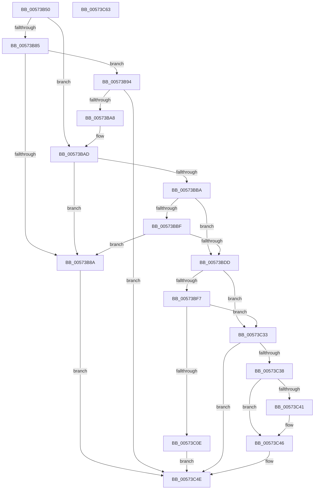

# HsaCreateDevice

- RVA: `0x00573B50`–`0x00573C64` (길이 `276` bytes)
- VA: `0x0000000140573B50`
- 실행 섹션: `.text`
- PDB 이름 있음: `예`; PDB Function 태그: `아니요`
- unwind 정보 RVA: `0x00099F28`
- 디코드: `84`개 명령, `276/276` bytes 표시
- 미해석 바이트: `0` (있으면 어셈블리에 `.byte`로 보존)

> 이 문서는 커널 이미지의 기계어와 PDB 기호를 분석해 생성했습니다. 4번과 5번은 함수 원형과 자료형을 바이너리 사용 방식에서 추정한 C 해석이며 원본 소스 복구 결과는 아닙니다.

## 1. Dependencies

- 직접 호출 지점: **5**; 고유 호출 대상: **3**
- 직접 호출자로 확인된 함수: **0**
- RIP 상대 이미지 참조: **0**

### Outgoing calls
- `0x00573B99` → [HsaQueryAcpiDeviceMapping](HsaQueryAcpiDeviceMapping_function_00574AA0.md) (function, `0x00574AA0`)
- `0x00573BE7` → [ExtEnvAllocateMemory](../56/ExtEnvAllocateMemory_function_005610B0.md) (function, `0x005610B0`)
- `0x00573C03` → [ExtEnvAllocateMemory](../56/ExtEnvAllocateMemory_function_005610B0.md) (function, `0x005610B0`)
- `0x00573C41` → [ExtEnvFreeMemory](../56/ExtEnvFreeMemory_function_00561320.md) (function, `0x00561320`)
- `0x00573C49` → [ExtEnvFreeMemory](../56/ExtEnvFreeMemory_function_00561320.md) (function, `0x00561320`)

### Direct callers
- 이 함수 시작 RVA로 연결되는 직접 call은 확인되지 않았습니다. 간접 호출은 완전히 역산할 수 없습니다.

### Static image references
- 디코드된 RIP-relative 메모리 참조가 없습니다.

## 2. Other-region calls and transfers

- 다른 실행 섹션으로 향하는 call: **0**
- 별도 외부 분기/꼬리 이동을 확인하지 못했습니다.

## 3. Assembly (complete function range)

```asm
00573B50  4C 8B DC                        mov r11, rsp
00573B53  49 89 5B 10                     mov qword ptr [r11 + 0x10], rbx
00573B57  49 89 6B 18                     mov qword ptr [r11 + 0x18], rbp
00573B5B  56                              push rsi
00573B5C  57                              push rdi
00573B5D  41 56                           push r14
00573B5F  48 83 EC 40                     sub rsp, 0x40
00573B63  33 C0                           xor eax, eax
00573B65  0F 57 C0                        xorps xmm0, xmm0
00573B68  49 21 43 08                     and qword ptr [r11 + 8], rax
00573B6C  41 8B D8                        mov ebx, r8d
00573B6F  0F 11 44 24 20                  movups xmmword ptr [rsp + 0x20], xmm0
00573B74  49 89 43 D8                     mov qword ptr [r11 - 0x28], rax
00573B78  48 8B F2                        mov rsi, rdx
00573B7B  8B 02                           mov eax, dword ptr [rdx]
00573B7D  4C 8B F1                        mov r14, rcx
00573B80  83 F8 01                        cmp eax, 1
00573B83  74 28                           je 0x140573bad
00573B85  83 F8 02                        cmp eax, 2
00573B88  74 0A                           je 0x140573b94
00573B8A  BF 25 02 00 C0                  mov edi, 0xc0000225
00573B8F  E9 BA 00 00 00                  jmp 0x140573c4e
00573B94  4C 8D 44 24 20                  lea r8, [rsp + 0x20]
00573B99  E8 02 0F 00 00                  call 0x140574aa0
00573B9E  8B F8                           mov edi, eax
00573BA0  85 C0                           test eax, eax
00573BA2  0F 88 A6 00 00 00               js 0x140573c4e
00573BA8  48 8D 74 24 20                  lea rsi, [rsp + 0x20]
00573BAD  0F B7 46 08                     movzx eax, word ptr [rsi + 8]
00573BB1  41 39 86 A0 00 00 00            cmp dword ptr [r14 + 0xa0], eax
00573BB8  75 D0                           jne 0x140573b8a
00573BBA  F6 C3 08                        test bl, 8
00573BBD  75 1E                           jne 0x140573bdd
00573BBF  0F B7 4E 0C                     movzx ecx, word ptr [rsi + 0xc]
00573BC3  49 8B 86 C0 00 00 00            mov rax, qword ptr [r14 + 0xc0]
00573BCA  8B D1                           mov edx, ecx
00573BCC  48 C1 EA 03                     shr rdx, 3
00573BD0  80 E1 07                        and cl, 7
00573BD3  8A 14 02                        mov dl, byte ptr [rdx + rax]
00573BD6  D2 FA                           sar dl, cl
00573BD8  F6 C2 01                        test dl, 1
00573BDB  74 AD                           je 0x140573b8a
00573BDD  4C 8D 44 24 60                  lea r8, [rsp + 0x60]
00573BE2  BA 38 00 00 00                  mov edx, 0x38
00573BE7  E8 C4 D4 FE FF                  call 0x1405610b0
00573BEC  48 8B 5C 24 60                  mov rbx, qword ptr [rsp + 0x60]
00573BF1  8B F8                           mov edi, eax
00573BF3  85 C0                           test eax, eax
00573BF5  78 3C                           js 0x140573c33
00573BF7  4C 8D 73 28                     lea r14, [rbx + 0x28]
00573BFB  BA 08 00 00 00                  mov edx, 8
00573C00  4D 8B C6                        mov r8, r14
00573C03  E8 A8 D4 FE FF                  call 0x1405610b0
00573C08  8B F8                           mov edi, eax
00573C0A  85 C0                           test eax, eax
00573C0C  78 25                           js 0x140573c33
00573C0E  49 8B 06                        mov rax, qword ptr [r14]
00573C11  0F B7 4E 0C                     movzx ecx, word ptr [rsi + 0xc]
00573C15  89 08                           mov dword ptr [rax], ecx
00573C17  49 8B 06                        mov rax, qword ptr [r14]
00573C1A  0F B7 4E 0A                     movzx ecx, word ptr [rsi + 0xa]
00573C1E  83 E1 03                        and ecx, 3
00573C21  33 FF                           xor edi, edi
00573C23  89 48 04                        mov dword ptr [rax + 4], ecx
00573C26  48 8B 84 24 80 00 00 00         mov rax, qword ptr [rsp + 0x80]
00573C2E  48 89 18                        mov qword ptr [rax], rbx
00573C31  EB 1B                           jmp 0x140573c4e
00573C33  48 85 DB                        test rbx, rbx
00573C36  74 16                           je 0x140573c4e
00573C38  48 8B 53 28                     mov rdx, qword ptr [rbx + 0x28]
00573C3C  48 85 D2                        test rdx, rdx
00573C3F  74 05                           je 0x140573c46
00573C41  E8 DA D6 FE FF                  call 0x140561320
00573C46  48 8B D3                        mov rdx, rbx
00573C49  E8 D2 D6 FE FF                  call 0x140561320
00573C4E  48 8B 5C 24 68                  mov rbx, qword ptr [rsp + 0x68]
00573C53  8B C7                           mov eax, edi
00573C55  48 8B 6C 24 70                  mov rbp, qword ptr [rsp + 0x70]
00573C5A  48 83 C4 40                     add rsp, 0x40
00573C5E  41 5E                           pop r14
00573C60  5F                              pop rdi
00573C61  5E                              pop rsi
00573C62  C3                              ret
00573C63  CC                              int3
```

## 4. C-style interpretation (structured pseudocode)

```c
__int64 __fastcall HsaCreateDevice(__int64 a1, __int64 a2, int a3, __int64 a4, __int64 a5)
{
    __int64 result;
    __int64 v_rdi;
    __int64 v_rsp;
    unsigned __int64 v_stack_m38;
    unsigned __int64 v_stack_p10;
    unsigned __int64 v_stack_p18;
    unsigned __int64 v_stack_p8;

    *(unsigned __int64 *)(v_rsp + 16) = v_rbx;
    *(unsigned __int64 *)(v_rsp + 24) = v_rbp;
    v_rsp = (v_rsp) - (64);
    result = 0;
    v_stack_m38 = v_xmm0;
    *(unsigned __int64 *)(v_rsp - 40) = 0;
    if (((unsigned int)((unsigned int)(*(unsigned int *)(a2)))) == 1) goto loc_00573BAD;
    if (((unsigned int)((unsigned int)(*(unsigned int *)(a2)))) == 2) goto loc_00573B94;
loc_00573B8A:
    goto loc_00573C4E;
loc_00573B94:
    result = HsaQueryAcpiDeviceMapping(a1, a2, v_stack_m38, a4);
    if (sign_flag) goto loc_00573C4E;
loc_00573BAD:
    if ((*(unsigned int *)(a1 + 160)) != ((unsigned int)(*(unsigned __int16 *)(v_stack_m38 + 8)))) goto loc_00573B8A;
    if ((((unsigned __int8)((unsigned int)(a3))) & (8)) != 0) goto loc_00573BDD;
    a2 = ((unsigned int)((unsigned int)(*(unsigned __int16 *)(v_stack_m38 + 12)))) >> (3);
    a1 = (unsigned __int8)((*(unsigned __int16 *)(v_stack_m38 + 12)) & (7));
    a2 = (unsigned __int8)((*(unsigned __int8 *)(a2 + *(unsigned __int64 *)(a1 + 192) * 1)) >> ((unsigned __int8)(a1)));
    if ((((unsigned __int8)(a2)) & (1)) == 0) goto loc_00573B8A;
loc_00573BDD:
    result = ExtEnvAllocateMemory(a1, 56, v_stack_p8, a4);
    if (sign_flag) goto loc_00573C33;
    result = ExtEnvAllocateMemory(a1, 8, v_stack_p8 + 40, a4);
    if (sign_flag) goto loc_00573C33;
    *(unsigned int *)(*(unsigned __int64 *)(v_stack_p8 + 40)) = (unsigned int)(*(unsigned __int16 *)(v_stack_m38 + 12));
    a1 = (unsigned int)((*(unsigned __int16 *)(v_stack_m38 + 10)) & (3));
    v_rdi = 0;
    *(unsigned int *)(*(unsigned __int64 *)(v_stack_p8 + 40) + 4) = (unsigned int)(a1);
    *(unsigned __int64 *)(a5) = v_stack_p8;
    goto loc_00573C4E;
loc_00573C33:
    if (v_stack_p8 == 0) goto loc_00573C4E;
    result = a5;
    if (*(unsigned __int64 *)(v_stack_p8 + 40) != 0) {
        result = ExtEnvFreeMemory(a1, *(unsigned __int64 *)(v_stack_p8 + 40), v_stack_p8 + 40, a4);
    }
    result = ExtEnvFreeMemory(a1, v_stack_p8, v_stack_p8 + 40, a4);
loc_00573C4E:
    v_rsp = (v_rsp) + (64);
    return 0;
}
```

## 5. (Beta) C Style

```c
int64_t HsaCreateDevice(void *Arg1, void *Arg2, int32_t Arg3, int64_t Arg4, void *Arg5)
{
    uint8_t *arg1 = (uint8_t *)Arg1;
    uint8_t *arg2 = (uint8_t *)Arg2;
    uint8_t *arg5 = (uint8_t *)Arg5;

    int64_t result;
    int64_t local_rdi;
    int64_t local_rsp;
    uint64_t v_stack_m38;
    uint64_t v_stack_p10;
    uint64_t v_stack_p18;
    uint64_t v_stack_p8;

    *(uint64_t *)(local_rsp + 0x10) = local_rbx;
    *(uint64_t *)(local_rsp + 0x18) = local_rbp;
    local_rsp = (local_rsp) - (64);
    result = 0;
    v_stack_m38 = v_xmm0;
    *(uint64_t *)(local_rsp - 0x28) = 0;
    if (((uint32_t)((uint32_t)(*(uint32_t *)(arg2)))) == 1) goto loc_00573BAD;
    if (((uint32_t)((uint32_t)(*(uint32_t *)(arg2)))) == 2) goto loc_00573B94;
loc_00573B8A:
    goto loc_00573C4E;
loc_00573B94:
    result = HsaQueryAcpiDeviceMapping(Arg1, Arg2, v_stack_m38, Arg4);
    if (sign_flag) goto loc_00573C4E;
loc_00573BAD:
    if ((*(uint32_t *)(arg1 + 0xA0)) != ((uint32_t)(*(uint16_t *)(v_stack_m38 + 0x8)))) goto loc_00573B8A;
    if ((((uint8_t)((uint32_t)(Arg3))) & (8)) != 0) goto loc_00573BDD;
    Arg2 = ((uint32_t)((uint32_t)(*(uint16_t *)(v_stack_m38 + 0xC)))) >> (3);
    Arg1 = (uint8_t)((*(uint16_t *)(v_stack_m38 + 0xC)) & (7));
    Arg2 = (uint8_t)((*(uint8_t *)(arg2 + *(uint64_t *)(arg1 + 0xC0) * 1)) >> ((uint8_t)(Arg1)));
    if ((((uint8_t)(Arg2)) & (1)) == 0) goto loc_00573B8A;
loc_00573BDD:
    result = ExtEnvAllocateMemory(Arg1, 56, v_stack_p8, Arg4);
    if (sign_flag) goto loc_00573C33;
    result = ExtEnvAllocateMemory(Arg1, 8, v_stack_p8 + 40, Arg4);
    if (sign_flag) goto loc_00573C33;
    *(uint32_t *)(*(uint64_t *)(v_stack_p8 + 0x28)) = (uint32_t)(*(uint16_t *)(v_stack_m38 + 0xC));
    Arg1 = (uint32_t)((*(uint16_t *)(v_stack_m38 + 0xA)) & (3));
    local_rdi = 0;
    *(uint32_t *)(*(uint64_t *)(v_stack_p8 + 0x28) + 0x4) = (uint32_t)(Arg1);
    *(uint64_t *)(arg5) = v_stack_p8;
    goto loc_00573C4E;
loc_00573C33:
    if (v_stack_p8 == 0) goto loc_00573C4E;
    result = Arg5;
    if (*(uint64_t *)(v_stack_p8 + 0x28) != 0) {
        result = ExtEnvFreeMemory(Arg1, *(uint64_t *)(v_stack_p8 + 0x28), v_stack_p8 + 40, Arg4);
    }
    result = ExtEnvFreeMemory(Arg1, v_stack_p8, v_stack_p8 + 40, Arg4);
loc_00573C4E:
    local_rsp = (local_rsp) + (64);
    return 0;
}
```

### 관측된 메모리 오프셋

구조체 형식이 확인되지 않은 접근은 인자 기준의 오프셋으로만 기록했습니다.

| 기준 인자 | 오프셋 표현 | 폭 (bit) | 접근 |
|---|---:|---:|---|
| `Arg1` | `+ 0xA0` | `32` | `R` |
| `Arg1` | `+ 0xC0` | `64` | `R` |
| `Arg2` | `+ 0x0` | `32` | `R` |
| `Arg5` | `+ 0x0` | `64` | `W` |

## 6. Execution-region graph

[열기: 2D/3D 그래프와 함수 탐색 컨트롤 패널](../../../control-panel.html?section=text&rva=0x00573B50&view=graph)

- 2D 그래프는 위에서 아래로 흐르고, 3D 그래프는 빈 공간을 드래그해 회전합니다. Shift+드래그는 이동, 휠은 확대·축소, 함수 노드 선택은 대상 보고서 이동입니다.

### Static fallback


