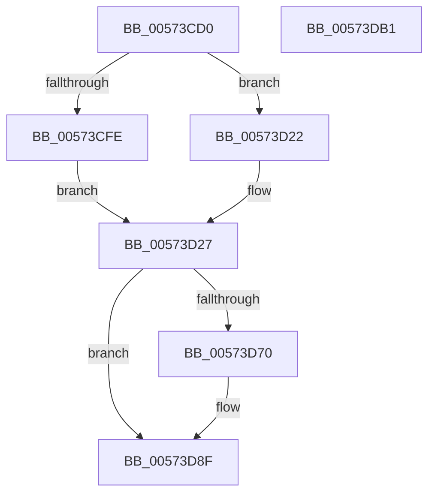

# HsaDismissPageFault

- RVA: `0x00573CD0`–`0x00573DB2` (길이 `226` bytes)
- VA: `0x0000000140573CD0`
- 실행 섹션: `.text`
- PDB 이름 있음: `예`; PDB Function 태그: `아니요`
- unwind 정보 RVA: `0x000BFA7C`
- 디코드: `51`개 명령, `226/226` bytes 표시
- 미해석 바이트: `0` (있으면 어셈블리에 `.byte`로 보존)

> 이 문서는 커널 이미지의 기계어와 PDB 기호를 분석해 생성했습니다. 4번과 5번은 함수 원형과 자료형을 바이너리 사용 방식에서 추정한 C 해석이며 원본 소스 복구 결과는 아닙니다.

## 1. Dependencies

- 직접 호출 지점: **2**; 고유 호출 대상: **2**
- 직접 호출자로 확인된 함수: **0**
- RIP 상대 이미지 참조: **1**

### Outgoing calls
- `0x00573D9A` → [HsaIommuSendCommand](../44/HsaIommuSendCommand_function_0044E1DC.md) (function, `0x0044E1DC`)
- `0x00573DA7` → [_security_check_cookie](../6A/_security_check_cookie_function_006AC640.md) (function, `0x006AC640`)

### Direct callers
- 이 함수 시작 RVA로 연결되는 직접 call은 확인되지 않았습니다. 간접 호출은 완전히 역산할 수 없습니다.

### Static image references
- `0x00573CD4` → RVA `0x00E0A740` (`.data`; read)

## 2. Other-region calls and transfers

- 다른 실행 섹션으로 향하는 call: **0**
- 별도 외부 분기/꼬리 이동을 확인하지 못했습니다.

## 3. Assembly (complete function range)

```asm
00573CD0  48 83 EC 48                     sub rsp, 0x48
00573CD4  48 8B 05 65 6A 89 00            mov rax, qword ptr [rip + 0x896a65]
00573CDB  48 33 C4                        xor rax, rsp
00573CDE  48 89 44 24 30                  mov qword ptr [rsp + 0x30], rax
00573CE3  0F 57 C0                        xorps xmm0, xmm0
00573CE6  4C 8B D1                        mov r10, rcx
00573CE9  0F 11 44 24 20                  movups xmmword ptr [rsp + 0x20], xmm0
00573CEE  66 44 89 44 24 20               mov word ptr [rsp + 0x20], r8w
00573CF4  4C 8B 44 24 28                  mov r8, qword ptr [rsp + 0x28]
00573CF9  83 FA FF                        cmp edx, -1
00573CFC  74 24                           je 0x140573d22
00573CFE  8B C2                           mov eax, edx
00573D00  49 83 C8 04                     or r8, 4
00573D04  48 C1 E0 20                     shl rax, 0x20
00573D08  48 BA FF FF FF FF 00 00 F0 FF   movabs rdx, 0xfff00000ffffffff
00573D12  48 8B C8                        mov rcx, rax
00573D15  48 33 4C 24 20                  xor rcx, qword ptr [rsp + 0x20]
00573D1A  48 23 CA                        and rcx, rdx
00573D1D  48 33 C8                        xor rcx, rax
00573D20  EB 05                           jmp 0x140573d27
00573D22  48 8B 4C 24 20                  mov rcx, qword ptr [rsp + 0x20]
00573D27  48 B8 FF FF FF FF FF FF FF 0F   movabs rax, 0xfffffffffffffff
00573D31  48 23 C8                        and rcx, rax
00573D34  48 B8 00 00 00 00 00 00 00 70   movabs rax, 0x7000000000000000
00573D3E  48 0B C8                        or rcx, rax
00573D41  41 0F B7 C1                     movzx eax, r9w
00573D45  48 C1 E0 20                     shl rax, 0x20
00573D49  48 8B D0                        mov rdx, rax
00573D4C  48 89 4C 24 20                  mov qword ptr [rsp + 0x20], rcx
00573D51  49 33 D0                        xor rdx, r8
00573D54  48 B9 FF FF FF FF 00 FE FF FF   movabs rcx, 0xfffffe00ffffffff
00573D5E  48 23 D1                        and rdx, rcx
00573D61  48 33 D0                        xor rdx, rax
00573D64  83 7C 24 70 00                  cmp dword ptr [rsp + 0x70], 0
00573D69  48 89 54 24 28                  mov qword ptr [rsp + 0x28], rdx
00573D6E  7D 1F                           jge 0x140573d8f
00573D70  48 B8 FF FF FF FF FF 1F FF FF   movabs rax, 0xffff1fffffffffff
00573D7A  48 23 D0                        and rdx, rax
00573D7D  48 B8 00 00 00 00 00 10 00 00   movabs rax, 0x100000000000
00573D87  48 0B D0                        or rdx, rax
00573D8A  48 89 54 24 28                  mov qword ptr [rsp + 0x28], rdx
00573D8F  45 33 C0                        xor r8d, r8d
00573D92  48 8D 54 24 20                  lea rdx, [rsp + 0x20]
00573D97  49 8B CA                        mov rcx, r10
00573D9A  E8 3D A4 ED FF                  call 0x14044e1dc
00573D9F  48 8B 4C 24 30                  mov rcx, qword ptr [rsp + 0x30]
00573DA4  48 33 CC                        xor rcx, rsp
00573DA7  E8 94 88 13 00                  call 0x1406ac640
00573DAC  48 83 C4 48                     add rsp, 0x48
00573DB0  C3                              ret
00573DB1  CC                              int3
```

## 4. C-style interpretation (structured pseudocode)

```c
__int64 __fastcall HsaDismissPageFault(__int64 a1, int a2, unsigned __int16 a3, unsigned __int16 a4, unsigned int a5)
{
    __int64 result;
    __int64 v_rsp;
    unsigned __int64 v_stack_m18;
    unsigned __int64 v_stack_m20;
    unsigned __int64 v_stack_m28;

    v_rsp = (v_rsp) - (72);
    result = (*(unsigned __int64 *)(v_rip + 9005669)) ^ (v_rsp);
    v_stack_m18 = result;
    v_stack_m28 = v_xmm0;
    v_stack_m28 = a3;
    if (a2 == -1) goto loc_00573D22;
    a3 = (v_stack_m20) | (4);
    result = ((unsigned int)(a2)) << (32);
    a1 = (result) ^ (v_stack_m28);
    a1 = (a1) & (a2);
    a1 = (a1) ^ (result);
    goto loc_00573D27;
loc_00573D22:
loc_00573D27:
    a1 = (v_stack_m28) & (result);
    a1 = (a1) | (result);
    result = (a4) << (32);
    v_stack_m28 = a1;
    a2 = (result) ^ (a3);
    a2 = (a2) & (a1);
    a2 = (a2) ^ (result);
    v_stack_m20 = a2;
    if (a5 < 0) {
        a2 = (a2) & (result);
        a2 = (a2) | (result);
        v_stack_m20 = a2;
    }
    a3 = 0;
    result = HsaIommuSendCommand(a1, v_stack_m28, a3, a4);
    a1 = (v_stack_m18) ^ (v_rsp);
    result = _security_check_cookie(a1, v_stack_m28, a3, a4);
    v_rsp = (v_rsp) + (72);
    return result;
}
```

## 5. (Beta) C Style

```c
int64_t HsaDismissPageFault(int64_t Arg1, int32_t Arg2, uint16_t Arg3, uint16_t Arg4, uint32_t Arg5)
{
    int64_t result;
    int64_t local_rsp;
    uint64_t v_stack_m18;
    uint64_t v_stack_m20;
    uint64_t v_stack_m28;

    local_rsp = (local_rsp) - (72);
    result = (*(uint64_t *)(v_rip + 0x896A65)) ^ (local_rsp);
    v_stack_m18 = result;
    v_stack_m28 = v_xmm0;
    v_stack_m28 = Arg3;
    if (Arg2 == -1) goto loc_00573D22;
    Arg3 = (v_stack_m20) | (4);
    result = ((uint32_t)(Arg2)) << (32);
    Arg1 = (result) ^ (v_stack_m28);
    Arg1 = (Arg1) & (Arg2);
    Arg1 = (Arg1) ^ (result);
    goto loc_00573D27;
loc_00573D22:
loc_00573D27:
    Arg1 = (v_stack_m28) & (result);
    Arg1 = (Arg1) | (result);
    result = (Arg4) << (32);
    v_stack_m28 = Arg1;
    Arg2 = (result) ^ (Arg3);
    Arg2 = (Arg2) & (Arg1);
    Arg2 = (Arg2) ^ (result);
    v_stack_m20 = Arg2;
    if (Arg5 < 0) {
        Arg2 = (Arg2) & (result);
        Arg2 = (Arg2) | (result);
        v_stack_m20 = Arg2;
    }
    Arg3 = 0;
    result = HsaIommuSendCommand(Arg1, v_stack_m28, Arg3, Arg4);
    Arg1 = (v_stack_m18) ^ (local_rsp);
    result = _security_check_cookie(Arg1, v_stack_m28, Arg3, Arg4);
    local_rsp = (local_rsp) + (72);
    return result;
}
```

## 6. Execution-region graph

[열기: 2D/3D 그래프와 함수 탐색 컨트롤 패널](../../../control-panel.html?section=text&rva=0x00573CD0&view=graph)

- 2D 그래프는 위에서 아래로 흐르고, 3D 그래프는 빈 공간을 드래그해 회전합니다. Shift+드래그는 이동, 휠은 확대·축소, 함수 노드 선택은 대상 보고서 이동입니다.

### Static fallback


