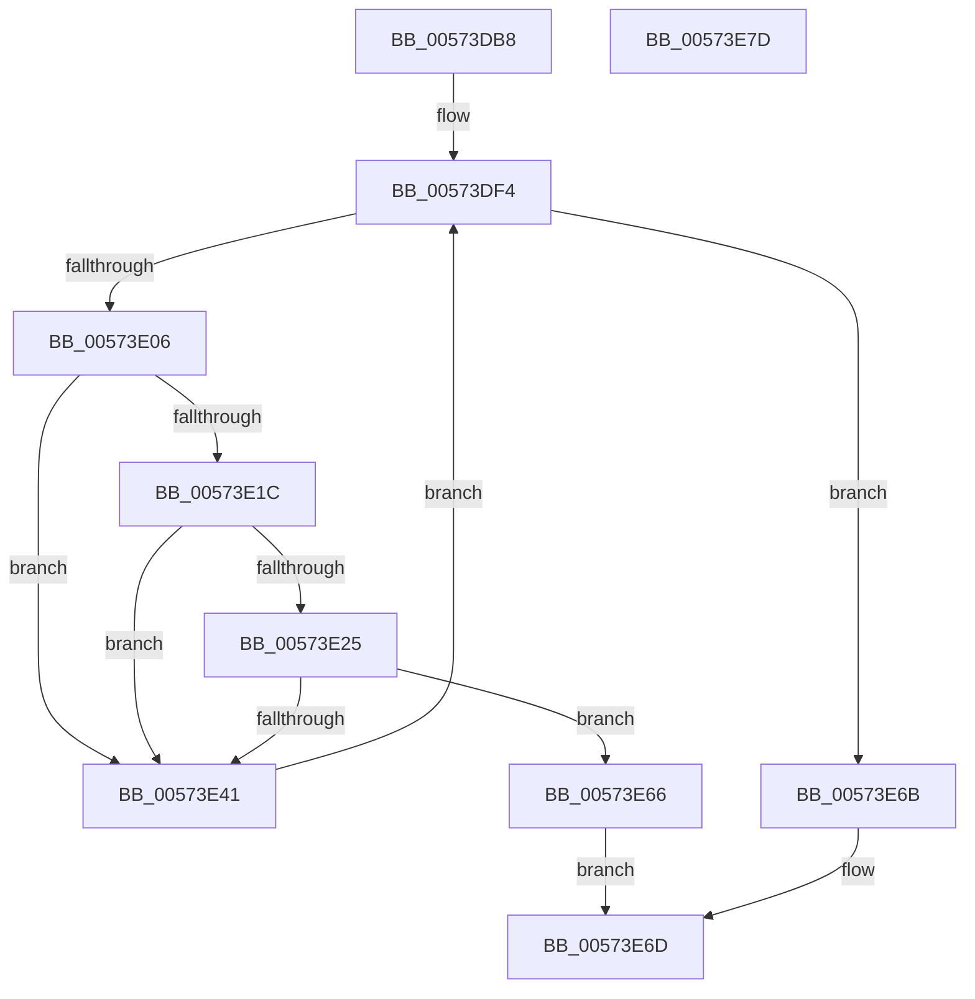

# HsaEnsureNoPendingFaults

- RVA: `0x00573DB8`–`0x00573E7E` (길이 `198` bytes)
- VA: `0x0000000140573DB8`
- 실행 섹션: `.text`
- PDB 이름 있음: `예`; PDB Function 태그: `아니요`
- unwind 정보 RVA: `0x00069588`
- 디코드: `55`개 명령, `198/198` bytes 표시
- 미해석 바이트: `0` (있으면 어셈블리에 `.byte`로 보존)

> 이 문서는 커널 이미지의 기계어와 PDB 기호를 분석해 생성했습니다. 4번과 5번은 함수 원형과 자료형을 바이너리 사용 방식에서 추정한 C 해석이며 원본 소스 복구 결과는 아닙니다.

## 1. Dependencies

- 직접 호출 지점: **0**; 고유 호출 대상: **0**
- 직접 호출자로 확인된 함수: **1**
- RIP 상대 이미지 참조: **0**

### Outgoing calls
- 직접 디코드된 call 명령이 없습니다.

### Direct callers
- [HsaSetPasidAddressSpace](HsaSetPasidAddressSpace_function_00574C40.md) at `0x00574C9F`

### Static image references
- 디코드된 RIP-relative 메모리 참조가 없습니다.

## 2. Other-region calls and transfers

- 다른 실행 섹션으로 향하는 call: **0**
- 별도 외부 분기/꼬리 이동을 확인하지 못했습니다.

## 3. Assembly (complete function range)

```asm
00573DB8  48 89 5C 24 08                  mov qword ptr [rsp + 8], rbx
00573DBD  48 89 74 24 10                  mov qword ptr [rsp + 0x10], rsi
00573DC2  48 89 7C 24 18                  mov qword ptr [rsp + 0x18], rdi
00573DC7  4C 8B 59 70                     mov r11, qword ptr [rcx + 0x70]
00573DCB  BE FF 7F 00 00                  mov esi, 0x7fff
00573DD0  48 8B 79 60                     mov rdi, qword ptr [rcx + 0x60]
00573DD4  8B DA                           mov ebx, edx
00573DD6  48 8B 09                        mov rcx, qword ptr [rcx]
00573DD9  90                              nop
00573DDA  49 C1 EB 04                     shr r11, 4
00573DDE  48 8B 81 30 20 00 00            mov rax, qword ptr [rcx + 0x2030]
00573DE5  90                              nop
00573DE6  48 8B 89 38 20 00 00            mov rcx, qword ptr [rcx + 0x2038]
00573DED  48 C1 E9 04                     shr rcx, 4
00573DF1  48 23 CE                        and rcx, rsi
00573DF4  4C 8B C8                        mov r9, rax
00573DF7  49 C1 E9 04                     shr r9, 4
00573DFB  4D 8B C1                        mov r8, r9
00573DFE  4C 23 C6                        and r8, rsi
00573E01  4C 3B C1                        cmp r8, rcx
00573E04  74 65                           je 0x140573e6b
00573E06  49 C1 E0 04                     shl r8, 4
00573E0A  4C 03 C7                        add r8, rdi
00573E0D  4D 8B 10                        mov r10, qword ptr [r8]
00573E10  49 8B D2                        mov rdx, r10
00573E13  48 C1 EA 3C                     shr rdx, 0x3c
00573E17  80 FA 01                        cmp dl, 1
00573E1A  75 25                           jne 0x140573e41
00573E1C  41 0F B7 50 02                  movzx edx, word ptr [r8 + 2]
00573E21  3B D3                           cmp edx, ebx
00573E23  75 1C                           jne 0x140573e41
00573E25  48 BA 00 00 00 00 00 02 24 00   movabs rdx, 0x24020000000000
00573E2F  4C 23 D2                        and r10, rdx
00573E32  48 BA 00 00 00 00 00 02 00 00   movabs rdx, 0x20000000000
00573E3C  4C 3B D2                        cmp r10, rdx
00573E3F  75 25                           jne 0x140573e66
00573E41  44 23 CE                        and r9d, esi
00573E44  33 D2                           xor edx, edx
00573E46  45 8D 41 01                     lea r8d, [r9 + 1]
00573E4A  45 3B C3                        cmp r8d, r11d
00573E4D  41 0F 45 D0                     cmovne edx, r8d
00573E51  44 8B C2                        mov r8d, edx
00573E54  49 C1 E0 04                     shl r8, 4
00573E58  49 33 C0                        xor rax, r8
00573E5B  48 25 0F 00 F8 FF               and rax, 0xfffffffffff8000f
00573E61  49 33 C0                        xor rax, r8
00573E64  EB 8E                           jmp 0x140573df4
00573E66  49 8B C0                        mov rax, r8
00573E69  EB 02                           jmp 0x140573e6d
00573E6B  33 C0                           xor eax, eax
00573E6D  48 8B 5C 24 08                  mov rbx, qword ptr [rsp + 8]
00573E72  48 8B 74 24 10                  mov rsi, qword ptr [rsp + 0x10]
00573E77  48 8B 7C 24 18                  mov rdi, qword ptr [rsp + 0x18]
00573E7C  C3                              ret
00573E7D  CC                              int3
```

## 4. C-style interpretation (structured pseudocode)

```c
__int64 __fastcall HsaEnsureNoPendingFaults(__int64 a1, int a2)
{
    __int64 result;
    __int64 v_r10;
    __int64 v_r11;
    unsigned __int64 v_stack_p10;
    unsigned __int64 v_stack_p18;
    unsigned __int64 v_stack_p8;

    v_stack_p8 = v_rbx;
    v_stack_p10 = v_rsi;
    v_stack_p18 = v_rdi;
    v_r11 = (*(unsigned __int64 *)(a1 + 112)) >> (4);
    a1 = (*(unsigned __int64 *)(*(unsigned __int64 *)(a1) + 8248)) >> (4);
    a1 = (a1) & ((unsigned int)(0x7FFFULL));
loc_00573DF4:
    a4 = (*(unsigned __int64 *)(*(unsigned __int64 *)(a1) + 8240)) >> (4);
    a3 = (a4) & ((unsigned int)(0x7FFFULL));
    if (a3 == a1) goto loc_00573E6B;
    a3 = (a3) << (4);
    a3 = (a3) + (*(unsigned __int64 *)(a1 + 96));
    a2 = (*(unsigned __int64 *)(a3)) >> (60);
    if (((unsigned __int8)(a2)) != 1) goto loc_00573E41;
    if (((unsigned int)(*(unsigned __int16 *)(a3 + 2))) != ((unsigned int)((unsigned int)(a2)))) goto loc_00573E41;
    v_r10 = (*(unsigned __int64 *)(a3)) & (*(unsigned __int16 *)(a3 + 2));
    if (v_r10 != (*(unsigned __int16 *)(a3 + 2))) goto loc_00573E66;
loc_00573E41:
    a4 = (unsigned int)((a4) & ((unsigned int)((unsigned int)(0x7FFFULL))));
    a2 = 0;
    if (((unsigned int)(a4 + 1)) != ((unsigned int)(v_r11))) { a2 = (unsigned int)(a4 + 1); }
    a3 = ((unsigned int)(a2)) << (4);
    result = (*(unsigned __int64 *)(*(unsigned __int64 *)(a1) + 8240)) ^ (a3);
    result = (result) & (0xFFFFFFFFFFF8000FULL);
    result = (result) ^ (a3);
    goto loc_00573DF4;
loc_00573E66:
    goto loc_00573E6D;
loc_00573E6B:
    result = 0;
loc_00573E6D:
    return result;
}
```

## 5. (Beta) C Style

```c
int64_t HsaEnsureNoPendingFaults(void *Arg1, int32_t Arg2)
{
    uint8_t *arg1 = (uint8_t *)Arg1;

    int64_t result;
    int64_t local_r10;
    int64_t local_r11;
    uint64_t v_stack_p10;
    uint64_t v_stack_p18;
    uint64_t v_stack_p8;

    v_stack_p8 = local_rbx;
    v_stack_p10 = local_rsi;
    v_stack_p18 = local_rdi;
    local_r11 = (*(uint64_t *)(arg1 + 0x70)) >> (4);
    Arg1 = (*(uint64_t *)(*(uint64_t *)(arg1) + 0x2038)) >> (4);
    Arg1 = (Arg1) & ((uint32_t)(0x7FFFULL));
loc_00573DF4:
    a4 = (*(uint64_t *)(*(uint64_t *)(arg1) + 0x2030)) >> (4);
    a3 = (a4) & ((uint32_t)(0x7FFFULL));
    if (a3 == Arg1) goto loc_00573E6B;
    a3 = (a3) << (4);
    a3 = (a3) + (*(uint64_t *)(arg1 + 0x60));
    Arg2 = (*(uint64_t *)(a3)) >> (60);
    if (((uint8_t)(Arg2)) != 1) goto loc_00573E41;
    if (((uint32_t)(*(uint16_t *)(a3 + 0x2))) != ((uint32_t)((uint32_t)(Arg2)))) goto loc_00573E41;
    local_r10 = (*(uint64_t *)(a3)) & (*(uint16_t *)(a3 + 0x2));
    if (local_r10 != (*(uint16_t *)(a3 + 0x2))) goto loc_00573E66;
loc_00573E41:
    a4 = (uint32_t)((a4) & ((uint32_t)((uint32_t)(0x7FFFULL))));
    Arg2 = 0;
    if (((uint32_t)(a4 + 1)) != ((uint32_t)(local_r11))) { Arg2 = (uint32_t)(a4 + 1); }
    a3 = ((uint32_t)(Arg2)) << (4);
    result = (*(uint64_t *)(*(uint64_t *)(arg1) + 0x2030)) ^ (a3);
    result = (result) & (0xFFFFFFFFFFF8000FULL);
    result = (result) ^ (a3);
    goto loc_00573DF4;
loc_00573E66:
    goto loc_00573E6D;
loc_00573E6B:
    result = 0;
loc_00573E6D:
    return result;
}
```

### 관측된 메모리 오프셋

구조체 형식이 확인되지 않은 접근은 인자 기준의 오프셋으로만 기록했습니다.

| 기준 인자 | 오프셋 표현 | 폭 (bit) | 접근 |
|---|---:|---:|---|
| `Arg1` | `+ 0x0` | `64` | `R` |
| `Arg1` | `+ 0x60` | `64` | `R` |
| `Arg1` | `+ 0x70` | `64` | `R` |

## 6. Execution-region graph

[열기: 2D/3D 그래프와 함수 탐색 컨트롤 패널](../../../control-panel.html?section=text&rva=0x00573DB8&view=graph)

- 2D 그래프는 위에서 아래로 흐르고, 3D 그래프는 빈 공간을 드래그해 회전합니다. Shift+드래그는 이동, 휠은 확대·축소, 함수 노드 선택은 대상 보고서 이동입니다.

### Static fallback


