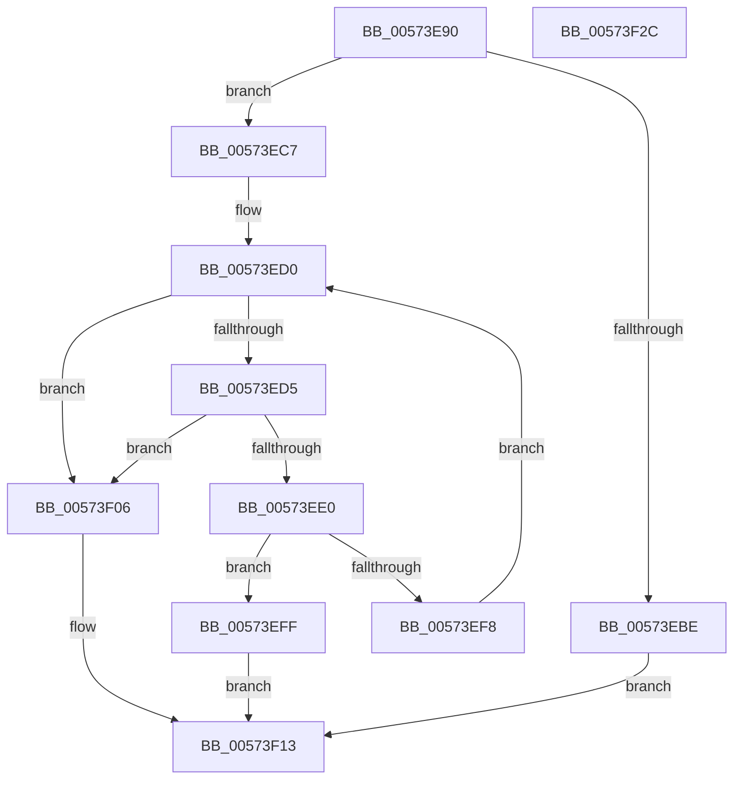

# HsaEnumerateIvmdDevices

- RVA: `0x00573E90`–`0x00573F2D` (길이 `157` bytes)
- VA: `0x0000000140573E90`
- 실행 섹션: `.text`
- PDB 이름 있음: `예`; PDB Function 태그: `아니요`
- unwind 정보 RVA: `0x00060300`
- 디코드: `49`개 명령, `157/157` bytes 표시
- 미해석 바이트: `0` (있으면 어셈블리에 `.byte`로 보존)

> 이 문서는 커널 이미지의 기계어와 PDB 기호를 분석해 생성했습니다. 4번과 5번은 함수 원형과 자료형을 바이너리 사용 방식에서 추정한 C 해석이며 원본 소스 복구 결과는 아닙니다.

## 1. Dependencies

- 직접 호출 지점: **1**; 고유 호출 대상: **1**
- 직접 호출자로 확인된 함수: **0**
- RIP 상대 이미지 참조: **0**

### Outgoing calls
- `0x00573EEA` → [HalpHsaCreateReservedDevice](HalpHsaCreateReservedDevice_function_00572AA8.md) (function, `0x00572AA8`)

### Direct callers
- 이 함수 시작 RVA로 연결되는 직접 call은 확인되지 않았습니다. 간접 호출은 완전히 역산할 수 없습니다.

### Static image references
- 디코드된 RIP-relative 메모리 참조가 없습니다.

## 2. Other-region calls and transfers

- 다른 실행 섹션으로 향하는 call: **0**
- 별도 외부 분기/꼬리 이동을 확인하지 못했습니다.

## 3. Assembly (complete function range)

```asm
00573E90  48 89 5C 24 08                  mov qword ptr [rsp + 8], rbx
00573E95  48 89 6C 24 10                  mov qword ptr [rsp + 0x10], rbp
00573E9A  48 89 74 24 18                  mov qword ptr [rsp + 0x18], rsi
00573E9F  57                              push rdi
00573EA0  41 56                           push r14
00573EA2  41 57                           push r15
00573EA4  48 83 EC 20                     sub rsp, 0x20
00573EA8  48 8B E9                        mov rbp, rcx
00573EAB  4D 8B F8                        mov r15, r8
00573EAE  48 8B 89 D0 00 00 00            mov rcx, qword ptr [rcx + 0xd0]
00573EB5  48 8B F2                        mov rsi, rdx
00573EB8  8B 01                           mov eax, dword ptr [rcx]
00573EBA  39 02                           cmp dword ptr [rdx], eax
00573EBC  73 09                           jae 0x140573ec7
00573EBE  89 02                           mov dword ptr [rdx], eax
00573EC0  B8 23 00 00 C0                  mov eax, 0xc0000023
00573EC5  EB 4C                           jmp 0x140573f13
00573EC7  4C 8D 71 08                     lea r14, [rcx + 8]
00573ECB  33 FF                           xor edi, edi
00573ECD  49 8B 1E                        mov rbx, qword ptr [r14]
00573ED0  49 3B DE                        cmp rbx, r14
00573ED3  74 31                           je 0x140573f06
00573ED5  48 8B 85 D0 00 00 00            mov rax, qword ptr [rbp + 0xd0]
00573EDC  3B 38                           cmp edi, dword ptr [rax]
00573EDE  73 26                           jae 0x140573f06
00573EE0  0F B7 8D A0 00 00 00            movzx ecx, word ptr [rbp + 0xa0]
00573EE7  48 8B D3                        mov rdx, rbx
00573EEA  E8 B9 EB FF FF                  call 0x140572aa8
00573EEF  49 89 04 FF                     mov qword ptr [r15 + rdi*8], rax
00573EF3  48 85 C0                        test rax, rax
00573EF6  74 07                           je 0x140573eff
00573EF8  48 8B 1B                        mov rbx, qword ptr [rbx]
00573EFB  FF C7                           inc edi
00573EFD  EB D1                           jmp 0x140573ed0
00573EFF  B8 9A 00 00 C0                  mov eax, 0xc000009a
00573F04  EB 0D                           jmp 0x140573f13
00573F06  48 8B 85 D0 00 00 00            mov rax, qword ptr [rbp + 0xd0]
00573F0D  8B 08                           mov ecx, dword ptr [rax]
00573F0F  33 C0                           xor eax, eax
00573F11  89 0E                           mov dword ptr [rsi], ecx
00573F13  48 8B 5C 24 40                  mov rbx, qword ptr [rsp + 0x40]
00573F18  48 8B 6C 24 48                  mov rbp, qword ptr [rsp + 0x48]
00573F1D  48 8B 74 24 50                  mov rsi, qword ptr [rsp + 0x50]
00573F22  48 83 C4 20                     add rsp, 0x20
00573F26  41 5F                           pop r15
00573F28  41 5E                           pop r14
00573F2A  5F                              pop rdi
00573F2B  C3                              ret
00573F2C  CC                              int3
```

## 4. C-style interpretation (structured pseudocode)

```c
__int64 __fastcall HsaEnumerateIvmdDevices(__int64 a1, __int64 a2, __int64 a3)
{
    __int64 result;
    __int64 v_rdi;
    __int64 v_rsp;
    unsigned __int64 v_stack_p10;
    unsigned __int64 v_stack_p18;
    unsigned __int64 v_stack_p8;

    v_stack_p8 = v_rbx;
    v_stack_p10 = v_rbp;
    v_stack_p18 = v_rsi;
    v_rsp = (v_rsp) - (32);
    if ((*(unsigned int *)(a2)) >= ((unsigned int)((unsigned int)(*(unsigned int *)(*(unsigned __int64 *)(a1 + 208)))))) goto loc_00573EC7;
    *(unsigned int *)(a2) = (unsigned int)((unsigned int)(*(unsigned int *)(*(unsigned __int64 *)(a1 + 208))));
    goto loc_00573F13;
loc_00573EC7:
    v_rdi = 0;
loc_00573ED0:
    if ((*(unsigned __int64 *)(*(unsigned __int64 *)(a1 + 208) + 8)) == (*(unsigned __int64 *)(a1 + 208) + 8)) goto loc_00573F06;
    if (0 >= (*(unsigned int *)(*(unsigned __int64 *)(a1 + 208)))) goto loc_00573F06;
    result = HalpHsaCreateReservedDevice(*(unsigned __int16 *)(a1 + 160), *(unsigned __int64 *)(*(unsigned __int64 *)(a1 + 208) + 8), a3, a4);
    *(unsigned __int64 *)(a3 + v_rdi * 8) = result;
    if (result == 0) goto loc_00573EFF;
    v_rdi = (unsigned int)((v_rdi) + 1);
    goto loc_00573ED0;
loc_00573EFF:
    goto loc_00573F13;
loc_00573F06:
    result = 0;
    *(unsigned int *)(a2) = (unsigned int)((unsigned int)(*(unsigned int *)(*(unsigned __int64 *)(a1 + 208))));
loc_00573F13:
    v_rsp = (v_rsp) + (32);
    return result;
}
```

## 5. (Beta) C Style

```c
int64_t HsaEnumerateIvmdDevices(void *Arg1, void *Arg2, void *Arg3)
{
    uint8_t *arg1 = (uint8_t *)Arg1;
    uint8_t *arg2 = (uint8_t *)Arg2;
    uint8_t *arg3 = (uint8_t *)Arg3;

    int64_t result;
    int64_t local_rdi;
    int64_t local_rsp;
    uint64_t v_stack_p10;
    uint64_t v_stack_p18;
    uint64_t v_stack_p8;

    v_stack_p8 = local_rbx;
    v_stack_p10 = local_rbp;
    v_stack_p18 = local_rsi;
    local_rsp = (local_rsp) - (32);
    if ((*(uint32_t *)(arg2)) >= ((uint32_t)((uint32_t)(*(uint32_t *)(*(uint64_t *)(arg1 + 0xD0)))))) goto loc_00573EC7;
    *(uint32_t *)(arg2) = (uint32_t)((uint32_t)(*(uint32_t *)(*(uint64_t *)(arg1 + 0xD0))));
    goto loc_00573F13;
loc_00573EC7:
    local_rdi = 0;
loc_00573ED0:
    if ((*(uint64_t *)(*(uint64_t *)(arg1 + 0xD0) + 0x8)) == (*(uint64_t *)(arg1 + 0xD0) + 8)) goto loc_00573F06;
    if (0 >= (*(uint32_t *)(*(uint64_t *)(arg1 + 0xD0)))) goto loc_00573F06;
    result = HalpHsaCreateReservedDevice(*(uint16_t *)(arg1 + 0xA0), *(uint64_t *)(*(uint64_t *)(arg1 + 0xD0) + 0x8), Arg3, a4);
    *(uint64_t *)(arg3 + local_rdi * 8) = result;
    if (result == 0) goto loc_00573EFF;
    local_rdi = (uint32_t)((local_rdi) + 1);
    goto loc_00573ED0;
loc_00573EFF:
    goto loc_00573F13;
loc_00573F06:
    result = 0;
    *(uint32_t *)(arg2) = (uint32_t)((uint32_t)(*(uint32_t *)(*(uint64_t *)(arg1 + 0xD0))));
loc_00573F13:
    local_rsp = (local_rsp) + (32);
    return result;
}
```

### 관측된 메모리 오프셋

구조체 형식이 확인되지 않은 접근은 인자 기준의 오프셋으로만 기록했습니다.

| 기준 인자 | 오프셋 표현 | 폭 (bit) | 접근 |
|---|---:|---:|---|
| `Arg1` | `+ 0xA0` | `16` | `R` |
| `Arg1` | `+ 0xD0` | `64` | `R` |
| `Arg2` | `+ 0x0` | `32` | `R` |
| `Arg2` | `+ 0x0` | `32` | `W` |
| `Arg3` | `+ 0x0 + rdi*8` | `64` | `W` |

## 6. Execution-region graph

[열기: 2D/3D 그래프와 함수 탐색 컨트롤 패널](../../../control-panel.html?section=text&rva=0x00573E90&view=graph)

- 2D 그래프는 위에서 아래로 흐르고, 3D 그래프는 빈 공간을 드래그해 회전합니다. Shift+드래그는 이동, 휠은 확대·축소, 함수 노드 선택은 대상 보고서 이동입니다.

### Static fallback


