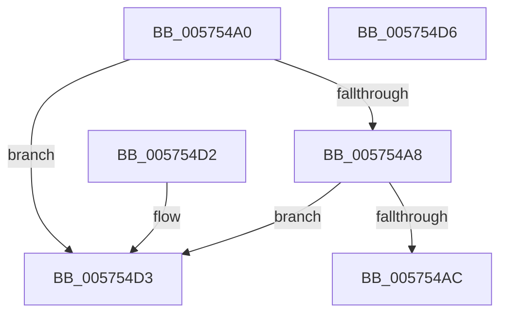

# HsaFlConfigureIntermediatePhysicalPte

- RVA: `0x005754A0`–`0x005754D7` (길이 `55` bytes)
- VA: `0x00000001405754A0`
- 실행 섹션: `.text`
- PDB 이름 있음: `예`; PDB Function 태그: `아니요`
- unwind 정보 RVA: `0x000DB714`
- 디코드: `18`개 명령, `55/55` bytes 표시
- 미해석 바이트: `0` (있으면 어셈블리에 `.byte`로 보존)

> 이 문서는 커널 이미지의 기계어와 PDB 기호를 분석해 생성했습니다. 4번과 5번은 함수 원형과 자료형을 바이너리 사용 방식에서 추정한 C 해석이며 원본 소스 복구 결과는 아닙니다.

## 1. Dependencies

- 직접 호출 지점: **0**; 고유 호출 대상: **0**
- 직접 호출자로 확인된 함수: **0**
- RIP 상대 이미지 참조: **0**

### Outgoing calls
- 직접 디코드된 call 명령이 없습니다.

### Direct callers
- 이 함수 시작 RVA로 연결되는 직접 call은 확인되지 않았습니다. 간접 호출은 완전히 역산할 수 없습니다.

### Static image references
- 디코드된 RIP-relative 메모리 참조가 없습니다.

## 2. Other-region calls and transfers

- 다른 실행 섹션으로 향하는 call: **0**
- 별도 외부 분기/꼬리 이동을 확인하지 못했습니다.

## 3. Assembly (complete function range)

```asm
005754A0  48 8B 01                        mov rax, qword ptr [rcx]
005754A3  48 85 C0                        test rax, rax
005754A6  75 2B                           jne 0x1405754d3
005754A8  85 D2                           test edx, edx
005754AA  74 27                           je 0x1405754d3
005754AC  49 33 C0                        xor rax, r8
005754AF  48 BA FF 0F 00 00 00 00 F0 FF   movabs rdx, 0xfff0000000000fff
005754B9  48 23 C2                        and rax, rdx
005754BC  48 BA 07 00 00 00 00 00 00 80   movabs rdx, 0x8000000000000007
005754C6  49 33 C0                        xor rax, r8
005754C9  48 0B C2                        or rax, rdx
005754CC  48 89 01                        mov qword ptr [rcx], rax
005754CF  B0 01                           mov al, 1
005754D1  C3                              ret
005754D2  CC                              int3
005754D3  32 C0                           xor al, al
005754D5  C3                              ret
005754D6  CC                              int3
```

## 4. C-style interpretation (structured pseudocode)

```c
__int64 __fastcall HsaFlConfigureIntermediatePhysicalPte(__int64 a1, int a2, __int64 a3)
{
    __int64 result;

    if (*(unsigned __int64 *)(a1) != 0) goto loc_005754D3;
    if (a2 == 0) goto loc_005754D3;
    result = (*(unsigned __int64 *)(a1)) ^ (a3);
    result = (result) & (a2);
    result = (result) ^ (a3);
    result = (result) | (a2);
    *(unsigned __int64 *)(a1) = result;
    return 1;
loc_005754D3:
    result = 0;
    return result;
}
```

## 5. (Beta) C Style

```c
int64_t HsaFlConfigureIntermediatePhysicalPte(void *Arg1, int32_t Arg2, int64_t Arg3)
{
    uint8_t *arg1 = (uint8_t *)Arg1;

    int64_t result;

    if (*(uint64_t *)(arg1) != 0) goto loc_005754D3;
    if (Arg2 == 0) goto loc_005754D3;
    result = (*(uint64_t *)(arg1)) ^ (Arg3);
    result = (result) & (Arg2);
    result = (result) ^ (Arg3);
    result = (result) | (Arg2);
    *(uint64_t *)(arg1) = result;
    return 1;
loc_005754D3:
    result = 0;
    return result;
}
```

### 관측된 메모리 오프셋

구조체 형식이 확인되지 않은 접근은 인자 기준의 오프셋으로만 기록했습니다.

| 기준 인자 | 오프셋 표현 | 폭 (bit) | 접근 |
|---|---:|---:|---|
| `Arg1` | `+ 0x0` | `64` | `R` |
| `Arg1` | `+ 0x0` | `64` | `W` |

## 6. Execution-region graph

[열기: 2D/3D 그래프와 함수 탐색 컨트롤 패널](../../../control-panel.html?section=text&rva=0x005754A0&view=graph)

- 2D 그래프는 위에서 아래로 흐르고, 3D 그래프는 빈 공간을 드래그해 회전합니다. Shift+드래그는 이동, 휠은 확대·축소, 함수 노드 선택은 대상 보고서 이동입니다.

### Static fallback


