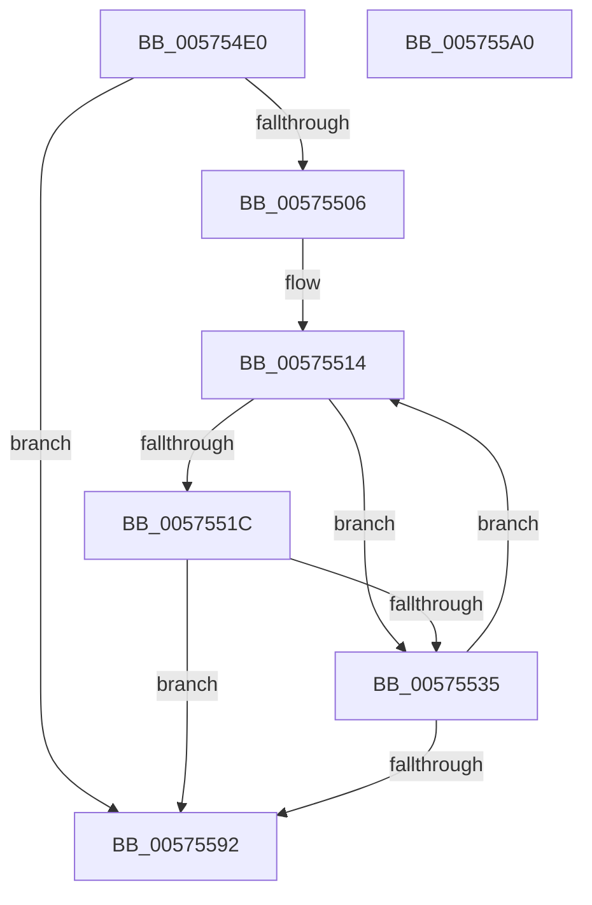

# HsaFlConfigureLeafPhysicalPte

- RVA: `0x005754E0`–`0x005755A1` (길이 `193` bytes)
- VA: `0x00000001405754E0`
- 실행 섹션: `.text`
- PDB 이름 있음: `예`; PDB Function 태그: `아니요`
- unwind 정보 RVA: `0x000950EC`
- 디코드: `50`개 명령, `193/193` bytes 표시
- 미해석 바이트: `0` (있으면 어셈블리에 `.byte`로 보존)

> 이 문서는 커널 이미지의 기계어와 PDB 기호를 분석해 생성했습니다. 4번과 5번은 함수 원형과 자료형을 바이너리 사용 방식에서 추정한 C 해석이며 원본 소스 복구 결과는 아닙니다.

## 1. Dependencies

- 직접 호출 지점: **0**; 고유 호출 대상: **0**
- 직접 호출자로 확인된 함수: **0**
- RIP 상대 이미지 참조: **0**

### Outgoing calls
- 직접 디코드된 call 명령이 없습니다.

### Direct callers
- 이 함수 시작 RVA로 연결되는 직접 call은 확인되지 않았습니다. 간접 호출은 완전히 역산할 수 없습니다.

### Static image references
- 디코드된 RIP-relative 메모리 참조가 없습니다.

## 2. Other-region calls and transfers

- 다른 실행 섹션으로 향하는 call: **0**
- 별도 외부 분기/꼬리 이동을 확인하지 못했습니다.

## 3. Assembly (complete function range)

```asm
005754E0  48 89 5C 24 08                  mov qword ptr [rsp + 8], rbx
005754E5  48 89 7C 24 10                  mov qword ptr [rsp + 0x10], rdi
005754EA  41 8B D8                        mov ebx, r8d
005754ED  4C 8B D2                        mov r10, rdx
005754F0  83 E3 02                        and ebx, 2
005754F3  49 C1 EA 0C                     shr r10, 0xc
005754F7  45 33 DB                        xor r11d, r11d
005754FA  41 8B F9                        mov edi, r9d
005754FD  45 85 C9                        test r9d, r9d
00575500  0F 84 8C 00 00 00               je 0x140575592
00575506  48 C1 EA 0C                     shr rdx, 0xc
0057550A  49 8B C2                        mov rax, r10
0057550D  48 2B C2                        sub rax, rdx
00575510  4C 8D 0C C1                     lea r9, [rcx + rax*8]
00575514  4D 8B 01                        mov r8, qword ptr [r9]
00575517  4D 85 C0                        test r8, r8
0057551A  74 19                           je 0x140575535
0057551C  49 8B C0                        mov rax, r8
0057551F  48 B9 FF FF FF FF FF 00 00 00   movabs rcx, 0xffffffffff
00575529  48 C1 E8 0C                     shr rax, 0xc
0057552D  48 23 C1                        and rax, rcx
00575530  49 3B C2                        cmp rax, r10
00575533  75 5D                           jne 0x140575592
00575535  49 8B D2                        mov rdx, r10
00575538  8B C3                           mov eax, ebx
0057553A  48 C1 E2 0C                     shl rdx, 0xc
0057553E  F7 D8                           neg eax
00575540  48 B8 FF 0F 00 00 00 00 F0 FF   movabs rax, 0xfff0000000000fff
0057554A  48 1B C9                        sbb rcx, rcx
0057554D  49 FF C2                        inc r10
00575550  83 E1 02                        and ecx, 2
00575553  41 FF C3                        inc r11d
00575556  48 23 C8                        and rcx, rax
00575559  48 B8 FD 0F 00 00 00 00 F0 FF   movabs rax, 0xfff0000000000ffd
00575563  4C 23 C0                        and r8, rax
00575566  48 B8 00 F0 FF FF FF FF 0F 00   movabs rax, 0xffffffffff000
00575570  48 23 D0                        and rdx, rax
00575573  49 0B C8                        or rcx, r8
00575576  48 33 CA                        xor rcx, rdx
00575579  48 B8 05 00 00 00 00 00 00 80   movabs rax, 0x8000000000000005
00575583  48 0B C8                        or rcx, rax
00575586  49 89 09                        mov qword ptr [r9], rcx
00575589  49 83 C1 08                     add r9, 8
0057558D  44 3B DF                        cmp r11d, edi
00575590  72 82                           jb 0x140575514
00575592  48 8B 5C 24 08                  mov rbx, qword ptr [rsp + 8]
00575597  41 8B C3                        mov eax, r11d
0057559A  48 8B 7C 24 10                  mov rdi, qword ptr [rsp + 0x10]
0057559F  C3                              ret
005755A0  CC                              int3
```

## 4. C-style interpretation (structured pseudocode)

```c
__int64 __fastcall HsaFlConfigureLeafPhysicalPte(__int64 a1, __int64 a2, int a3, int a4)
{
    __int64 result;
    __int64 v_r10;
    __int64 v_r11;
    __int64 v_rbx;
    unsigned __int64 v_stack_p10;
    unsigned __int64 v_stack_p8;

    v_stack_p8 = v_rbx;
    v_stack_p10 = v_rdi;
    v_rbx = (unsigned int)(((unsigned int)(a3)) & (2));
    v_r10 = (a2) >> (12);
    v_r11 = 0;
    if (a4 == 0) goto loc_00575592;
    a2 = (a2) >> (12);
    result = (v_r10) - (a2);
loc_00575514:
    if (*(unsigned __int64 *)(a1 + result * 8) == 0) goto loc_00575535;
    result = (*(unsigned __int64 *)(a1 + result * 8)) >> (12);
    result = (result) & (a1);
    if (result != v_r10) goto loc_00575592;
loc_00575535:
    a2 = (v_r10) << (12);
    result = (unsigned int)(-((unsigned int)((unsigned int)(v_rbx))));
    v_r10 = (v_r10) + 1;
    a1 = (unsigned int)((a1) & (2));
    v_r11 = (unsigned int)((v_r11) + 1);
    a1 = (a1) & (result);
    a3 = (*(unsigned __int64 *)(a1 + result * 8)) & (result);
    a2 = (a2) & (result);
    a1 = (a1) | (a3);
    a1 = (a1) ^ (a2);
    a1 = (a1) | (result);
    *(unsigned __int64 *)(a1 + result * 8) = a1;
    a4 = (a1 + result * 8) + (8);
    if (((unsigned int)(v_r11)) < ((unsigned int)((unsigned int)(a4)))) goto loc_00575514;
loc_00575592:
    return (unsigned int)((unsigned int)(v_r11));
}
```

## 5. (Beta) C Style

```c
int64_t HsaFlConfigureLeafPhysicalPte(void *Arg1, int64_t Arg2, int32_t Arg3, int32_t Arg4)
{
    uint8_t *arg1 = (uint8_t *)Arg1;

    int64_t result;
    int64_t local_r10;
    int64_t local_r11;
    int64_t local_rbx;
    uint64_t v_stack_p10;
    uint64_t v_stack_p8;

    v_stack_p8 = local_rbx;
    v_stack_p10 = local_rdi;
    local_rbx = (uint32_t)(((uint32_t)(Arg3)) & (2));
    local_r10 = (Arg2) >> (12);
    local_r11 = 0;
    if (Arg4 == 0) goto loc_00575592;
    Arg2 = (Arg2) >> (12);
    result = (local_r10) - (Arg2);
loc_00575514:
    if (*(uint64_t *)(arg1 + result * 8) == 0) goto loc_00575535;
    result = (*(uint64_t *)(arg1 + result * 8)) >> (12);
    result = (result) & (Arg1);
    if (result != local_r10) goto loc_00575592;
loc_00575535:
    Arg2 = (local_r10) << (12);
    result = (uint32_t)(-((uint32_t)((uint32_t)(local_rbx))));
    local_r10 = (local_r10) + 1;
    Arg1 = (uint32_t)((Arg1) & (2));
    local_r11 = (uint32_t)((local_r11) + 1);
    Arg1 = (Arg1) & (result);
    Arg3 = (*(uint64_t *)(arg1 + result * 8)) & (result);
    Arg2 = (Arg2) & (result);
    Arg1 = (Arg1) | (Arg3);
    Arg1 = (Arg1) ^ (Arg2);
    Arg1 = (Arg1) | (result);
    *(void **)(arg1 + result * 8) = Arg1;
    Arg4 = (Arg1 + result * 8) + (8);
    if (((uint32_t)(local_r11)) < ((uint32_t)((uint32_t)(Arg4)))) goto loc_00575514;
loc_00575592:
    return (uint32_t)((uint32_t)(local_r11));
}
```

### 관측된 메모리 오프셋

구조체 형식이 확인되지 않은 접근은 인자 기준의 오프셋으로만 기록했습니다.

| 기준 인자 | 오프셋 표현 | 폭 (bit) | 접근 |
|---|---:|---:|---|
| `Arg1` | `+ 0x0` | `64` | `R` |
| `Arg1` | `+ 0x0` | `64` | `W` |
| `Arg1` | `+ 0x0 + rax*8` | `64` | `R` |

## 6. Execution-region graph

[열기: 2D/3D 그래프와 함수 탐색 컨트롤 패널](../../../control-panel.html?section=text&rva=0x005754E0&view=graph)

- 2D 그래프는 위에서 아래로 흐르고, 3D 그래프는 빈 공간을 드래그해 회전합니다. Shift+드래그는 이동, 휠은 확대·축소, 함수 노드 선택은 대상 보고서 이동입니다.

### Static fallback


