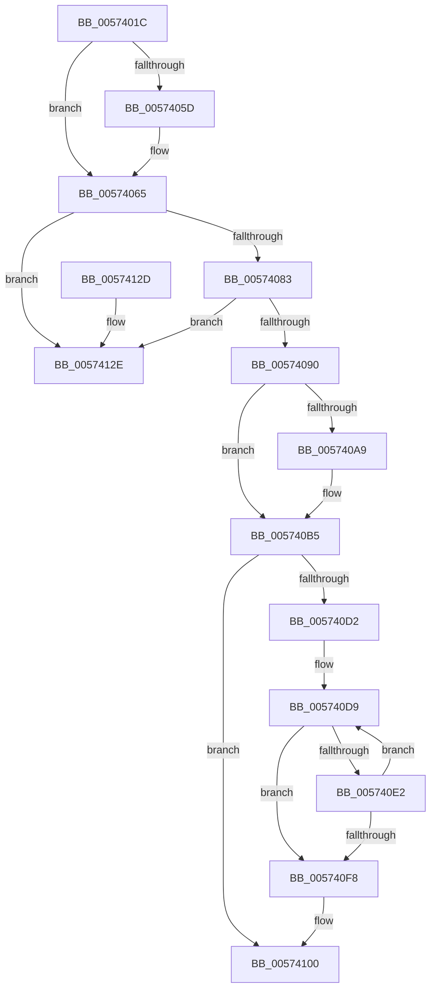

# HsaFreePasidTables

- RVA: `0x0057401C`–`0x00574135` (길이 `281` bytes)
- VA: `0x000000014057401C`
- 실행 섹션: `.text`
- PDB 이름 있음: `예`; PDB Function 태그: `아니요`
- unwind 정보 RVA: `0x0008CF6C`
- 디코드: `75`개 명령, `281/281` bytes 표시
- 미해석 바이트: `0` (있으면 어셈블리에 `.byte`로 보존)

> 이 문서는 커널 이미지의 기계어와 PDB 기호를 분석해 생성했습니다. 4번과 5번은 함수 원형과 자료형을 바이너리 사용 방식에서 추정한 C 해석이며 원본 소스 복구 결과는 아닙니다.

## 1. Dependencies

- 직접 호출 지점: **9**; 고유 호출 대상: **7**
- 직접 호출자로 확인된 함수: **2**
- RIP 상대 이미지 참조: **1**

### Outgoing calls
- `0x00574060` → [KiRaiseIrqlProcessIrqlFlags](../4F/KiRaiseIrqlProcessIrqlFlags_function_004F56FC.md) (function, `0x004F56FC`)
- `0x00574071` → [KeAcquireInStackQueuedSpinLockAtDpcLevel](../27/KeAcquireInStackQueuedSpinLockAtDpcLevel_function_00275740.md) (function, `0x00275740`)
- `0x0057409C` → [KeReleaseInStackQueuedSpinLockFromDpcLevel](../21/KeReleaseInStackQueuedSpinLockFromDpcLevel_function_002171B0.md) (function, `0x002171B0`)
- `0x005740B0` → [KiLowerIrqlProcessIrqlFlags](../4F/KiLowerIrqlProcessIrqlFlags_function_004F5698.md) (function, `0x004F5698`)
- `0x005740C1` → [KeAcquireSpinLockRaiseToDpc](../20/KeAcquireSpinLockRaiseToDpc_function_00208470.md) (function, `0x00208470`)
- `0x005740E5` → [ExtEnvFreeMemory](../56/ExtEnvFreeMemory_function_00561320.md) (function, `0x00561320`)
- `0x005740FB` → [ExtEnvFreeMemory](../56/ExtEnvFreeMemory_function_00561320.md) (function, `0x00561320`)
- `0x00574107` → [KeReleaseSpinLock](../39/KeReleaseSpinLock_function_00392BA0.md) (function, `0x00392BA0`)
- `0x0057410F` → [ExtEnvFreeMemory](../56/ExtEnvFreeMemory_function_00561320.md) (function, `0x00561320`)

### Direct callers
- [HsaAllocatePasidTables](HsaAllocatePasidTables_function_005735DC.md) at `0x005737E1`
- [HsaDeleteDevice](HsaDeleteDevice_function_00573C70.md) at `0x00573C82`

### Static image references
- `0x00574055` → RVA `0x00FC6D20` (`ALMOSTRO`; read)

## 2. Other-region calls and transfers

- 다른 실행 섹션으로 향하는 call: **0**
- 별도 외부 분기/꼬리 이동을 확인하지 못했습니다.

## 3. Assembly (complete function range)

```asm
0057401C  4C 8B DC                        mov r11, rsp
0057401F  49 89 5B 08                     mov qword ptr [r11 + 8], rbx
00574023  49 89 6B 10                     mov qword ptr [r11 + 0x10], rbp
00574027  49 89 73 18                     mov qword ptr [r11 + 0x18], rsi
0057402B  57                              push rdi
0057402C  41 56                           push r14
0057402E  41 57                           push r15
00574030  48 83 EC 40                     sub rsp, 0x40
00574034  0F 57 C0                        xorps xmm0, xmm0
00574037  33 C0                           xor eax, eax
00574039  0F 11 44 24 20                  movups xmmword ptr [rsp + 0x20], xmm0
0057403E  49 89 43 D8                     mov qword ptr [r11 - 0x28], rax
00574042  48 8B DA                        mov rbx, rdx
00574045  48 8B E9                        mov rbp, rcx
00574048  44 0F 20 C6                     mov rsi, cr8
0057404C  8D 50 0F                        lea edx, [rax + 0xf]
0057404F  44 0F 22 C2                     mov cr8, rdx
00574053  33 FF                           xor edi, edi
00574055  39 3D C5 2C A5 00               cmp dword ptr [rip + 0xa52cc5], edi
0057405B  74 08                           je 0x140574065
0057405D  40 8A CE                        mov cl, sil
00574060  E8 97 16 F8 FF                  call 0x1404f56fc
00574065  48 8D 8D 98 00 00 00            lea rcx, [rbp + 0x98]
0057406C  48 8D 54 24 20                  lea rdx, [rsp + 0x20]
00574071  E8 CA 16 D0 FF                  call 0x140275740
00574076  48 8B 0B                        mov rcx, qword ptr [rbx]
00574079  48 39 59 08                     cmp qword ptr [rcx + 8], rbx
0057407D  0F 85 AB 00 00 00               jne 0x14057412e
00574083  48 8B 43 08                     mov rax, qword ptr [rbx + 8]
00574087  48 39 18                        cmp qword ptr [rax], rbx
0057408A  0F 85 9E 00 00 00               jne 0x14057412e
00574090  48 89 08                        mov qword ptr [rax], rcx
00574093  48 89 41 08                     mov qword ptr [rcx + 8], rax
00574097  48 8D 4C 24 20                  lea rcx, [rsp + 0x20]
0057409C  E8 0F 31 CA FF                  call 0x1402171b0
005740A1  39 3D 79 2C A5 00               cmp dword ptr [rip + 0xa52c79], edi
005740A7  74 0C                           je 0x1405740b5
005740A9  44 0F 20 C1                     mov rcx, cr8
005740AD  40 8A D6                        mov dl, sil
005740B0  E8 E3 15 F8 FF                  call 0x1404f5698
005740B5  40 0F B6 C6                     movzx eax, sil
005740B9  44 0F 22 C0                     mov cr8, rax
005740BD  48 8D 4B 10                     lea rcx, [rbx + 0x10]
005740C1  E8 AA 43 C9 FF                  call 0x140208470
005740C6  48 8B 6B 30                     mov rbp, qword ptr [rbx + 0x30]
005740CA  44 8A F8                        mov r15b, al
005740CD  48 85 ED                        test rbp, rbp
005740D0  74 2E                           je 0x140574100
005740D2  48 8D B5 00 10 00 00            lea rsi, [rbp + 0x1000]
005740D9  F6 86 00 F0 FF FF 01            test byte ptr [rsi - 0x1000], 1
005740E0  74 16                           je 0x1405740f8
005740E2  48 8B 16                        mov rdx, qword ptr [rsi]
005740E5  E8 36 D2 FE FF                  call 0x140561320
005740EA  FF C7                           inc edi
005740EC  48 83 C6 08                     add rsi, 8
005740F0  81 FF 00 02 00 00               cmp edi, 0x200
005740F6  72 E1                           jb 0x1405740d9
005740F8  48 8B D5                        mov rdx, rbp
005740FB  E8 20 D2 FE FF                  call 0x140561320
00574100  41 8A D7                        mov dl, r15b
00574103  48 8D 4B 10                     lea rcx, [rbx + 0x10]
00574107  E8 94 EA E1 FF                  call 0x140392ba0
0057410C  48 8B D3                        mov rdx, rbx
0057410F  E8 0C D2 FE FF                  call 0x140561320
00574114  48 8B 5C 24 60                  mov rbx, qword ptr [rsp + 0x60]
00574119  48 8B 6C 24 68                  mov rbp, qword ptr [rsp + 0x68]
0057411E  48 8B 74 24 70                  mov rsi, qword ptr [rsp + 0x70]
00574123  48 83 C4 40                     add rsp, 0x40
00574127  41 5F                           pop r15
00574129  41 5E                           pop r14
0057412B  5F                              pop rdi
0057412C  C3                              ret
0057412D  CC                              int3
0057412E  B9 03 00 00 00                  mov ecx, 3
00574133  CD 29                           int 0x29
```

## 4. C-style interpretation (structured pseudocode)

```c
__int64 __fastcall HsaFreePasidTables(__int64 a1, __int64 a2)
{
    __int64 result;
    __int64 v_rdi;
    __int64 v_rsi;
    __int64 v_rsp;
    unsigned __int64 v_stack_m38;
    unsigned __int64 v_stack_p10;
    unsigned __int64 v_stack_p18;
    unsigned __int64 v_stack_p8;

    *(unsigned __int64 *)(v_rsp + 8) = v_rbx;
    *(unsigned __int64 *)(v_rsp + 16) = v_rbp;
    *(unsigned __int64 *)(v_rsp + 24) = v_rsi;
    v_rsp = (v_rsp) - (64);
    result = 0;
    v_stack_m38 = v_xmm0;
    *(unsigned __int64 *)(v_rsp - 40) = 0;
    v_rdi = 0;
    if ((*(unsigned int *)(v_rip + 10824901)) != 0) {
        a1 = (unsigned __int8)(v_cr8);
        result = KiRaiseIrqlProcessIrqlFlags(a1, result + 15, a3, a4);
    }
    result = KeAcquireInStackQueuedSpinLockAtDpcLevel(a1 + 152, v_stack_m38, a3, a4);
    if ((*(unsigned __int64 *)(*(unsigned __int64 *)(a2) + 8)) != a2) goto loc_0057412E;
    if ((*(unsigned __int64 *)(*(unsigned __int64 *)(a2 + 8))) != a2) goto loc_0057412E;
    *(unsigned __int64 *)(*(unsigned __int64 *)(a2 + 8)) = *(unsigned __int64 *)(a2);
    *(unsigned __int64 *)(*(unsigned __int64 *)(a2) + 8) = *(unsigned __int64 *)(a2 + 8);
    result = KeReleaseInStackQueuedSpinLockFromDpcLevel(v_stack_m38, v_stack_m38, a3, a4);
    if ((*(unsigned int *)(v_rip + 10824825)) != 0) {
        a1 = result + 15;
        a2 = (unsigned __int8)(v_cr8);
        result = KiLowerIrqlProcessIrqlFlags(a1, a2, a3, a4);
    }
    result = KeAcquireSpinLockRaiseToDpc(a2 + 16, a2, a3, a4);
    if (*(unsigned __int64 *)(a2 + 48) == 0) goto loc_00574100;
loc_005740D9:
    if (((*(unsigned __int8 *)(*(unsigned __int64 *)(a2 + 48) + 4096 - 4096)) & (1)) == 0) goto loc_005740F8;
    result = ExtEnvFreeMemory(a2 + 16, *(unsigned __int64 *)(*(unsigned __int64 *)(a2 + 48) + 4096), a3, a4);
    v_rdi = (unsigned int)((v_rdi) + 1);
    v_rsi = (*(unsigned __int64 *)(a2 + 48) + 4096) + (8);
    if (((unsigned int)(v_rdi)) < 512) goto loc_005740D9;
loc_005740F8:
    result = ExtEnvFreeMemory(a2 + 16, *(unsigned __int64 *)(a2 + 48), a3, a4);
loc_00574100:
    result = KeReleaseSpinLock(a2 + 16, (unsigned __int8)((unsigned __int8)(result)), a3, a4);
    result = ExtEnvFreeMemory(a2 + 16, a2, a3, a4);
    v_rsp = (v_rsp) + (64);
    return result;
loc_0057412E:
    return result;
}
```

## 5. (Beta) C Style

```c
int64_t HsaFreePasidTables(void *Arg1, void *Arg2)
{
    uint8_t *arg1 = (uint8_t *)Arg1;
    uint8_t *arg2 = (uint8_t *)Arg2;

    int64_t result;
    int64_t local_rdi;
    int64_t local_rsi;
    int64_t local_rsp;
    uint64_t v_stack_m38;
    uint64_t v_stack_p10;
    uint64_t v_stack_p18;
    uint64_t v_stack_p8;

    *(uint64_t *)(local_rsp + 0x8) = local_rbx;
    *(uint64_t *)(local_rsp + 0x10) = local_rbp;
    *(uint64_t *)(local_rsp + 0x18) = local_rsi;
    local_rsp = (local_rsp) - (64);
    result = 0;
    v_stack_m38 = v_xmm0;
    *(uint64_t *)(local_rsp - 0x28) = 0;
    local_rdi = 0;
    if ((*(uint32_t *)(v_rip + 0xA52CC5)) != 0) {
        Arg1 = (uint8_t)(v_cr8);
        result = KiRaiseIrqlProcessIrqlFlags(Arg1, result + 15, a3, a4);
    }
    result = KeAcquireInStackQueuedSpinLockAtDpcLevel(Arg1 + 152, v_stack_m38, a3, a4);
    if ((*(uint64_t *)(*(uint64_t *)(arg2) + 0x8)) != Arg2) goto loc_0057412E;
    if ((*(uint64_t *)(*(uint64_t *)(arg2 + 0x8))) != Arg2) goto loc_0057412E;
    *(uint64_t *)(*(uint64_t *)(arg2 + 0x8)) = *(uint64_t *)(arg2);
    *(uint64_t *)(*(uint64_t *)(arg2) + 0x8) = *(uint64_t *)(arg2 + 0x8);
    result = KeReleaseInStackQueuedSpinLockFromDpcLevel(v_stack_m38, v_stack_m38, a3, a4);
    if ((*(uint32_t *)(v_rip + 0xA52C79)) != 0) {
        Arg1 = result + 15;
        Arg2 = (uint8_t)(v_cr8);
        result = KiLowerIrqlProcessIrqlFlags(Arg1, Arg2, a3, a4);
    }
    result = KeAcquireSpinLockRaiseToDpc(Arg2 + 16, Arg2, a3, a4);
    if (*(uint64_t *)(arg2 + 0x30) == 0) goto loc_00574100;
loc_005740D9:
    if (((*(uint8_t *)(*(uint64_t *)(arg2 + 0x30) + 0x1000 - 0x1000)) & (1)) == 0) goto loc_005740F8;
    result = ExtEnvFreeMemory(Arg2 + 16, *(uint64_t *)(*(uint64_t *)(arg2 + 0x30) + 0x1000), a3, a4);
    local_rdi = (uint32_t)((local_rdi) + 1);
    local_rsi = (*(uint64_t *)(arg2 + 0x30) + 4096) + (8);
    if (((uint32_t)(local_rdi)) < 512) goto loc_005740D9;
loc_005740F8:
    result = ExtEnvFreeMemory(Arg2 + 16, *(uint64_t *)(arg2 + 0x30), a3, a4);
loc_00574100:
    result = KeReleaseSpinLock(Arg2 + 16, (uint8_t)((uint8_t)(result)), a3, a4);
    result = ExtEnvFreeMemory(Arg2 + 16, Arg2, a3, a4);
    local_rsp = (local_rsp) + (64);
    return result;
loc_0057412E:
    return result;
}
```

### 관측된 메모리 오프셋

구조체 형식이 확인되지 않은 접근은 인자 기준의 오프셋으로만 기록했습니다.

| 기준 인자 | 오프셋 표현 | 폭 (bit) | 접근 |
|---|---:|---:|---|
| `Arg1` | `+ 0x98` | `64` | `R` |
| `Arg2` | `+ 0x0` | `64` | `R` |
| `Arg2` | `+ 0x8` | `64` | `R` |
| `Arg2` | `+ 0x10` | `64` | `R` |
| `Arg2` | `+ 0x30` | `64` | `R` |

## 6. Execution-region graph

[열기: 2D/3D 그래프와 함수 탐색 컨트롤 패널](../../../control-panel.html?section=text&rva=0x0057401C&view=graph)

- 2D 그래프는 위에서 아래로 흐르고, 3D 그래프는 빈 공간을 드래그해 회전합니다. Shift+드래그는 이동, 휠은 확대·축소, 함수 노드 선택은 대상 보고서 이동입니다.

### Static fallback


