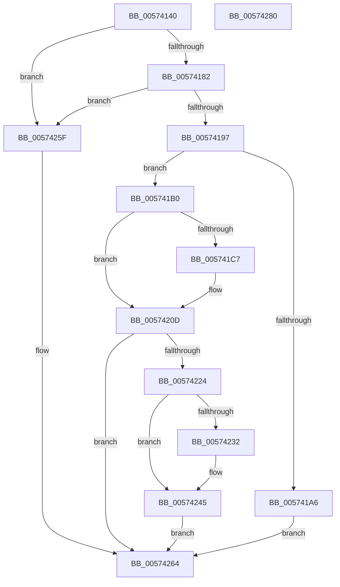

# HsaFreeRemappingTableEntry

- RVA: `0x00574140`–`0x00574281` (길이 `321` bytes)
- VA: `0x0000000140574140`
- 실행 섹션: `.text`
- PDB 이름 있음: `예`; PDB Function 태그: `아니요`
- unwind 정보 RVA: `0x0008CA40`
- 디코드: `85`개 명령, `321/321` bytes 표시
- 미해석 바이트: `0` (있으면 어셈블리에 `.byte`로 보존)

> 이 문서는 커널 이미지의 기계어와 PDB 기호를 분석해 생성했습니다. 4번과 5번은 함수 원형과 자료형을 바이너리 사용 방식에서 추정한 C 해석이며 원본 소스 복구 결과는 아닙니다.

## 1. Dependencies

- 직접 호출 지점: **8**; 고유 호출 대상: **8**
- 직접 호출자로 확인된 함수: **0**
- RIP 상대 이미지 참조: **6**

### Outgoing calls
- `0x00574199` → [HsaGetDeviceAperture](HsaGetDeviceAperture_function_00574288.md) (function, `0x00574288`)
- `0x005741B7` → [HalpAcquireHighLevelLock](../2D/HalpAcquireHighLevelLock_function_002D2390.md) (function, `0x002D2390`)
- `0x005741D5` → [HsaUpdateRemappingTableInDeviceTableEntry](HsaUpdateRemappingTableInDeviceTableEntry_function_005751DC.md) (function, `0x005751DC`)
- `0x00574200` → [memset](../6C/memset_function_006C6C40.md) (function, `0x006C6C40`)
- `0x0057421A` → [HalpReleaseHighLevelLock](../2D/HalpReleaseHighLevelLock_function_002D1C58.md) (function, `0x002D1C58`)
- `0x0057423F` → [ExtEnvCriticalFailure](../56/ExtEnvCriticalFailure_function_00561300.md) (function, `0x00561300`)
- `0x00574250` → [ExtEnvFreePhysicalMemory](../56/ExtEnvFreePhysicalMemory_function_00561360.md) (function, `0x00561360`)
- `0x00574258` → [ExtEnvFreeMemory](../56/ExtEnvFreeMemory_function_00561320.md) (function, `0x00561320`)

### Direct callers
- 이 함수 시작 RVA로 연결되는 직접 call은 확인되지 않았습니다. 간접 호출은 완전히 역산할 수 없습니다.

### Static image references
- `0x00574176` → RVA `0x00F8F644` (`.data`; read)
- `0x005741B0` → RVA `0x00F8F630` (`.data`; read)
- `0x005741BC` → RVA `0x00F8F638` (`.data`; write)
- `0x005741CE` → RVA `0x00F8F660` (`.data`; read)
- `0x0057420D` → RVA `0x00F8F638` (`.data`; read)
- `0x00574229` → RVA `0x00F8F668` (`.data`; read)

## 2. Other-region calls and transfers

- 다른 실행 섹션으로 향하는 call: **0**
- 별도 외부 분기/꼬리 이동을 확인하지 못했습니다.

## 3. Assembly (complete function range)

```asm
00574140  48 8B C4                        mov rax, rsp
00574143  48 89 58 08                     mov qword ptr [rax + 8], rbx
00574147  48 89 68 10                     mov qword ptr [rax + 0x10], rbp
0057414B  48 89 70 18                     mov qword ptr [rax + 0x18], rsi
0057414F  57                              push rdi
00574150  41 56                           push r14
00574152  41 57                           push r15
00574154  48 83 EC 60                     sub rsp, 0x60
00574158  0F 57 C0                        xorps xmm0, xmm0
0057415B  33 DB                           xor ebx, ebx
0057415D  0F 11 40 B8                     movups xmmword ptr [rax - 0x48], xmm0
00574161  45 33 FF                        xor r15d, r15d
00574164  41 8B F0                        mov esi, r8d
00574167  0F 11 40 C8                     movups xmmword ptr [rax - 0x38], xmm0
0057416B  8B C2                           mov eax, edx
0057416D  48 8B E9                        mov rbp, rcx
00574170  C1 E8 09                        shr eax, 9
00574173  44 8A F3                        mov r14b, bl
00574176  3B 05 C8 B4 A1 00               cmp eax, dword ptr [rip + 0xa1b4c8]
0057417C  0F 83 DD 00 00 00               jae 0x14057425f
00574182  8B C2                           mov eax, edx
00574184  25 FF 01 00 00                  and eax, 0x1ff
00574189  41 03 C0                        add eax, r8d
0057418C  3D 00 02 00 00                  cmp eax, 0x200
00574191  0F 87 C8 00 00 00               ja 0x14057425f
00574197  8B CA                           mov ecx, edx
00574199  E8 EA 00 00 00                  call 0x140574288
0057419E  48 8B F8                        mov rdi, rax
005741A1  48 39 28                        cmp qword ptr [rax], rbp
005741A4  74 0A                           je 0x1405741b0
005741A6  BB E6 00 00 C0                  mov ebx, 0xc00000e6
005741AB  E9 B4 00 00 00                  jmp 0x140574264
005741B0  48 8D 0D 79 B4 A1 00            lea rcx, [rip + 0xa1b479]
005741B7  E8 D4 E1 D5 FF                  call 0x1402d2390
005741BC  88 05 76 B4 A1 00               mov byte ptr [rip + 0xa1b476], al
005741C2  29 77 30                        sub dword ptr [rdi + 0x30], esi
005741C5  75 46                           jne 0x14057420d
005741C7  48 8D 57 34                     lea rdx, [rdi + 0x34]
005741CB  48 8B CD                        mov rcx, rbp
005741CE  4C 8D 05 8B B4 A1 00            lea r8, [rip + 0xa1b48b]
005741D5  E8 02 10 00 00                  call 0x1405751dc
005741DA  0F 10 47 08                     movups xmm0, xmmword ptr [rdi + 8]
005741DE  33 D2                           xor edx, edx
005741E0  48 8B CF                        mov rcx, rdi
005741E3  0F 10 4F 18                     movups xmm1, xmmword ptr [rdi + 0x18]
005741E7  0F 11 44 24 30                  movups xmmword ptr [rsp + 0x30], xmm0
005741EC  44 8D 42 40                     lea r8d, [rdx + 0x40]
005741F0  F2 0F 10 47 28                  movsd xmm0, qword ptr [rdi + 0x28]
005741F5  F2 0F 11 44 24 50               movsd qword ptr [rsp + 0x50], xmm0
005741FB  0F 11 4C 24 40                  movups xmmword ptr [rsp + 0x40], xmm1
00574200  E8 3B 2A 15 00                  call 0x1406c6c40
00574205  4C 8B 7C 24 50                  mov r15, qword ptr [rsp + 0x50]
0057420A  41 B6 01                        mov r14b, 1
0057420D  8A 15 25 B4 A1 00               mov dl, byte ptr [rip + 0xa1b425]
00574213  48 8D 0D 16 B4 A1 00            lea rcx, [rip + 0xa1b416]
0057421A  E8 39 DA D5 FF                  call 0x1402d1c58
0057421F  45 84 F6                        test r14b, r14b
00574222  74 40                           je 0x140574264
00574224  48 8B 54 24 38                  mov rdx, qword ptr [rsp + 0x38]
00574229  48 3B 15 38 B4 A1 00            cmp rdx, qword ptr [rip + 0xa1b438]
00574230  75 13                           jne 0x140574245
00574232  45 33 C9                        xor r9d, r9d
00574235  48 89 5C 24 20                  mov qword ptr [rsp + 0x20], rbx
0057423A  45 33 C0                        xor r8d, r8d
0057423D  33 D2                           xor edx, edx
0057423F  E8 BC D0 FE FF                  call 0x140561300
00574244  CC                              int3
00574245  44 8B 44 24 40                  mov r8d, dword ptr [rsp + 0x40]
0057424A  41 B9 01 00 00 00               mov r9d, 1
00574250  E8 0B D1 FE FF                  call 0x140561360
00574255  49 8B D7                        mov rdx, r15
00574258  E8 C3 D0 FE FF                  call 0x140561320
0057425D  EB 05                           jmp 0x140574264
0057425F  BB 0D 00 00 C0                  mov ebx, 0xc000000d
00574264  4C 8D 5C 24 60                  lea r11, [rsp + 0x60]
00574269  8B C3                           mov eax, ebx
0057426B  49 8B 5B 20                     mov rbx, qword ptr [r11 + 0x20]
0057426F  49 8B 6B 28                     mov rbp, qword ptr [r11 + 0x28]
00574273  49 8B 73 30                     mov rsi, qword ptr [r11 + 0x30]
00574277  49 8B E3                        mov rsp, r11
0057427A  41 5F                           pop r15
0057427C  41 5E                           pop r14
0057427E  5F                              pop rdi
0057427F  C3                              ret
00574280  CC                              int3
```

## 4. C-style interpretation (structured pseudocode)

```c
__int64 __fastcall HsaFreeRemappingTableEntry(__int64 a1, int a2, int a3, int a4)
{
    __int64 result;
    __int64 v_r14;
    __int64 v_r15;
    __int64 v_rbx;
    __int64 v_rsp;
    unsigned __int64 v_stack_m18;
    unsigned __int64 v_stack_m28;
    unsigned __int64 v_stack_m38;
    unsigned __int64 v_stack_m40;
    unsigned __int64 v_stack_m48;
    unsigned __int64 v_stack_m58;

    *(unsigned __int64 *)(v_rsp + 8) = v_rbx;
    *(unsigned __int64 *)(v_rsp + 16) = v_rbp;
    *(unsigned __int64 *)(v_rsp + 24) = v_rsi;
    v_rsp = (v_rsp) - (96);
    v_rbx = 0;
    *(unsigned __int64 *)(v_rsp - 72) = v_xmm0;
    v_r15 = 0;
    *(unsigned __int64 *)(v_rsp - 56) = v_xmm0;
    result = (unsigned int)(((unsigned int)(a2)) >> (9));
    if (((unsigned int)(result)) >= (*(unsigned int *)(v_rip + 10597576))) goto loc_0057425F;
    result = (unsigned int)(((unsigned int)(a2)) & (511));
    result = (unsigned int)((result) + (a3));
    if (((unsigned int)(result)) > 512) goto loc_0057425F;
    result = HsaGetDeviceAperture((unsigned int)(a2), a2, a3, a4);
    if ((*(unsigned __int64 *)(result)) == a1) goto loc_005741B0;
    goto loc_00574264;
loc_005741B0:
    result = HalpAcquireHighLevelLock(v_rip + 10597497, a2, a3, a4);
    *(unsigned __int8 *)(v_rip + 10597494) = (unsigned __int8)(result);
    v_r14 = 0;
    if ((*(unsigned __int64 *)(result)) == a1) {
        a2 = result + 52;
        a1 = a1;
        a3 = v_rip + 10597515;
        result = HsaUpdateRemappingTableInDeviceTableEntry(a1, a2, a3, a4);
        a2 = 0;
        a1 = result;
        v_stack_m48 = v_xmm0;
        a3 = a2 + 64;
        v_stack_m28 = v_xmm0;
        v_stack_m38 = v_xmm1;
        result = memset(a1, a2, a3, a4);
        v_r15 = v_stack_m28;
        v_r14 = 1;
    }
    result = HalpReleaseHighLevelLock(v_rip + 10597398, *(unsigned __int8 *)(v_rip + 10597413), a3, a4);
    if ((unsigned __int8)(v_r14) == 0) goto loc_00574264;
    if (v_stack_m40 == (*(unsigned __int64 *)(v_rip + 10597432))) {
        a4 = 0;
        v_stack_m58 = (unsigned int)(0xC00000E6ULL);
        a3 = 0;
        a2 = 0;
        result = ExtEnvCriticalFailure(v_rip + 10597398, a2, a3, a4);
    }
    result = ExtEnvFreePhysicalMemory(v_rip + 10597398, a2, (unsigned int)(v_stack_m38), 1);
    result = ExtEnvFreeMemory(v_rip + 10597398, v_r15, (unsigned int)(v_stack_m38), 1);
    goto loc_00574264;
loc_0057425F:
loc_00574264:
    return (unsigned int)((unsigned int)((unsigned int)(0xC000000DULL)));
}
```

## 5. (Beta) C Style

```c
int64_t HsaFreeRemappingTableEntry(int64_t Arg1, int32_t Arg2, int32_t Arg3, int32_t Arg4)
{
    int64_t result;
    int64_t local_r14;
    int64_t local_r15;
    int64_t local_rbx;
    int64_t local_rsp;
    uint64_t v_stack_m18;
    uint64_t v_stack_m28;
    uint64_t v_stack_m38;
    uint64_t v_stack_m40;
    uint64_t v_stack_m48;
    uint64_t v_stack_m58;

    *(uint64_t *)(local_rsp + 0x8) = local_rbx;
    *(uint64_t *)(local_rsp + 0x10) = local_rbp;
    *(uint64_t *)(local_rsp + 0x18) = local_rsi;
    local_rsp = (local_rsp) - (96);
    local_rbx = 0;
    *(uint64_t *)(local_rsp - 0x48) = v_xmm0;
    local_r15 = 0;
    *(uint64_t *)(local_rsp - 0x38) = v_xmm0;
    result = (uint32_t)(((uint32_t)(Arg2)) >> (9));
    if (((uint32_t)(result)) >= (*(uint32_t *)(v_rip + 0xA1B4C8))) goto loc_0057425F;
    result = (uint32_t)(((uint32_t)(Arg2)) & (511));
    result = (uint32_t)((result) + (Arg3));
    if (((uint32_t)(result)) > 512) goto loc_0057425F;
    result = HsaGetDeviceAperture((uint32_t)(Arg2), Arg2, Arg3, Arg4);
    if ((*(uint64_t *)(result)) == Arg1) goto loc_005741B0;
    goto loc_00574264;
loc_005741B0:
    result = HalpAcquireHighLevelLock(v_rip + 10597497, Arg2, Arg3, Arg4);
    *(uint8_t *)(v_rip + 0xA1B476) = (uint8_t)(result);
    local_r14 = 0;
    if ((*(uint64_t *)(result)) == Arg1) {
        Arg2 = result + 52;
        Arg1 = Arg1;
        Arg3 = v_rip + 10597515;
        result = HsaUpdateRemappingTableInDeviceTableEntry(Arg1, Arg2, Arg3, Arg4);
        Arg2 = 0;
        Arg1 = result;
        v_stack_m48 = v_xmm0;
        Arg3 = Arg2 + 64;
        v_stack_m28 = v_xmm0;
        v_stack_m38 = v_xmm1;
        result = memset(Arg1, Arg2, Arg3, Arg4);
        local_r15 = v_stack_m28;
        local_r14 = 1;
    }
    result = HalpReleaseHighLevelLock(v_rip + 10597398, *(uint8_t *)(v_rip + 0xA1B425), Arg3, Arg4);
    if ((uint8_t)(local_r14) == 0) goto loc_00574264;
    if (v_stack_m40 == (*(uint64_t *)(v_rip + 0xA1B438))) {
        Arg4 = 0;
        v_stack_m58 = (uint32_t)(0xC00000E6ULL);
        Arg3 = 0;
        Arg2 = 0;
        result = ExtEnvCriticalFailure(v_rip + 10597398, Arg2, Arg3, Arg4);
    }
    result = ExtEnvFreePhysicalMemory(v_rip + 10597398, Arg2, (uint32_t)(v_stack_m38), 1);
    result = ExtEnvFreeMemory(v_rip + 10597398, local_r15, (uint32_t)(v_stack_m38), 1);
    goto loc_00574264;
loc_0057425F:
loc_00574264:
    return (uint32_t)((uint32_t)((uint32_t)(0xC000000DULL)));
}
```

## 6. Execution-region graph

[열기: 2D/3D 그래프와 함수 탐색 컨트롤 패널](../../../control-panel.html?section=text&rva=0x00574140&view=graph)

- 2D 그래프는 위에서 아래로 흐르고, 3D 그래프는 빈 공간을 드래그해 회전합니다. Shift+드래그는 이동, 휠은 확대·축소, 함수 노드 선택은 대상 보고서 이동입니다.

### Static fallback


