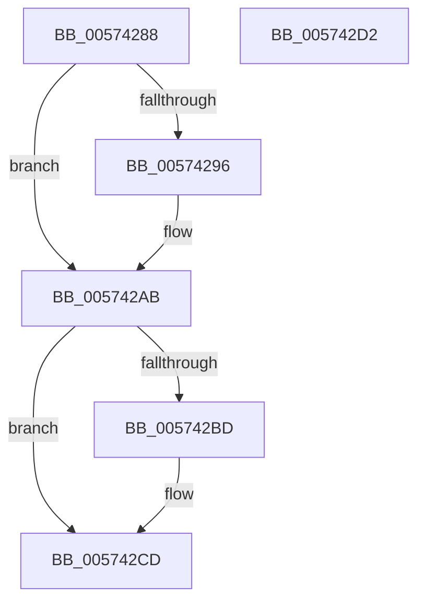

# HsaGetDeviceAperture

- RVA: `0x00574288`–`0x005742D3` (길이 `75` bytes)
- VA: `0x0000000140574288`
- 실행 섹션: `.text`
- PDB 이름 있음: `예`; PDB Function 태그: `아니요`
- unwind 정보 RVA: `0x0005D2F4`
- 디코드: `25`개 명령, `75/75` bytes 표시
- 미해석 바이트: `0` (있으면 어셈블리에 `.byte`로 보존)

> 이 문서는 커널 이미지의 기계어와 PDB 기호를 분석해 생성했습니다. 4번과 5번은 함수 원형과 자료형을 바이너리 사용 방식에서 추정한 C 해석이며 원본 소스 복구 결과는 아닙니다.

## 1. Dependencies

- 직접 호출 지점: **1**; 고유 호출 대상: **1**
- 직접 호출자로 확인된 함수: **4**
- RIP 상대 이미지 참조: **1**

### Outgoing calls
- `0x005742A5` → [ExtEnvCriticalFailure](../56/ExtEnvCriticalFailure_function_00561300.md) (function, `0x00561300`)

### Direct callers
- [HsaAllocateRemappingTableEntry](HsaAllocateRemappingTableEntry_function_00573820.md) at `0x00573940`
- [HsaAllocateRemappingTableEntry](HsaAllocateRemappingTableEntry_function_00573820.md) at `0x00573A52`
- [HsaFreeRemappingTableEntry](HsaFreeRemappingTableEntry_function_00574140.md) at `0x00574199`
- [HsaUpdateRemappingDestination](HsaUpdateRemappingDestination_function_00574DB0.md) at `0x00574DFB`
- [HsaUpdateRemappingTableEntry](HsaUpdateRemappingTableEntry_function_00575000.md) at `0x00575038`

### Static image references
- `0x005742AB` → RVA `0x00F8F6A0` (`.data`; read)

## 2. Other-region calls and transfers

- 다른 실행 섹션으로 향하는 call: **0**
- 별도 외부 분기/꼬리 이동을 확인하지 못했습니다.

## 3. Assembly (complete function range)

```asm
00574288  48 83 EC 38                     sub rsp, 0x38
0057428C  8B C1                           mov eax, ecx
0057428E  C1 E8 10                        shr eax, 0x10
00574291  83 F8 20                        cmp eax, 0x20
00574294  72 15                           jb 0x1405742ab
00574296  33 C0                           xor eax, eax
00574298  45 33 C9                        xor r9d, r9d
0057429B  45 33 C0                        xor r8d, r8d
0057429E  48 89 44 24 20                  mov qword ptr [rsp + 0x20], rax
005742A3  33 D2                           xor edx, edx
005742A5  E8 56 D0 FE FF                  call 0x140561300
005742AA  CC                              int3
005742AB  48 8D 15 EE B3 A1 00            lea rdx, [rip + 0xa1b3ee]
005742B2  48 8B 14 C2                     mov rdx, qword ptr [rdx + rax*8]
005742B6  33 C0                           xor eax, eax
005742B8  48 85 D2                        test rdx, rdx
005742BB  74 10                           je 0x1405742cd
005742BD  8B C1                           mov eax, ecx
005742BF  48 C1 E8 09                     shr rax, 9
005742C3  83 E0 7F                        and eax, 0x7f
005742C6  48 C1 E0 06                     shl rax, 6
005742CA  48 03 C2                        add rax, rdx
005742CD  48 83 C4 38                     add rsp, 0x38
005742D1  C3                              ret
005742D2  CC                              int3
```

## 4. C-style interpretation (structured pseudocode)

```c
__int64 __fastcall HsaGetDeviceAperture(int a1, int a2, int a3, int a4)
{
    __int64 result;
    __int64 v_rsp;
    unsigned __int64 v_stack_m18;

    v_rsp = (v_rsp) - (56);
    result = (unsigned int)(((unsigned int)(a1)) >> (16));
    if (((unsigned int)(result)) >= 32) {
        result = 0;
        a4 = 0;
        a3 = 0;
        v_stack_m18 = 0;
        a2 = 0;
        result = ExtEnvCriticalFailure(a1, a2, a3, a4);
    }
    result = 0;
    if (*(unsigned __int64 *)(v_rip + 10597358 + result * 8) != 0) {
        result = a1;
        result = (result) >> (9);
        result = (unsigned int)((result) & (127));
        result = (result) << (6);
        result = (result) + (*(unsigned __int64 *)(v_rip + 10597358 + result * 8));
    }
    v_rsp = (v_rsp) + (56);
    return result;
}
```

## 5. (Beta) C Style

```c
int64_t HsaGetDeviceAperture(int32_t Arg1, int32_t Arg2, int32_t Arg3, int32_t Arg4)
{
    int64_t result;
    int64_t local_rsp;
    uint64_t v_stack_m18;

    local_rsp = (local_rsp) - (56);
    result = (uint32_t)(((uint32_t)(Arg1)) >> (16));
    if (((uint32_t)(result)) >= 32) {
        result = 0;
        Arg4 = 0;
        Arg3 = 0;
        v_stack_m18 = 0;
        Arg2 = 0;
        result = ExtEnvCriticalFailure(Arg1, Arg2, Arg3, Arg4);
    }
    result = 0;
    if (*(uint64_t *)(v_rip + 0xA1B3EE + result * 8) != 0) {
        result = Arg1;
        result = (result) >> (9);
        result = (uint32_t)((result) & (127));
        result = (result) << (6);
        result = (result) + (*(uint64_t *)(v_rip + 0xA1B3EE + result * 8));
    }
    local_rsp = (local_rsp) + (56);
    return result;
}
```

## 6. Execution-region graph

[열기: 2D/3D 그래프와 함수 탐색 컨트롤 패널](../../../control-panel.html?section=text&rva=0x00574288&view=graph)

- 2D 그래프는 위에서 아래로 흐르고, 3D 그래프는 빈 공간을 드래그해 회전합니다. Shift+드래그는 이동, 휠은 확대·축소, 함수 노드 선택은 대상 보고서 이동입니다.

### Static fallback


